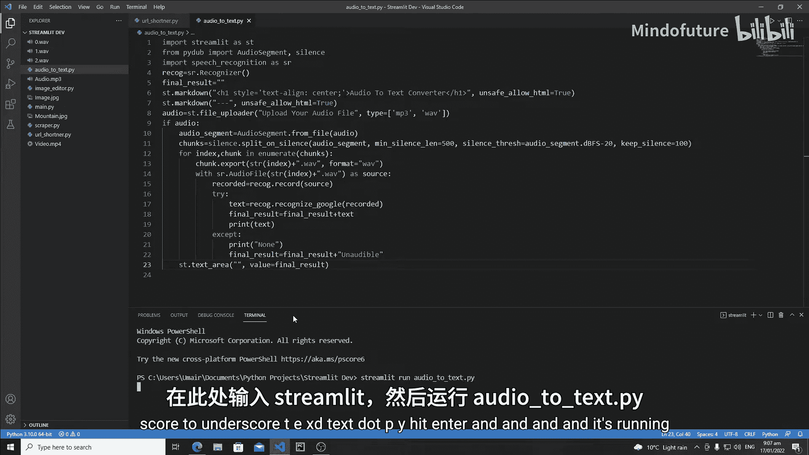
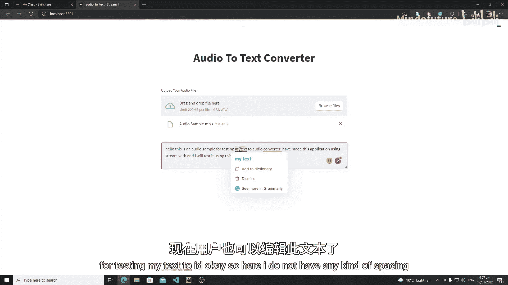
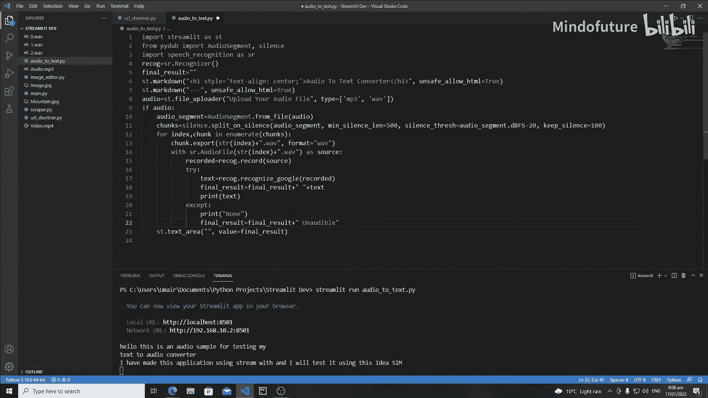
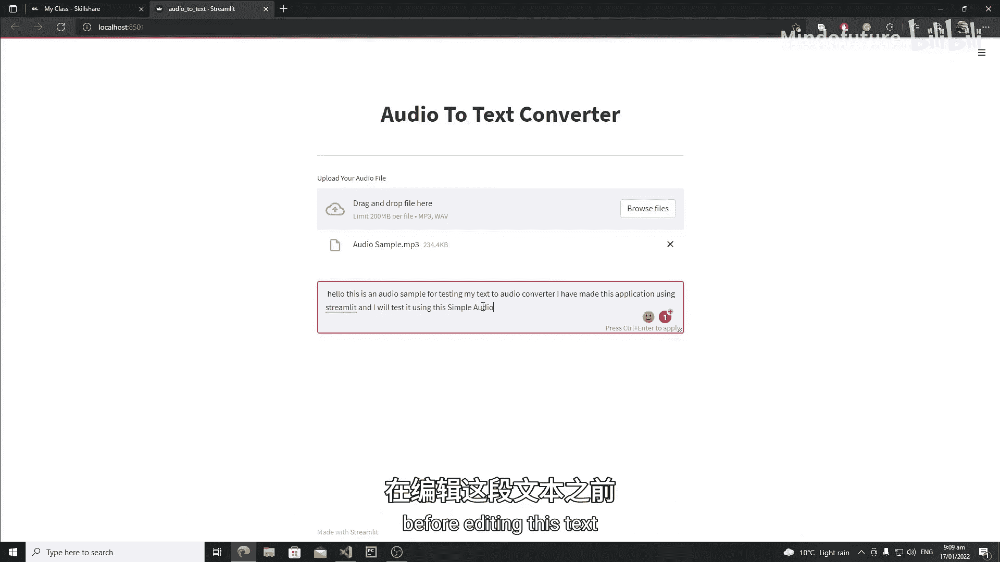
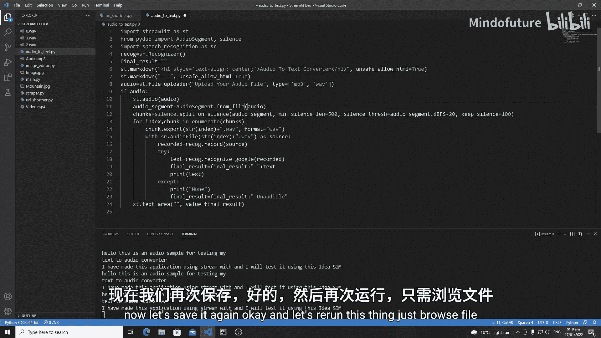
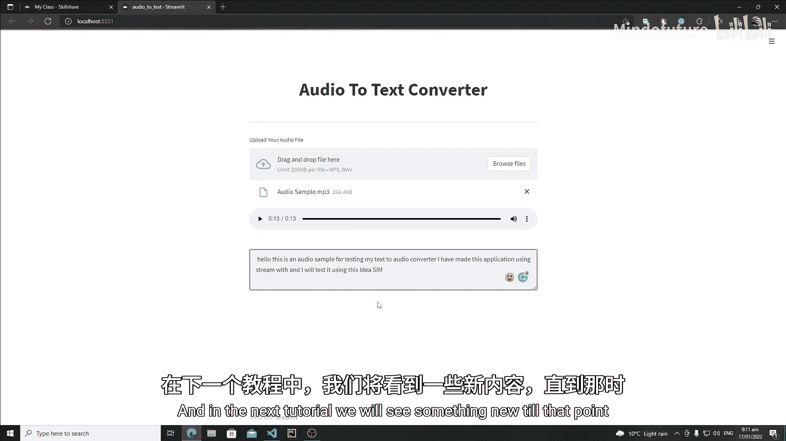

# Python-Streamlit-完全教程-p30-P30-Streamlit-Audio-to-Text-Converter-Web-App---Complete-Streamlit-Python-Course--BV1yHVhz1EUD_p30-

Hi everyone in this tutorial we will continue our development and in this tutorial we will print our results on our streamlit web app so here I am thinking that as we have noticed in the previous tutorial that Google is not translating 100% correctly so instead of printing our text in a non-editable format I will print my text on the streamnet in an editable format like I will either use a text input widget or I will use a text area widget but I think text area widget will be more suitable because it allow us to input big inputs and I will use that and for this purpose instead of printing this text one by one in a different text input area I will create a final result of the whole text and then I will print that final result in a single。

Text input area so just create here simple variable okay and I will say like fL final underscore Rult final result is equals to empty so this will be my empty string okay and first of all here I will say F NL final result is equals to F NL final result then print and then I will say T E XD text okay so this is how I will get a final result of the whole text okay and when it comes to accept I will say F NL final result is equals to FNL final result plus and I will say unauudible okay so you and A D I so just check this spelling my spellings are very very bad okay so but this is how you can understand this thing and then out。

side this for loop okay， so make sure that you should create your text input area widget outside this folder because if you create it inside this。

 it will create to maybe four or five different input widgets based on the chunks which you have created here Okay。

 so make sure that you should write here outside this for loop S dot T XT text area okay and then my level will be nothing okay so just keep this string empty but my values okay。

 my values will be F I N final results Okay and now let's save it and just open the terminal terminal and right here T R E M L I streamlet and then are you and run you D your I underscore to underscore T E X D text do P hit enter。

And then then it's running。

Okay， so we need to select our file， browse file， select audio sample， open it。

 it's so processing like sweat for a few seconds。And here we got our output so now user can actually edit this text as well so here is hello this is an id sample for testing my text to audioioO so here I do not have any kind of spacing and here I do not have any kind of spacing so let's open this via code and here instead of adding this thing like this I will add a space here as well okay so just give a blank space then plus and I will do the same process here but here I will just give a space before this un audible text okay now let's save it and let's re this thing again and let's browse file open audio sample and wait。

😊。

And yeah this is our output so hello this is an ideal sample for texting my text to Iio converter I have made this application using stream light O so just convert this with with something like LIT late and I will test it using this simple I so just right here S MPL simple AUDio I okay so this is how you can actually edit your text to and then you can copy it and past it anywhere and here I think one thing is still missing and that is we need to create here and Iio widget so that user could listen to the I file as well before editing this text so let's create here an Iio widget okay so here I will create an Iio widgetO so just write here S do ADioideio okay and I will pass my this I here okay。

😊。

So just right here， you the your I okay， now let's save it again okay， and let's rerun this thing。

Just browse file or audio sample open it Okay and now here we can actually listen to the audio and then after listening to the audio we can actually edit our text okay so now let's listen it hellello this is an audio sample for testing my text to audioio converter I have made this application using streamlit and I will test it using this audio sample and everything is quite good and here as you can see we have text and you can edit this text so this is how you can actually create this audio to text converter so I hope that you have enjoyed this tutorial and in the next tutorial we will see something new to that point bye bye。

