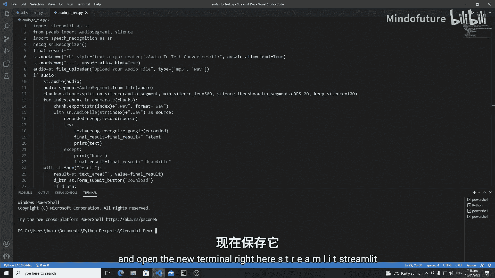
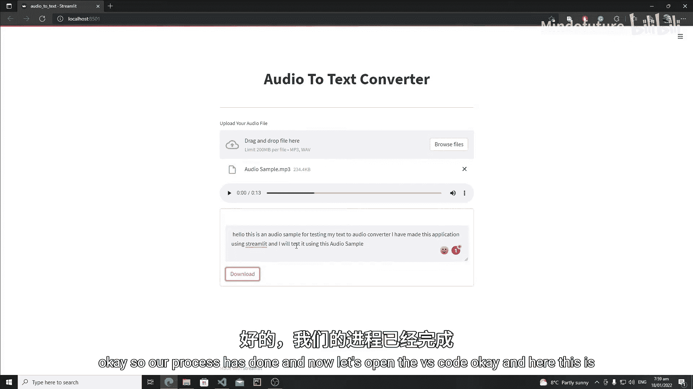
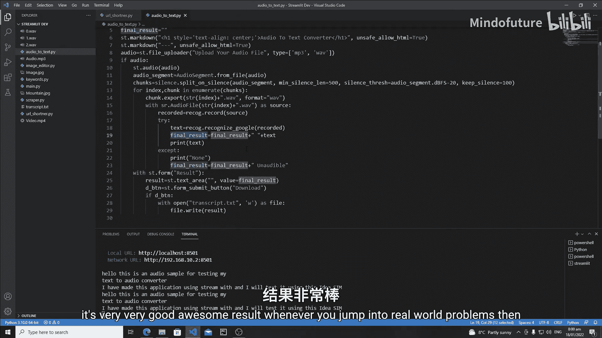
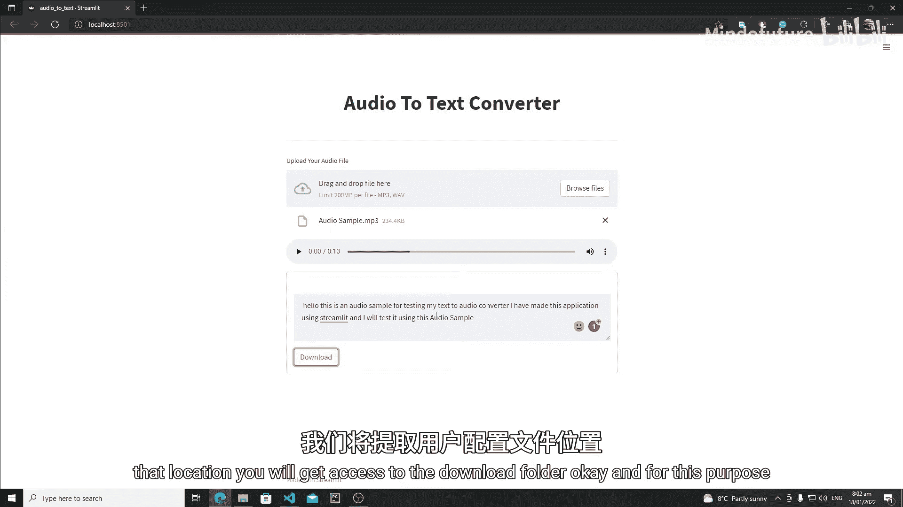
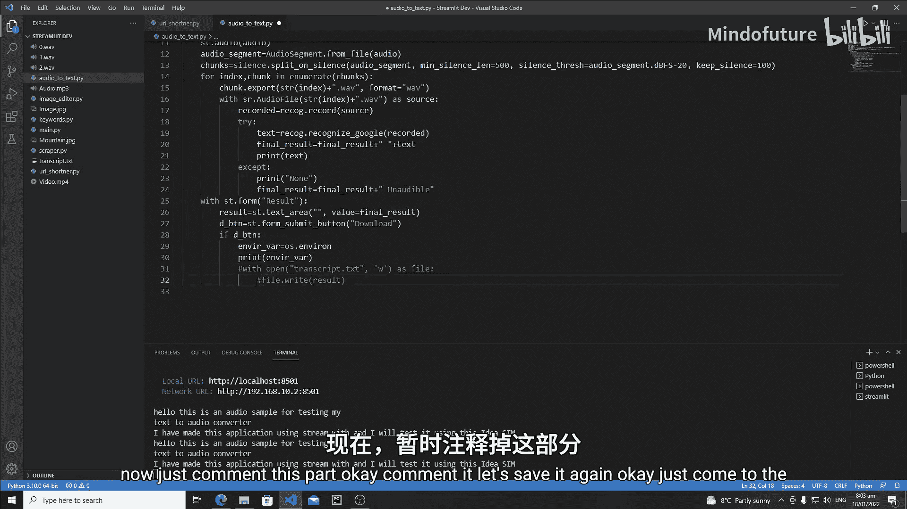
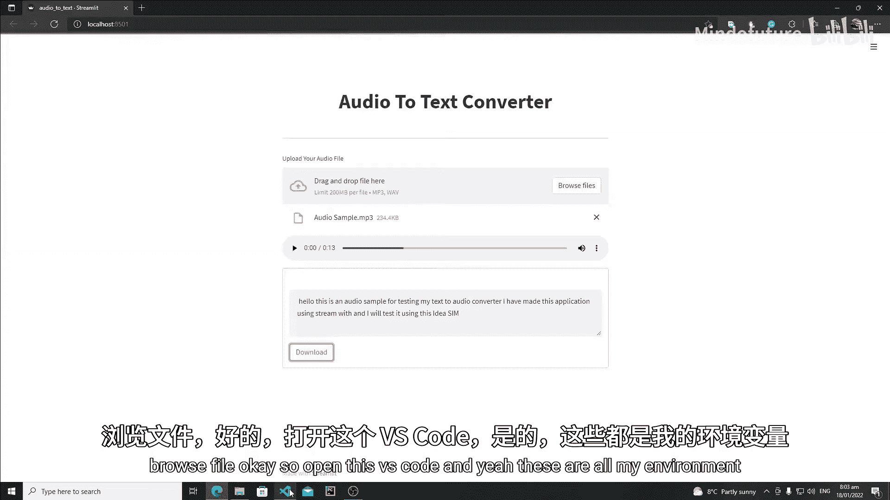
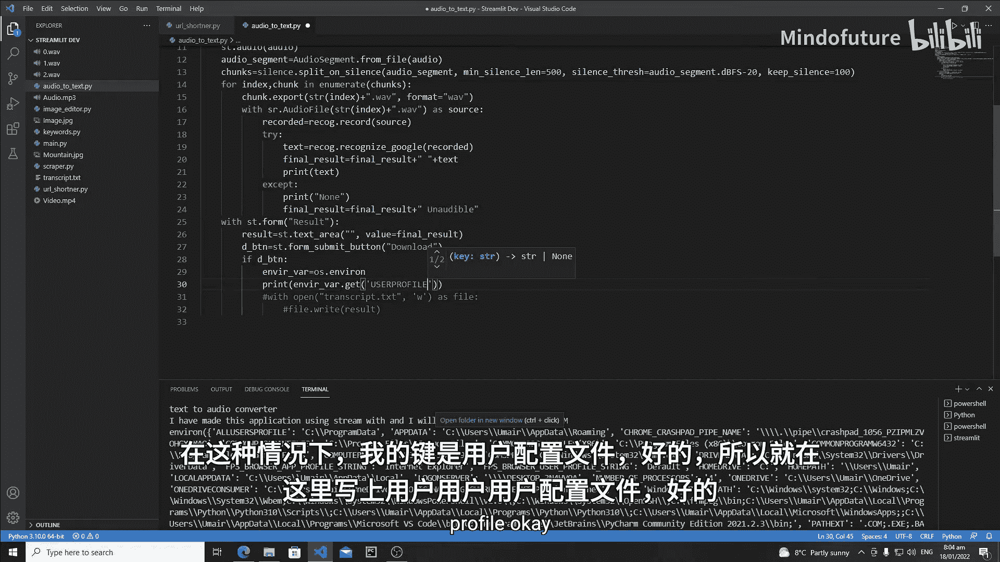
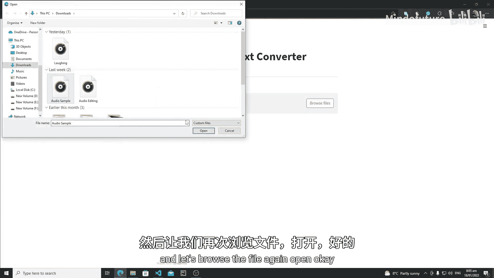
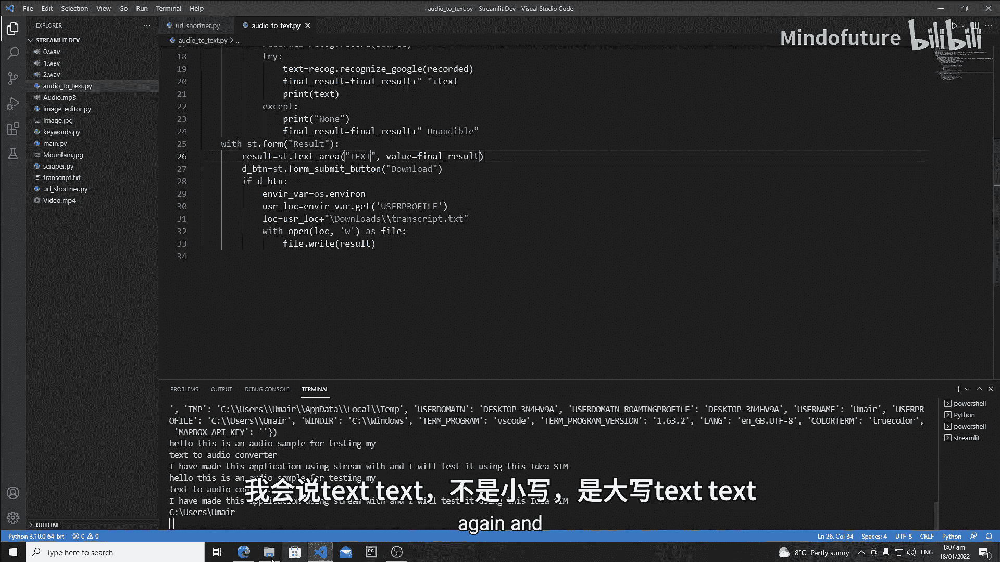
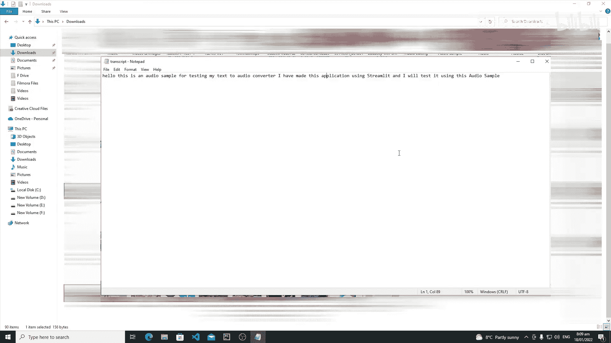

# Python-Streamlit-完全教程-p31-P31-Streamlit-Audio-to-Text-Converter-Web-App---Complete-Streamlit-Python-Course--BV1yHVhz1EUD_p31-

Hi everyone in this tutorial， we will modify our idea to text converter and we will add some more features to it like downloading our translated file and everything else so first of all here I am just creating a text area I am thinking that I will create this text area inside your form and I will create a download button on that form and whenever user clicks on that download button we need to download all the content which is present in this text area and which is obviously our translation of the audio so let's create here a form first so here I will go with the width keyword so with S do form O I will say myl the keyword for this form will be resolved and then I will put this S text area inside this form and here I will create a submit button。

SUBM IT submit form submit button okay but the text for this button will be something like D or W and L download okay and then I will save the state of this button inside this D sorry D underscore BTN variable and I will check that if my D underscore B and is true this means that if user clicks on this button then I need to process everything else so first of all we will actually create a text file and then we will put the content of this text area inside that text file and the reason why I am putting the content of this text area instead of putting this final result is that is very obvious that Google will not translate the idea 100 percent correctly and the user need to make some changes in the text So user will make changes inside this text area and that's the reason why we will get。

Final result of the user instead of using this final result Okay so let's save the final result inside this re Ult result variable Okay and then here I will first of all。

 create a text file So creating a text file in patternon is a very。

 very easy process So first of all we need to write here and other with a keyword so and I will say P and open and then I need to define the path where I want to save my file and in this case I will use this path which is the default one and here I just need to define my file La and in this case I will go with like a T and I transcript do Tx sorry TXT and now when it comes to more the is a very。

 very important part in this case because the mode will actually create our file and this open。

Fction basically provide us many different modes okay but in this case we will use this W mode or write mode and the reason is that this right mode basically allow us to create the file if it doesn't exist in that particular directory and if it exists in that particular directory then it will override that file this means that it will change the content which is present inside that file okay so thats why I will recommend to you that you should use this W mode and you can actually use here the x mode as well so there is a minor difference between the x mode and the W mode and that is the W mode basically allow us to overwride the previously existing file while x mode doesn't allow us the overriding feature but again it is recommended that you should use here W mode and now once we are checking that if my this file exists then well and good if it doesn't then it will create that file and now I need to。

Actually open this file as my FL file。 Okay， and now I need to write my content inside this file。

 Okay， so just right here FL file or w R It right okay and then here I need to pass my string okay and in this case it is it is obvious that we will pass our result okay。

 so just right here R S ULt result okay， and now let's save it and open the new terminal。Right here。

 SDR E A ML LIT streamlit。

And yeah here is our application。 First of all we need to select a file browse file okay Iio sample open it and it's running。

 it's processing， let's for the operation and yeah here we have a form okay and this is our text area you can modify it and this is our download button so for now let's make some changes like this is an error which is stream LIT streamlit okay and I will test it using this Iio sample just replace it with U D Iio Iio as MPL Iio sample okay and now let's click on this download button and see what we will get okay so it's running This means it is processing。

Okay so our process has done and now let's open the VS code okay and here this is our output now if I open my Expr and yeah here is our transcript do TxT file so double click it and yeah this is our output which is hello this is an ideal sample for testing my idea I have made this application using streamlet okay so this is the reason why I have told you that you should use the final result of this text area instead of using this final result so stream it and I will test it using this I sample okay so it's very very good awesome result whenever you jump into real world problems then you will know very well that whenever you click on the download button on any website your content is download it in your downloads folder okay so we need some sort of code which will actually download our this TXT file in our download folder。

Now， you know very well that if I use my default location of the download further then that will not be your default location because download folder location is directly related to your user profile location。

 So if you have a different user profile location then you will have a different download folder location and in that case you will get an error So how to solve this problem。

 So the solution of this problem is simple。 you need to get access to your environment variables。

 and inside the system environment variables。 the Windows has already defined your user profile location。

 So if you can access user profile location， then obviously you can access the download folder as well and in this case we will also access our environment variable and we will access the user profile location and from that location you will get access to the download folder okay and for this purpose we will use the。

OS library or module of Python which is a built in module okay so just to write here IP or RRT import OS okay and now first of all we need to get access to the environment variables of whole system okay so here I think down here I will say that E and V IR underscore VR environment variables is equals to OS dot E and V IR O and environment okay so now this line basically return us a whole dictionary of all environment variables along with the keys and values okay and if you print this E and V IR and variable you will see the result okay so print E and V IR okay environment variable let's save it okay and I think for now just commit this part okay。

Comment it， let's save it again， okay， just come to the application， let's rerun it。

Browse file。Okay， so open this we code and yeah these are all my environment variables as you can see this is our invi Okay and this is auditary and as you can see。

 this is a keyword and this is a value okay so we have a bunch of bunch of keys and values okay so I do not need to extract all of these environment variables I'm only concerned with the user profile location Okay so how to get the user profile location so process is very simple now once you have all your environment variables you just need to write here dot G ET okay get and then inside this get function you need to define your key and in this case my key is user profile okay so just right here you E user P user profile and let's save it again and let's refresh it okay let's refresh it。

And let's browse the file again open okay。

Just open your VS code Okay and yeah this is my user profile location C slash user s okay so this is my current user profile location and if you write this line you will get a different user profile location Now here we need to add one more thing and that is slash downloads so which is the folder name and this is how you can access the downloads folder of any user okay so here I will save this whole line this whole location inside this USR underscore L variable and then inside this USR underscore LO variable I will make some addition so I will say LC is equals to USR underscore LO plus and I will say or W andedS downloads so this is my。

downloads folder name okay and then inside download inside the download folder I will create a transcript do txt file okay so just write here slash and then our T and IP transcript TX but here you will have an error and that is this slash T basically allow us to give a tab okay so in order to solve this problem we need to write here s another slash okay so now this double s will basically allow us to create only one slash in the output so here just make sure that you should put this double slashes and then your transcript tXt file and now let's un in this part and now instead of writing everything like this I will just pass my this location variable here so just write here location and let's save it and here I need to pass a label for this text id as well。

And I will save theXD text okay， so not small capital Tt text okay now let's save it again and now let's see the final output okay。

 so let's refresh it grouse file。

Sample idea。Now let's make some changes， just collect the errors， okay， stream LIT streamlet。

 just remove this indentation， okay， and let's write here AUD your Iio， S MPL audioio sample。

 just give you a space， just make this Scap， okay， and let's click on this download。

Okay so our process has done and now let's go to your download folder okay so this is my download folder and as you can see here we have our transcript file so just double click on this transcript file and yeah this is my output okay so hello this is an ideal sample for text for testing my text and I have made this application using streamlet and I will test it using this I sample so how simple it is to download anything from your streamnet so I hope that you have enjoyed this tutorial and in the next tutorial we will see something new till that point bye bye。

