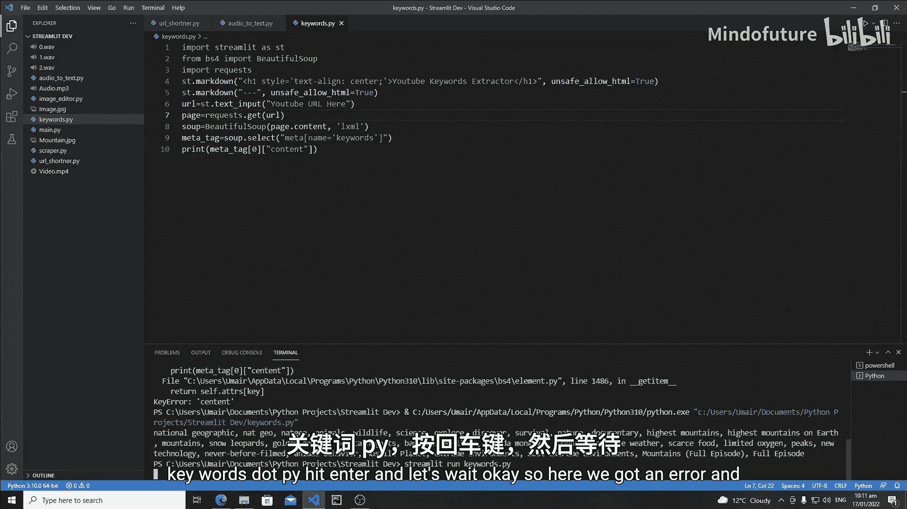
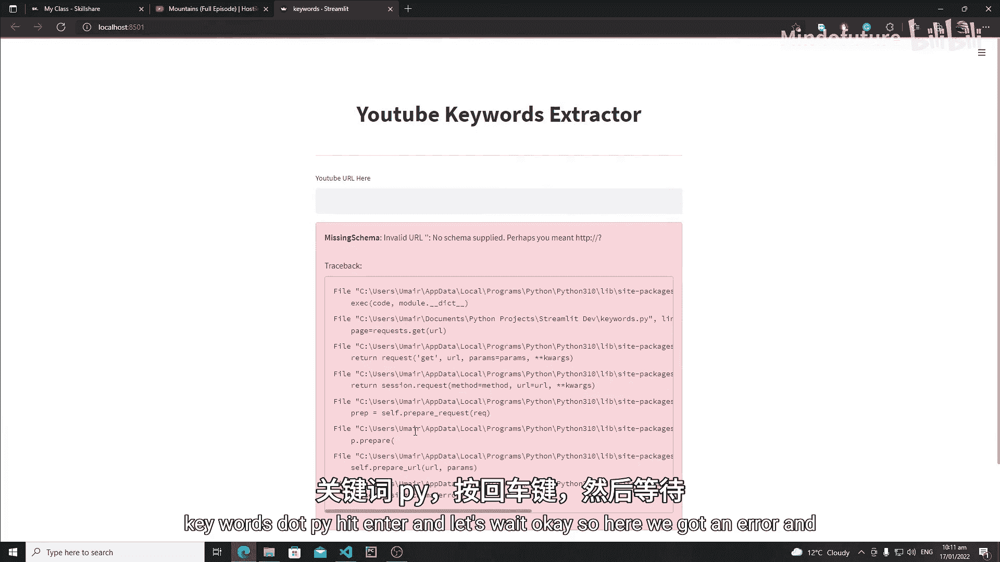
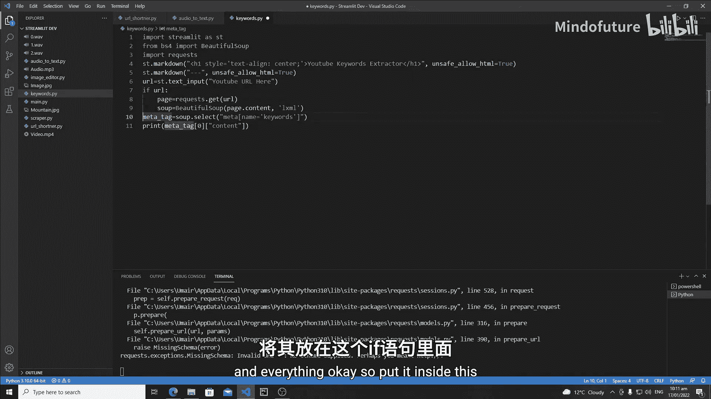
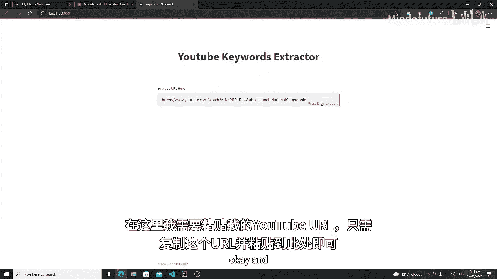
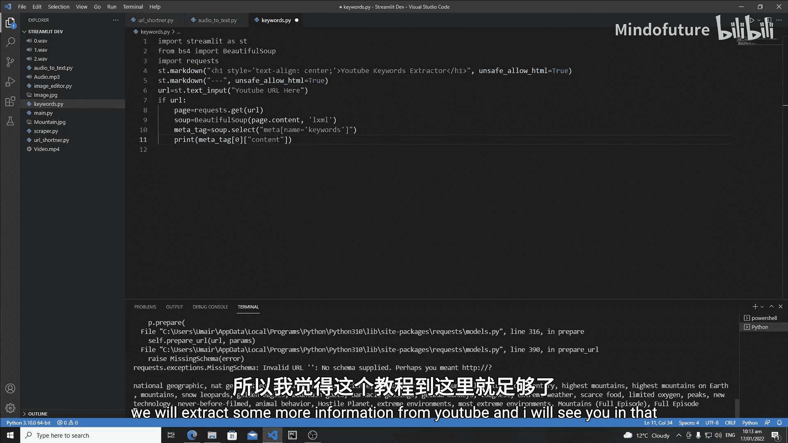

# Python-Streamlit-完全教程-p32-P32-Streamlit-YouTube-Keyword-Extractor-Web-App---Complete-Streamlit-Python-Cour--BV1yHVhz1EUD_p32-

Hi everyone in this tutorial we will start making our YouTube keyword extractor application in streamrelight。

 so before we actually start scrapping YouTube it is very very important to understand the structure of the YouTube and to understand where the YouTube actually store its hidden keyword of any video so let's start understanding the structure So you just need to right click and click on this inspect element and this will open such type of interface so there are a bunch of lines but let's remind some HTMLl and CSS concept。

 so YouTube keyword is actually a metter data and if you are little little bit familiar with the HTMLl and CSS coding you will know that we always place。

Meta data inside our heading tag Okay so let's first do research on heading tag so just close this body tag。

 let's open this heading tag okay okay so here we have script script script okay and okay so this is meta data meetup keyword but this is a property Okay so this is not what we are looking for Okay so here we have this meter keyword and here we have this keywords name and these are all the keywords of this video so also we have got access to the YouTube hidden keywords of any video and now we will extract these hidden keywords and as you can see we have a description as well okay so this is a hidden description So YouTube have given this description to their website which is enjoy the videos and music you love。

Reginal content and share it all with friends， family and the world on YouTube Okay。

 so this is the hidden description of YouTube website。 Okay。

 and we do not have any concern with this thing。 we are only concerned with this keywords Okay so now we will extract this part。

 So keep in mind that it is inside this heading。 okay and we have this meter。

 so let's start creating a scrapper for it。 So just open your VS code okay and here let's create a new file Okay and I will say okay E Y W RD keywords dot P Y okay hit enter and here first of all。

 we need to import our streamlet okay so just right here I am or R T import S D R E I import streamlet okay hit enter but I will import it as。

Okay now we will use beautiful soup for web scrapping。

 so just import of I will import from B4 IP or RRT import B U T beautiful soup and we need to import an other library and that is requests so just right here IP orRT import ourM ESTS request so with the help of this request library first of all we will send our get request to this YouTube URL in order to see whether it is scrapable or not so just copy this URL copy it and just open ESScor again and here first of all I will say PG pages is equals to R EKM U ED requests dot G T get and then I need to past the URL here okay but don't in the upcoming tutorials we will ask。

User to enter this URL okay so we will scrap different YouTube videos okay so don't worry about this thing now first of all we need to print this status quo in order to check whether YouTube is craftable or not okay so just right here print PG page do Su status quo okay and for now I think let's come into this line okay and now let's directly run this thing and see the output here。

And yeah YouTube is scrap for 200， so 200 means everything is working fine and we are successfully sending a get request now let's come to the original topic so lets let's un in this part for now and now here first of all I need to convert this page content to soup Okay so just right here SoUP soup is equals to be UT if you beautiful soup okay and let's pass here the page content so page or T and the content and I will use a parcel and that is L Xl my favorite one and now we are successfully converting our content into beautiful soup let's save it and let's see how to scrap our YouTube so just often again and here we have as you can see we have multiple me tag so how to distinguish between each me text。

As you can see we do not have any kind of class reference or something like that。

 The only difference is that this me tag has a different name okay and this one has a different name and this one this one has a different property okay so it's a different name so with the help of this name property we can distinguish between these two things okay so if I use find or find al function I need to have a class reference in order to distinguish between different text but in this case I do not have any class okay so we have only one solution and that is to use CSS selectors so with the help of CSS selectors we can actually distinguish between each meter tag so just open this c code again and now instead of using find or find al function we will use the select or select al function which is used for CSS selection okay so I will say。

ME T A meta underscore T AG me tag is equals to and I will say S OUP soup dot S EL so I will select only one me tag okay so that's what I'm writing here select or you can if you want to select multiple me tags then you can use here select al function okay so select and now I need to define here the CSS selector and first of all we will search for this me tag okay so just right here M E T meta okay and then inside this me tag we need to have a name property okay so just right here and me name okay and then we need to search for only that me tag for which the name is equals to keywords okay so just right here these single course and then K E YW or orD keywords okay and now let's print this meta tag so。

Just right here PR I in print， Okay， and then M E T A meta T me tag Okay， let's save it。

 and I think let's come in this for now as well。 just run it again Okay， so yeah， we got our output。

 These are my keys。 Okay， so now we need to access the first value of this list and that is these data。

 Okay， so the whole data is a first value of this list。

 So just right here these square brackets and then index0， Okay， and now let's run it again。

And now we have this output okay and now I will access values of this content property。

 so here I just need to put an other pair of square brackets and now inside these square brackets I will write my property name or attribute name and that is your NTE。

Anti content， okay， and now let's save it and let's rerun it again。Okay， so we got an error， C， O。

 N T， N T， What is the correct C， O， Okay， So instead of E， just right here， C， O， Okay。

 let's save it。 And now let's rerun it again。And yeah these are all my keywords okay so we are successfully extracting our keywords and now it's time to play with the streamlate okay so just uncoming this part okay and first of all I will create a heading okay so just copy this same line okay copy it copy and paste it right here and instead of Io2v text converter。

 I will say UTB YouTube E Y W RD keywords E X C R keyword extractor okay and now after this heading I will create a simple line okay and then I will create a text input widget okay so with the help of that widget。

 I will get this link from the user okay so just right here do。And P T input， sorry， T input。 Okay。

 and the label will be like Y O U to， P You， URL。H ER URL here。 Okay。

 and I will save my information inside this URL variable。 Okay， and instead of this thing。

 I will send a request to my URL。 Okay and let's save it everything and now let's run our streamlit application。

 So just write here R E A M L I streamlit then R U run and then K E Y W or RD keywords dot P Y hit enter and let's sweat and okay。

 so here we got an error and that is very， very simple error first of all。

 we will check that if my URL is not empty。 this means that if user has entered the URL。

 then I need to process each and everything。 Okay， so put it inside this if statement。

 let's save it again and let's reload it。

And here I need to past my YouTube URL。 So just copy this URL。 past it right here。 Okay。

 and we need to hit enter， hit enter。 And now let's see okay， so these are all my keywords。 Okay。

 so we are now successfully extracting our keywords。

 Okay so I think that it's enough for this tutorial。 And in the next tutorial。

 we will actually print all of these keywords on our streamnet Web app。

 and we will extract some more information from YouTube。

 and I will see in that tutorial till that point bye bye。

