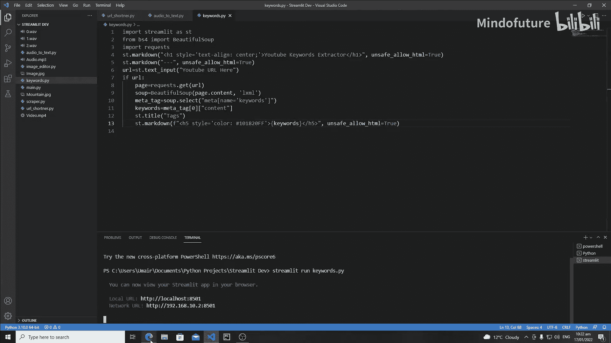
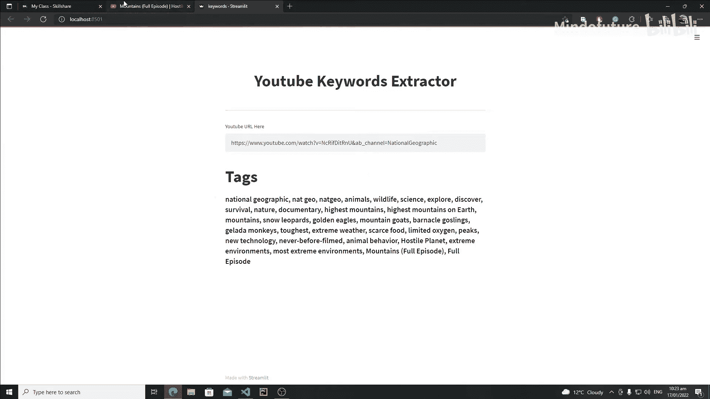
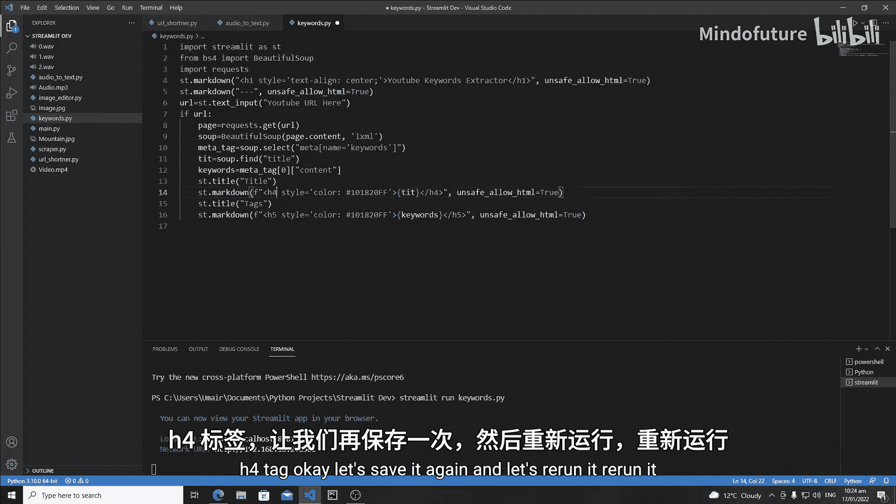
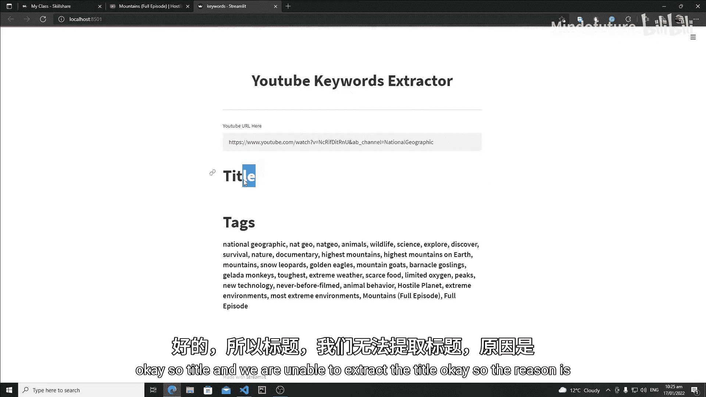
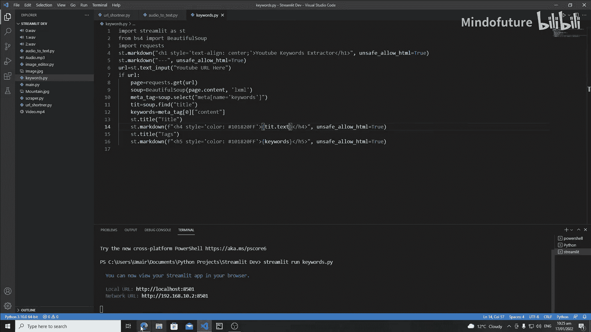
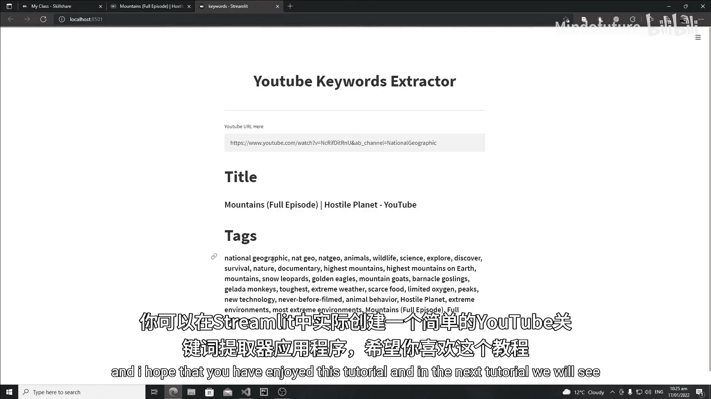

# Python-Streamlit-完全教程-p33-P33-Streamlit-YouTube-Keyword-Extractor-Web-App---Complete-Streamlit-Python-Cour--BV1yHVhz1EUD_p33-

Hi everyone in this tutorial we will continue our development and we will print our keywords on streamlit web app So instead of printing all of the keywords on terminal I will save them in K E Yw RDS keywords variable and here I will first create a title for these keywords and I will say S do T I Tl title and I will say TgS tags okay and then I will use ST do markdown okay so markdown and then I will use I think h5 h5 tag but this will be my formatted stream and then let's change the styling so just right hereY style is equals to sorry S Y style is equals to and then I will say C LR cover。

I will use a Hx Z DL code for the colors， or a number。Then I did。Danddi。And then F F。

 I think it's a great color。 Okay， and then let's close this as well Okay so slash h5。

 and now inside these two H 5 tags， I will pass my keywords。 Okay， okay， E Y W or are these keywords。

 okay， and here I will say you and S if unsafe allow H TMl to T R U true。 Okay， let's save it。

 and then now let's open new terminal， new terminal and let's write here stream theron keywords dot P Y。

 hit enter， it's running。 Okay。

Let's open it and let's refresh it。Okay so here we need to paste the URL， just copy this URL。

 paste it right here， hit enter okay and it's running。

 and yeah these are all my keywords okay so as you can see we are now successfully extracting our keywords so user can copy these keywords and now here I think that I will extract the title as well and I will first print the title and then the keywords okay so let's do some scrapping of the YouTube as also here first of all I am scrapping the keywords okay and here I will scrap the title as also just right here the I is equals to and then S U P do I defined and I will say my key my tagm I T title as you can see if I open this browser as you can see our title is inside。

Our this title variable okay so this is our title and I will extract this information Okay sos minimize it and I will say title and then before keywords I will say S dot T I TL title I will give another title or heading okay I will say T I TL title and then I will say S dot R markdown okay and just copy this line copy it and paste it right here but instead of a keyword I will say T okay and then instead of h5 tag I will use H4 tag okay h4 tag okay let's save it again and let's rerun it rerun it。

And let's， let's， let's past the URL。 Sorry， not that this one。

 Just copy this URL past it right here。 Okay， hit enter。And it's running。😔，Okay， so title。

 and we are unable to extract the title。 Okay， so the reason is that instead of this title。

 I will say title dot T E X D text。 Okay， so I need to extract text from the title。 Okay。

 so let's save it again and let's rerun this thing。

Just。Just past the URL hit enter。And yeah now we are successfully extracting the title and these are all my keywords。

 so this is how you can actually create a simple YouTube keyword extractor application in Streamni and I hope that you have enjoyed this tutorial and in the next tutorial we will see something new till that point bye bye。

