# Python-Streamlit-完全教程-p34-P34-Streamlit-Keyword-Density-Checker-Web-App---Complete-Streamlit-Python-Course--BV1yHVhz1EUD_p34-

Hi everyone in this tutorial we will start making our keyword density checker application in streamlit。

 so first of all let's create a simple python file So right here something like D D S ITY density underscore underscore C K or checker P and then hit enter So first of all we need to import our streamlit so import S R E L S and then first of all let's create a heading but I will copy a line okay let's copy these two lines。

 copy them and past them right here okay and let's change this text from YouTube keyword extractor to like D sorry D S ITY density C K or density checker okay and this application will basically allow us to check the density of specific word in line or paragraph okay so it's very very。

Important when it comes to SEOo because whenever you need to write a description for your YouTube channel or for anything okay so if you want to work on Five or on freelancer or on upwork then it is very important to keep perfect amount of your targeted keyword in your paragraph so you can do this process with the help of these density checkers okay so there are a bunch of density checkers out there okay you can use them or you can create your own density checker using Python and with the help of this density checker you can write a very Se friendly description for your digital assets okay so let's start working on it and this is my heading density checker this will create a simple line and first of all let's create here an S do text area w so I will get input from the user okay and here I will say。

PRA G R P paragraph okay so this will be my label okay and I will save my data inside this TXD text variable okay and then first of all it is obvious that in our paragraph we will have some special correctors we will have question marks we will have exclamation marks periods and everything else we need to remove these special correctors so there are a bunch of methods with the help of it you can remove these special science but I will go with a simple one and that is to use the substitution function of rejectx module okay so just to import here I or to import Rri so Rri is a builtin module of Python you do not need to install it okay so just to import Rri and here I will say as I am S underscoreosco tXD this means simple text so S text is equals to re do sUB sub so this sub method or the。

Intitution method will basically allow us to substitute our different signs and correctors in a text so here you just need to pass your pattern okay so let's put these double codes and now we will pass collection of special charactersors okay so in order to pass collection of special corrector as your pattern you need to put these square brackets okay now inside these square brackets you need to define all of your special correctors okay so first of all we will remove period okay then we will search for question mark and we will remove these exclamation mark okay and we will remove these end signs and then these tar okay and then maybe this semicolon。

 this column okay so these are my special correctors and I will replace them with the empty spaces okay and in which text in this text so now let's understand this part okay so I will replace all of these data。

Impty spaces or with no spaces actually in this text to and I will store my result inside this simple text toer now if I print this simple text to so right here SIMP Sim text to。

 you will see that we will have a simple text to on new terminal。

 let's right here SREAM LIT streamlet run。D， E， N S， I T O identity， underscore Scy H， E C， K。

 E F checker dot Pva heter。

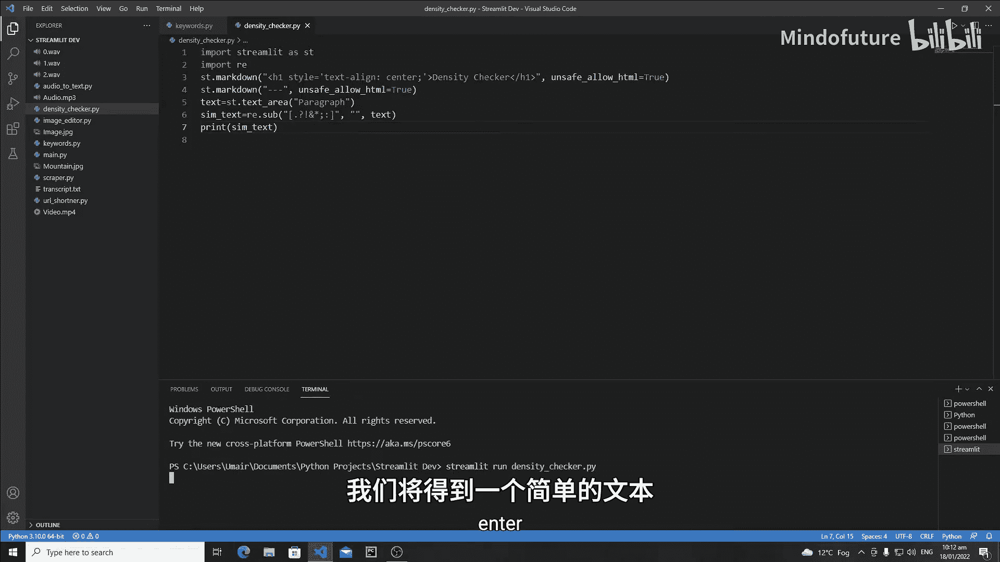

And yeah this is our density checker so we need to pass your paragraph。

 so let's write your paragraph like achieve hello I am a PR O GRAW programmer and my name is UA okay so now we need to hold control and hit enter okay and now let's see the terminal and yeah this is our output okay hello I am parameterr and as you can see it has not removed this comma and the reason is that we have not defined here this comma okay so let's write here this okay now let's save it again and let's copy this this text okay copy it and now let's rerun this application。

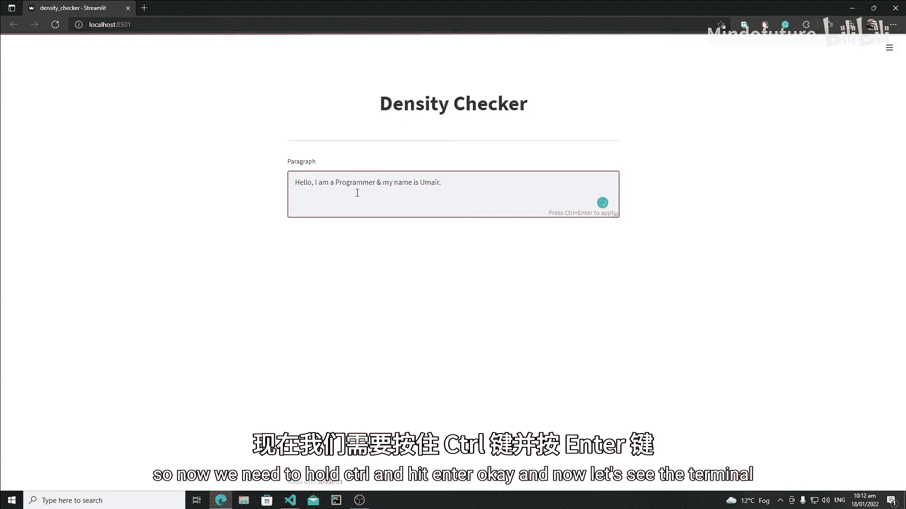

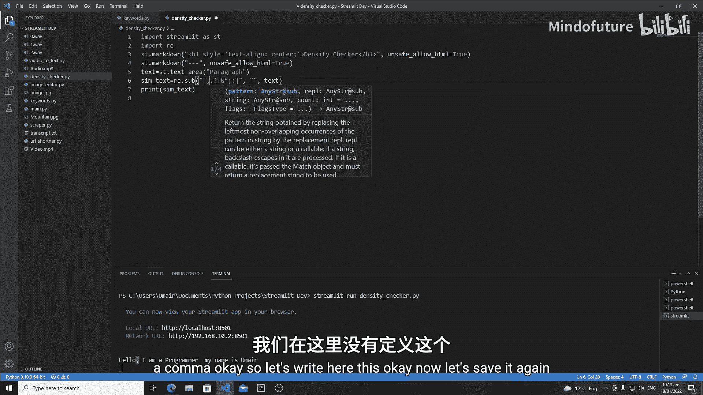

Pas paste here， hold control， hit enter open the terminal and yeah now we are getting a very simple text okay and now here we need to modify this text a little bit more and that is we need to convert each and every character to the lower case okay so let's convert it and the conversion is very simple we just need to write here dot sorry or we lower okay now this lower function will convert my whole text into lower case is okay so let's save it again and let's rerun this application let's paste the paragraph hit enter okay open the terminal and yeah now we have everything in lower case okay so this is how you can actually clean your text OK so this was the first step and that is to clean your text okay now let's talk about the second step and that is we need to actually split all of the data in。

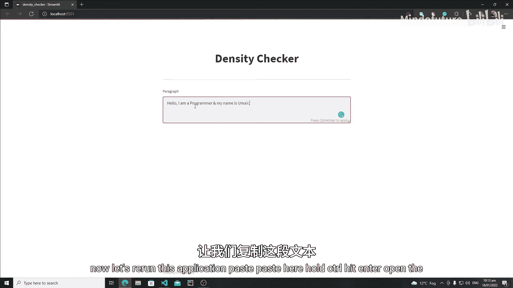

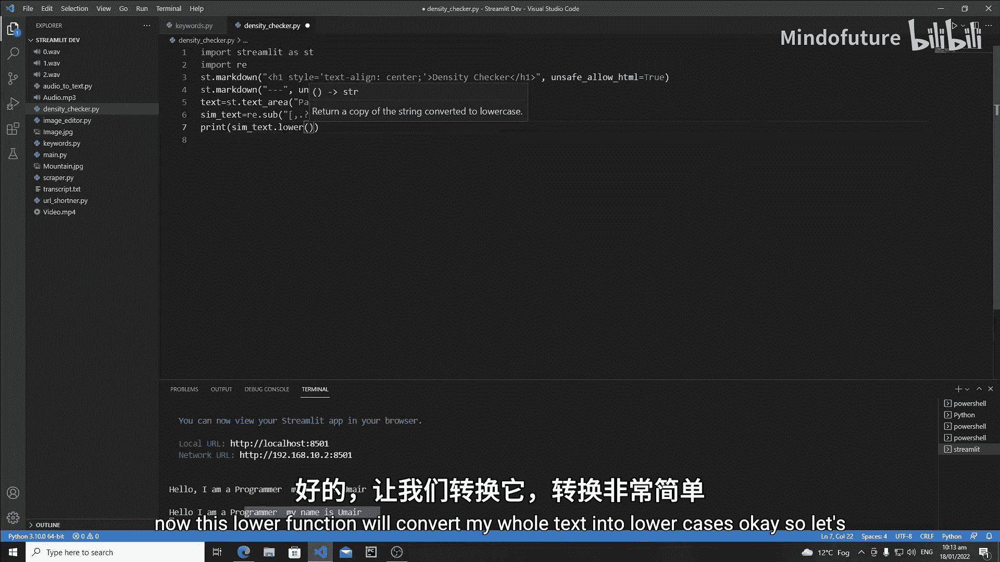

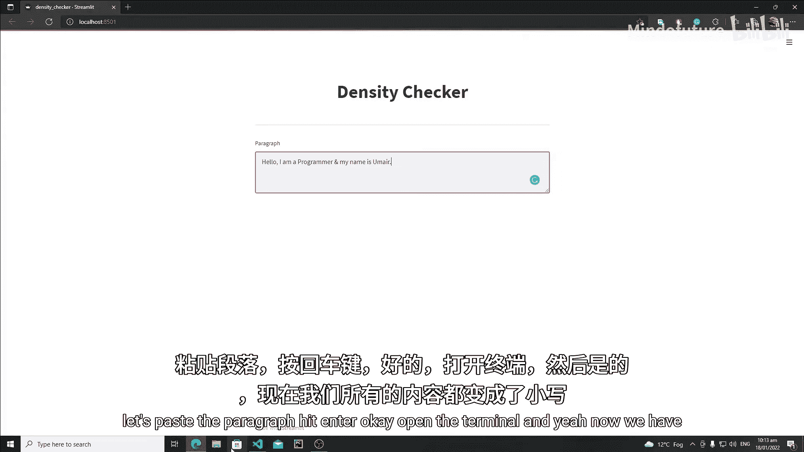

To words based on these empty spaces。 Okay， so the process is again very simple。

 sorry in front of this law， I just need to put dot， and then I just need to write S L I T split。

 Okay， and I will split my data based on this empty white space。 Okay。

 and I will sell my result inside this W or RDS words variable。 Okay。

 and now let's print this words variable， and you will see that we will get a list of words。 Okay。

 so let's save it again and let's rerun it。

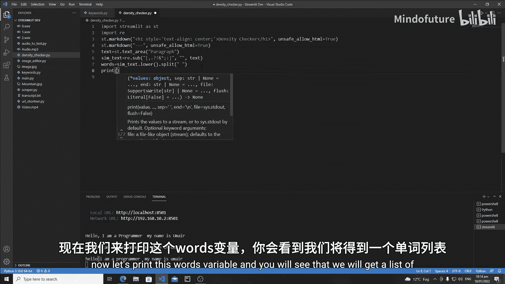

Let's paste it control hit okay let's open terminal and yeah now we got this output but here one thing that you have noticed is that we are also getting an other empty list before this and the reason is that here before actually we process all of these three lines first of all we will check that if my text is not empty this means that if user has enter data then we need to process everything okay so just tab it okay let's save it again and let's reload this thing paste the paragraph hold control hit enter open the terminal now we are getting our required output some。

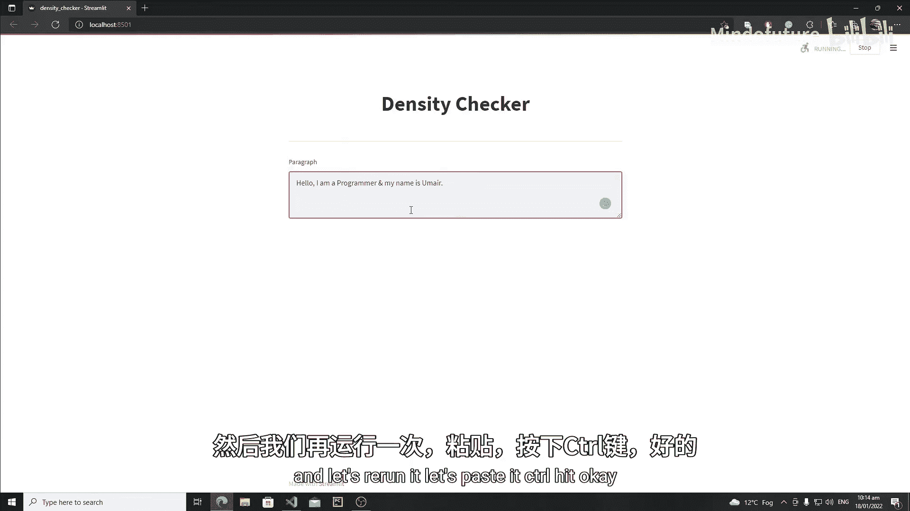

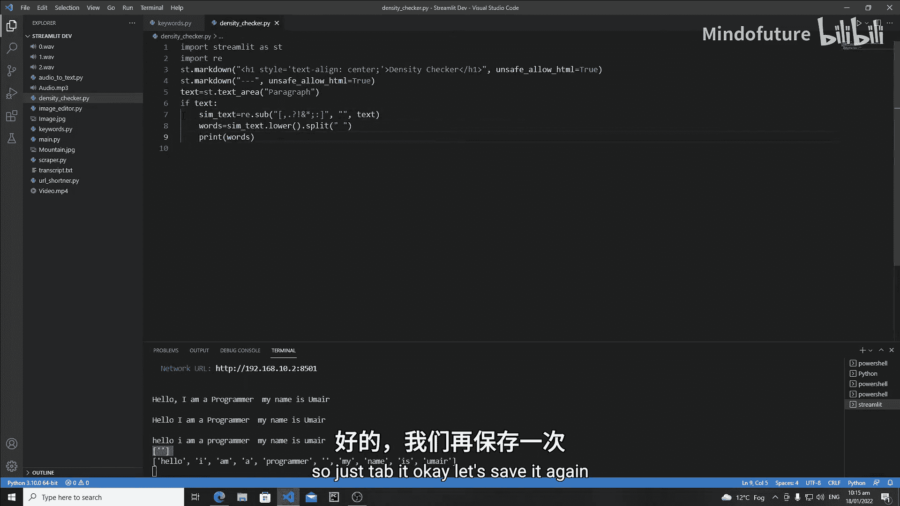

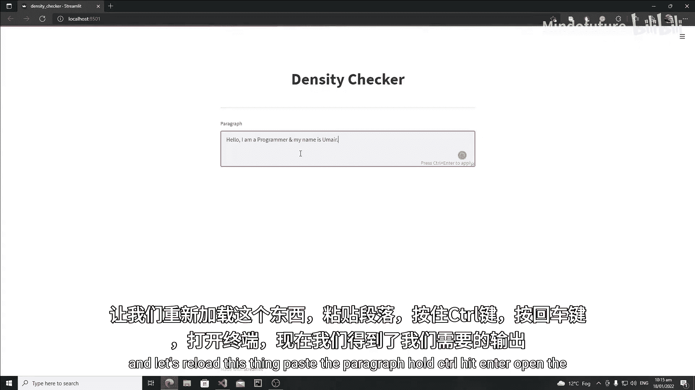

Let's talk about the logic of keyword density checker and first of all I will actually create here an empty dictionary okay and I will check that if we have this particular keyword in our dictionary then we need to increment the value of that particular keyword and if my that particular keyword is not in the dictionary then we need to create one okay and my keywords will be these words in case of dictionary so let's write here the logic for it and let's remove these words for now and let's create here an empty dictionary and I will say WRRDS words underscore the ICT is equals to the ICT okay this will be my empty dictionary and I will say F4 WRD word in WRDs words okay and I will check that if my WRD word in WRDs。

Words dictionary okay so if it exists already in the dictionary。

 this means that we need to increment its value okay so I will just write to WRD words dictionary then I need to pass the word which is the key okay and I will say is equals to the ICT not dictionary WRD words dictionary then WRD word okay and then I will say plus1 okay so I need to increment its value and if my this word does not exist in my dictionary this means that it is appearing first time in the paragraph or in the line then we need to create key and its value in the dictionary okay so just write here WRD words dictionary then we need to pass here the word which is the key actually and then I will say is equals to one so one will be the default value then now let's save it and now outside this follow loop。

Sprintnt of dictionary。 Okay， now in the output， you will get aary having side by side keys and values。

 Okay， so W O R the word dictionary。 Okay， let's save it。 Okay， and let's reload this thing。

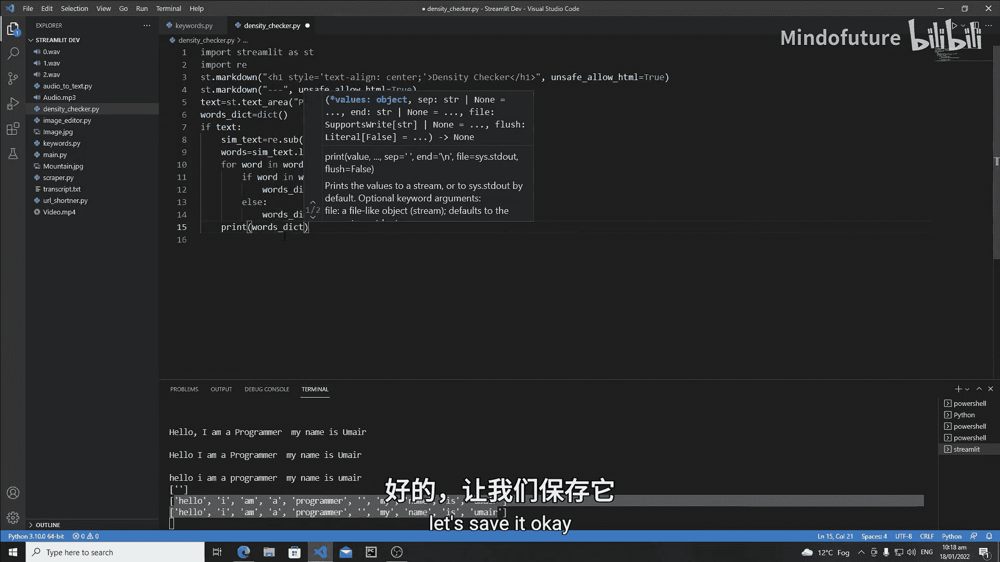

Best your paragraph here。 Okay， hold control， hit enter。 Okay， and now let's open terminal。 And yeah。

 this is our diary。 And now we are getting the word and its occurrences。 Okay。

 so hello has occurred only one time in our line I has occurred only one time M has occurred only one time is occurred only one time。

 programminggram is occurred only one time。 Okay， and this is how you can actually play with the keyword density。

 So now let's change this line。 Okay， so I will say H GW hello I。

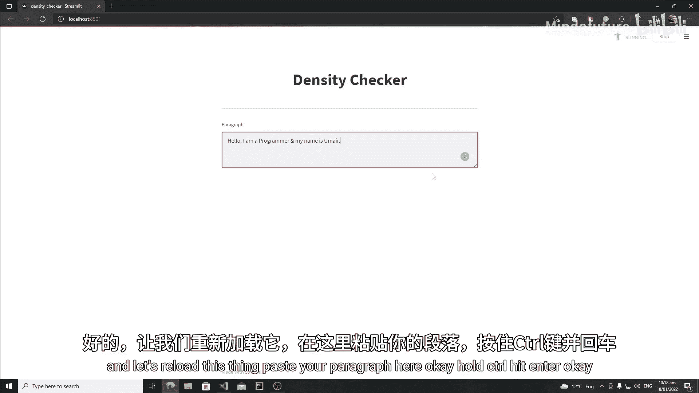

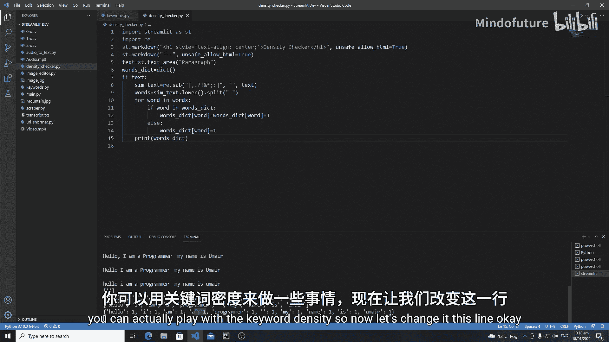

So now let's hold control hit enter and let's see outputting the terminal and yeah now hello is one time I is two time and m is one time is one time developer is one time and is one time and the programs is two time and everything else is good okay so this is how this keyword density to logic will work and I think that it's enough for this tutorial and the next tutorial we will actually make some changes and we will display our result and we will calculate the percentage of each word and we will display our result on this stream lit web so I will see in that tutorial till that point bye bye。

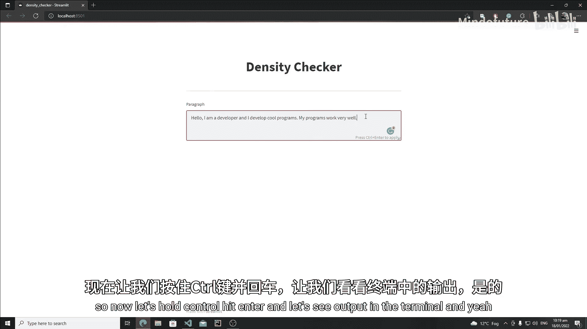

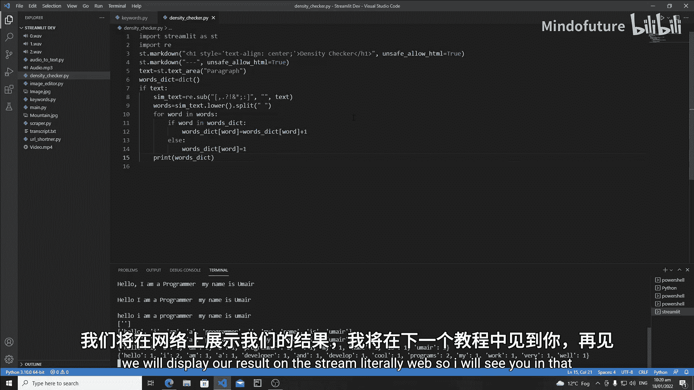