# Python-Streamlit-完全教程-p35-P35-Streamlit-Keyword-Density-Checker-Web-App---Complete-Streamlit-Python-Course--BV1yHVhz1EUD_p35-

Hi everyone， in this tutorial we will continue our development and we will display our this dictionary on the streamlit web app。

 So for this purpose， I need to extract these keys from this dictionary separately and then these values from this dictionary separately and then I will use a single markdown for keys and then a single markdown for these values Okay so let's see how we can extract our information from dictionary so lets outside this for loop let's create here keys variable okay I will say keys is equals to W R words dictionary and then I will say dot K E Y keys okay so this will basically return our keys but those keys will not be in a list format So we need to convert all of these keys into a list So just right here LIStISt list okay and put these rounded brackets okay。

So this is how you can actually extract your keys from any kind of dictionary。

 Now let's extract the values as well。 So just right here via values is equals to aISD list okay again。

 we need to convert over all of those values into a list okay so that's why I'm writing here list and then write here wR words dictionary dot L values。

 Now once we have keys and values， first of all we need to loop through each key and each values。

 and then we need to display that information on the screen。

 So instead of writing here two different for loops。

 I will write only one for loop okay so I will say for I in our Nng range and then I need to pass here range and the range will be the length of keys or the length of values。

 So here you can pass here the length of keys or you can pass here the length of values。

 not difference okay so。Right to your length and then I will pass your keys。And then first of all。

 I will say ST dot MA markdown okay and this will be my formatted markdown okay and I think I will use h5 heading okay for this so h5 and then let's close this h5 heading okay and then inside this h5 headings first of all I will pass my keys okay so just right here K Eva S keys and then as as we have converted over these keys into a list of keys okay so here first of all I need to define here the index of which key I want to display so that index will be determined by this value of I so just pass here this I and then let's create another S dot markdown S dot markdown this will be formatted string again okay and it will be h5 heading okay so just write here h5 let's close h5 okay。

Here I will say the V US values。 Okay， and then again。

 I need to pass my index and the index will be I okay， and in both cases， let's write unsafe。

 allow hml to TR U true Okay or TR U E true and then here as well unsafe， allow hml to TR U true。

 Okay， now let's save this thing and let's copy this information again。

 copy it and let's reload this application。 let's paste the data hold control hit enter。 Okay。

 so we got an error and that is okay， so function or method object is not a travel。 Okay。

 so let's see the output why it is not a travel。 We need to put these round bracket here as well。

 So let's save it again let's reload it let's paste it control enter and yeah now this is our output as you can see this is our keyword。

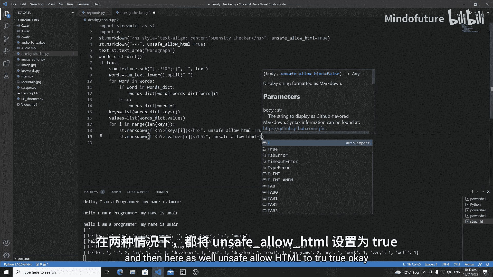

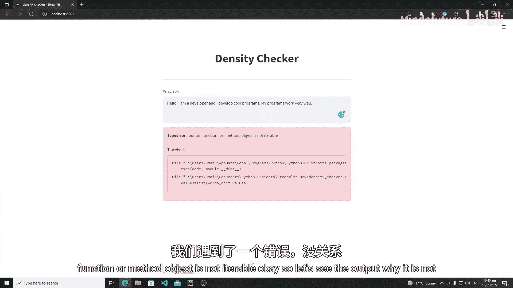

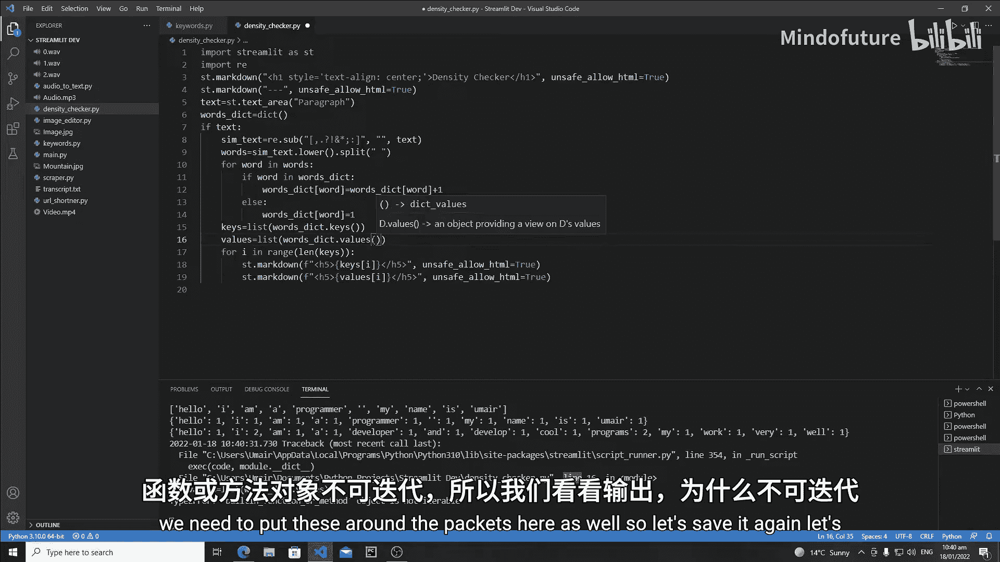

And this is its value okay so hello has appeared only one time I has appeared only two time M has appeared one time is appeared one time and so on okay now I think I know very well that the output is not as good as it should be so I need to print my these values and key side by side okay and one thing that I am thinking that I also need to print the percentage as well so I just need to divide this whole area into two into three different columns okay so beneath this text area let's write here C or L call1 C or L call2 then C or L call 3 okay is equals to S or C or M and columns okay and I will create three different columns or let's put here 3 okay and now instead of using everything like this let's write here C or L call one here okay。

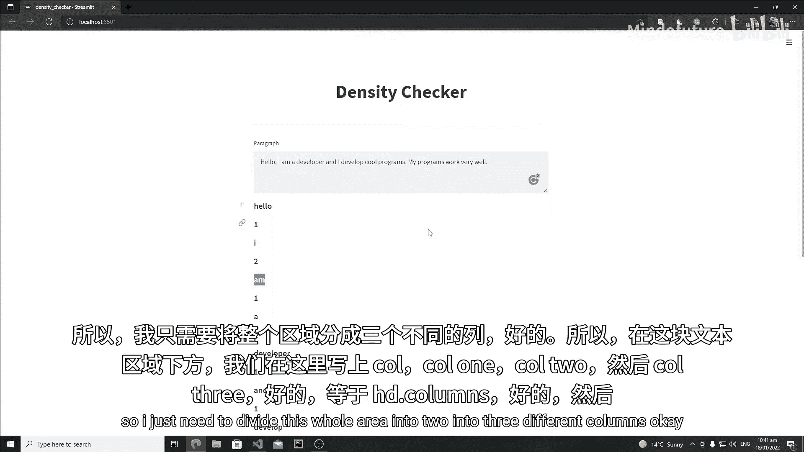

And then see or I'll call2 here and now let's calculate here the percentage。

 so just write here call 3 dot MK D or W and mark down okay。

 this will be again my formatted string and this will be h5 heading H5 and let's close this h5 heading let's write here unsafe sorry let's copy this line Okay。

 copy it and paste it right here okay paste it here now here we need to define our percentage logic okay so first of all。

 I need to calculate the total length of the words okay so we are so here we are calculating our words So I will say T underscore L EN is equals to length of WRDS words okay so we need to find the length of the words and then I will write。

L is values， okay， values of I divided by total underscore length， Okay， total length。

 And then I need to multiply this value with 100， Okay。

 and let's put this part inside these rounded brackets， okay。

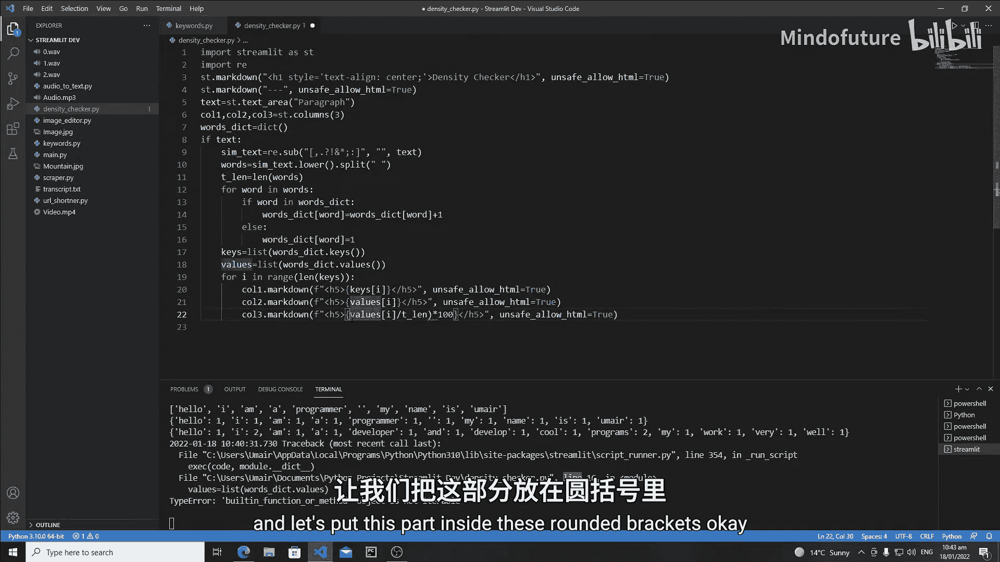

Records and let's save it again and now let's rerun this application。😔。

let's write a sentence like HWL hellello， I am U am AI simple line， Okay， control enter。 and yeah。

 this is my output O， so hello has appeared one time this is the value and this is the percentage。

 Okay， so let's create here some headings for them as well。 Okay。

 so just open this again and here I will write C or I call1 dot M R K mark D or W and markdown。 Okay。

 but instead of writing this thing here， let's write this below this text O So C or I'll call1 dot mark down。

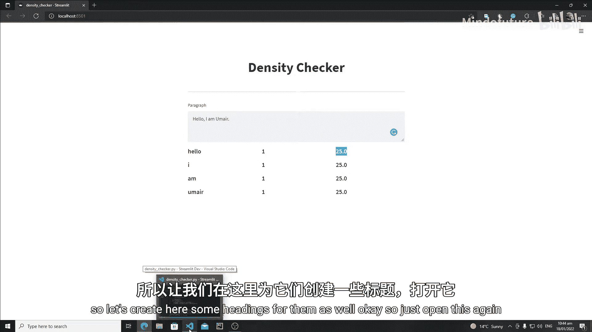

I RKD or W and markdown okay and then I this with my formatted string okay and it will be like maybe like H3 heading。

 okay a little bit bigger heading。And then slash h3， okay。

 and then here I will save K E Y W RDS keywords， okay。And I will say unsafe。

 allow U NS SF unsafe underscore A or W underscore HMl， unsafe， allow H TMl to T R U true。 Okay。

 and I will put this part in the middle。 Okay， so just come to keyword and let's copy this line。

 Okay， copy it and paste it right here。 Okay， paste it here and let's copy this whole line。

 copy and paste it one more time。 Okay， and this will be my column2， and this will be my column 3。

 Okay， column 3， and then let's change the heading from keywords to or double C U R and C S occurrences。

 Okay， and then to P E R， see N AGS percentages。 Okay。

 and now here I just need to put this percentage sign， okay。Percentage sign。

 And I think I will also put these value skis and percentage in the middle of the column。

 So just copy this line， copy and paste it right here。

 paste it right here and then write here as a okay。 Now let's save it and let's re this application。

 I write a paragraph like H EW hello。

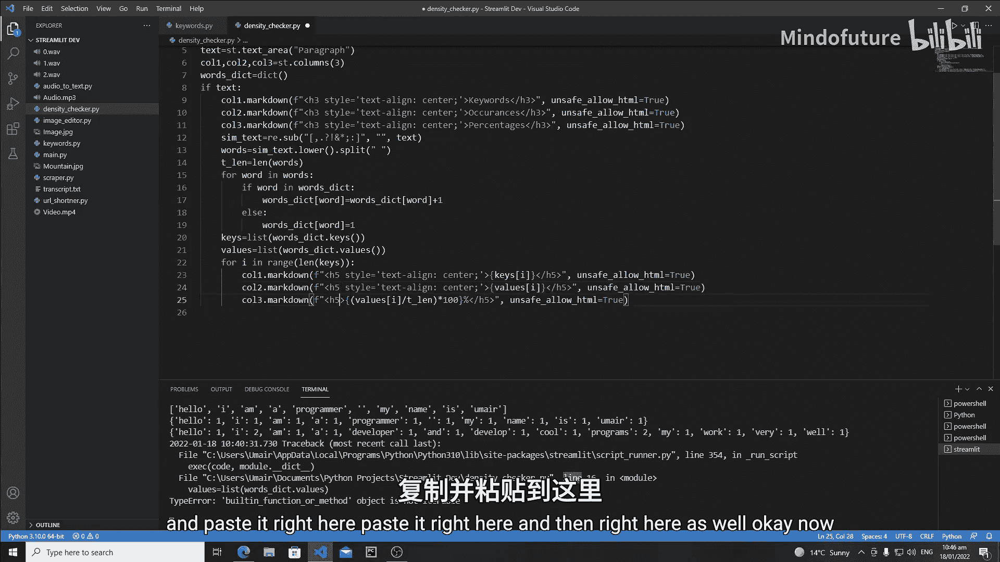

And now let's hold control hit enter keyword occurrences and percentages， okay。

 everything is fine Hello I am and this is the occurrences and this is the percentage but as you can see the percentage is quite weird so we need to round this percentage okay so let's round it and where this is my percentage so here I will write our O andD round okay and I put everything inside。

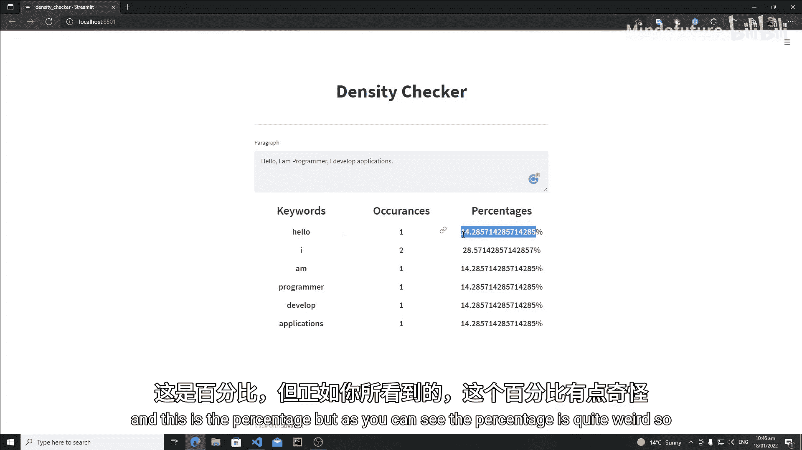

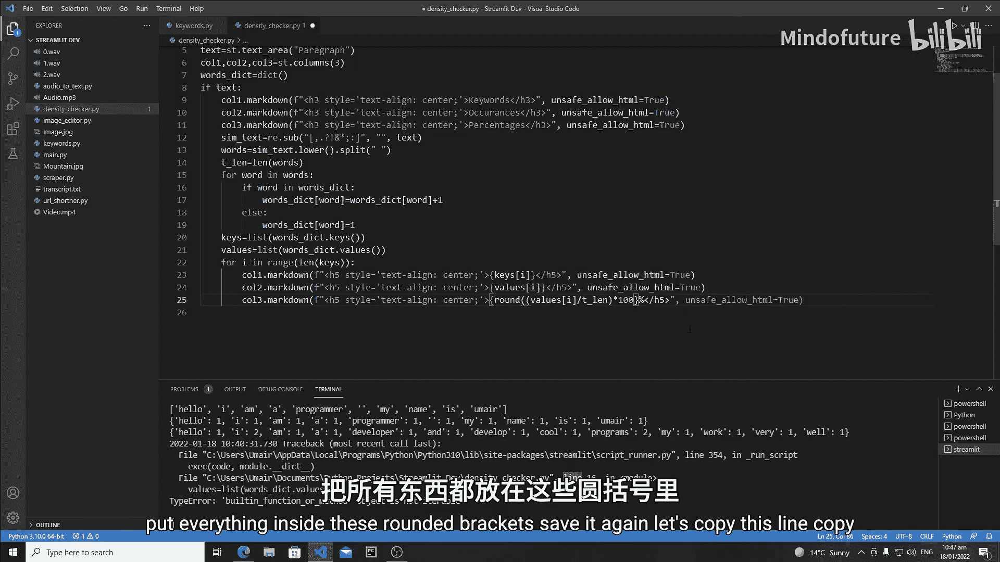

These rounded brackets， save it again。 let's copy this line， copy it， let's reload it。

 let's paste it again， hold control， hit enter。 and yeah now I think the output is quite good。

 So this is how you can develop density checker。 Okay now let's copy a paragraph for it。

 and let's copy this one Okay， so this is the definition of a paragraph So let's copy this one and past it try it here。

 hold control， hit enter and yeah this is the output or keywords occurrences and percentages。

 these are all the keywords。 Okay these are all the occurrences and these are the percentages。

 So this is how you can develop this keyword density checker application。

 and I hope that you have enjoyed this tutorial and in the next tutorial we will see something new till that point bye bye。

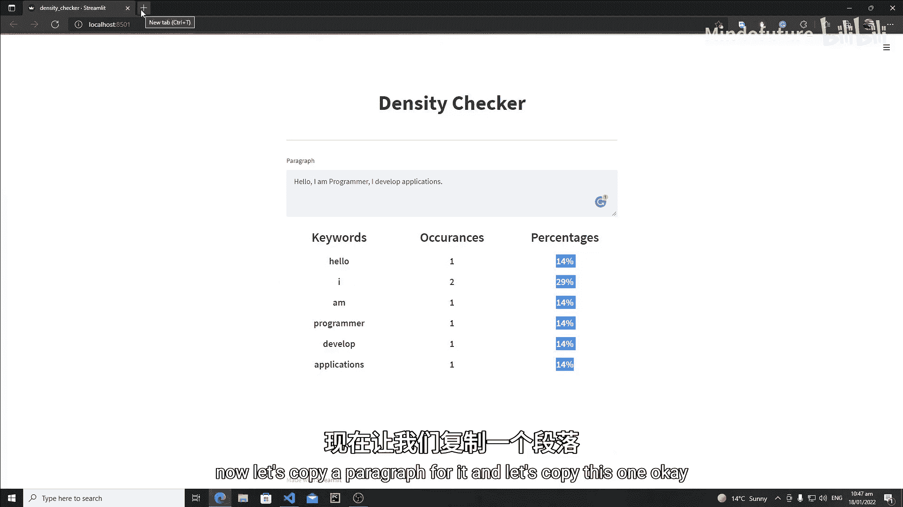

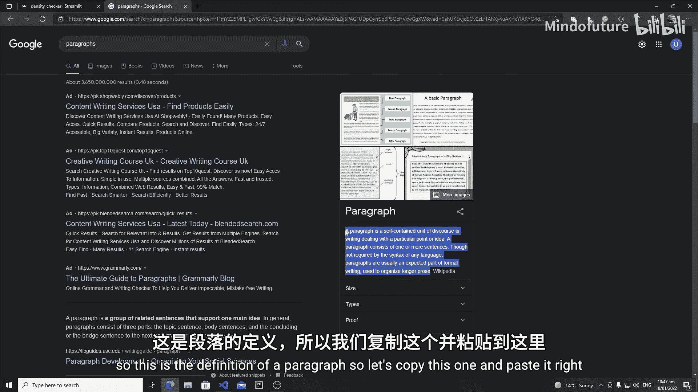

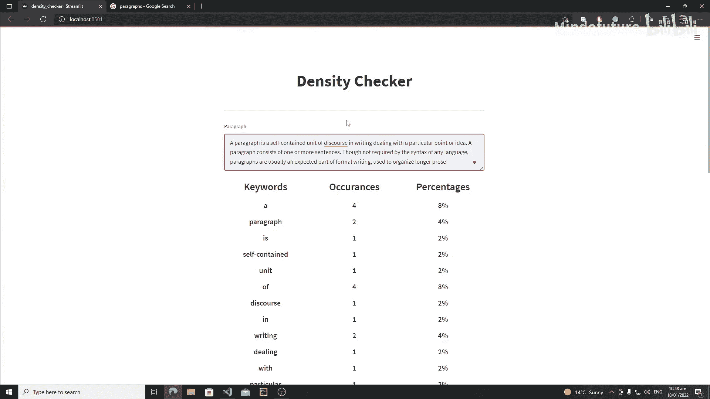