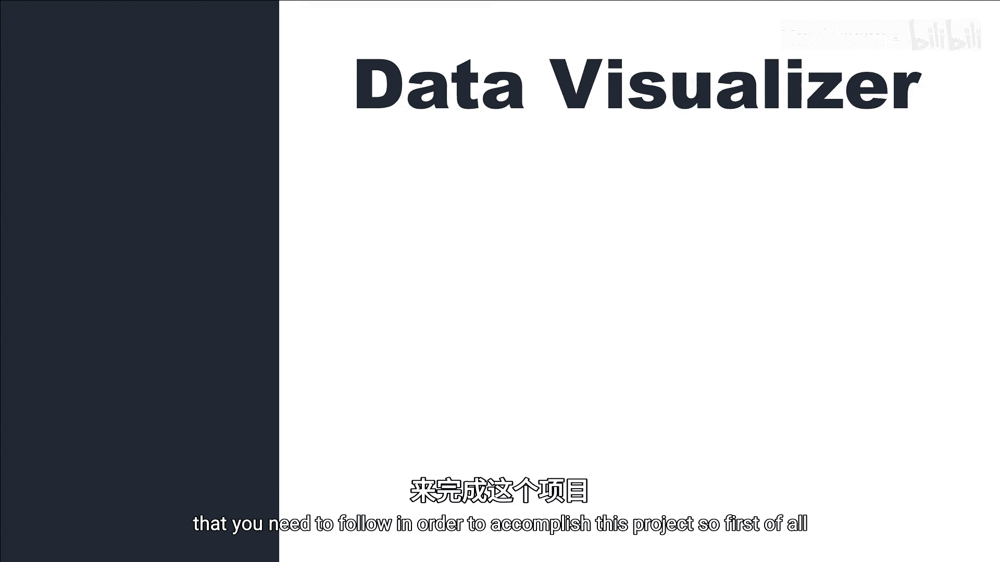
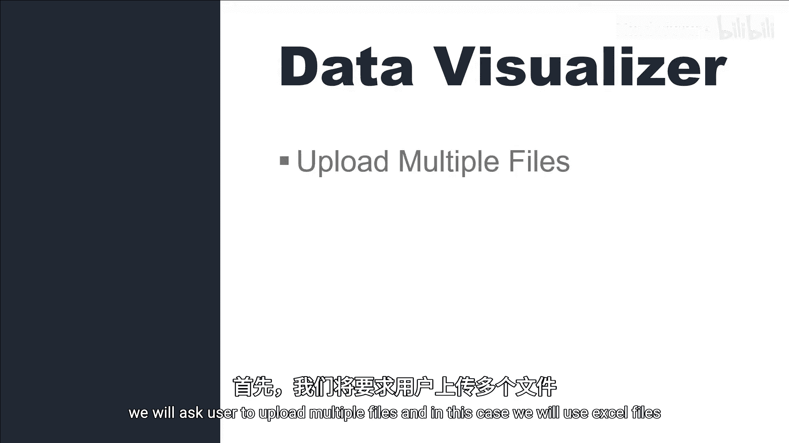
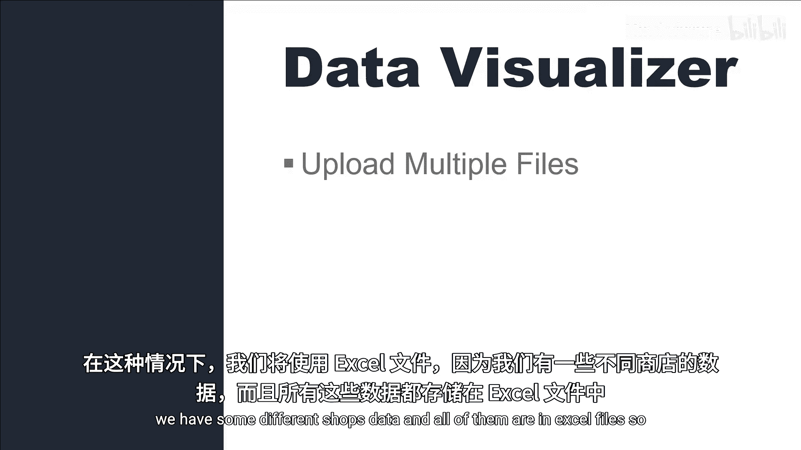
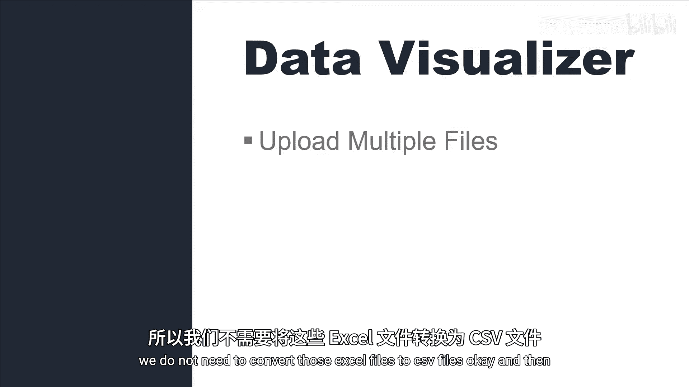
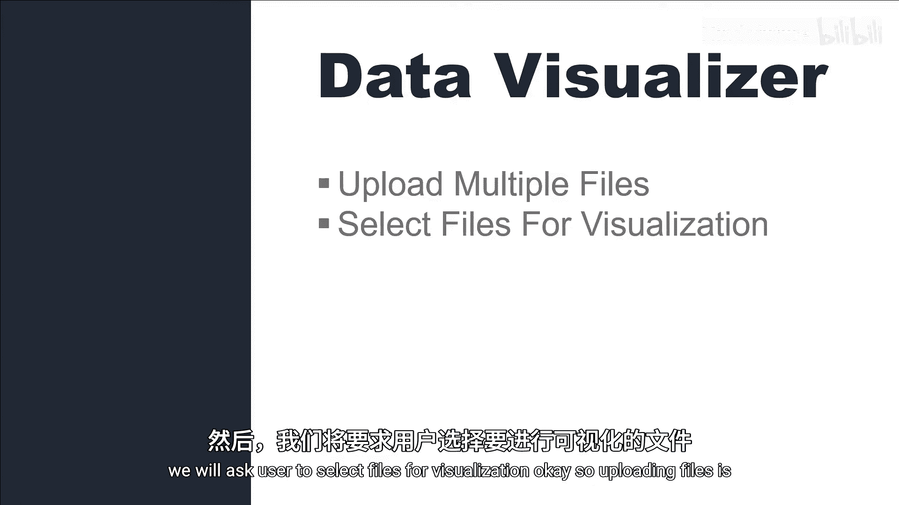
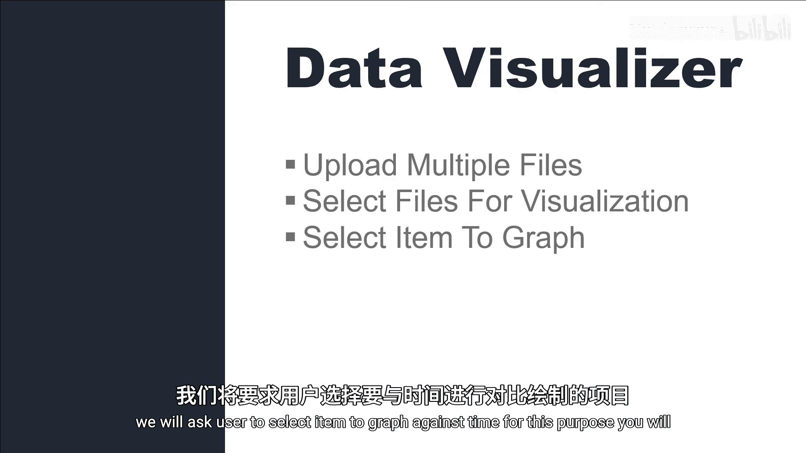
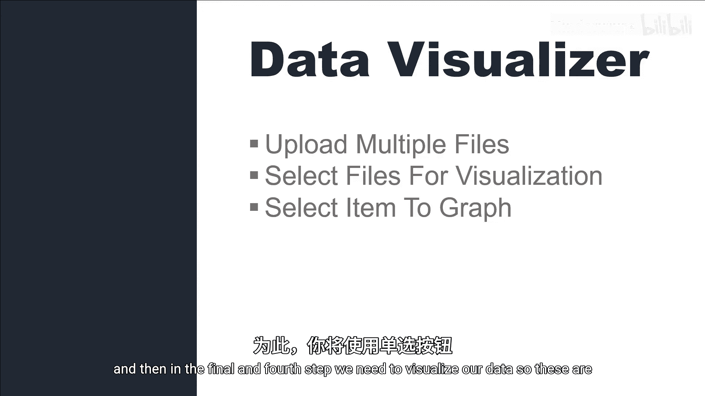
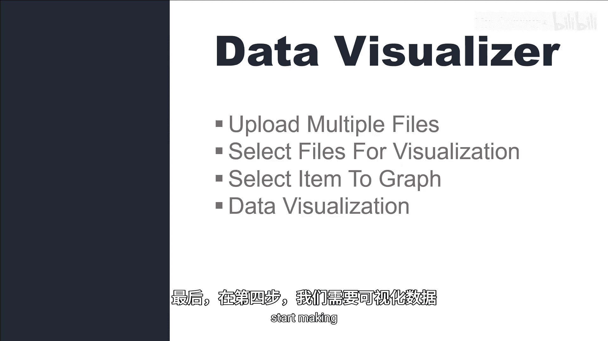

# Python-Streamlit-完全教程-p36-P36-Streamlit-Data-Visualizer-Web-App---Complete-Streamlit-Python-Course---Tutor--BV1yHVhz1EUD_p36-

Hi everyone in this tutorial we will start making our data visualizer app and first of all there are a few steps that you need to follow in order to accomplish this project so first of all we will ask user to upload multiple files and in this case we will use Excel files because we have some different shops data and all of them are in Excel files so we do not need to convert those Excel files to CSV files okay and then we will ask user to select files for visualization okay so uploading files is different and selection of files is different and then in step number three we will ask user to select item to graph against time for this purpose we will actually use radio buttons and then in the final and fourth step we need to visualize our data so these are four steps that we need to follow in order to complete this project and in the next tutorial we will start。

Making， and I will see you there till that point， Bye bye。

