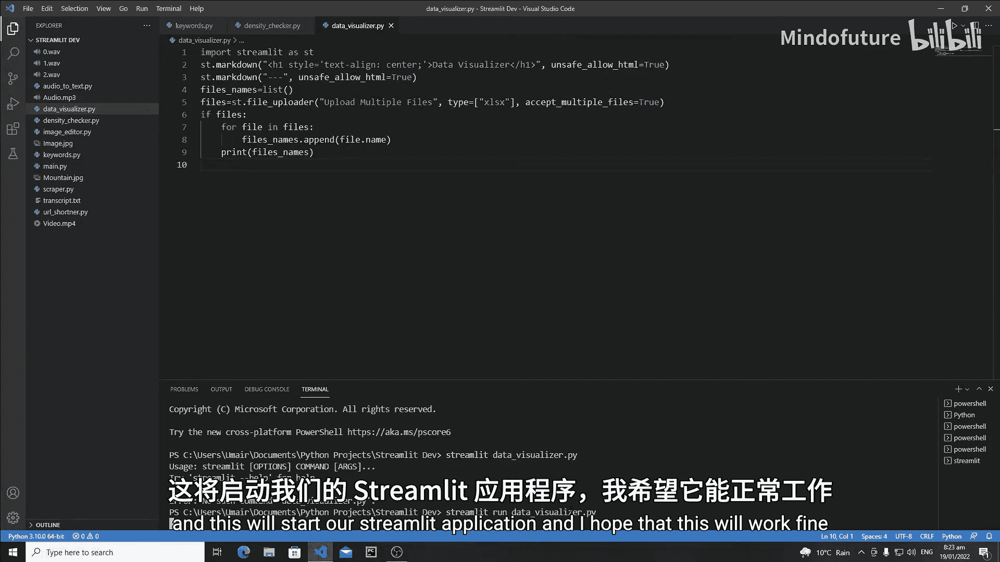
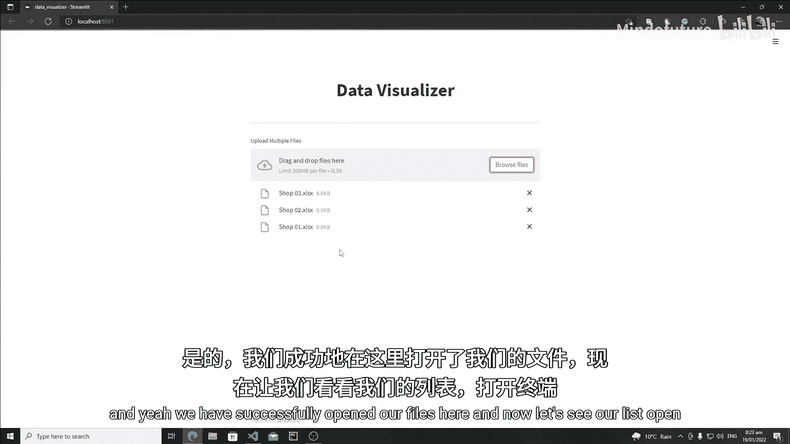
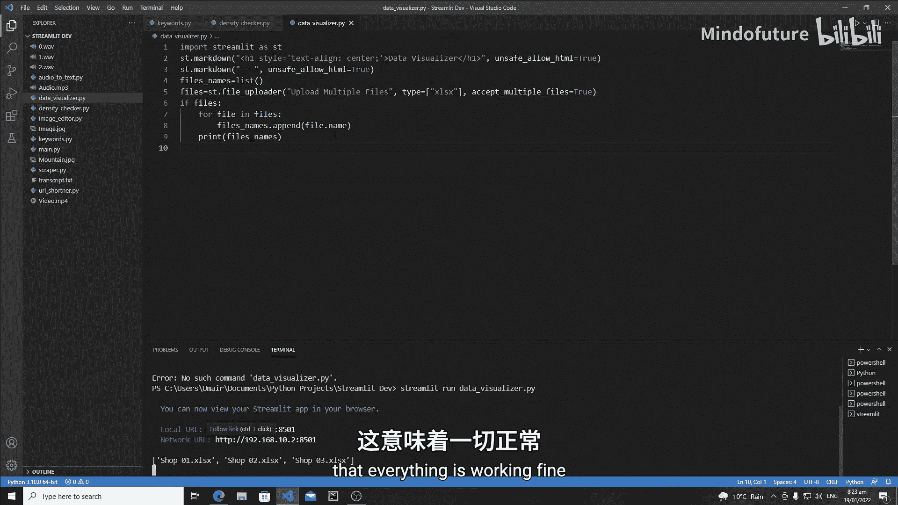
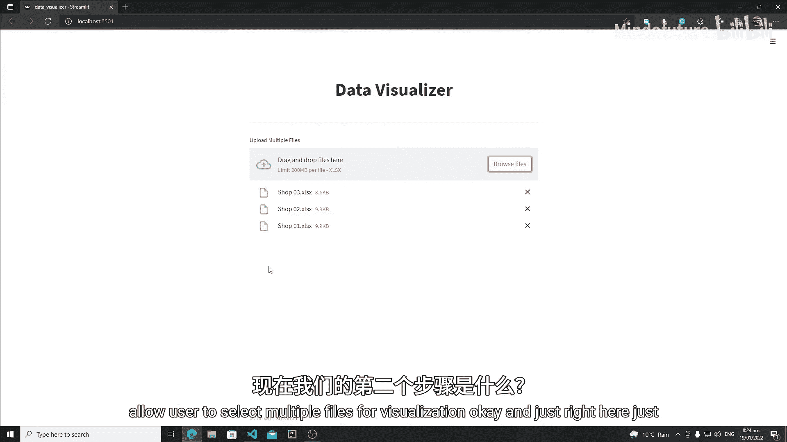
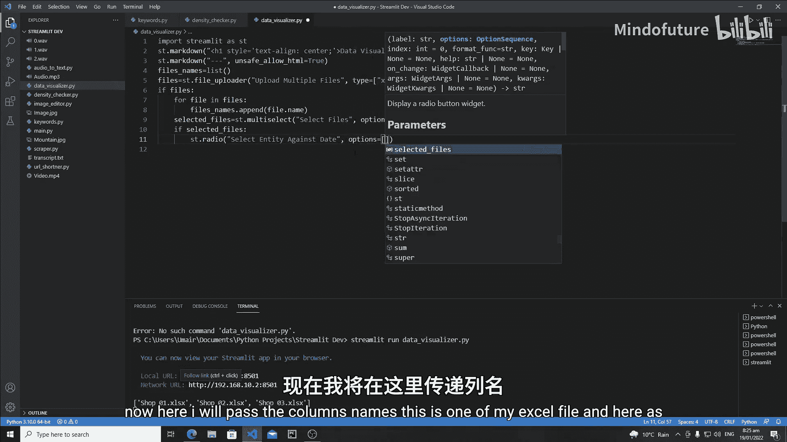
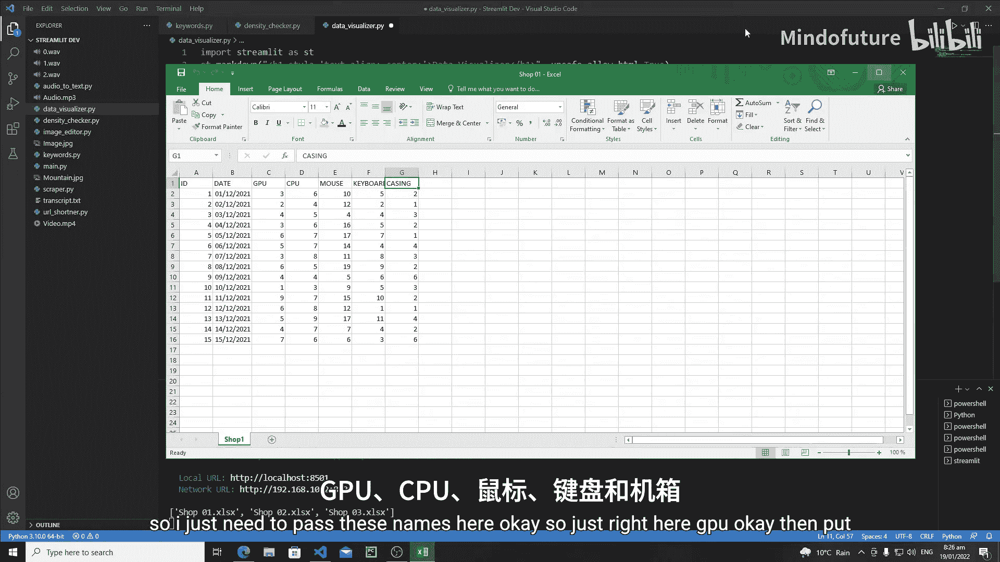
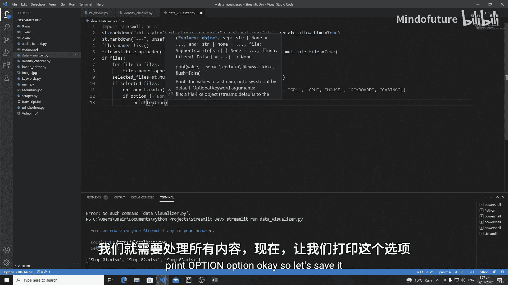
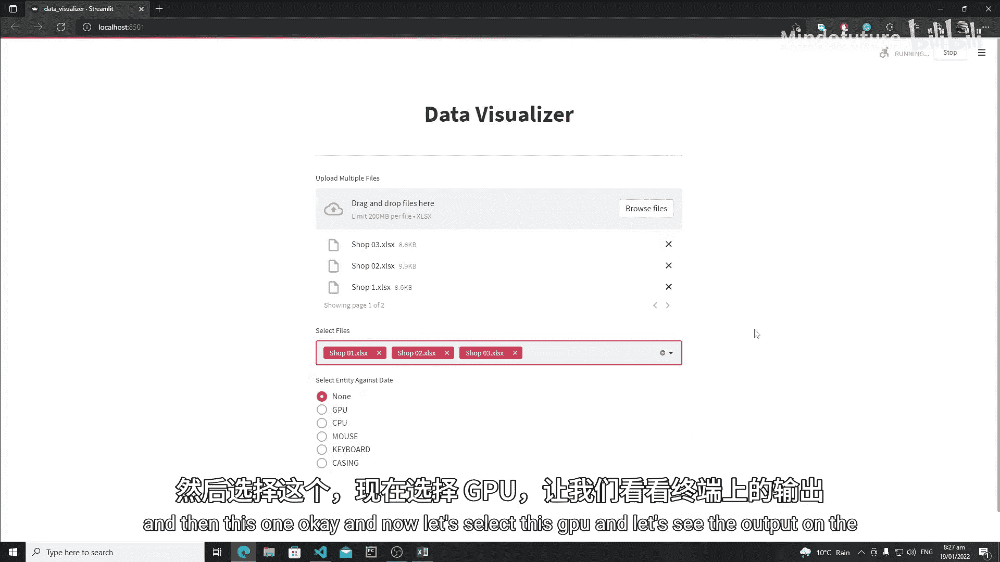
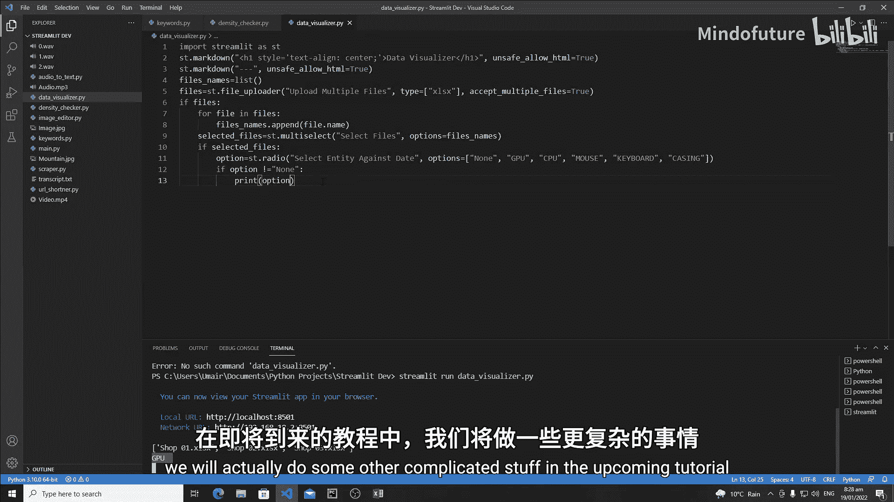

# Python-Streamlit-完全教程-p37-P37-Streamlit-Data-Visualizer-Web-App---Complete-Streamlit-Python-Course---Tutor--BV1yHVhz1EUD_p37-

Hi everyone in this tutorial， we will start making our data visualizer app。 So first of all。

 let's create a Python file for it and I will name it like D data and underscore score V I S U A L I Z E R dot P O and hit enter So this is my data visualizer app。

 So first of all we need to import streamlet So import S R E sorry L T S S O and then first of all we let's create title。

 So just go to the previous app just copy these two lines O copy them and paste them right here And now instead of writing here density checker I will say D data V I S U L I Z R data visualizer Now first of all。

 we need to create a file uploader widget because with the help of that widget we will ask user to upload multiple files okay so I just need to write here。

Dot fL file uploader okay and I will say U P L O upload M U L T I P multiple FS multiple files okay sorry small I upload multiple files and then we need to define here the extension TYp type O is equal to and in this case the extension is Xl S X okay。

 which is the extension of Excel files and then we need to store these files inside this FiS files variable okay and just make other property to true and that is multiple A C P accept multiple files to T U true because user need to upload multiple files he can upload actually a single file but it it will be good to upload multiple files okay and then after uploading multiple files。

 first of all we need to get the names of those files okay so let's create。

Here an empty list O so I will name it like FLES files and meS names is equals toT list and that will be an empty list and first of all we will store all the files name inside this variable okay so I just need to loop through each file So just right here but before I loop it first of all I will check that if my files is true this means that if user has uploaded files then I need to loop through it okay so just right here for fL file in fLS files okay and then I will say fLS files underscore names do aP and the append and I need to append fLE file dot name okay and then for now just print this list O so print fLS files underscore and meES names okay and let's save it and open。

The new terminal， new terminal and right here， ST T， R E A ML L T streamamlit。

 D A T A data underscore VIS S U A L I Z E R dot P by hit Inter not sorry we need to write here。

 run as well so just right here R U N R U and runok。

 then hit Inter and this will start our streamlit application and I hope that this will work fine。

So upload multiple files， browse files okay and these are my files okay so let's upload this Shop 1。

 Shop 2 and Shop 3 okay open them and yeah we have successfully opened our files here and now let's see our list open the terminal and yeah this is my list O so show 1 dot X LSX and these are my three files so this means that everything is working file now our second step was to create here a multiselect widget and which will allow user to select multiple files for visualization okay and just right here just remove this line okay and here I will say M I will say S dot M LT multiselect and then my label for this will be like L select。

Filees， okay， this will be my label and then as an option I will pass the list of these file names Okay。

 so options is equals to and then FS files underscore names and this is the reason why Im extracting these files name okay because I need to pass these files name as my option inside this multiviit and I will save my result inside this S LD selected underscore files variable and then I will check that if S LD selected files is true this means that diffus has selected files then I just need to make a radio button here okay so I will write here S do R D I or radio button okay and then for the label I will say S L select E and T I。

Select entity A G AI NSD against debt okay and then for the options， I will say。

 so now here I will pass the columns names， this is one of my Excel file and here as you can see first of all we have I D okay and then we have this debt then we have GP CPU mouse keyboard and casing。

 So here these are my entities， GPU CPU mouse keyboard and casing okay so I just need to pass these names here okay so just right here。

 GP okay， then put comma and then CPU， then put comma， then M O USU mouse。

 then K E Y B O A RD keyboard and then see S I N G casing okay and I think yeah this is good okay so this is my radio button and now I will save output of this radio。

Button inside this O P TI O an option variable。 Okay， but before I actually run it。

 let's create an other entity here as well， and that will be an or any none okay。

 and or any none and if user select this none this means that we do not need to process anything okay。

 so just right here if O P T O an option is not equal to an or any none。

 this means that the user has selected something， then we need to process each and everything and for now let's print this option。

 Okay， so print or P TI O an option。 Okay， so let's save it and let's open it again let's reload it。

Select browse files， okay， select these files， open them and we need to select files okay so just select this one and let's select this one and then this one okay and now let's select this GPU and let's see the output on the terminal and yeah we have selected this GPU okay so this is how everything will work okay I think it's enough for this tutorial and in the next tutorial we will read our Excel files and we will actually do some other complicated stuff in the upcoming tutorial so I will see there till that point bye bye。

