# Python-Streamlit-完全教程-p38-P38-Streamlit-Data-Visualizer-Web-App---Complete-Streamlit-Python-Course---Tutor--BV1yHVhz1EUD_p38-

Hi everyone in this tutorial we will continue our development and now let's remove this print option okay and here after checking that if user has selected any option we need to look through each file and for this purpose I will use here a for loop or right here forD file in f these files okay now here one thing that you need to keep in mind that we do not need to extract information from each and every file which user has uploaded and the reason is that because we are explicitly asking user to for selection of files as you can see here we are asking user so first of all we will check the names of the files which user has selected so first of all we will match that if the file name is Sam as the one which user has selected using this widget then we need to extract information from that file So for this purpose here I will write an if statement so just。

If my fad file dot name in selected files okay so if my this file name exists in the selected files。

 then I need to extract information from that file otherwise I will skip it so here in order to extract information from Excel file or CSV file or from any kind of spreadsheet pandas is a best option okay so there are other libraries as well but pans is easy to use and it's a very powerful library so we just need to import pandas but if you don't have pandas just open new terminal and just right here PIP INSDW install P pandas okay and hit into and this will install your pans okay so after installation of pandas you just need to import pandas so just right here IP or to import PDS Padas P which is a convention and here。

After importing pandas， I just need to write PD dot read Excel file okay so as you can see here。

 we have a bunch of options， but in this case we will read Excel file okay so just select this read Excel file and here you just need to pass the part of your Excel file or the file name and in this case my file name or part of file is this f file okay so just pass here your are file okay so just write here f file okay and I will save my result inside this S or P shop underscore score the data variable okay and now for now just print this data okay so print S or P shop underscore data okay and let's save it and now here let me run this thing So S but instead of writing everything like this just select this one stream run data visualizer。

Inter and thats sweat。It's opening。

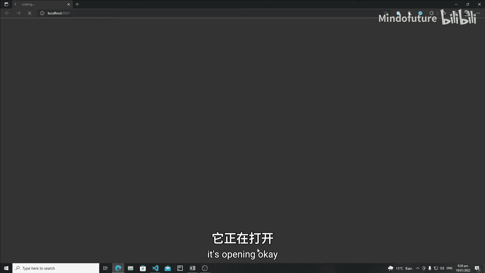

Okay so we just need to select files， okay browse files， select them。

 open them and let's select like shop one option， then shop2 and then shop3 okay and now let's select this CPU okay and now let's see the output on the terminal and yeah this is my output okay so as you can see this is my file one information because user has selected three files that's why we are able to see three different files data okay and now let's suppose that if user select like let's click on none and let's suppose that if users select only these two files and now if I click on this keyboard or something like that open the terminal and now you will see only two files okay and yeah these are my two files okay so this is how this system will work now here you need to make some correction inside this data and that is if you focus on the。

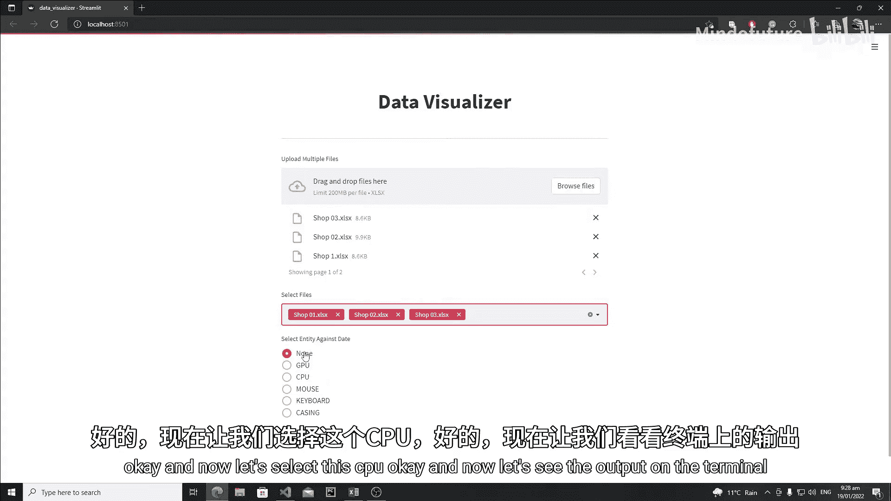

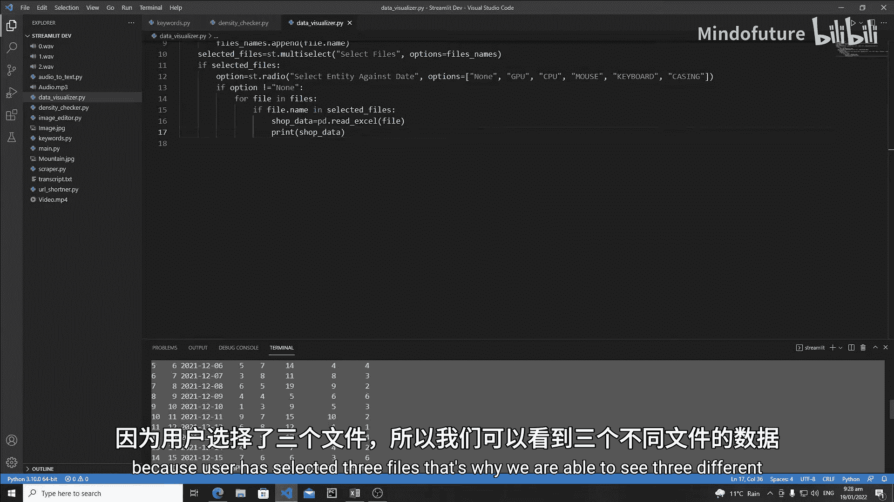

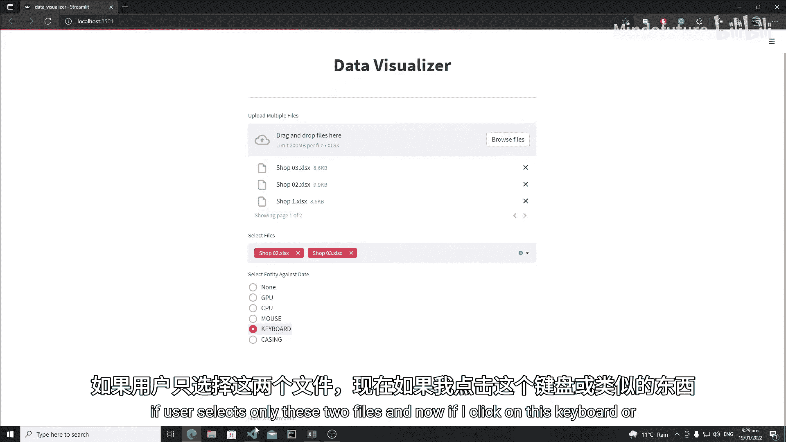

Left side here we are getting this0，1，23，4，5，6 okay while our ID has a separate column inside our Excel sheet so how to solve this problem So the panda is automatically assigning indexes to each row so in order to avoid this problem we need to define our index column and that is our first column which is present at index0 so here after reading this file we need to pass an extra argument and that is I D index call is equals to and you need to define here you are index of your column and in this case my index is0 now let's save it and now if I again reload this application you will see a better output so browse files select these four files okay and now I will select only one file so just select this show of one data and now let's select this GPU and open the terminal and yeah as you can see now we are not getting any kind of。

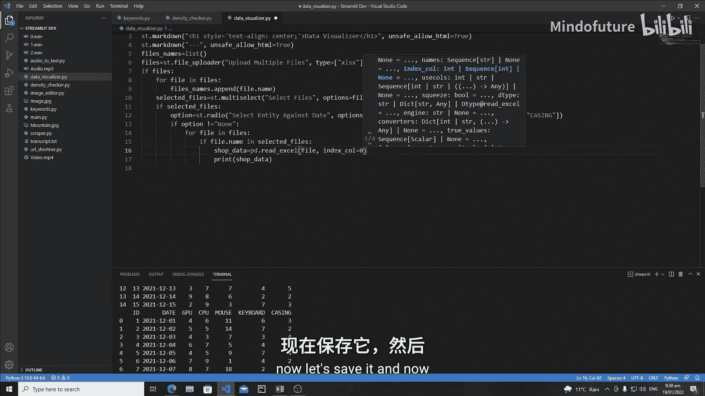

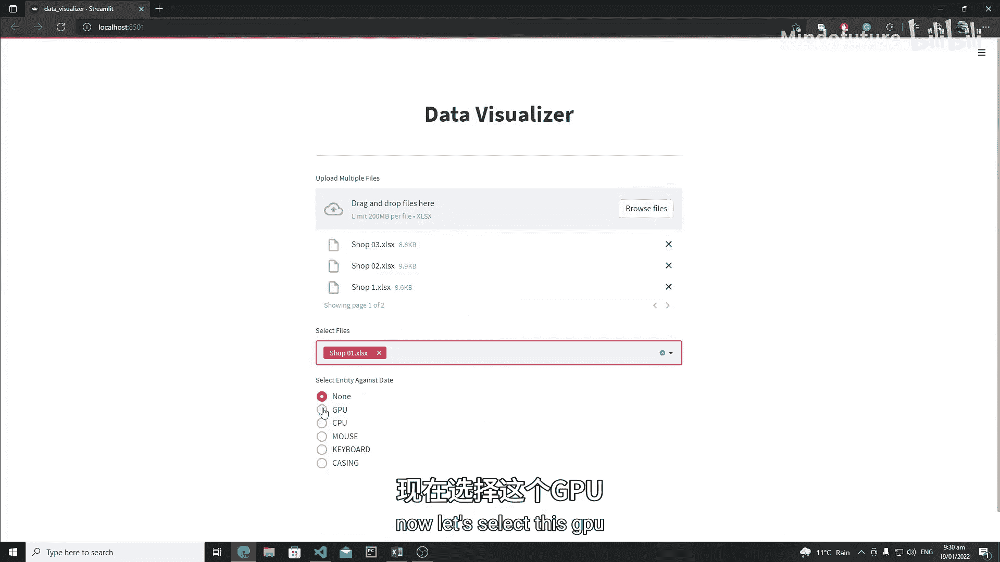

Automaically generated indexes okay so Brandise is treating this ID。

 which is column1 as index column okay so this is how you can actually read data from the Excel file using pandas and now let's suppose that I do not want to print this whole table I just want to print only that column data which user will define here using this radio button So in here I just need to put these secure brackets okay and I need to define here the column level or the column heading and in this case my column heading will be this option so just right here p1 option okay so if user selects GP column then we will see only GPU data here if user selects CPU column we will see only CPU data and so on and so forth So let's save this and now let's reload this application again。

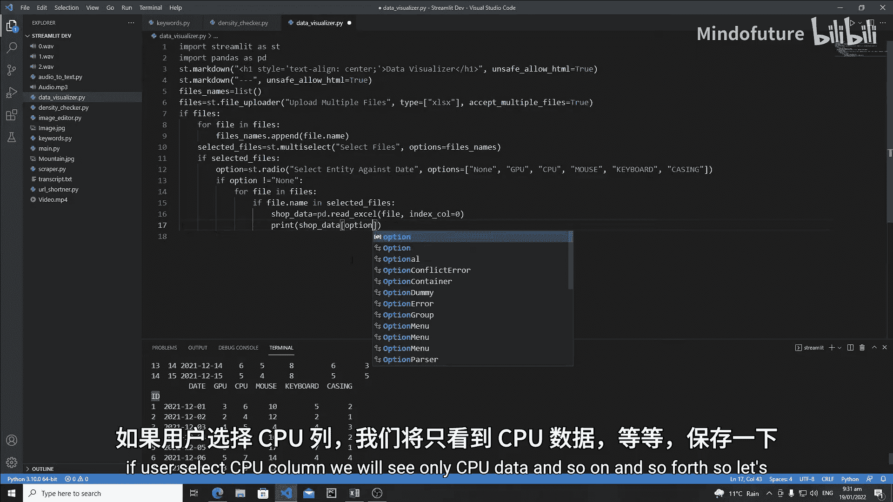

Let's browse files。 Select these four files。Now let's select shop one data and then the shop two data and now I just want to print this casing information Okay and let's open terminal and yeah as you can see here now we are getting only this one column okay and this is the name of this column as you can see casing So this is the shop2 data and this is the shop one data okay so if I open this terminal little bit more okay and this is the information now I think it is visible to you so this is how we can actually extract this data but here our objective is to visualize this data so we need to convert this data to list okay so the process is very simple just right here liISD so liISD okay and then put this whole information inside this list and now you will see here the output as a list okay so let's reload this data reload application。

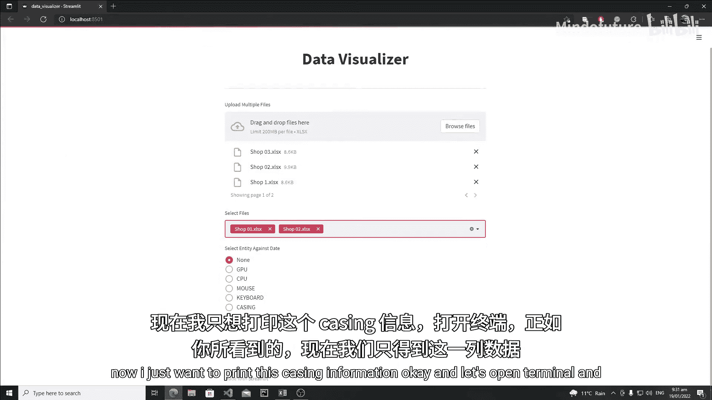

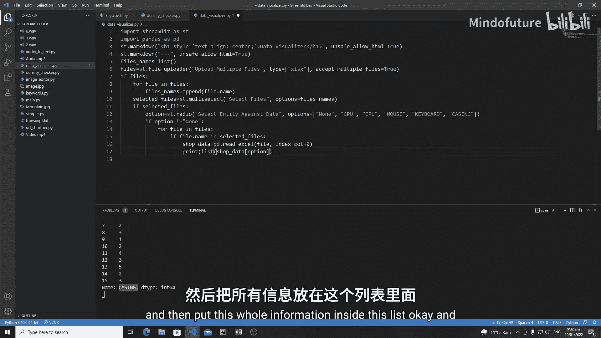

Browse files， select these four files and now let's select this shop1 okay and CPU and let's open the terminal and as you can see here now we are getting only list of CPU so this is how you can actually extract data and now we need to actually visualize this data against that time okay so if I open my Excel sheet as you can see here first of all we have ID then we have data so I will print these dates on my Xxes and then I will print my items on my yxes and this is how you will get a graph but here one thing that is very very important to discuss is that whenever I click on this ID column as you can see here my format is general and if I click on this GPU my generalist format but if I select any of the cell from this data column here my format is dead okay and which is very different from all of these data。

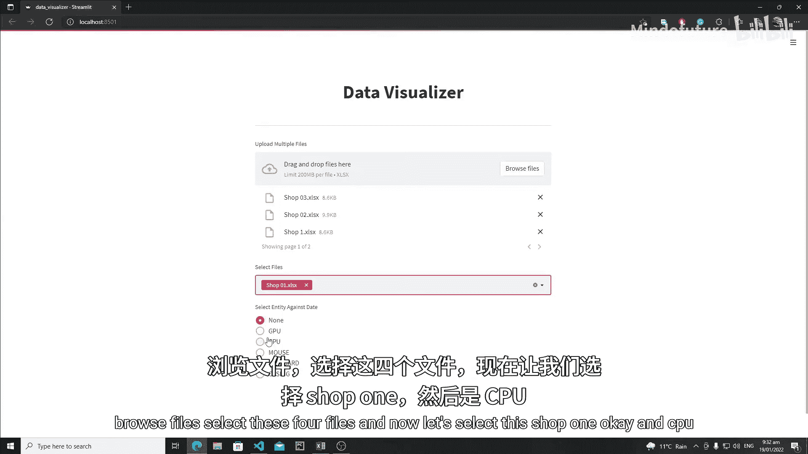

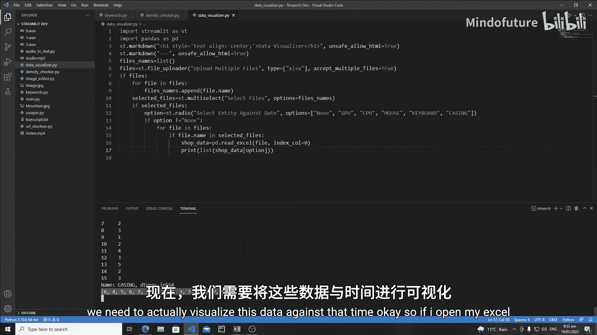

Okay so even if you print your dead column using this type of operation。

 you will see here a very very weird output okay so for example。

 if I write here like D D D date here you will see a very weird output so let's save it and let's reload this thing okay and let's browse files select these four files select this one maybe any of the option and now let's see open the terminal and yeah as you can see here now we are getting a very weird output okay so we are getting that time objects okay so this is the date and then this is the time okay so instead of actually accessing dates like this I will extract the values from this dead column okay so instead of converting it to list I will say just remove this list and here I will say dot V LUS values okay now this values。

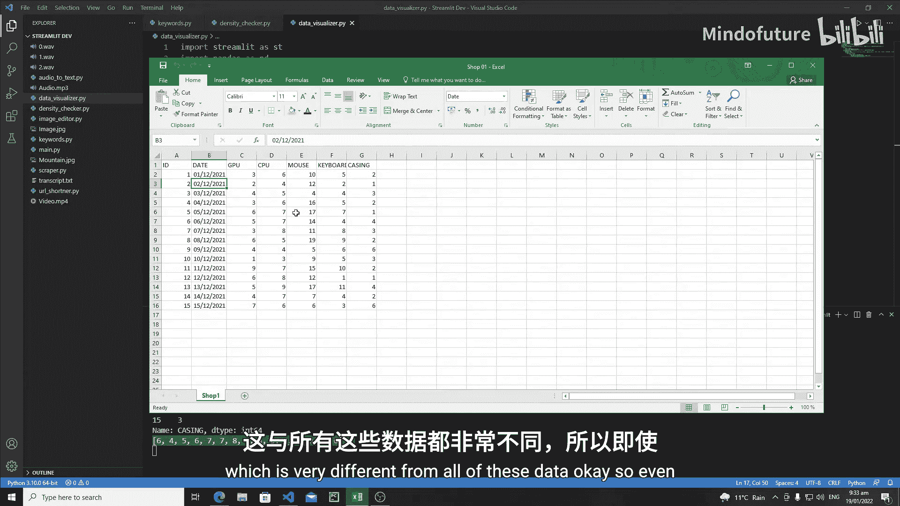

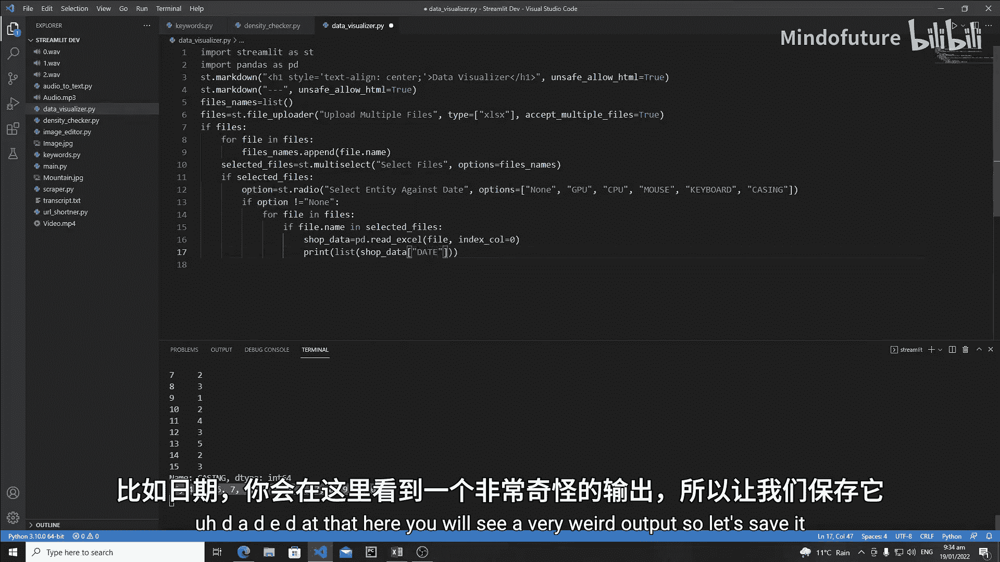

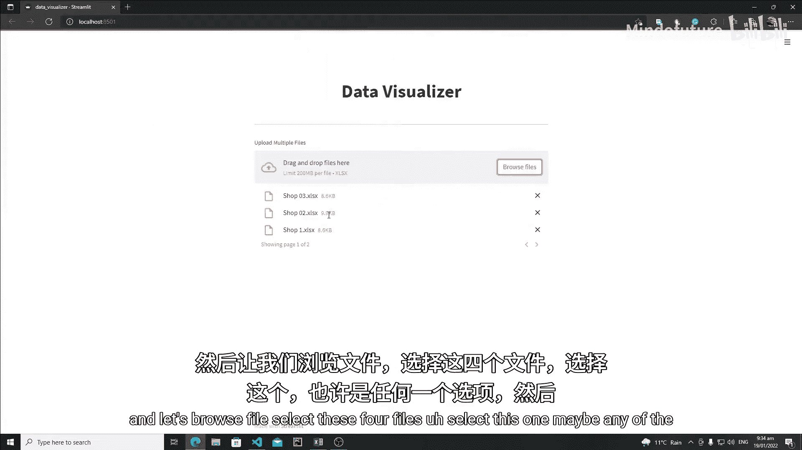

will basically allow me to extract the values of this column okay so now let's save it and this will print me the data and the time okay so let's reload this application again okay let's browse file select these four files select this one okay CPU and let's open the terminal and yeah as you can see it is returning as a list okay and inside this list we are getting the data okay so till this point it is the date and then this is the time okay so we are not concerned with the time and we just need to skip the time and we need to extract only this part so for this purpose I think that we will use a split function okay and we will split each information based on this T okay so as you can see here T then here T T so I then after splitting I will get a further list okay and inside each list I will have two。

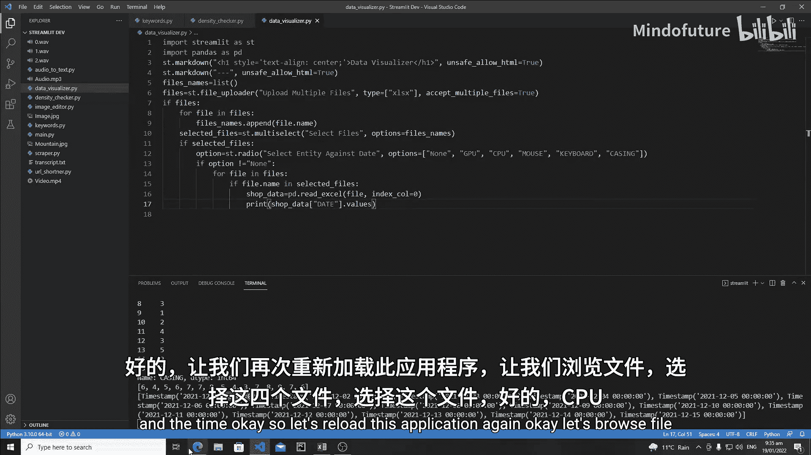

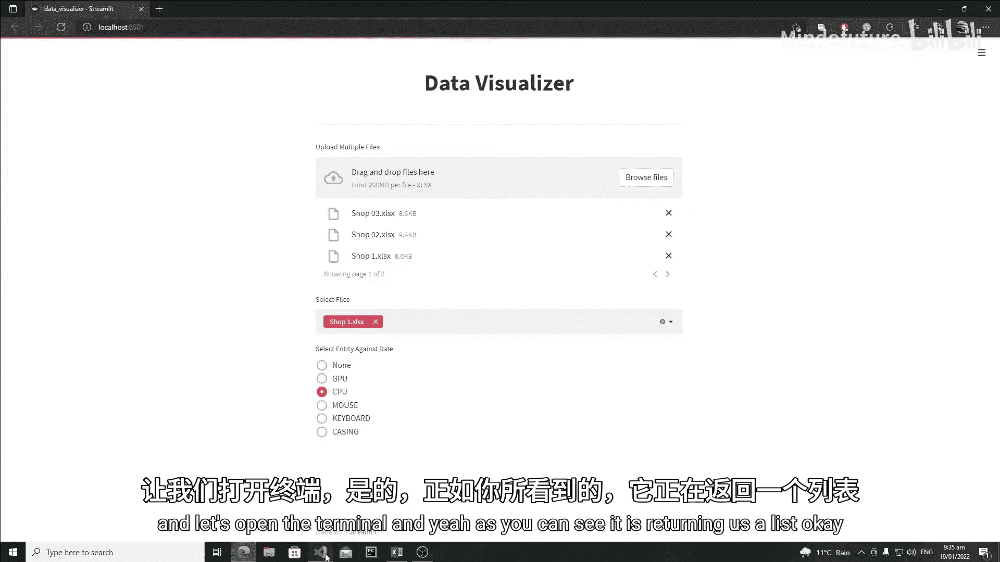

valuealues1 will be the dead and other one will be the time so I will extract only the first value which is the debt okay and I think for this purpose I will create a separate function okay so just create here a separate function like somewhere here okay or maybe above everything so just right here de and I will say DT D underscore c or NVE ort or that converter and here I will accept this debt column so I will say DT underscore C orL call so first of all I will convert this debt column to its values okay so I will all of the values inside this L values variable and I will say DT underscore C orL call L values okay and here remove this line okay and I will set theTs debt。

Eals to D debt converter okay and then I need to pass here my that column okay so just write here S H of shop data okay and then I need to pass D debt column okay and this is how you will pass data and this function will return us values okay so I will say that R U R return R U Lt result okay and we will calculate this result So it will basically return us a list of that So let's create here an MTt list so I will say re U Lt result is equals to list this will be an empty list and now after extract an information I will say V values dot I will loop through each value so just right here for the value in V L values is okay for value。

valueues and then I will say we value dot sv Lt split okay and I will split this value based on this T okay capital T so just put this double chs and right here capital T and then I will access the first element of this list which is the data okay so just right here dot or not dot just put these square brackets and write here0 and just remove this dot okay and this will access the first element and I will say that Rlt result dot aP and the append okay and I will append my result inside this result list and finally I will return this result bus but here again this is a thattime object okay so we need to convert this whole part into string before we apply the split operation So here you just need to write SR string and then you。

To put this value inside the string okay and now let's save it and here I will print these dates okay。

 so just right here， V are I and T print the AT is dates okay and now I think we will get a better output so let's save it and let's reload this application again。

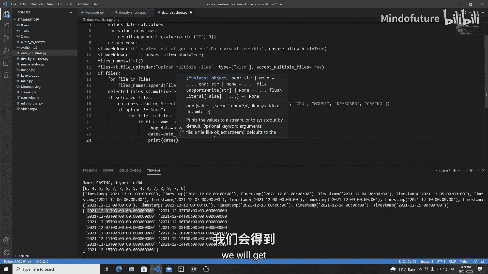

Browse files， O， just select these four files， select shop one or maybe shop2 data。 Okay。

 and then select this GPU。 And now let's see the output on the terminal。

 And yeah now we are getting a very， very cool output。 we are only extracting dates。 Okay。

 and now I will print these dates on my X X is using math plotlib graph and my other stuff on Y axis。

 but we will do this process in the next tutorial till that point bye bye。😔。

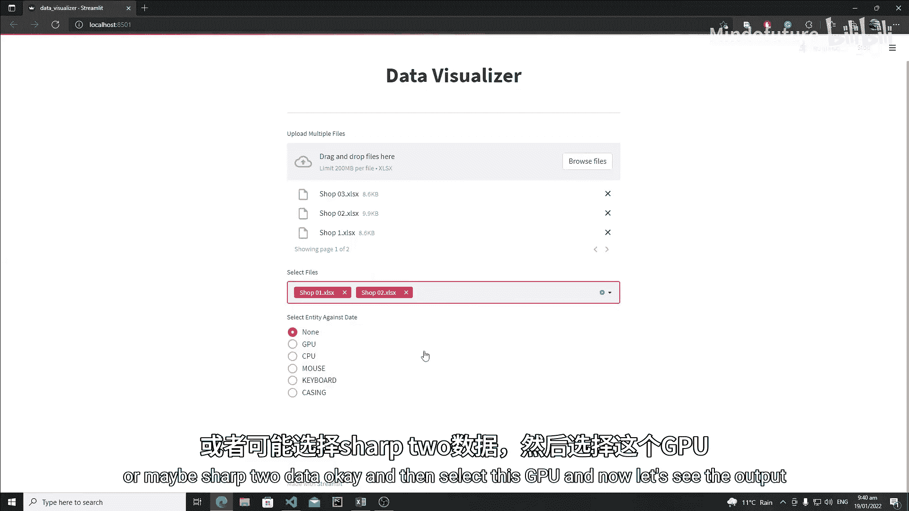

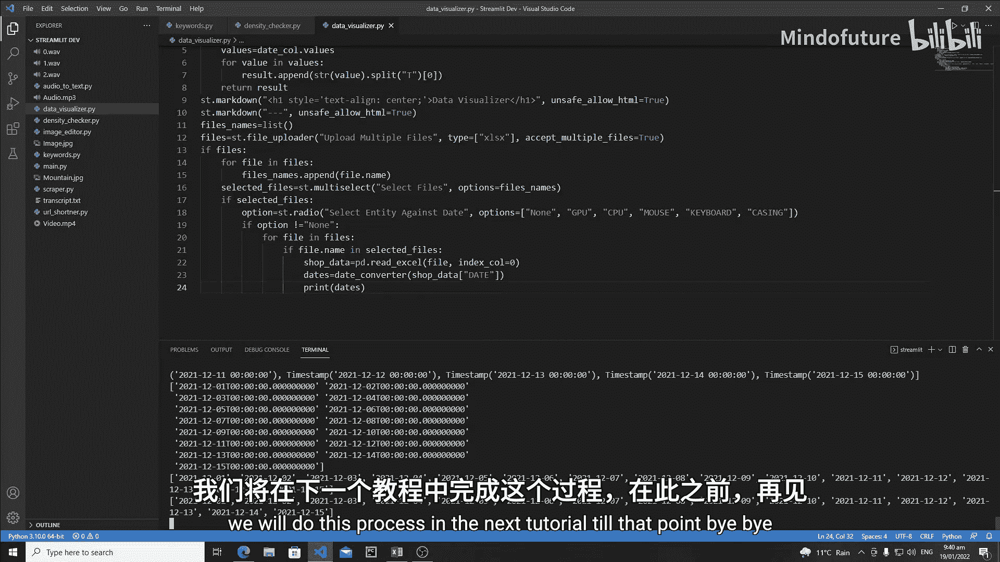