# Python-Streamlit-完全教程-p39-P39-Streamlit-Data-Visualizer-Web-App---Complete-Streamlit-Python-Course---Tutor--BV1yHVhz1EUD_p39-

Hi everyone in this tutorial we will visualize our data so for visualization you can use different visualization libraries of Python but I will go with Matplotlib so just right here I am I am from mT from Matplotlib I importpl S PlT So if you don't have Matplotlib then make sure that you should install it so just right here PIP install Matplotlib and this will install Matplotlib but if you get any kind of error this means that you do not have Microsoft visualual C++ build tool so just go to the official website of Microsoft do co and here in the visual Studio you will find a section with the name build tools and just download those build tools and if you don't know just go to YouTube and there are a bunch of videos and tutorials out there on how to install build tools。

Just download and install build tools and then install mathplotlib using PIP command okay and after installation of Matplotlib just to restart your visual Studio code okay and after reopening the visual Studio code just import Matplotlib like this and we will use this ppl module of Matplotlib and I'm importing this pplot S PLT so after importing Matplotlib first of all we need to instantiate figure okay so I will say FG U figure is equal to PLT do FG U figure okay and it's very important to instantiate figure when you are using Matplotlib with streamnet so after instantiating figure let's visualize our word data so here I will say Pt do plot not PLT do plot and then I need to pass my arguments my X values and my y values and make sure that you should pass here list。

Now here， one thing that I'm thinking is that instead of passing this data as my Xxes list。

 I will pass here a simple nuy array as my Xxs list and then I will replace the values with these dates using the xt function of mat plotlet okay so now let's create here here a simple array and I will limit it like I DX index is equals to and I will say NP do Nng range but we need to import this nuy okay so just right here IMP or Rt import and you NP and N as NP so make sure again that you should have nuP okay if you don't have just right here PIP installed NP okay so we need to use this range function of nuP okay which will allow us to create an array of specified length okay and now the length of my array。

will be equals to the length of these dates list okay so just right here LN here and then just right here the ATS dates okay and I think it will work fine and now here as an xxes I will pass my indexes okay and then for the Yxes I will pass my these options but let's create here item variable item is equals to S O shop data okay and then sharp data and then we need to pass here the column name and in this case my column name will be this option okay so just right here sorry O PT on option okay and I need to convert values to list O so just right here LIST list and then put this line inside this list function okay and now here I will pass ITM item now outside this for loop I need to print my this figure on the streamlet web app so just go outside this。

Lo and write ST dot right function and as you know very well that right function is a Swwiiss knife of streamlit so with the help of right function you can actually write anything on streamlit Web Okay so I will use ST dot right function and then I need to pass here this figure okay so just right here FGU R figure okay and now let's run this application streamlit run data visualizer dot PY hit enter and let's wait。

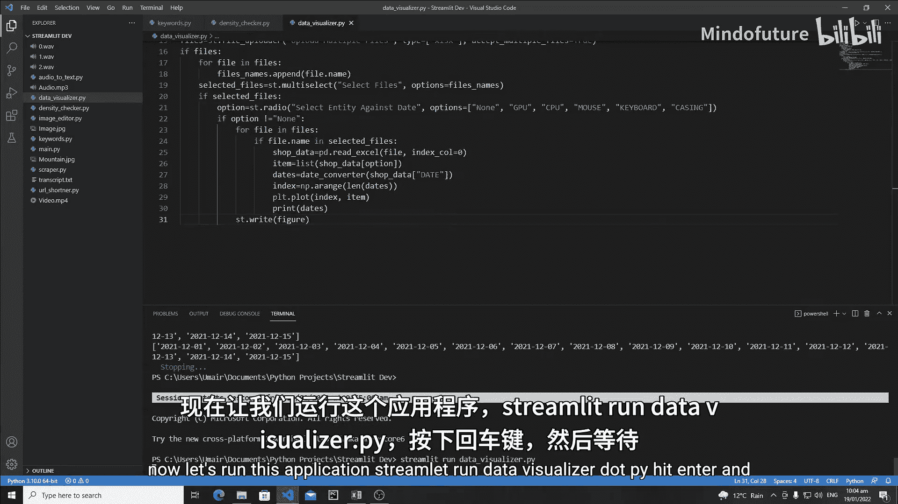

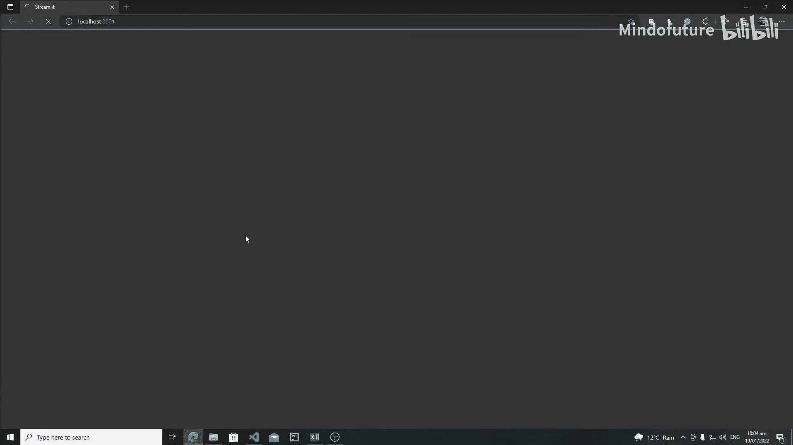

Okay， so this is our app browse files， select files， open them and select I will select this Shop1。

 this Shop2 and then this Shop3 okay， and I will visualize this maybe let's for now just remove these two shops and just select this GPU。

And yeah， this is my graph So it's looking awesome okay so this is how you can actually visualize this graph。

 but currently I know I know very well it's very， very weird。

 So we will modify this graph as well and now let's suppose that if I want to visualize this mouse item yeah it's mouse and what if I want to visualize more than one Shop O so let's select here Shop 2 as well and let's select here Shop 3 and as you can see it is updating in real time Okay so now we have this line for Shop 1 this blue for Shop 2 and then this screen for Shop 3 I think so okay so we will assign levels in a movement as well so don't worry but let's visualize this keyboard and yeah everything is working fine so this is how you can actually use streamlit for data visualization and it's working fine now let's modify this graph for now and here as you can see that we have0123。

Ne to replace these values with actual dates okay and for this purpose I will use xt function of math plot clip so upon with we scored again and here here where is my okay so here I just need to write PLT PLt dot xt okay so xts and now first of all we need to define here the value which I want to replace okay and in this case I want to replace this index is okay so just write here I D X index okay and I want to replace this index with this dash okay so just write here theS dashs okay now let's save it and let's rerun this application again。

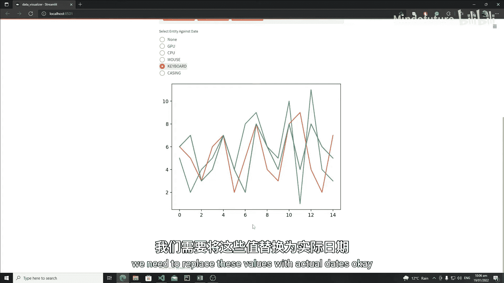

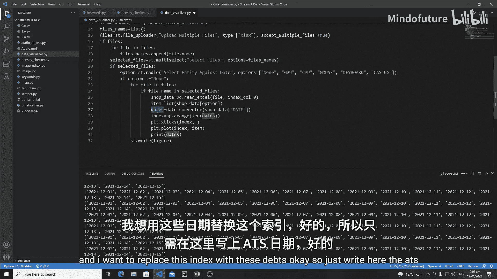

Browse files， select these files and select Shop  one， Shop 2， O， select this GPU。

And yeah but but here is a plugin that is as you can see my these dates are overlapping so how to solve this problem so the solution is very simple here we need this Xt so you just need to write PLT dot GCF okay get current figure dot AUT or auto format FMT auto format underscore X D A X data okay and then this will solve our problem so it's quite a big line。

 but yeah this is what it do okay so let's save it and now let's refresh this thing。

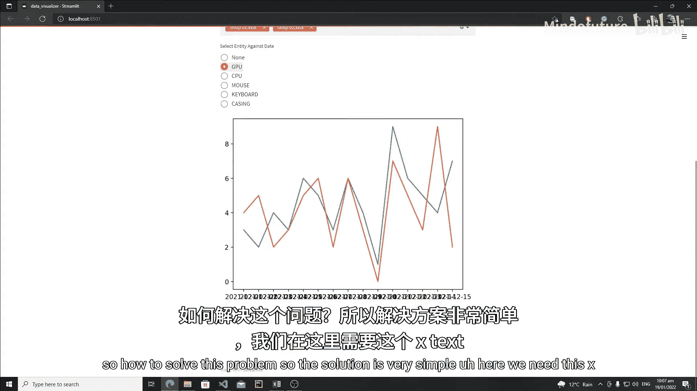

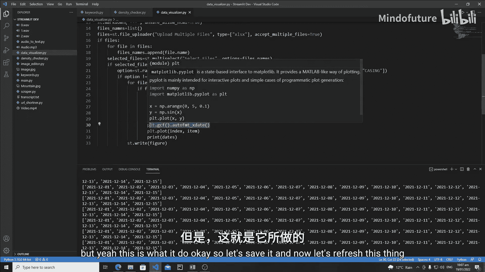

Browse files。 select these four files。 Okay， and shop 1， shop 2。 Okay， GPU。

And yeah as you can see now we are getting quite better output okay so we have tiltness in our labels okay and now let's modify this thing a little bit more and here I'm thinking that I will assign a label here and a label here and then I need to assign a title here and I need to enable a grid system inside this as well okay so let's do this process so first of all let's write a label okay so just right here PLT do X level okay and on my x is my label will be theTE data okay and then for my PLT do Y level my Y label will be like sorry ITM item okay and let's save it and now let's before I actually reload it let's give a title as also PLT do TTLE title and my title will be something like C。

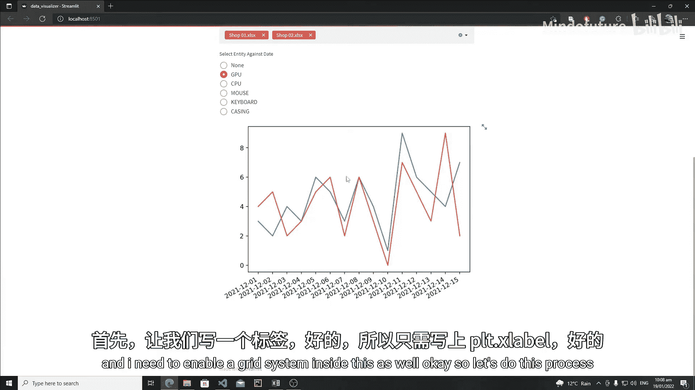

H ART chart okay and let's enable grid system as well So just right here just right here。

 PL T do G R I D grid okay and then by default it will be false so we need to make it through So just pass the are you through here Okay and now let's save it and let's reload this application let's browse files okay select these four files open them select file of Shop2 shop one Shop 2 CPU。

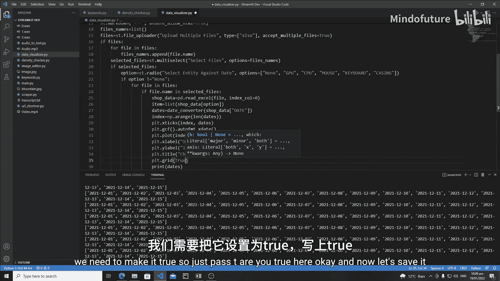

And yeah now I think it's looking quite good， but again here I am thinking that instead of writing here item or charts。

 I will write here that item name which is I'm currently visualizing and here I will write the same thing okay and as you can see here we are visualizing CPU so instead of writing here item I will write here CPU and instead of writing here chart I will write here CPU chart okay so let's do this process and here is my item so just remove this thing okay remove it and I will pass my option here so O I an option okay and here I will say O I an option plus okay and then this chart but make sure you should use a white space。

 a blank space here okay and I also I'm also thinking that I will use here some kind of markers okay and。

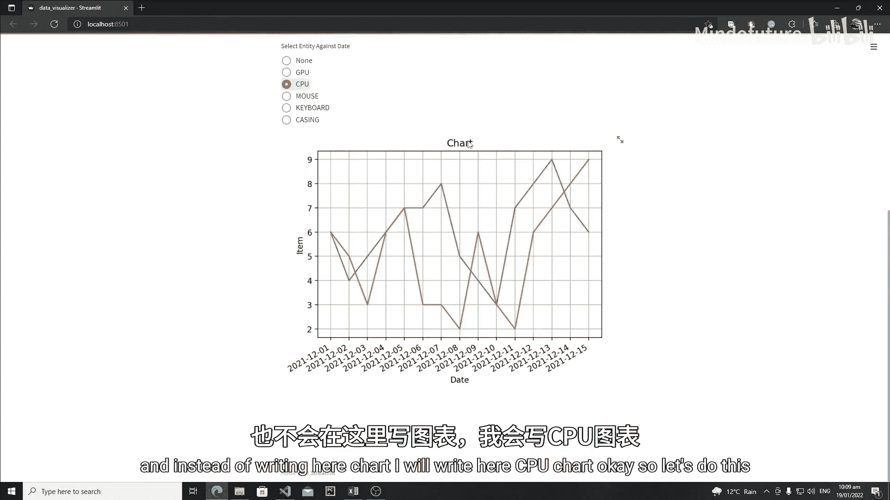

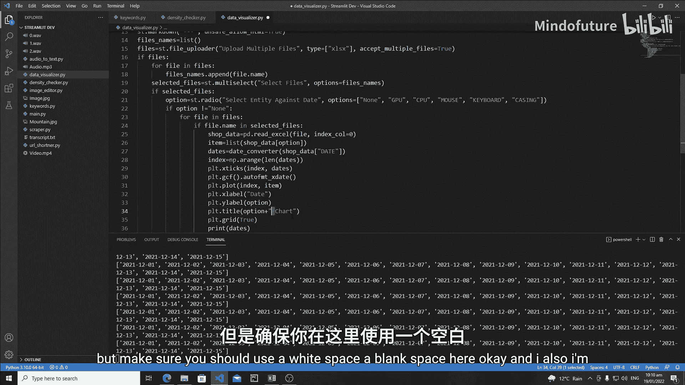

I will use here some legends for these lines okay in order to distinguish between each line okay so let's use legends and markers so here where is my where I am plotting this line okay so here I am actually plotting the line okay so for Le I will pass here a label okay so just write hereE level is equals to and then my label will be the shop name okay so just right here FL file do name name okay and let's assign a marker to it as wellER marker is equals to and I will use circular marker so the symbol for circular marker in mat plotlib is this okay let's save it but my label is where not work okay so we need to write here an extra line again so just write here PLT do LG and the Le okay and now you will be able to see these markers so let's save it。

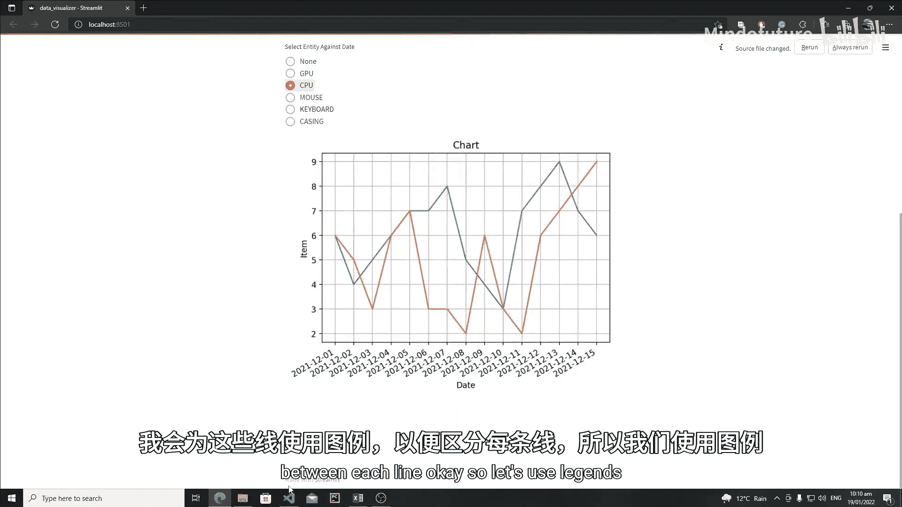

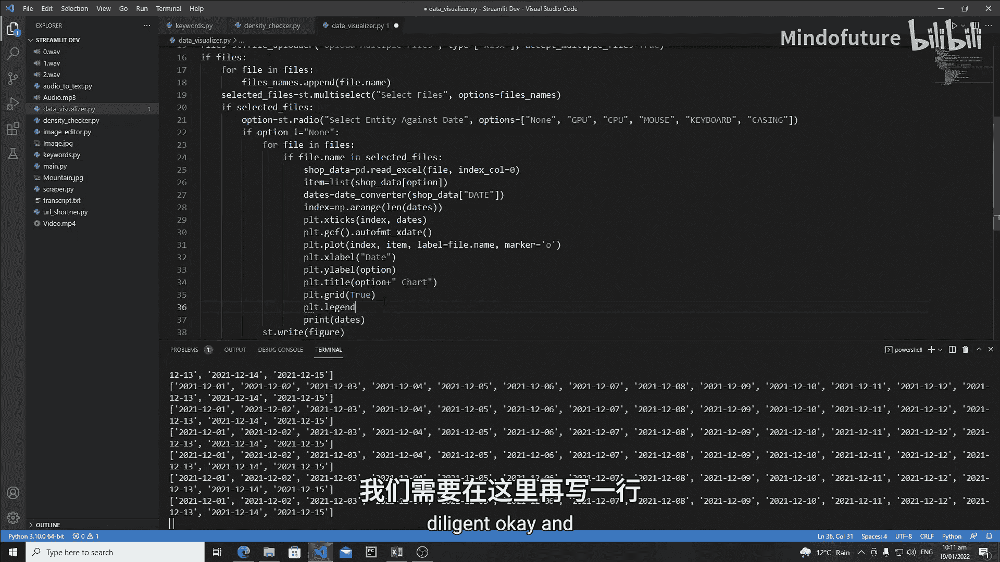

And let's reload this application again， just browse files， select these for files， okay？

Select Shop  one， Shop 2， and then shop 3， okay， and let's visualize this GPU。

And yeah now I think my graph is looking quite good okay， so we have here GPU， we have here De， okay。

 we have here GPU chart and these are all my legends okay and then we have these markers and everything is quite good and one important thing that is it is updating in real time so if I click on this mouse。

My graph has updated we have now mouse chart here we have mouse and everything else is fine。

 Okay so if I remove this Shop3 from the list okay from the selected files just remove it and now I have only two lines Shop 1 and Shop2 and this legend is also positioning itself automatically okay so I hope the hoteler you have enjoyed this data visualizer app and you can add bunch of features to it you can add bar charts you can actually track your information in real time using different Python modules and I will see in the next tutorial till that point bye bye。

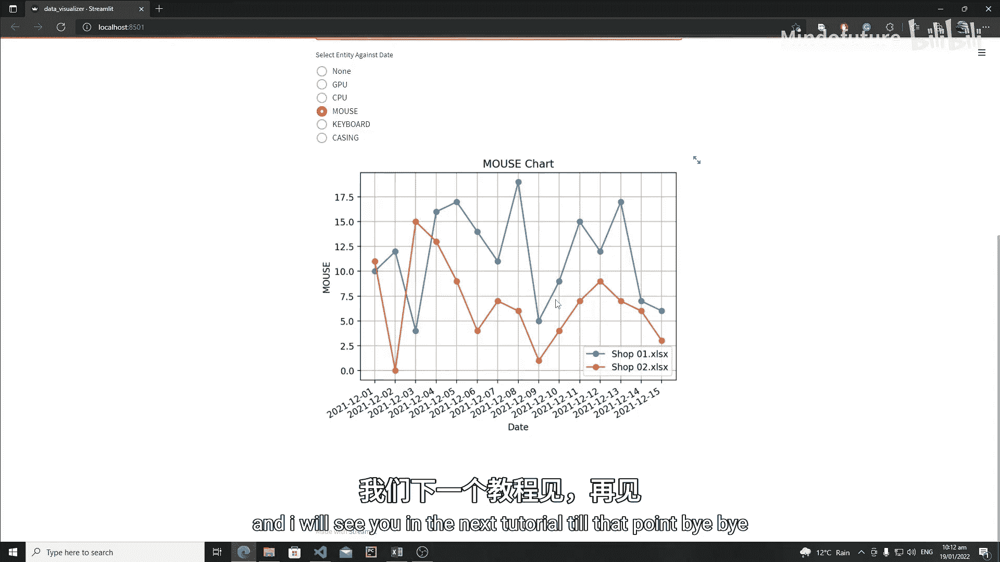