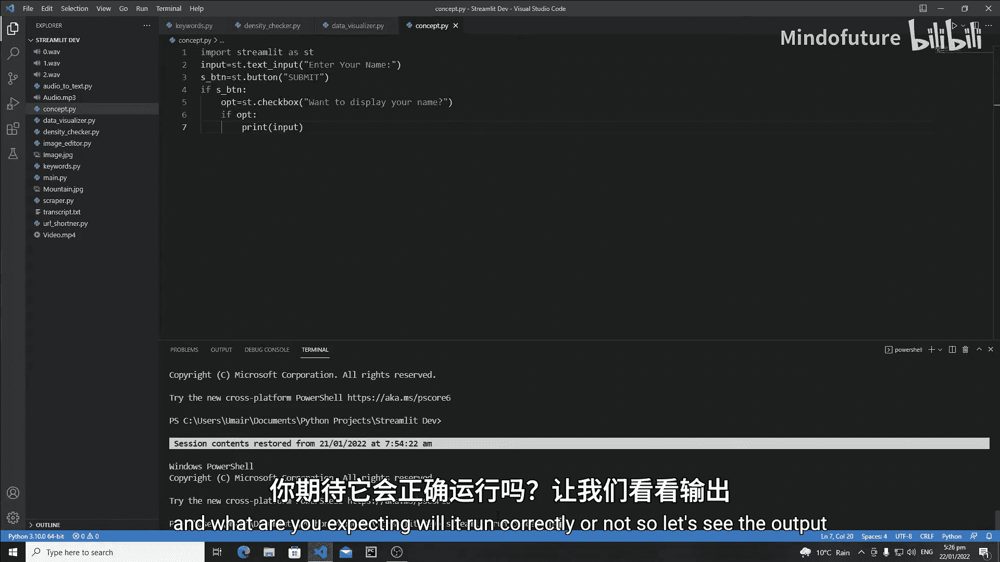
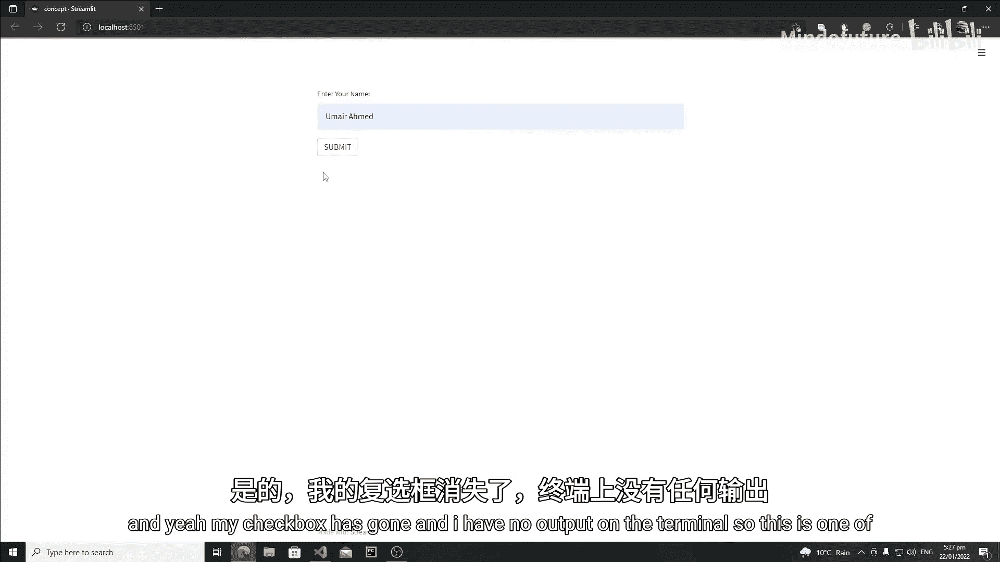
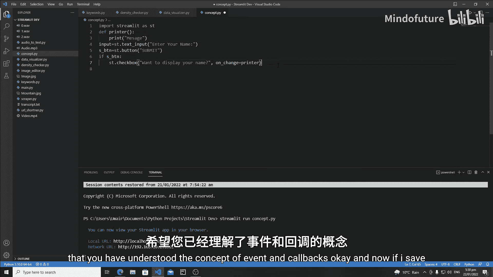
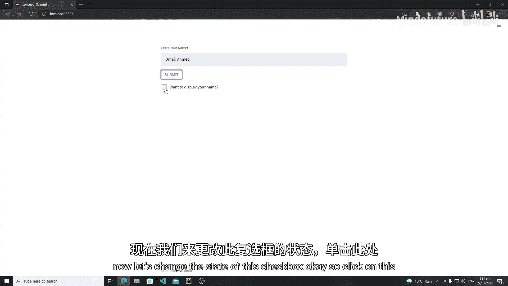
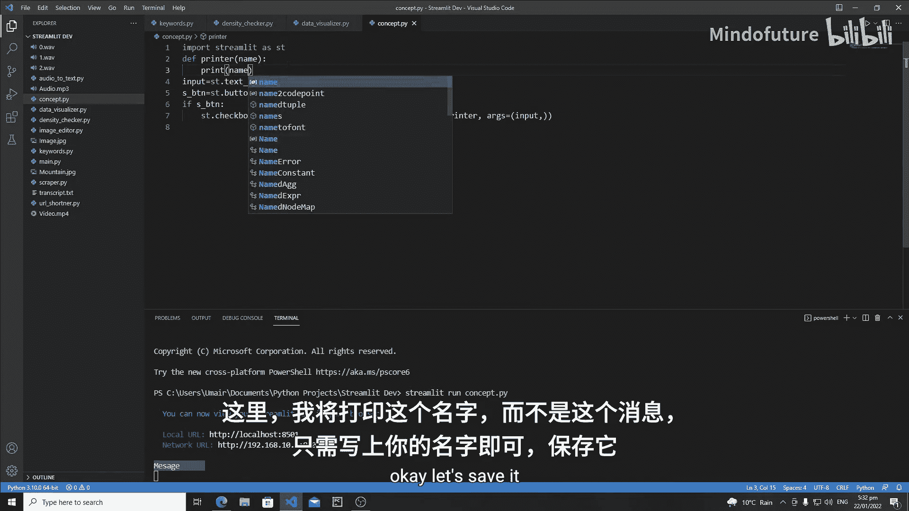
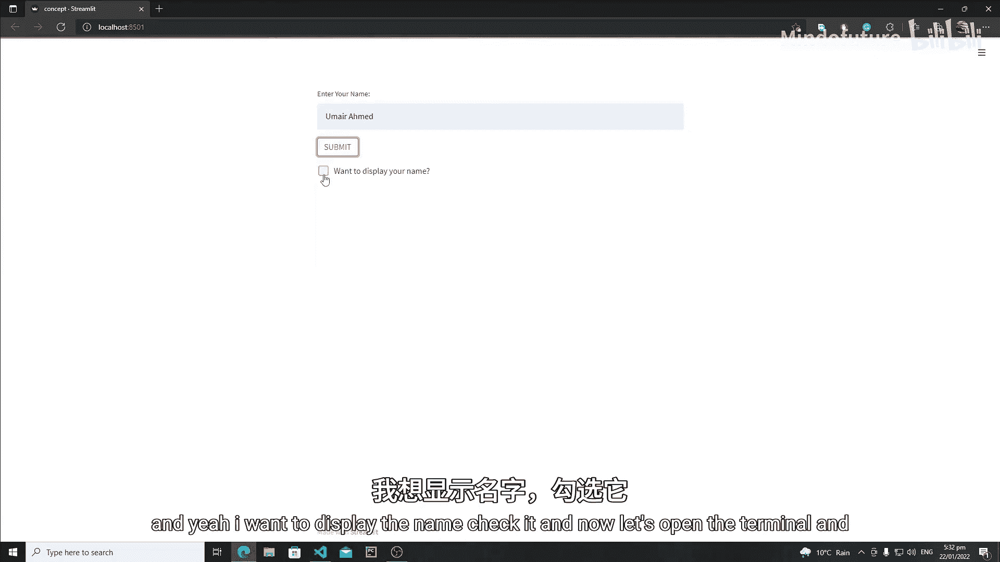
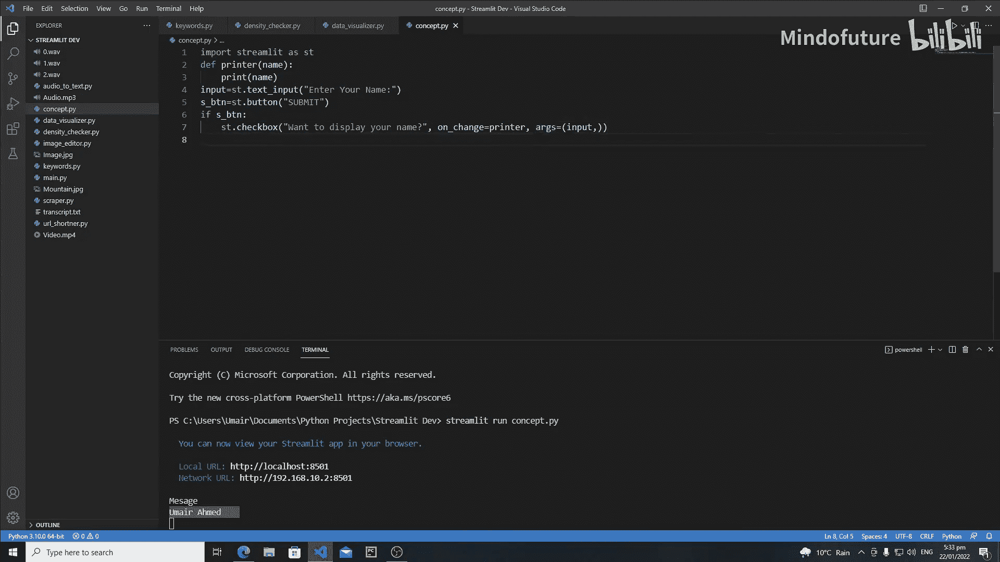

# Python-Streamlit-完全教程-p40-P40-Call-backs-Properties-In-Streamlit---Complete-Streamlit-Python-Course---Stre--BV1yHVhz1EUD_p40-

Hi everyone in this tutorial we will talk about conceptual programming in Stlit and these concepts are very。

 very important when it comes to real world scenarios so first of all in this tutorial we will discuss callbacks of streamlit so callbacks are simply functions which will occur at a certain event and that event can be your button click or that event can be a radio button options okay whenever someone selects a different option of the radio button that event may occur okay or it can be a checkbox sta changing as well okay so whenever someone changes the state of the checkbox that event may occur so these callbacks are very。

 very important and you will go through different types of situations where you need those callbacks and in this tutorial we will discuss one of the simplest situation of the callbacks so without further discussion let's jump right into the practical work and let's create here a simple。

File okay and I will name it like C N C EP concept do P okay and then hit enter So first of all。

 we need to import streamlets So right here It input sorry let's remove this S and import E L streamlet as and now let's create here a simple text input So just write to S do Txt text underscore input okay and now let's say that I want to fetch the user name so just right here E or your enter your name a simple situation okay and I will save my this input inside this IP input variable and now let's create here a submit button as well so just write to your S underscore BN is equals to S do B U button and just right here S and now whenever user clicks on that submit button。

need to display a checkbox okay so just write here I underscore BT and okay B T and okay and I need to write S do C E a checkbox okay and now here let's suppose that whenever user checks this checkbox I need to display his or her name okay so just right here want to display1 to DIS P display your name okay so we will ask a question and based on this output。

 we will process everything else okay so just right here OT is equals to and here let's write if OPT is true if user has check this checkbox we need to print this input variable so just write here INPT I N PT input now let's save it and let's run this application S R E L IT streamlet。

R UN run CncCP concept do py okay and what are you expecting will it run correctly or not。

 so let's see the output。

Okay so here we need to enter the name so let's enterhammed and then just click on this submit and we have a widget so I want to display my name on this terminal but whenever I check this checkbox what are you expecting so let's check it。

And yeah my checkbox has gone and I have no output on the terminal so this is one of the situation where you need to understand the concept of callbacks so before we jump into callbacks concept it's very important to understand behind the scene concept of streamlit so whenever user change the state of this checkbox the streamlit application reload or rerun this whole script and this whole lines from this start and whenever this streamlit comes to this point we are actually checking that if the state of button is true or not then we need to process everything else so here whenever it comes we will not click on that button and it will stop its operation until and unless we click on this button and whenever we click on that button it will open this checkbox it will show up this checkbox and whenever we change the state of this checkbox it will。

rerun this whole application and we will never get this print message so in order to solve this kind of problem we need to use callback so callbacks basically changes the behavior of streamlet back and programming so before it actually runs the hall program from this start it runs the callback first and then all other functions okay so for example let's remove this line and let's remove it as well okay and now here let's create a function okay and that function will be our call back so just right here de and here I will say PR and TR printer okay and I want to print something okay so just put this call and then right here print and here I will pass I will print a message like meW SG message okay and then here I will pass my this call back okay and here I will say that procoma and then on underscore the score change so stream。

It basically provides us two different types of callback So one is the onchan callback and other one is the on click callback okay and the on click callback is basically related to buttons whenever someone clicks on the button you need to call the on click callback okay and whenever user changes the state of the interactive widgets of streamlit you need to call this on change callback okay so checkbox is an interactive widget of streamnet that's why it will support this on change callback okay so just right here on change and then we need to pass here the function name and in this case my function name is this printer okay so just right here PRI NR printer okay so now I have mentioned you that this is a callback so this is actually not a callback our callback is this this is an event okay so whenever this event records we need to call this callback okay so I hope that you have understood the concept of event and callback。

Okay， and now if I save it and if I run my this program， you will see that we will get our output。

 Okay， so let's inter here any kind of demin name。 just click on this submit。

 and now let's change the state of this checkbox。 Okay， so click on this。

And upon the terminal and now we are getting our message now we need to understand the backend programming of streamlit so whenever we change the state of this checkbox。

 the streamlit will basically run this line first okay and then it will run this one this one and everything else okay so before it actually runs the hall program it will first run the callback and then it will rerun the hall program and that's the reason why we are getting our required message now here in many situations we also need to pass some kind of arguments call back so the process is again very simple you just need to write here AgS As property okay and hit enter and here you need to define your arguments in form of a tu so let's create here a simple tuple and in this situation I need to pass this input so just right here I P input and then put this comma so here make sure that you should put this comma otherwise you will get an error。

Okay and now here inside this callback function we need to accept an extra argument and that will be like an me name okay and here instead of this message I will print the name just right here an me name okay let's save it and let's reload this application again and let's pass the name here and just click on this submit and yeah I want to display the name check it and now let's open the terminal and yeah we are now getting our name so this is how this callback concept will work okay and I hope that you have understood how callbacks work and how to pass arguments to the callback and I will see in the next tutorial till that point bye bye。

