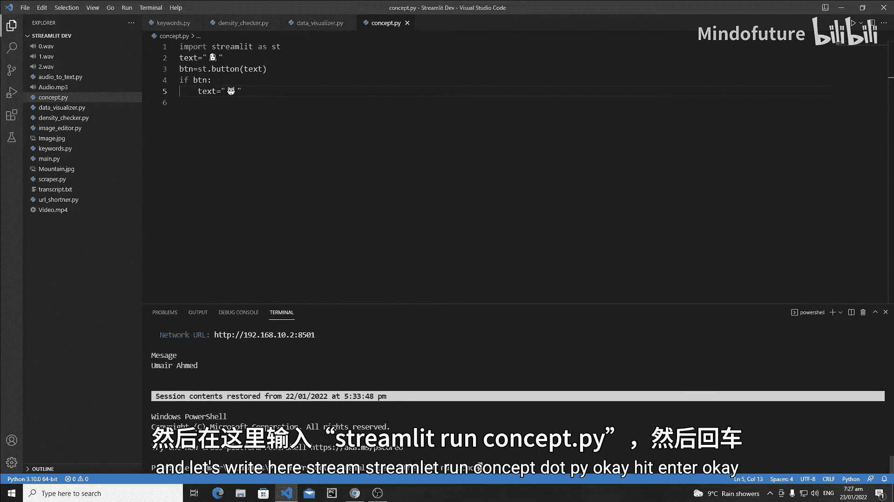
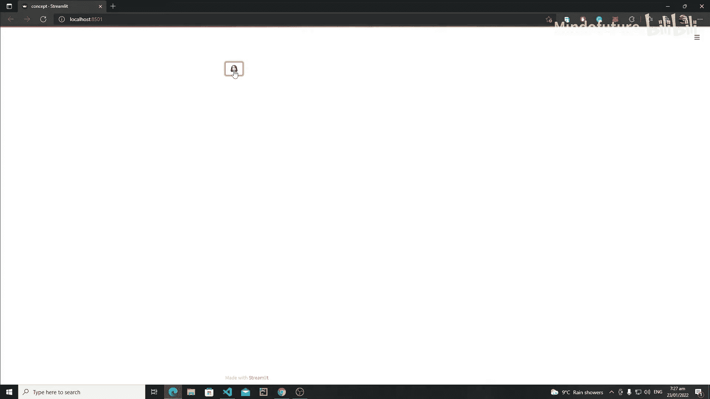
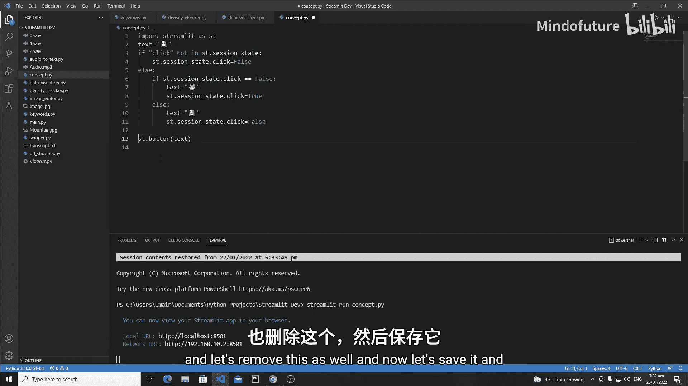
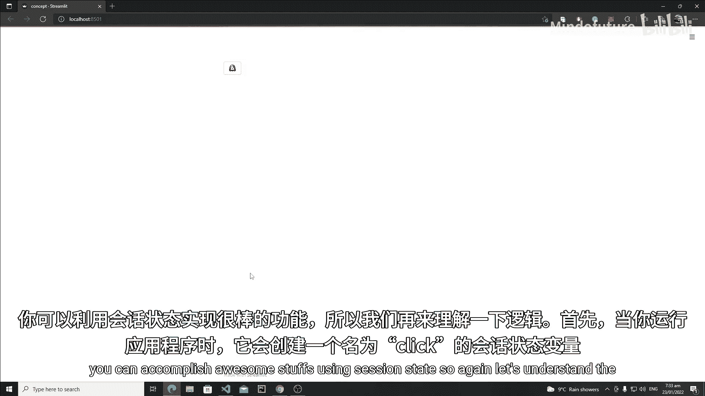
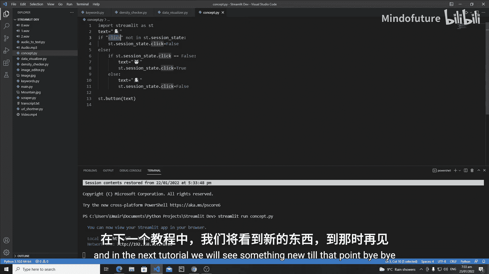

# Python-Streamlit-完全教程-p41-P41-Session-States-In-Streamlit---Complete-Streamlit-Python-Course---Streamlit-T--BV1yHVhz1EUD_p41-

Hi everyone in this tutorial we will talk about session sta so the concept of session sta is very。

 very important in streamlit and it help us a lot so first of all what is session sta so it's a way of sharing variables between regions for each user so if you want to refresh your browser but you do not want to lose your variables and their data then session sta will help you a lot and we will see it in this tutorial as well how session sta make our work a lot easier so without further discussion let's jump right into the program and let's create here a simple program and here I'm thinking that I will create a button and then whenever user clicks on that button I need to change the text of that button let's create it and here first of all let's write a variable like takes the text is equal。

And instead of text I will use here an emoji and I will use a dog emoji and I hope that this will not look weird okay and now let's create here a button S dot B U double t and button okay and my TXT text will be this text not sorry not text just write here text and then nothing else okay so and I will save the instead of this button as well and I will save Bt and is equals to this okay and whenever user clicks on this Bt and I need to change the text okay so just write here t X text again okay is equals to in this case I will use a cat emoji So just paste here the CA emoji and now let's save it and what are you thinking well it work or not okay so let's see the output and let's write here S R E A M streamlet R U and run C NP。

Concept do py okay hit enter okay so this is our button okay so whenever I click on this button。

 nothing is happening and the reason is that whenever you click on the button the stream it will re the whole application okay and it will change the text again to this dog before it actually represents this so in order to solve this kind of problem。

 we have session status So session steps basically allow us to reserve the variables and their values even after red the application Okay so let's create here a simple session state variable and I will name it something like click so first of all you have two steps to accomplish the session state logic so in the first step you need to create a session set and then in the second step you need to check for that session set and you need to perform every other logic so。

we need to create a session state。 So here I will write that if my this C I click okay so this will be my variable name Okay。

 so make sure that you should pass variable name in form of a string here。

 and I will check that if my this click not in S dot session。

 So this means that if my this click variable is not in session。

 this means that we need to create it first so just write dot and session dots click here you have two different types of methods to create a session state variable one is to use this dot operator and the other one is to use square brackets like this then inside these brackets。

 you need to pass your variable name but I will go with the dot operator so just write to your dot and then C I click is equal to and this。

able will act like a booleion and the default value of this variable will be like LSE false。

 Okay so we need to make it false and this is how you can create a session state variable first of all it will check that if this variable exists then well I'm good and if it does not exist。

 this will create it and stream it will execute this block on the first run because on the first run we will not have this variable inside the session state。

 but after first run we will have this click variable inside of our session so now here after creating a variable now let's create here an else statement so E so this means that if my this variable exists then we need to perform every other stuff and here I will check that if my if doS session state。

t C L I click is double equals to L LSC false。 Okay。

 this means that if my decision state click variable is false this means that user has just clicked on this button after loading the application then we need to change the text of this button okay and Ill we also need to change this state of this click variable So just right here T E X T text is equals to and in this case I will change my text to this K so just past this text here and then I also need to change the state of this click variable So just copy this line and past it right here and instead of false I will make it to T R true and now let's write here an L statement as well So E L ELC L okay and if my user is clicking second time this means that we need to change the。

From the cat to again dog okay so just copy this line copy it and I to try it here。 and now again。

 let's change the state of this click variable。 copy it and instead of true make it to false again So false and I hope that this will work fine and now we do not need this if statement So just remove it and let's remove this as well and now let's save it and now this will work fine Okay so just reload this application。

 and just click on this dog and yeah cat and again click on this cat dog So everything is working fine and this is how you can accomplish awesome stuff using session So again let's understand the logic first of all when you run the application。

 it will create a session variable with name click and then after every button click this will execute this。

Blog， because we have this click variable， which is in our session starts。

 And I hope that you have enjoyed this tutorial。 And in the next tutorial。

 we will see something new till that point， bye， bye。😊。

