# Python-Streamlit-完全教程-p42-P42-Cache-In-Streamlit---Complete-Streamlit-Python-Course---Streamlit-Tutorial-4--BV1yHVhz1EUD_p42-

Hi everyone in this tutorial we will talk about streamlit cacheier So what is streamnet cacheching so streamlit cacheier basically provides a casching mechanism that is very crucial for optimized performance so whenever you have a very complicated application and you have to process lots of function then you need to use this streamlit casching now here you will be thinking that what is casching so its a technique that stores a copy of given resource and serves it back when requested for faster functioning so let's suppose that if you have a function and it takes around about235 for maybe 10 seconds so you need to cache that function in order to optimize the performance so that function will execute itself for the faster and then our streamlit cacheier will store the results of that function and whenever user request that。

Function the streamlit cachehe will give the results and this is how you will optimize your function using cachehe without testinging for time let's jump right into the practical word and let's create here a function okay and I will emit something likep I and T or printer or something like that and now here let's suppose that this function text around about three seconds for processing so here let's type a delay so just write your time do slp sleep and sorrym Sw ifp sleep okay and then let's pass here something like three seconds and we need to import this time module so just write your import T me time okay and now I just need to return a string after three seconds so just write your return and I will say SG message so you need to pass your message and then here。

SaS dot wR I right okay and now I need to print the result of this printer function So just right here PRR I and T ER printer okay and I hope that this will work fine now whenever we rerun our application this will take three second before it actually print the message okay so let's see the output and just type here string trend man concept do P1 and let's。

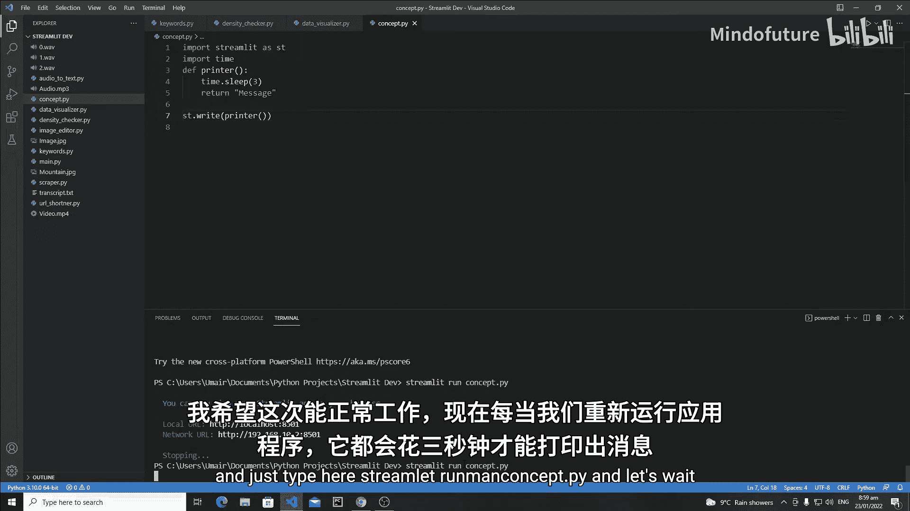

And yeah this is our streamnet application and we got this message okay so well let's reload this application again and it is running and yeah we got this message okay so this is how this thing will work so it basically takes three seconds before it print this message okay and now what if I want to cache this function so on first run it will take three second okay and then it will cache the result and then whenever we call our this printer function it will give the results without processing each and everything else so you just need to write here a cache a decorator so just right here this edit sign and then S dot C CH E cache okay let's save it and now let's reload this application and see the output okay so it's running this printer function okay and we got this message。

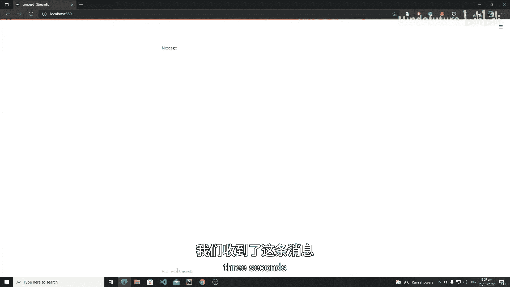

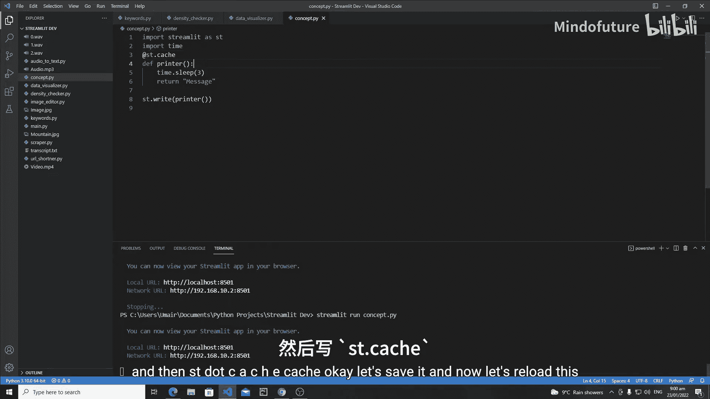

But what if I reload this application？Yeah， we got our message so it is actually not vetting for that three seconds and the reason is that we have cached this function okay and for example。

 if you click on the hamburger icon of stream it here you will find an option clear cachehe so what if I clear this cache clear cachehe and now if I reload this application。

 you will see that it will again take three seconds before it actually print this message so let's reload it it's running and yeah this is our message okay so it is taking time but if I again reload this application now it will not take time okay so this is have this cachehe work and now for example here I just want to print a message before I actually we for some time okay so just write to your ST do WIt right okay and I will say are you double NN running let's save it again。

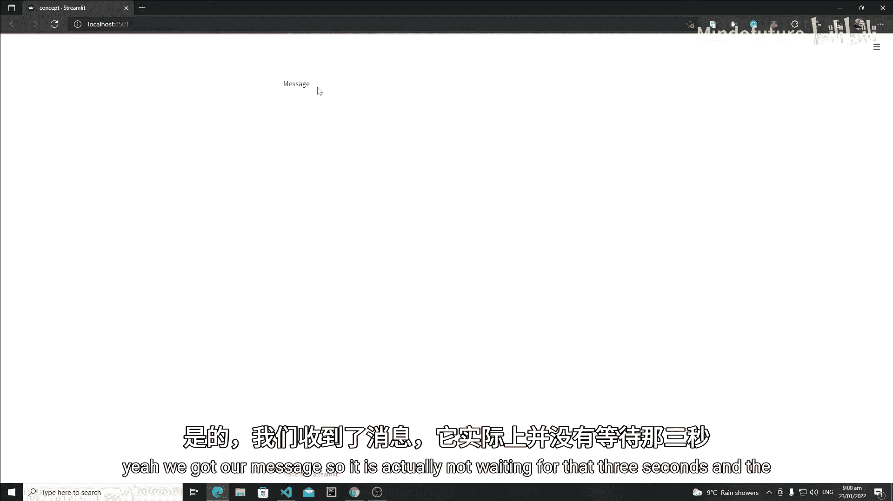

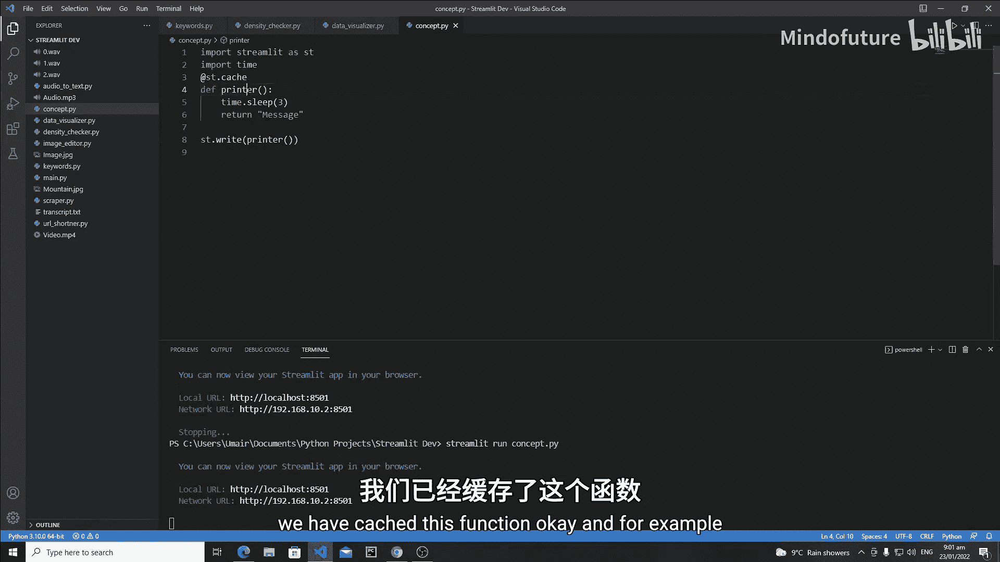

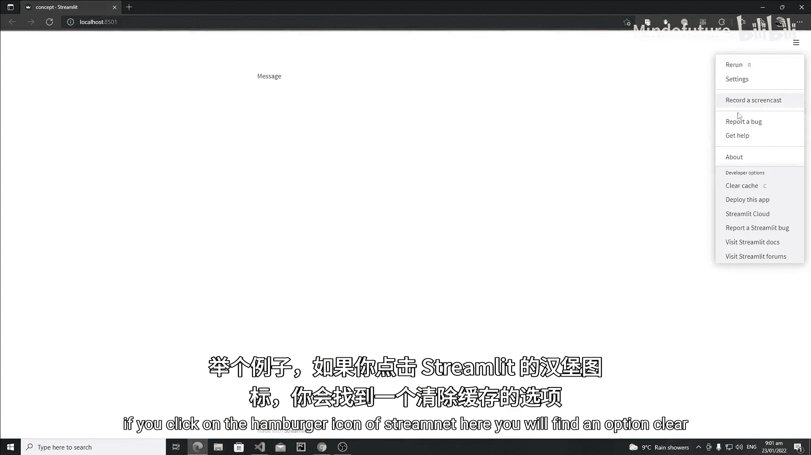

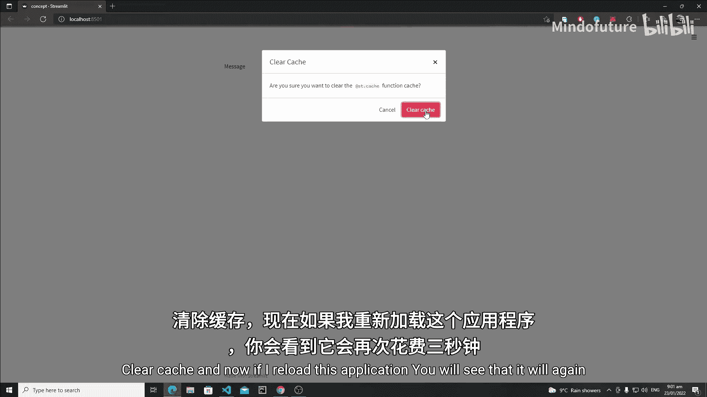

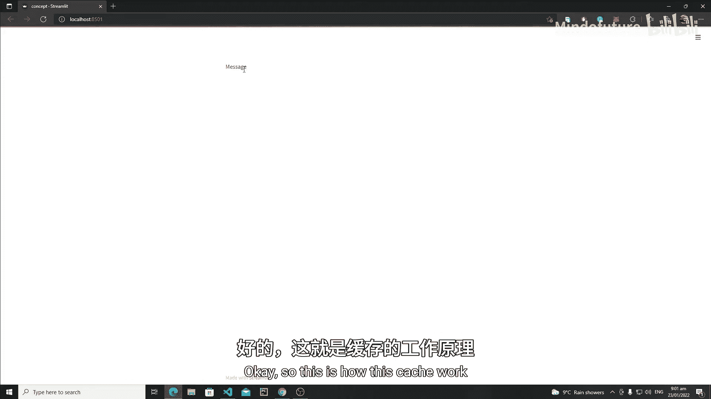

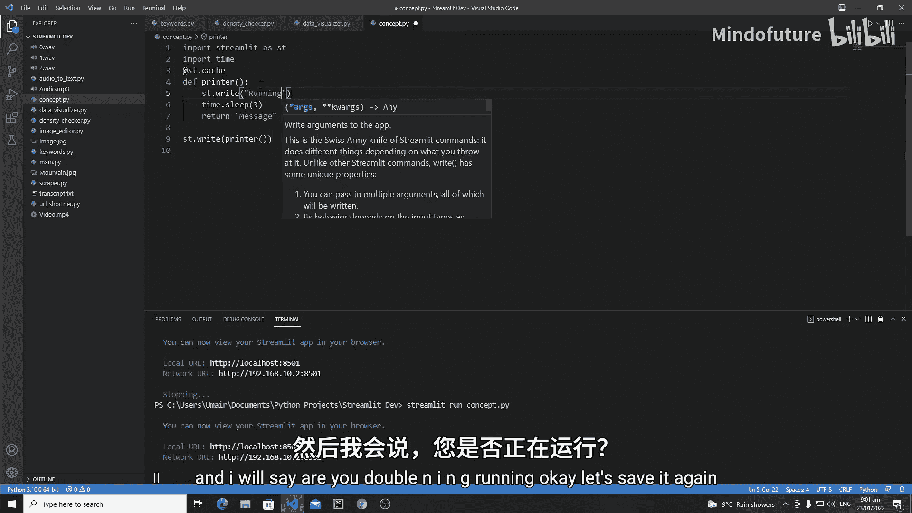

And let's reload this thing。 Okay， so we are actually getting this type of output。

 So how to solve this problem。 Okay， so the solution is very simple here inside this cacheier decorator。

 you need to pass an extra argument and that is S you P EwS suppress at warnings。 okay。

 and by default it will be false so we need to make it true Okay。

 so just write here TR true Okay let's save it again and let's reload it and now you will not see this function。

 Okay， okay， so we got our message。 Okay but let's remove let's clear the cacheier clear it okay and now let's reload it。

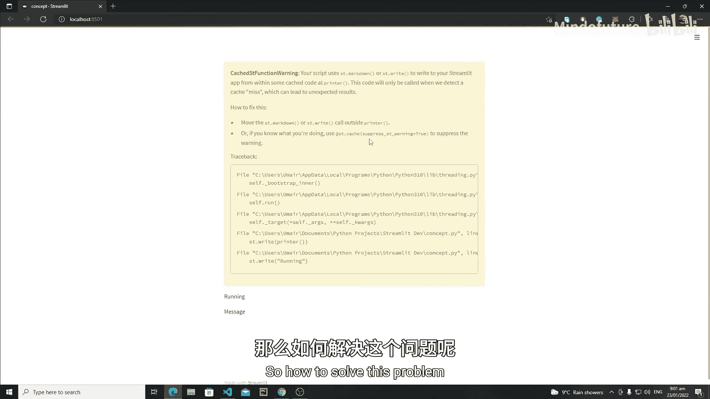

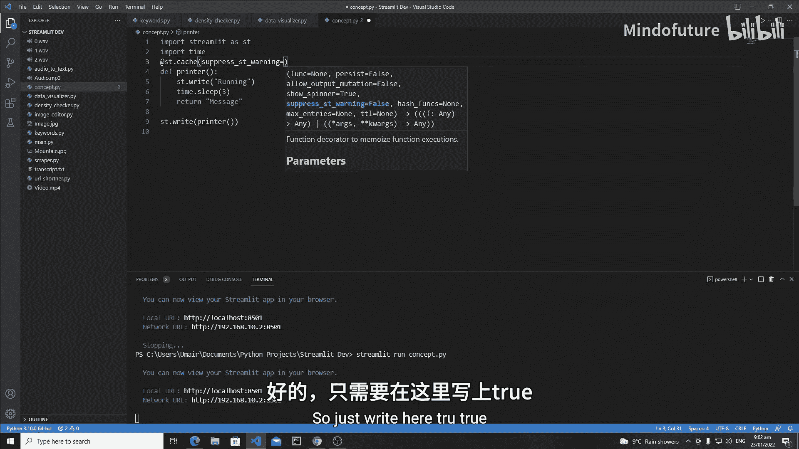

Okay， so we are getting this running message first。And then we got this message Okay。

 and now if I reload this application， what are you expecting。

 will it print this running or will it print just this message Okay， so let's see the outward。

 let's reload it。And now we are getting this message and the reason is that this streamlit has cached this function okay and streamlit has stored the output inside the cachehe and now whenever you rerun this application instead of running the whole function it will just print the result and there's the reason why we are not getting this ST trite message on the second and third and so on reruns okay so I hope that you have understood the concept of cachehe and it's very important for optimized performance and if you are performing text analysis if you are using Spy or if you are using tensorflowkiras then cachehe will help you a lot for training models because all of those models tens and thousands of seconds for training and you do not want to wait for 10 minutes or 20 minutes after every reload okay and for that purpose you need to use this cacheshe so I hope that。

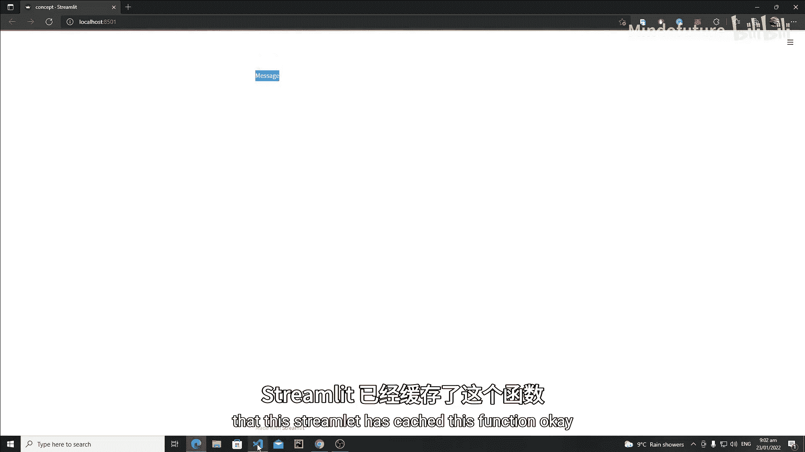

You have enjoyed this tutorial and in the next tutorial， we will see something new till that point。

 bye bye。

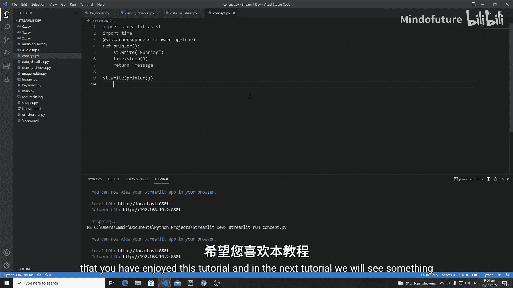