# Python-Streamlit-完全教程-p43-P43-Custom-HTML-In-Streamlit---Complete-Streamlit-Python-Course---Streamlit-Tuto--BV1yHVhz1EUD_p43-

Hi everyone in this tutorial we will talk about custom Hml and how to embed custom HTMLl in your streamlit Web app。

 So in streamlit， we have two different ways to add custom HTMLl one is to use the markdown function of streamlit which is actually an unofficial way of adding hml So the official way of actually adding HTMLml in your streamlit Web app is to use the HTMLml function of the component module of streamlit So in this tutorial we will discuss that function So first of all let's create here a new Python file sorry let me create a new Python file and I will limit something like or custom underscore hml do P and hit enter So first of all we need to import a streamlit and then inside the streamlit we need to import components module So just right here IM or import streamlit as。

Okay and then we need to import the component module okay so just right here I RRT import hR EM streamlet dot co MP E components do V1 version1 or something like that okay and that name is quite long so I need to import this as something like co okay so I hope this will work fine so now let's start embedding a custom hml so here I'm assuming that you have a very very little knowledge regarding HTMLl so there is no rocket sign in HTMLl these are just tags okay and I'm assuming that you have some sort of a knowledge regarding it okay so let's call HTMLl function so just right here CM co and then you need to write dot HTMLl HTMLl and now there is one major difference between the markdown function and HTMLl function and that is these three properties okay so as you can see。

Html function basically provides us the width property。

 We can define custom width and then we can define custom height for this function and we can enable this scrolling feature as well okay first of all we need to pass some HTML coding so let's create here some HTMLl coding so you can pass your HTML coding using these double chs if you want to embed everything。

 everything inside a single line but if you want to embed a very long HTMLl coding then I will recommend to you that you should use here these six quotation marks okay and then inside these six quotation marks you can define your HTML coding on multiple lines okay so I actually prefer this method but it depends on your HTMLl coding okay so let's first of all I'm thinking that I will write a heading but before I actually write a heading let's create separate division for it so just。

Here a div tag and then let's close this div tag here。 Okay。

 DV div and now inside this div tag let's create a heading tag okay so just right here something like H1 tag this will be my h1 tag again okay so just put here this H1 tag and now let's write here a heading and I will say this is my H E A D I and G heading。

 okay now let's save it okay and just type T R E A MLlT stream it R U and run see U okay。

 so if youve hit this tab button， this will automatically fetch fetch this name Okay。

 so hit tab and then hit enter and let's save。

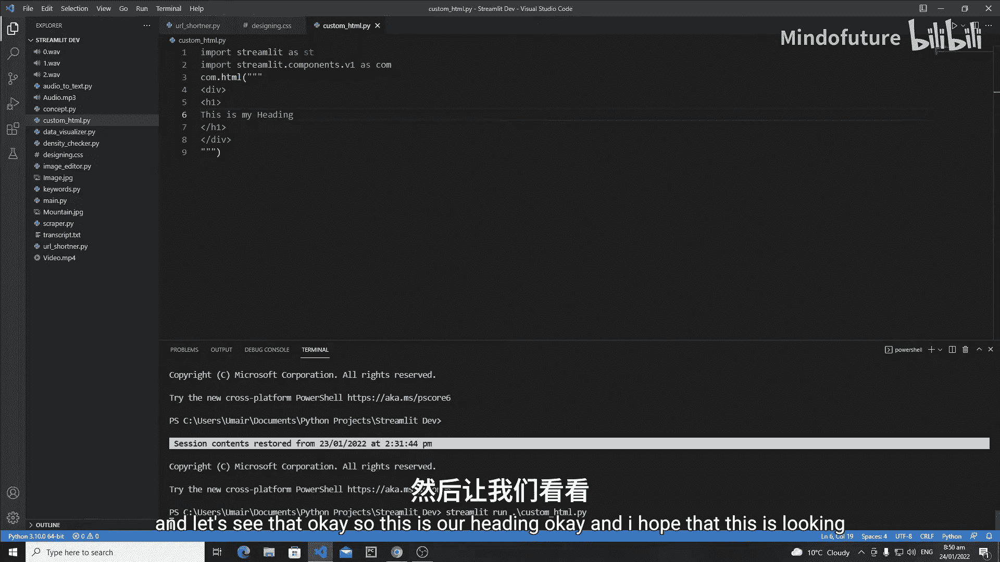

Okay， so this is our heading okay and I hope that it's just looking good。

 So now we have created this heading using HTMLl。 so we have not used any kind of mark down here。

 we have not used any kind of title function of streamnet okay so now I think that I will add here some sort of a paragraph as well so let's create here a paragraph tag inside this division and P tag okay and then let's close this P tag and now let's write here some sort of a paragraph I will use learn Ipsum paragraph and just past here okay and let's save it again and let's reload this application。

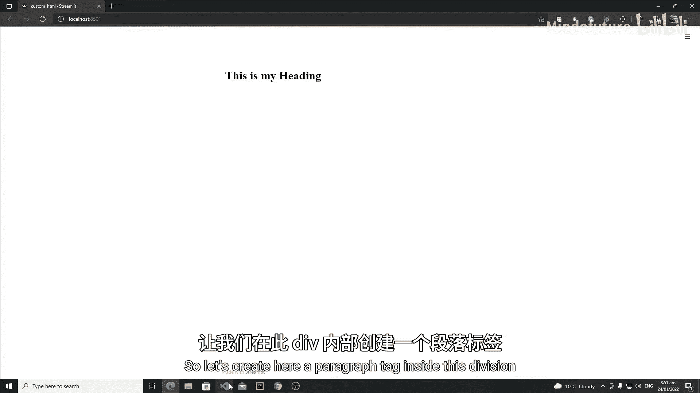

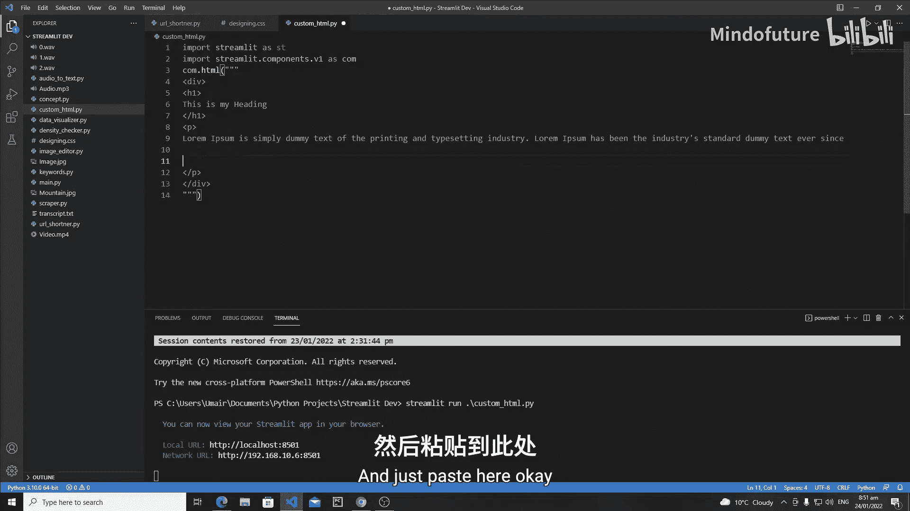

And yeah， this is my paragraph okay so I hope that it's looking fine and this is how you can actually add a paragraph using the P tagag Now let's customize this property and how we can embed the CSs inside this HTML so in the previous tutorial I have told you that how to embed CSS so there are three different ways to embed CSs one is to use the inline style attribute of CSs other one is to define the CSs in an external file and then embed it using the style tag or the third method is to use the internal CSS method okay so in this tutorial I will discuss the internal and external both of them okay so first of all let's discuss the internal method so let's create here a style tag okay so just right here style tag and then let's close the style tag clause style tag okay for example if I want to change the color of this。

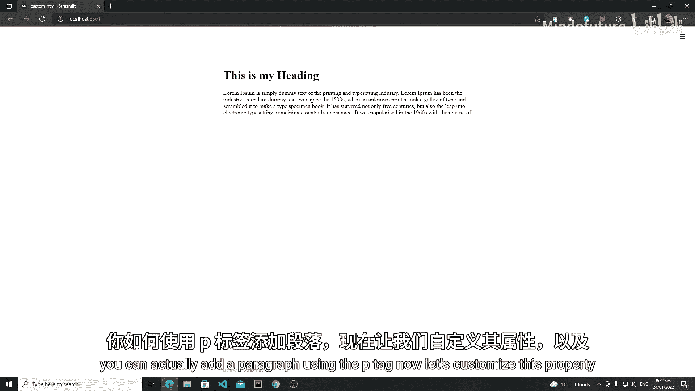

H tagag and then everything else so I need some sort of a reference so just give a class name to this heading as well so just write here CWS class is equals to and my class name will be something like heading okay this right here your heading and now just try right here H1 do H E the ING heading now inside this parentheesis unit need to define your properties for that tag and let's change here the background color first O so again I will copy some stuff okay so let's copy these two lines the background color okay and then the color itself copy it and past it right here and I will copy this border radius as well okay so just copy it and paste it here as well okay so now let's save it and let's reload this thing I hope this will not look weird this is our heading tag but as you can see here this is kind of weird。

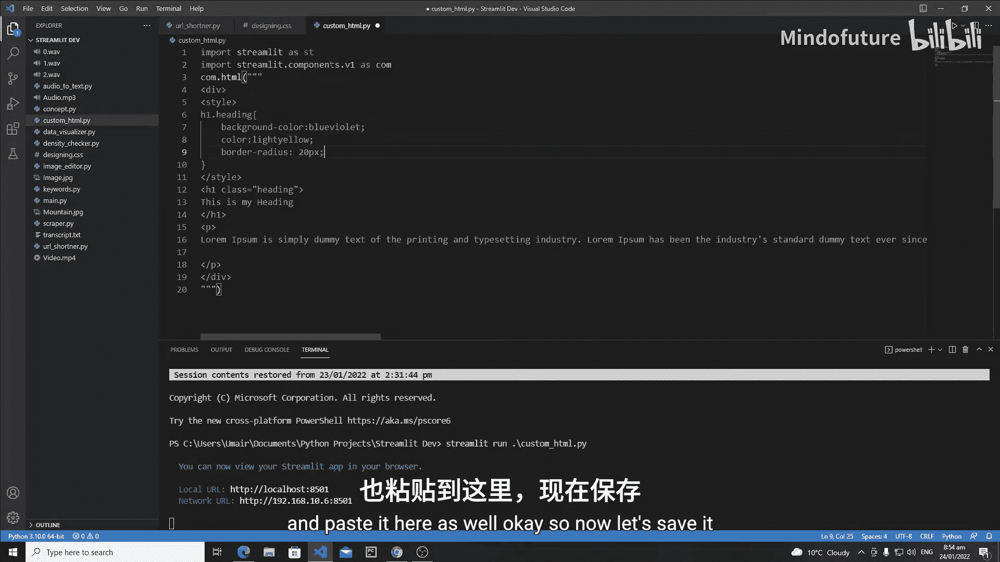

So we need to align this text in this center， so just write here another property that is TXDtigG and text align and I will make it to the center。

 okay center and just save it and let's reload it again， sorry let's reload it。

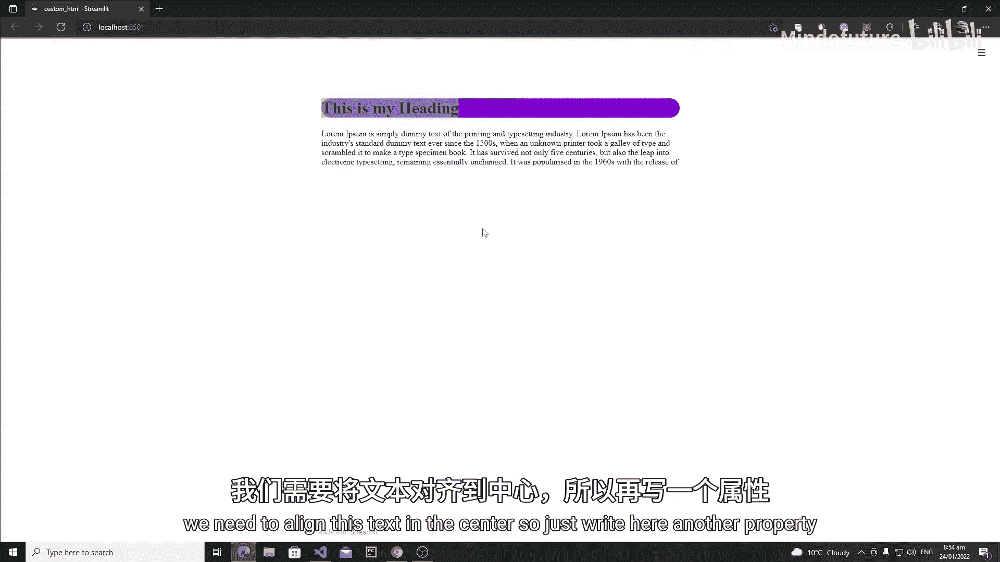

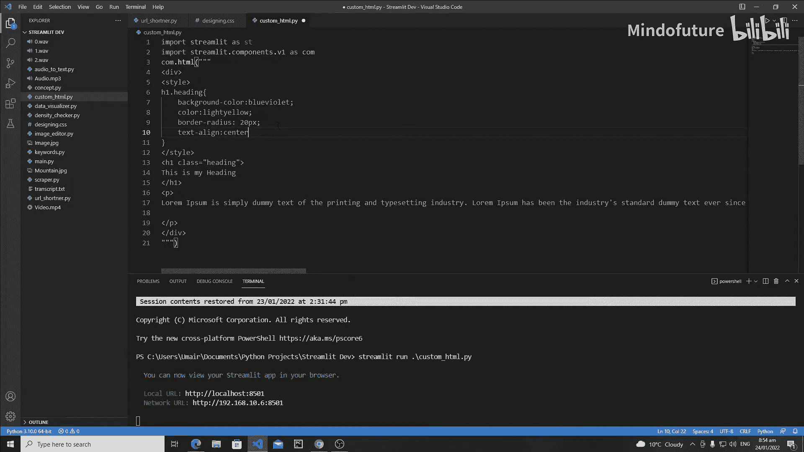

Okay so now I think it's working fine， but here one thing that I need to discuss is as you can see our lines are not visible after this off and the reason is that we need to define the height and div for this HTML text so in this case I think div is fine but I need to define the height in order to see each and every content okay so just put this comma and I will keep divt to none okay but I will say H E IgST height is equal to and I will go with something like 600 pixels okay so let's save it and now let's reload it。

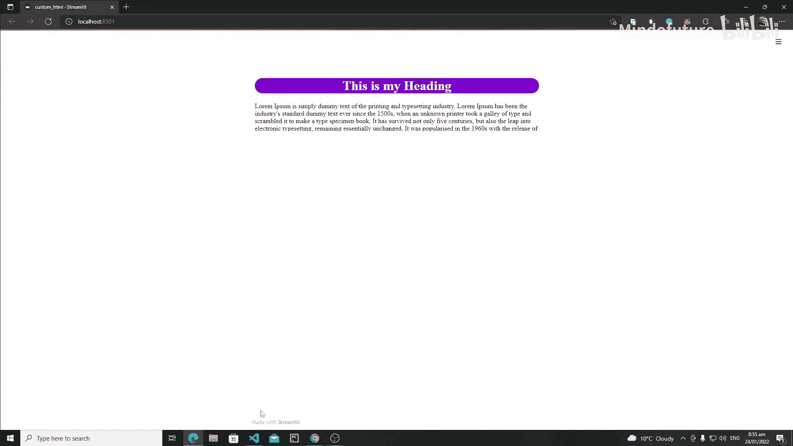

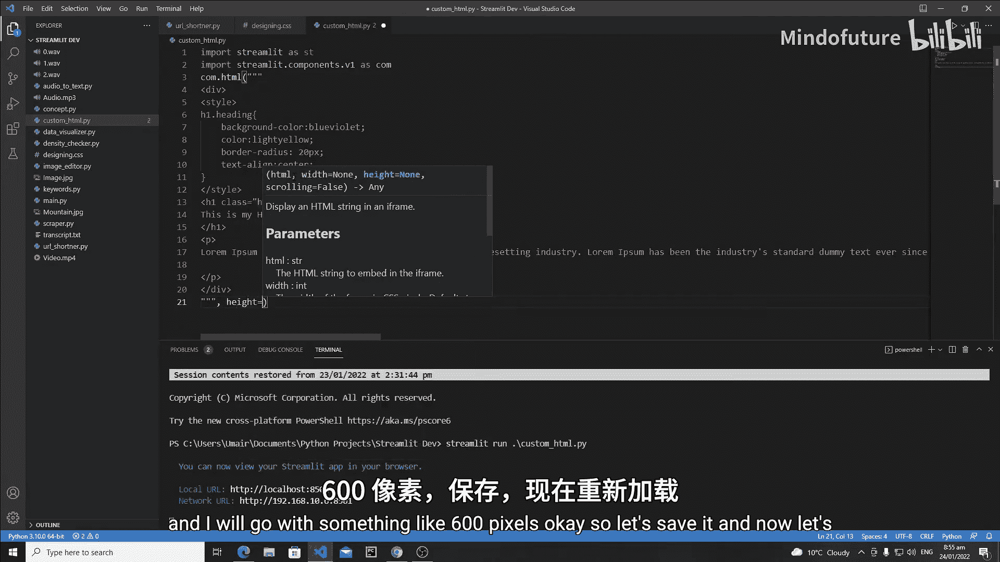

And yeah now my content are quite visible okay so this is how you can actually use this width and height property or if I do not define here my height property and if I say SCR orLI is scrolling to true okay now you will see that we will have some sort of a scrolling in this as well okay so let's refresh it。

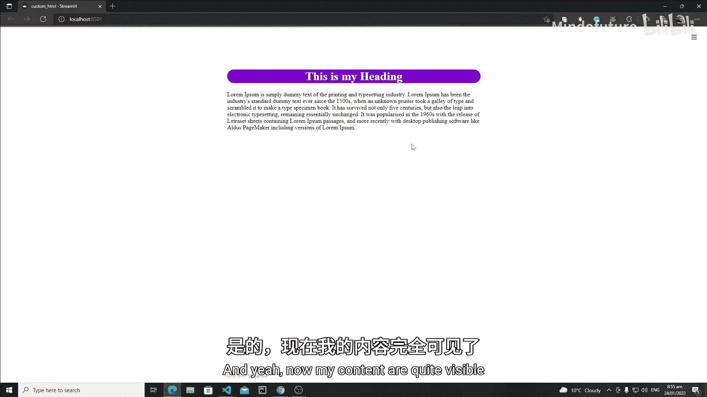

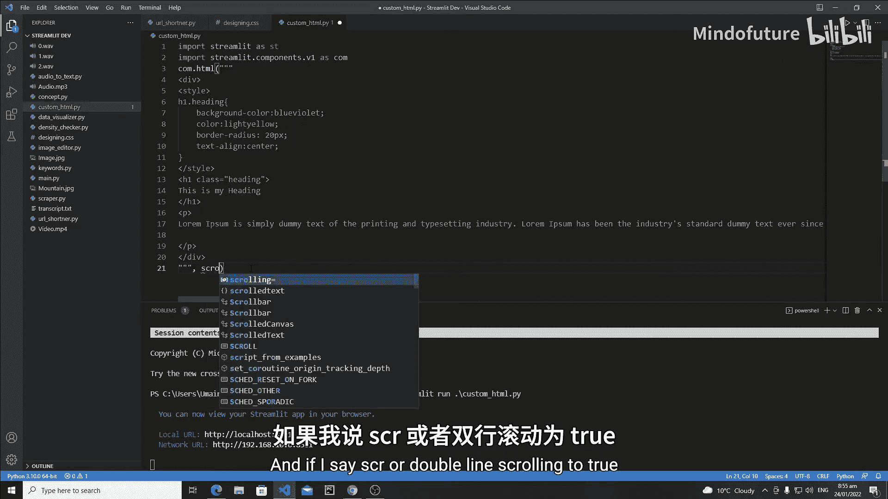

And yeah as you can see now we have scrolling because our this content is not within the box Okay so that's why streamamlit is automatically creating this scrolling for it okay so this is have this scrolling work and this is how this height work but I will go with height in this case as well let's save it now let's discuss the second method of embedding the CSs so for example let's suppose that if you have a very complicated HTMLl coding and for complicated HTMLl coding。

 you will obviously have a very complicated CSS styling as well and you will define your CSsS styling in a separate file now how to embed a separate file inside this HTMLl function So again the process is very simple you just need to open this HTMLl file in your streamlit web app and then you need to embed it so let's open this CSS file so just try it here with P and open then。

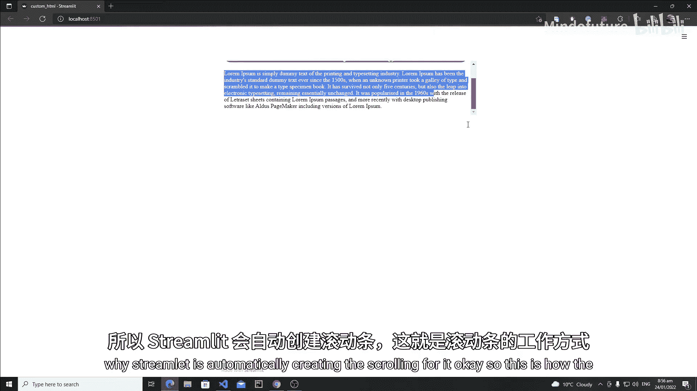

Need to define your CSS file name okay and in this case I will use this design dot cS okay so just write here D S and design do cs make sure that you should type the name correctly here it's not design it's designing designing do cS and then I will open this file as SRC source okay and now I need to store the content inside this D S and variable okay and I will say S URC source do R or read okay I hope this will work fine and now here I will use a formatted string okay so just put this F and instead of writing everything like this in this styling variable I will remove everything okay remove everything and I will put this parenthesesis here and now inside this parentheesis I will pass my this design okay so just copy this name and past it right here but make sure that you should。

Your design along with the parentheses inside this style tag otherwise this will not work okay so let's save it and now let's define here the properties for over these classes okay so just commit this part now okay so put this slash then start okay and then star and then this slash okay and now first of all we have this heading class okay so just right here h1 do H E heading okay and now let's define properties for this heading and I will use these properties copy them paste it right here okay and let's align this text request or text line and I will say seeN your center okay and let's save our work and let's reload this application and see the output。

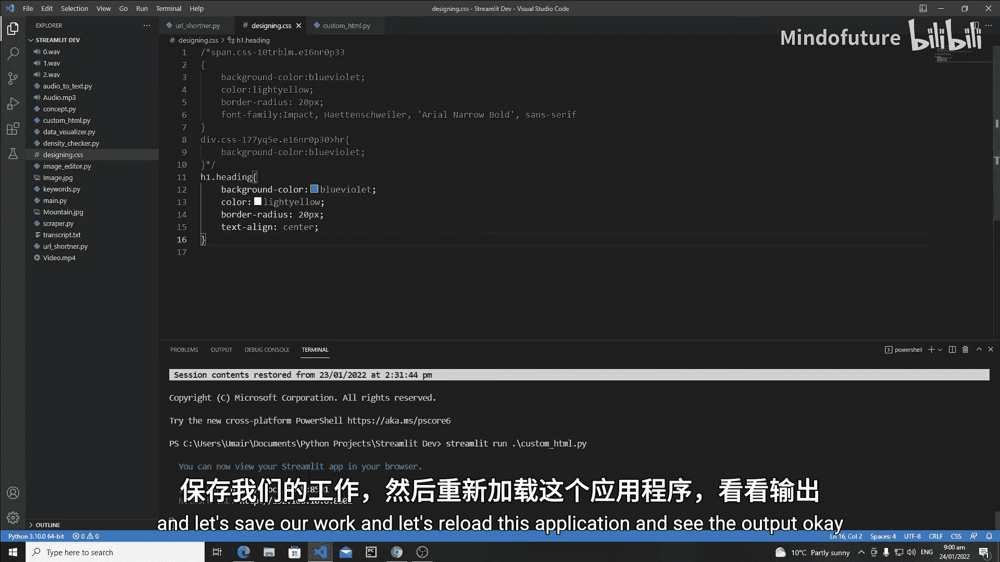

Okay， so this is my heading and this is my paragraphs， or you can edit your paragraph as well。 Okay。

 and you can change the background color， De text style and everything else。

 So I hope that you have enjoyed this tutorial and in the next tutorial。

 we will see something new till that point， bye bye。😊。

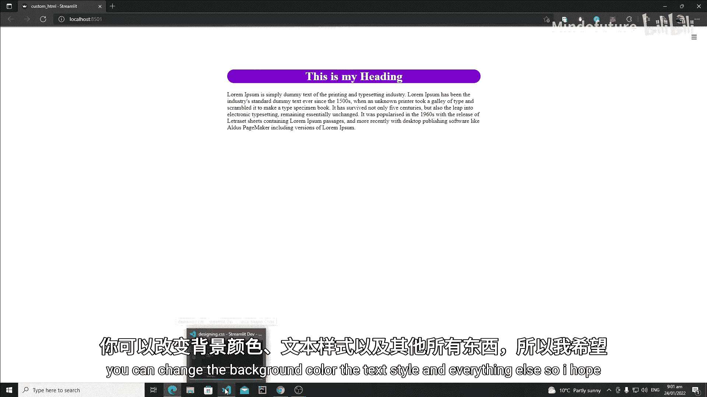

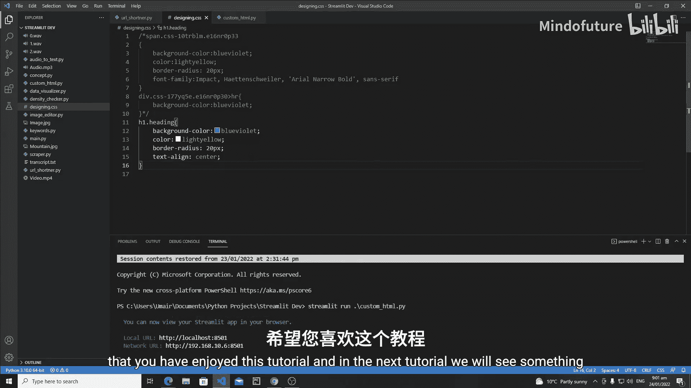