# Python-Streamlit-完全教程-p44-P44-Custom-CSS-In-Streamlit---Complete-Streamlit-Python-Course---Streamlit-Tutor--BV1yHVhz1EUD_p44-

Hi everyone in this tutorial we will talk about designing streamlit applications and there are a bunch of methods which you can used for designing but in this tutorial we will talk about the CSS so we will actually adjust the CSS styling of our streamamlit web app and for this tutorial I will use my URL shortener application which we have developed in the previous tutorials so without further discussion let's jump right to the tutorial and first of all the first thing that you need to do is to run your application in order to understand the CSS of the Web app so just right here STRAM so I will skip this part so I hope that you will get bored during writing this thing and this is our simple URL shortener application looking very very boring and in this tutorial we will change the coloring the styling and everything。

😊。

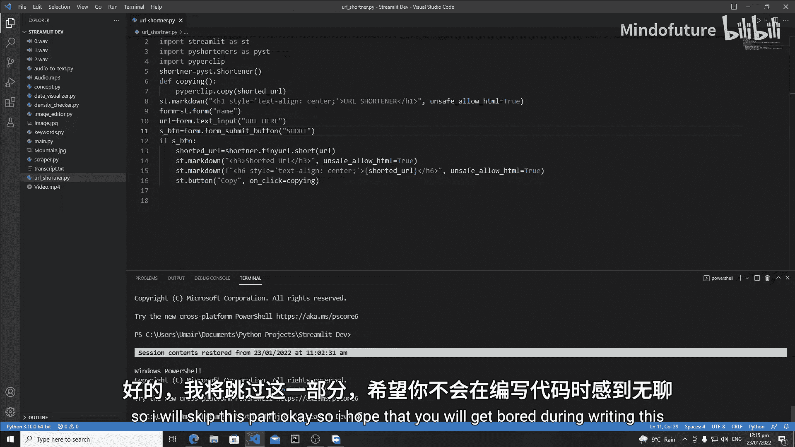

So of this so first of all you need to inspect it okay so just right click hit this inspect okay and this will open this hml and CSs of this whole thing Okay so this is the hml part and down here you will see the cS okay so we are concerned with this part as well and we are concerned with this part as well okay so first of all we need to change the URL shortener title okay so just right click inspect element and okay so this is the division for this thing okay and then we have this and then we have the span okay so this pen is basically responsible for this thing so first of all we need to extract the the span okay so the class name and then with the help of this class name we will actually change the cs of this title okay so let's copy this class name here and open your VScor again and now let's create a CS file separate。

😊。

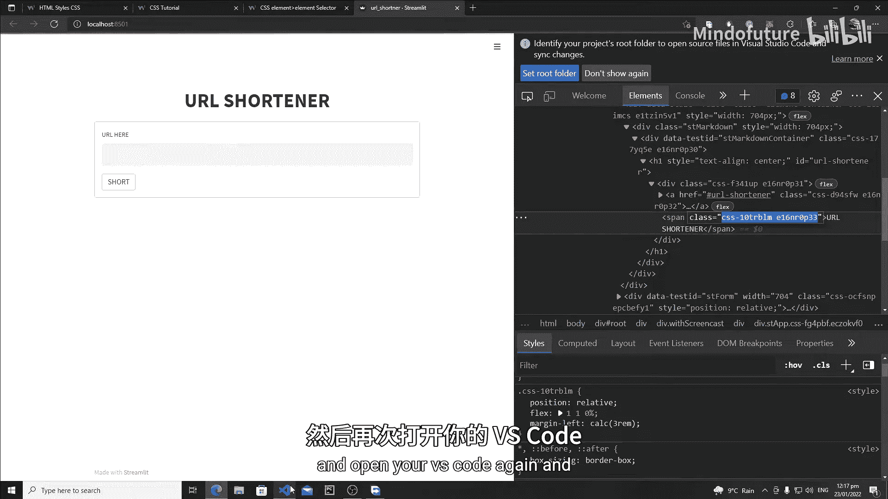

So just to name it something like meDE S IG and IG designing dot cS okay whatever you want。

 just hit enter and now you need to write our CSS so if you go to this W3 schools okay so it's an awesome website regarding HTMLl and CSS although they have added this SQL jascript and everything else but it is known for HTMLl CSS okay so if you want to learn about HTMLl and CSs then it's a perfect website obviously here we will learn how to define CSS styling so when you click on this CSs home okay so make sure that you should on this CSS step and here in the first example you will see that this is the way of defining a CSS so you need to create a separate file okay and then inside that separate file you need to define your properties you coloring your styles and everything。

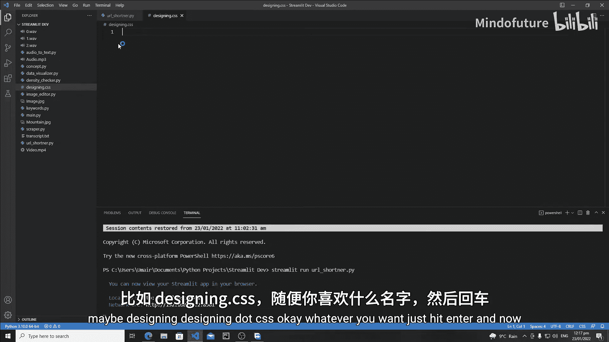

elselse like this so this is our tag name okay and this is the property which is the CSS property obviously and this line basically allow us to change the background color of the body so now if you compare this part with our this inspect element here instead of body we have this span tag So just open this Vscor again and first of all we need to write here this S and span okay and now in this example we have only one body tag but what if you have multiple body tag which is obviously not possible but in our case we can have multiple span text so how to distinguish between multiple span So for this purpose we need to have some sort of difference as well and in this tutorial I will use this class of this span in order to distinguish between this span and every other span so how to embed classes so it's a very simple process in HTMLml csS dot operator basically。

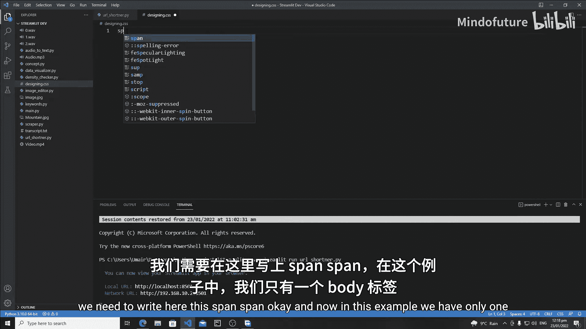

Represents our class name while if you have ID， then you can represent your tag using that ID and for this purpose you need to use the number sign okay but in this tutorial our tag doesn't have any kind of ID so we need to use this class name and for this purpose I will use dot operator so after the tag name you need to put this dot and then you need to define the class name so just copy the class name and paste it and now as you can see we have two classes okay so this is my class one and then this is my class2 so you need to replace this white space with dot again okay so just put here dot and now we have a proper reference to our span tag now again let's come to this W3 schools okay so Im not sponsoring this website but yeah it's a perfect website if you want to learn HTMLl and CSS now we have completed this part so in the next step we need to put these parentheses so just open VS code again and。

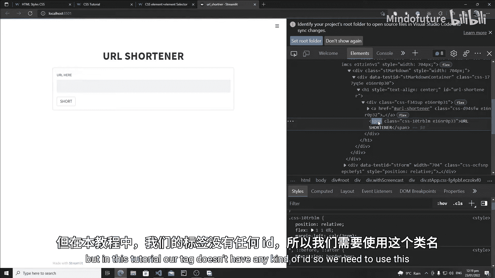

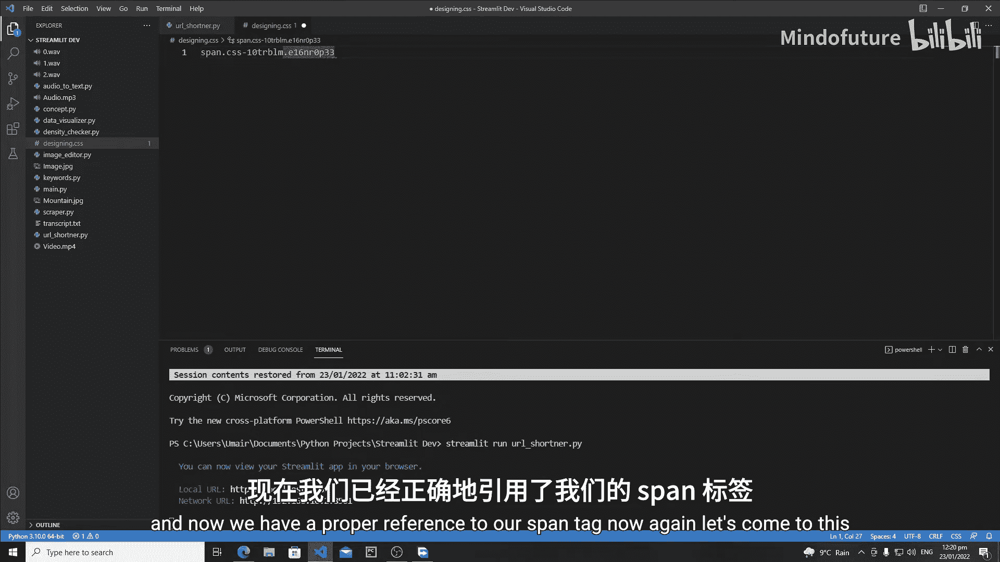

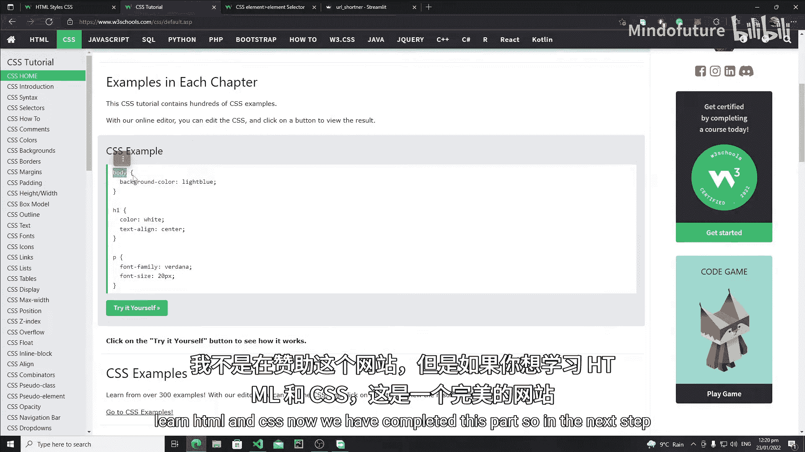

These parentheses like this And now inside these parentheses， we need to define our properties。

 So let's suppose that I want to change the background color of this URL shortener title okay so just go to CSs again okay and here you have bunch of chapters okay so just to go to this background chapter okay and here you will find a lot of stuff related to background So background color background image。

 background repeat and everything is background so we need to change the background color okay so you just need to copy this line okay so copy it and paste it right here and now you need to define your color name so you can use here the hex code as well or you can define the name of the color as well okay so for example。

 let's go with something like blue okay B blue okay blue violet I think it will look perfect okay let。

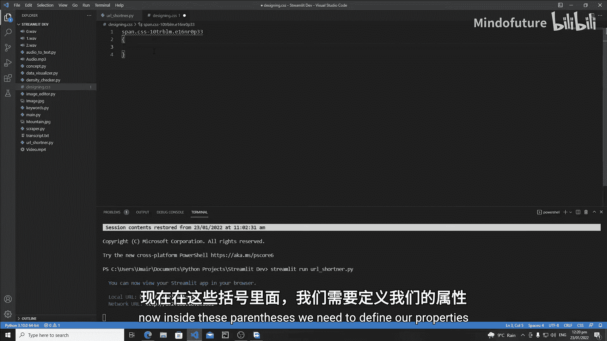

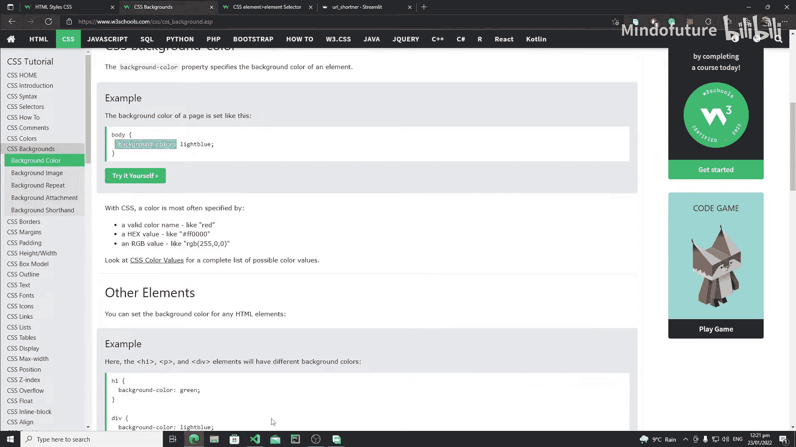

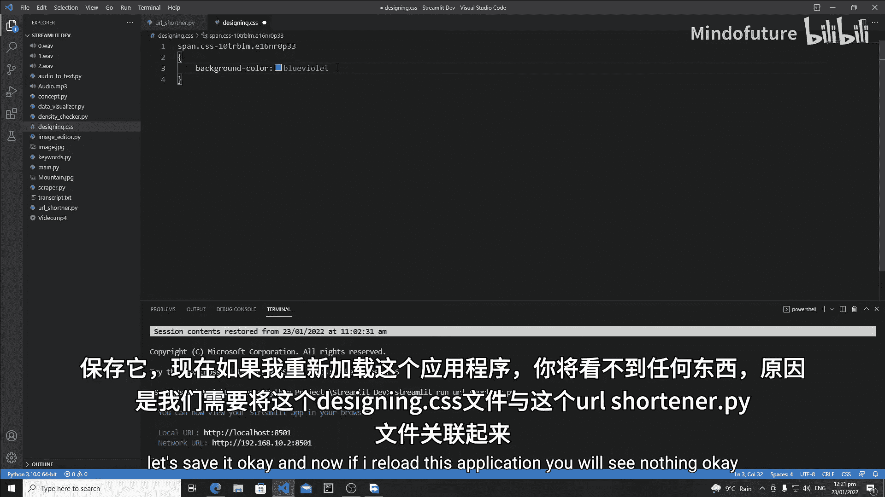

Sa it okay and now if I reload this application， you will see nothing and the reason is that now we need to attach this designing dot css file with this URL shortener do pfi So how to attach it So the answer is very simple you need to use the markdown and in this case I will go with markdown although there are some other options as well but I think those will be complicated and we will discuss them as well in the upcoming tutorials but for now let's go with markdown okay so just right here S do markdown。

 but before I actually write the markdown， I need to import this design do css file as well。

 So just remove this and write here w and then op and open and I need to open this designing do c okay so just write here D S Ig and IN designing do css and I will。

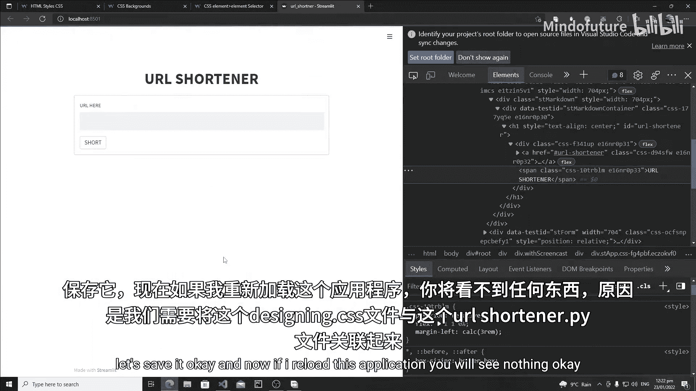

Open it as my S O U RRC source underscore design Okay so source design。

 and then I will write S dot markdown okay and now here how to embed your CS files inside the HTMLl So again open the browser and go to this HTML tab and here under this hml cS chapter you will find that what is CS or it's a casecadding style sheet okay which is used to format the layout of web page and then using okay so inside the using you have three different ways to embed your cS inside your HTMLl coding so one method is to use this inline feature and we are using this inline feature in our web app and that is if I open viacor here as you can see we are adding our CS using the inline feature and with the help of this style key I am。

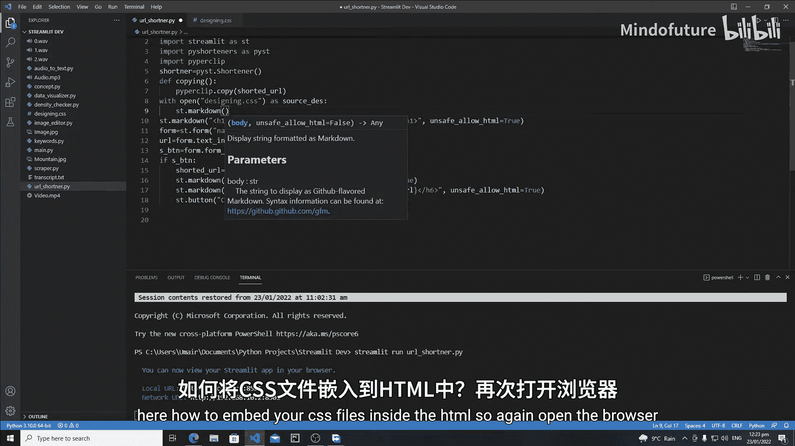

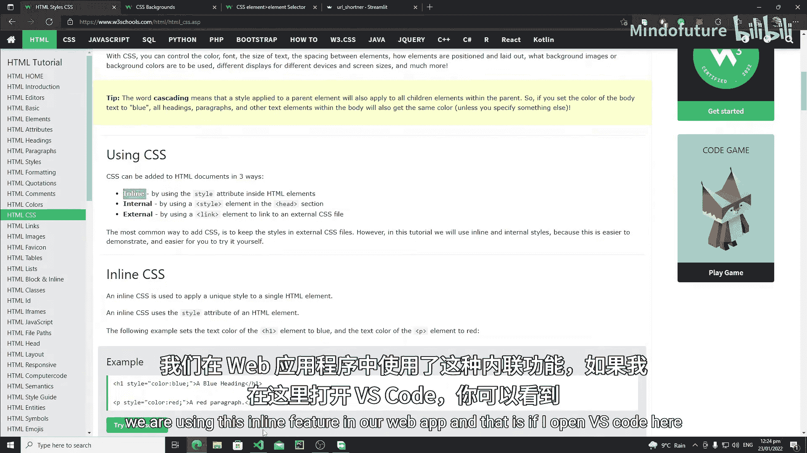

Adding the CSS okay so this text align is basically a CSS property okay and this is the first way of adding CSs and then we have an other one that is internal and in this tutorial we will use this is internal okay and then you have external asz well but I will discuss this external method in the upcoming tutorials when we will use the streamlit components okay and in that tutorials I will discuss this external but for now just stick with this internal okay so how to use this internal so just come to this internal and here you will see the whole definition and everything else I'm not interested in these words the only thing which I need to know is how to add this style okay so first of all they are creating a style tag okay and then they are closing this style tag and then they are actually adding the CSS okay so I will go with this method okay so just open we scored again。

😊。

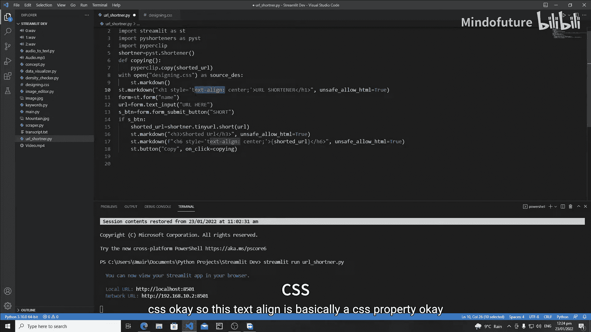

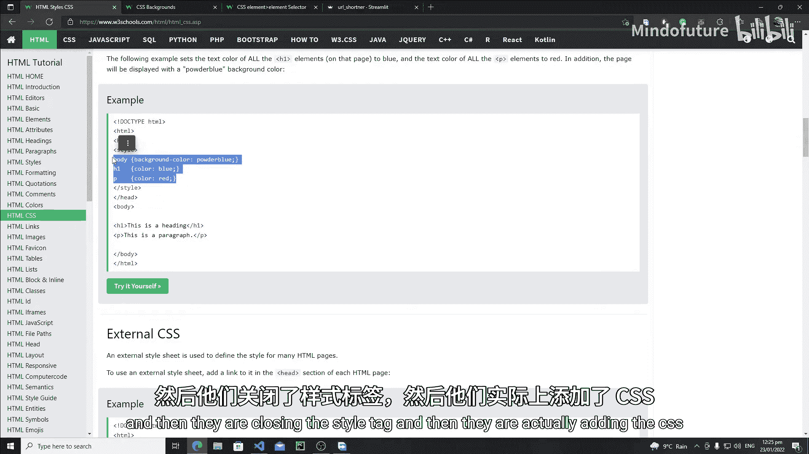

And here inside the markdowns， I will go with formatted string okay and then just put these double chs and right here a style tag okay so just right here TYL style and we need to close this style tag asl So just close S TYL style and now as we have mentioned here the formatted string。

 So we need to pass the content of this design dot css file here and for this purpose I just need to write here source okay so just put this parentheses and then right here S O U RRC source do underscore design and I want to read it as also just right here dot our ED read okay and unsafe allow HTMLtml to true okay so make sure that you should put this property to true otherwise this will not work okay so let's open the app again let's refresh it and now we have a cool output okay So this is how you can actually modify。

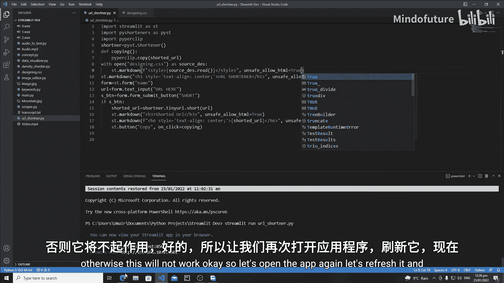

Your streamlit web app so we have changed the background color of our web app okay and now for example。

 if I want to change the text color as well so just right here and otherwise property inside this design and dot cS okay and that isR color okay and then put this color but before I actually start working on the color I just need to put this semicollon here okay so don't forget this semicollon you need to put it otherwise you will get an error okay so color and then I need to define my color again you can pass here the hex code or you can write the color name and in this case I will go with color name and I will say something like LgST light maybe light blue light C and I think I think which light will be good light yellow let's try it I'm very bad in colors but yeah let's try it and。

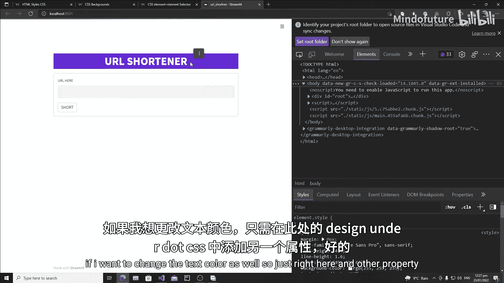

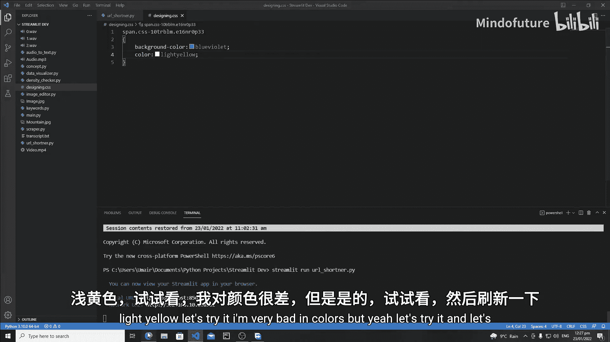

Let's refresh this thing and see the output and yeah now I think it's looking perfect so here one thing that is quite weird for me is these edges okay so I think if I round these edges then my output will look better okay so again go to this W3 school and heres go to the CSs borders and these are all borders okay and okay so here we have the rounded borders so just click on the rounded borders。

😊，And here we have these rounded borders， Okay， so this is the method of adding rounded borders okay。

 so just copy this property， copy it and open wecor again。

 go to design and pass to right here and let's refresh this and yeah now we have cool roundness in our borders okay so you can increase this roundness to something like a weird value maybe 20 okay so let's save it and let's reload this application。

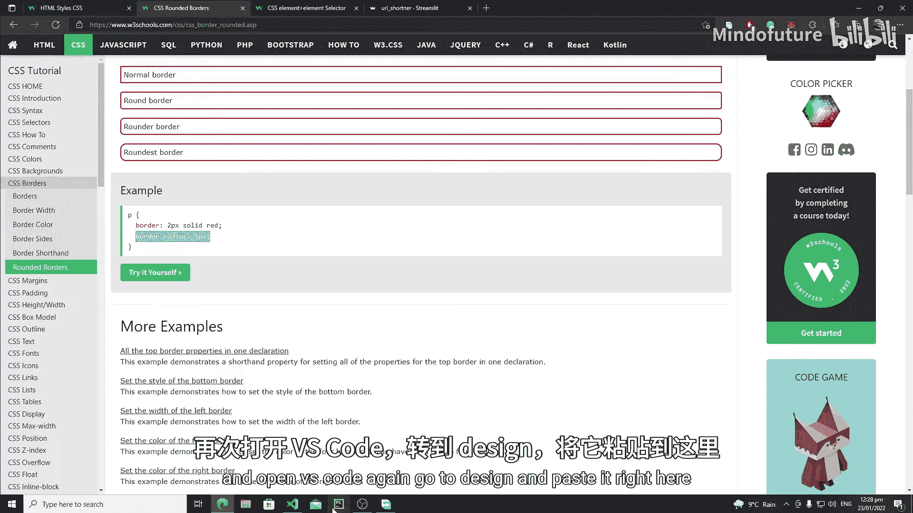

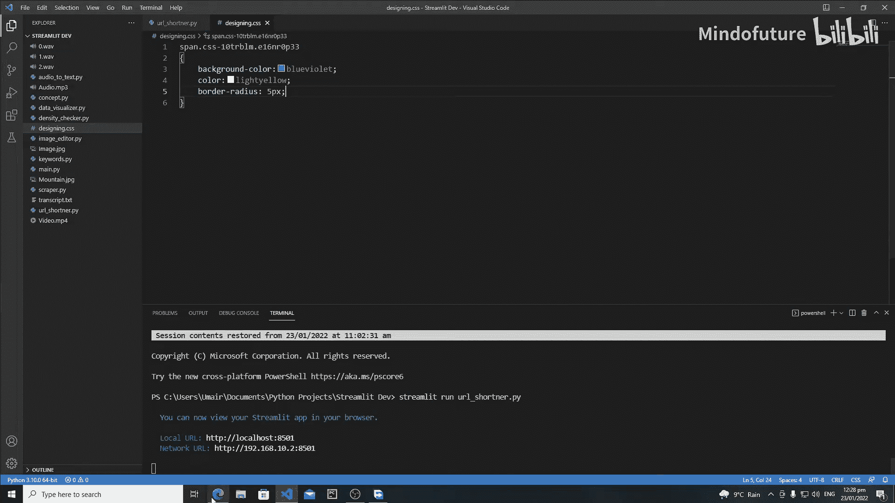

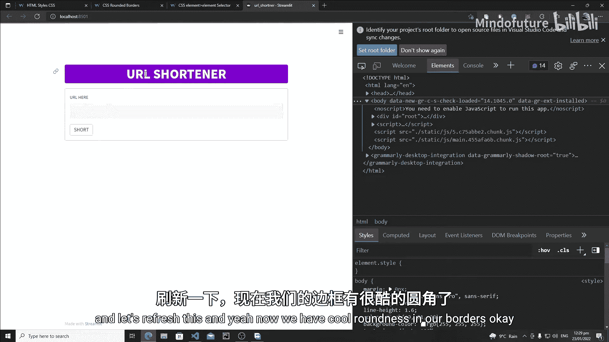

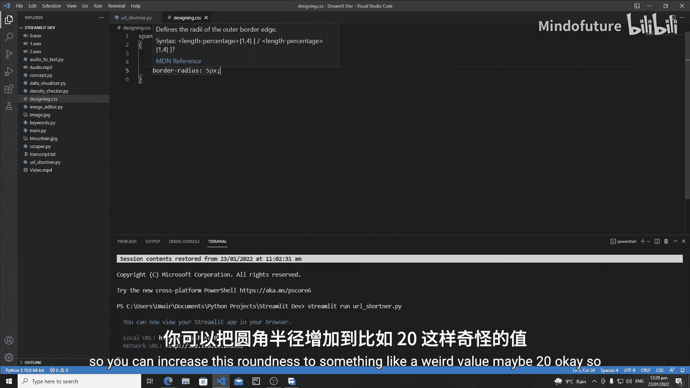

And yeah I think it's good and here one thing that I'm thinking is still missing is to add a line here。

 okay， so let's add a line， so just go to this URL shortener and we need this URL shortener heading let's sorry let's write here ST do mKD or WN markdown okay。

 and let's add a horizontal line let's save it。

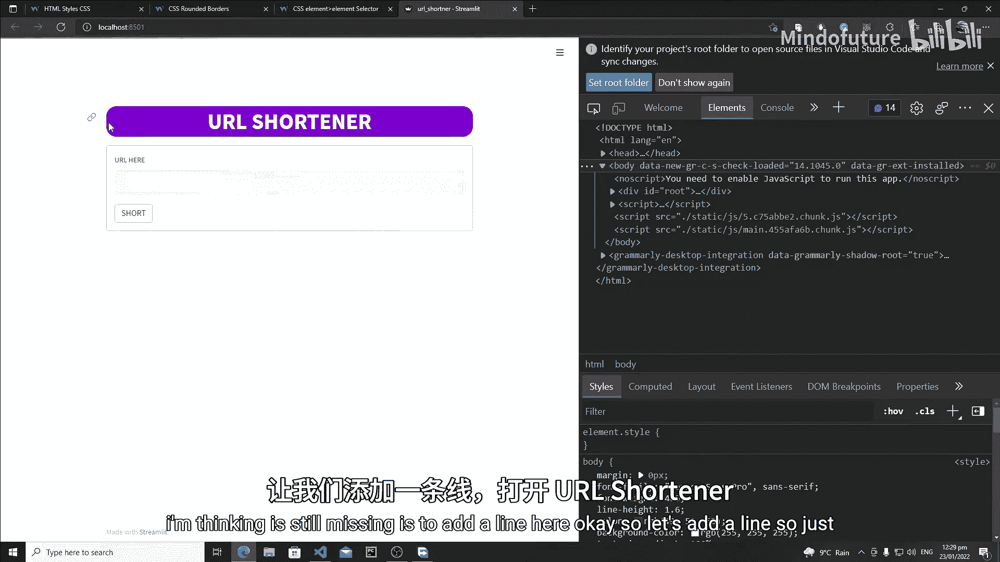

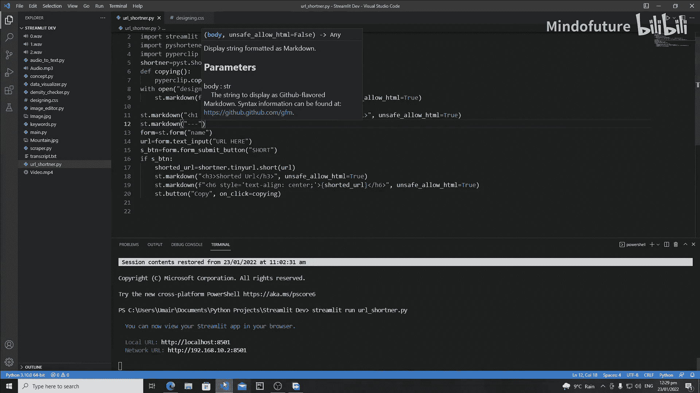

And let's reload this application。And yeah now I have a horizontal line and now I need to modify this horizontal line as well and I need to change the color of this horizontal line to something else Okay so you just need to right click and again go to In and this will open this type of interface。

 whatever you call it just open this division tag and open this division tag okay sorry and here you will find that we have this HR tag so HR tag basically represent horizontal okay so if you go to this Hl and if you search for something like I hope it will be in styling maybe okay I don't know where it is but yeah this HR tag basically allow us to add a horizontal line and we need to modify this HR tag but as you can see here for this HR tag we do not have any kind of class reference we do not have any kind of ID okay。

And it is obvious that you will have more than one HR tag in your Web app so how to distinguish between each tag so for this purpose I will use my this this division tag because for this division tag I have a k reference okay so I will access this division tag and then with the help of this division tag I will access this HR tag and for this purpose I will use CSS selectors so again if you go to W3 schools and here you will find I will give a link as well so here you will find a CSS element element selector okay so this is a whole documentation of CSS selector okay so you can see you can read it how to select one element based on the information of other elements and this is the example of CSS selector so first of all we will have one element and then we need to put this greater sign or less than sign so if your element。

To below that element， you need to put this sign if your element exists about that element。

 you need to put， I think the other one sign okay so I don't know whether it's a gra sign or it's less than sign but yeah this element will be under this element okay so if you replace this sign then this element will be under this element so this means that it will be above it or okay so I hope that you have understood the concept So we need to use this CSsS selector method so just open via code again go to designing so first of all we need to access our Dave tag just right here just copy this class name okay so copy it and right here D D and then dot operator past the class name just replace this white space with dot again and then our HR tag is under this division tag so put this sign and then you need to define here the tagum and in this case my tag is this HR okay and。

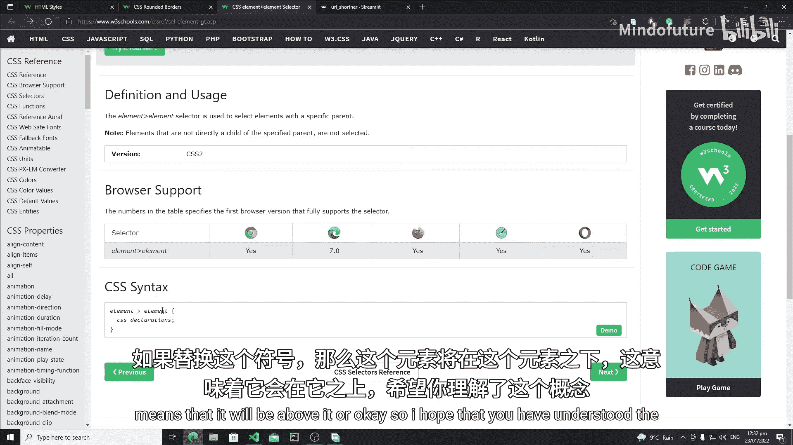

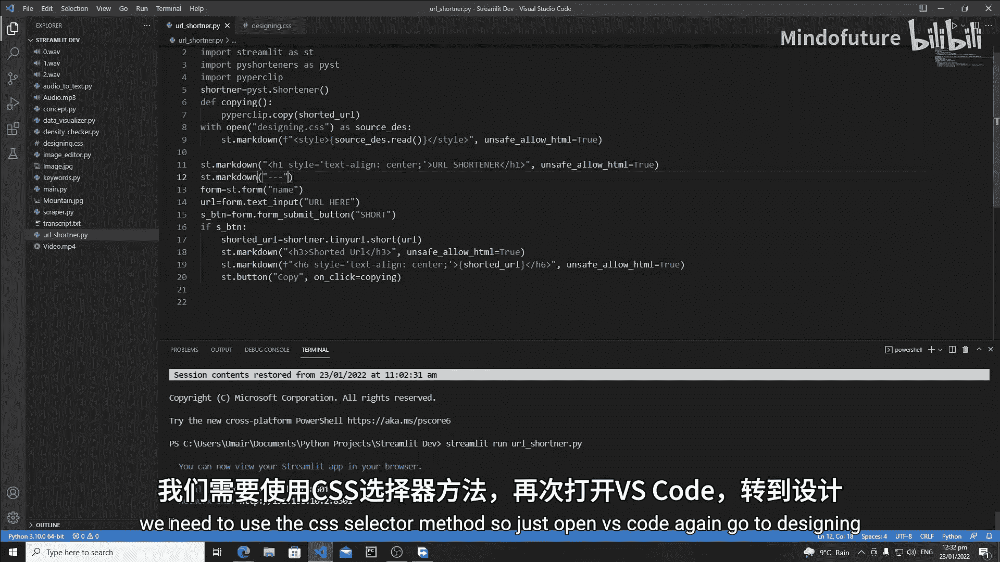

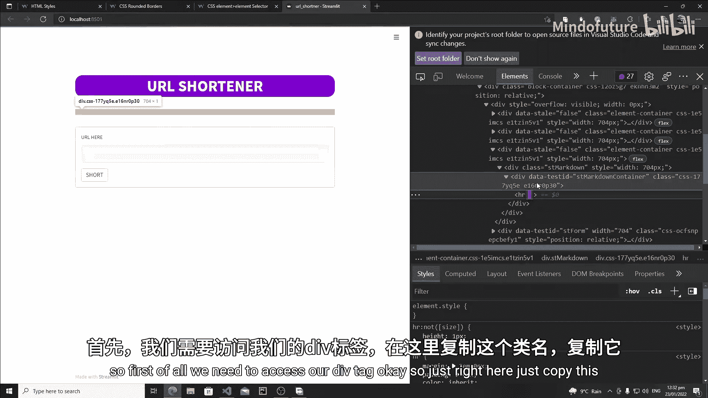

put these parentheses and now inside these parentheses I need to define my CSS properties and in this case I will use this background color property okay so just copy it and paste it right here。

 let's save it and let's reload this application and you will see that we will have a different color here。

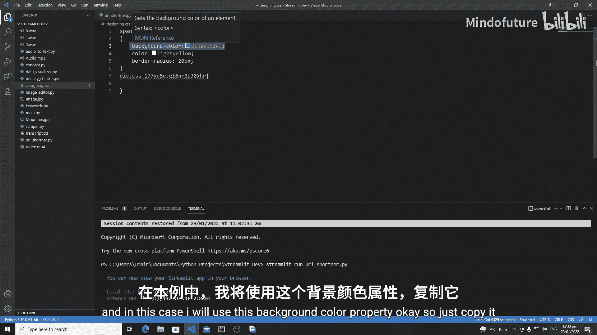

And yeah our color of the line has changed okay so this is how you can actually change the color and CSS properties of streamamlit Web app and I hope that you have enjoyed this tutorial and just play with these thing so you can even change the color of this button you can change the font family as well so for example just go to this W3 school again and just go to the CSS fonts and here you will find different fonts okay and just copy this property copy it and if I want to change the font family of my title so just past this property here and let's define font family and I will go with IMPit impact okay so this will look very weird but just ignore the output and let's reload this application。

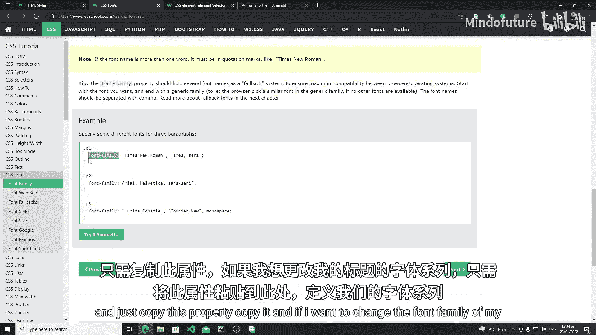

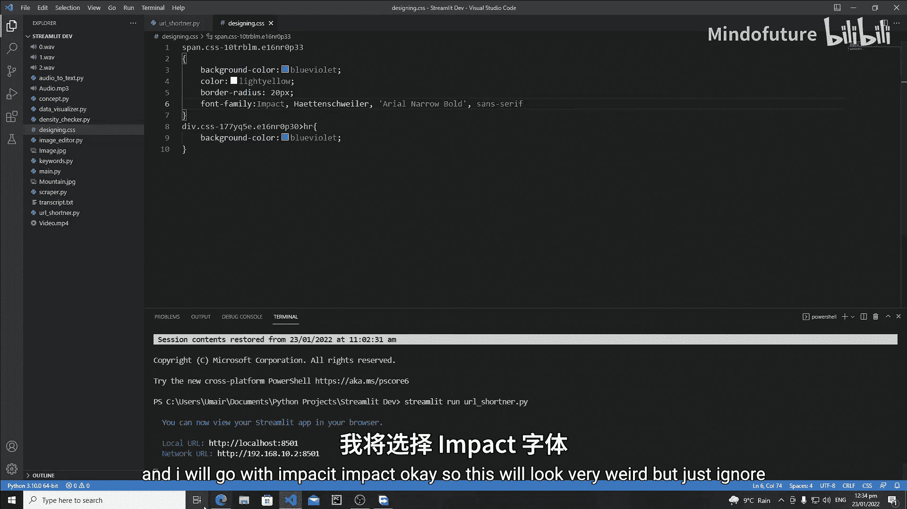

And yeah our font has changed okay so now we have a very very weird output but yeah this is how you can change the font。

 so I hope that you have enjoyed this tutorial and play with these properties and I will see you in the next tutorial till that point bye bye。

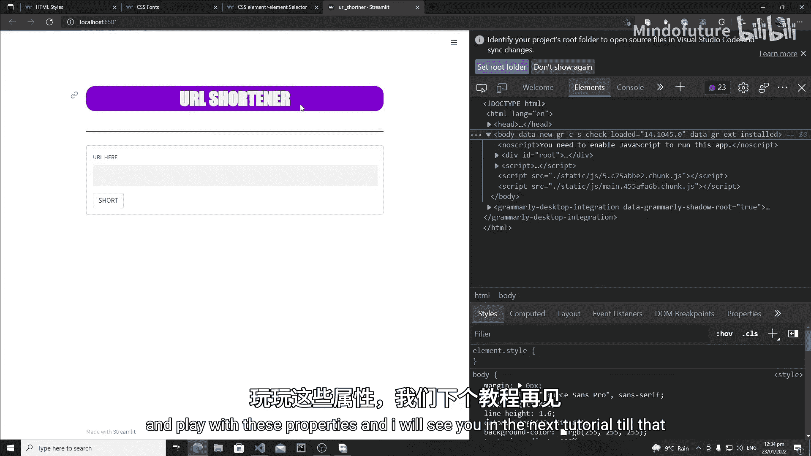