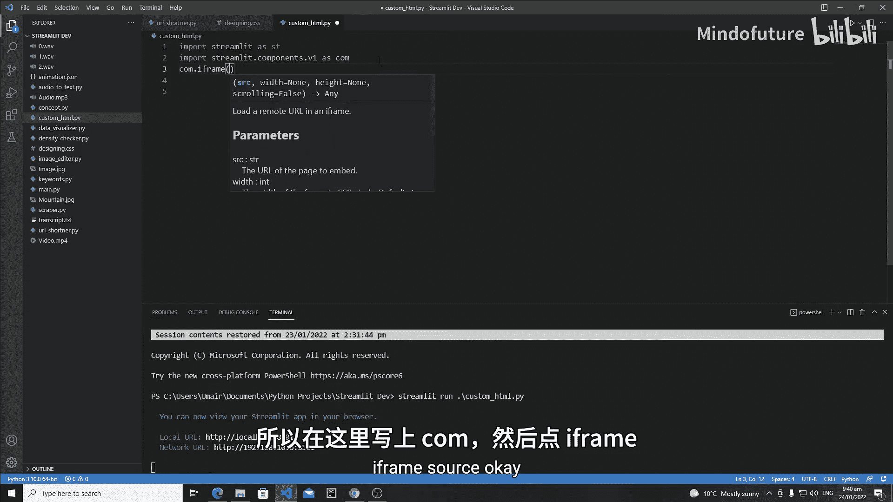
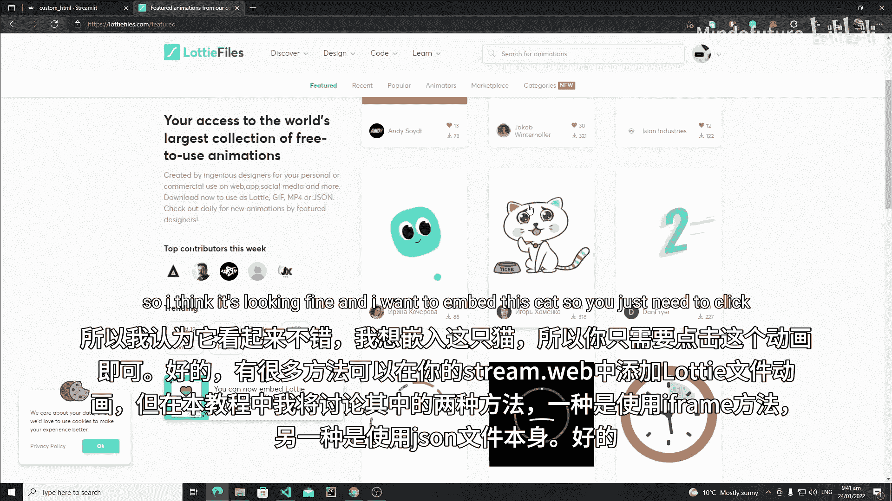
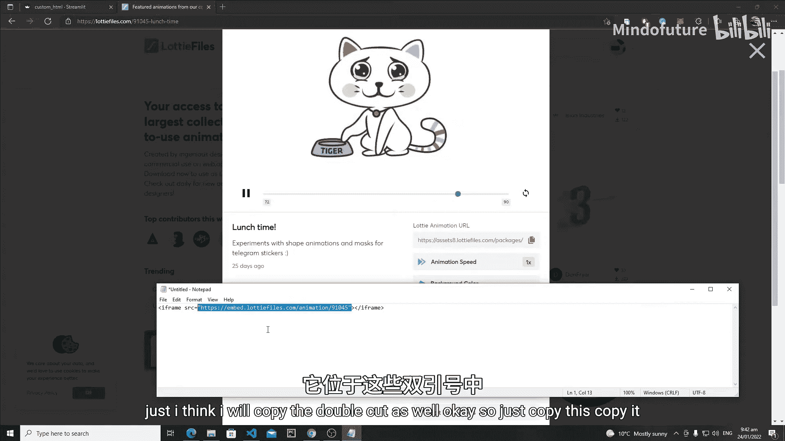
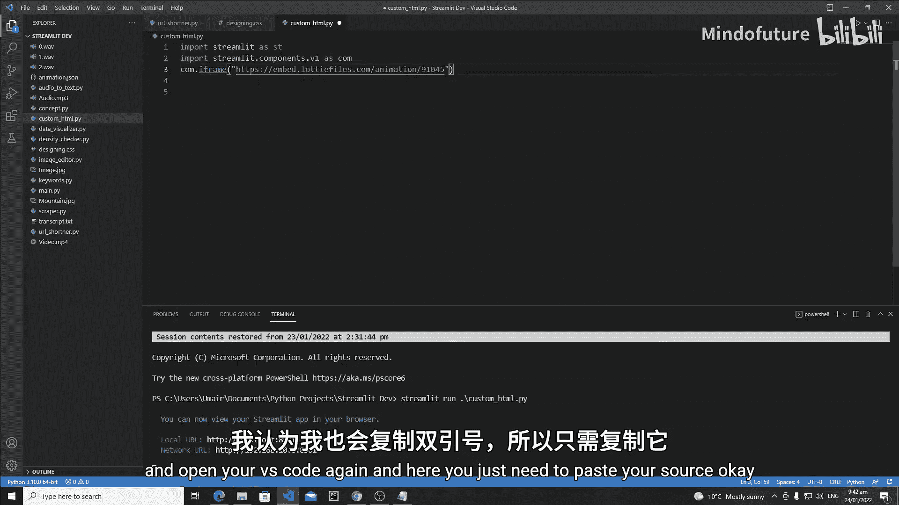
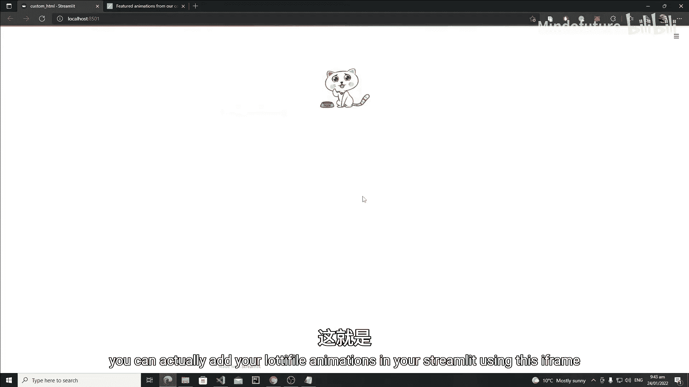
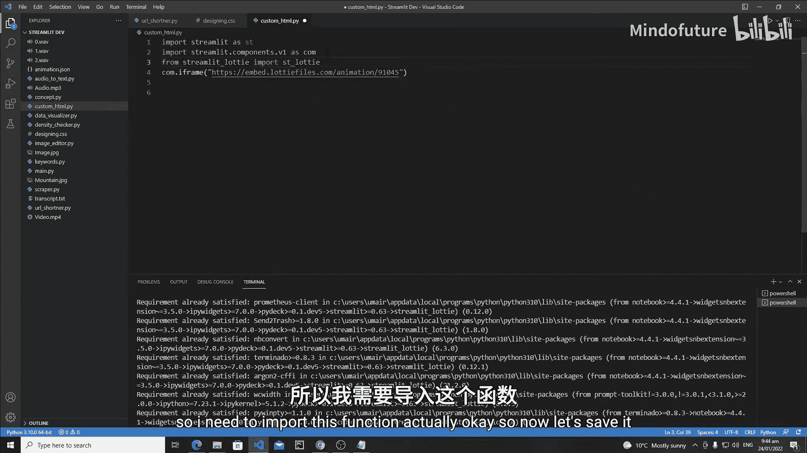
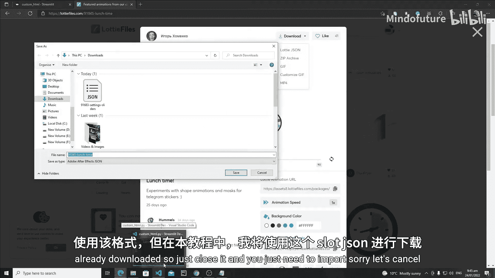
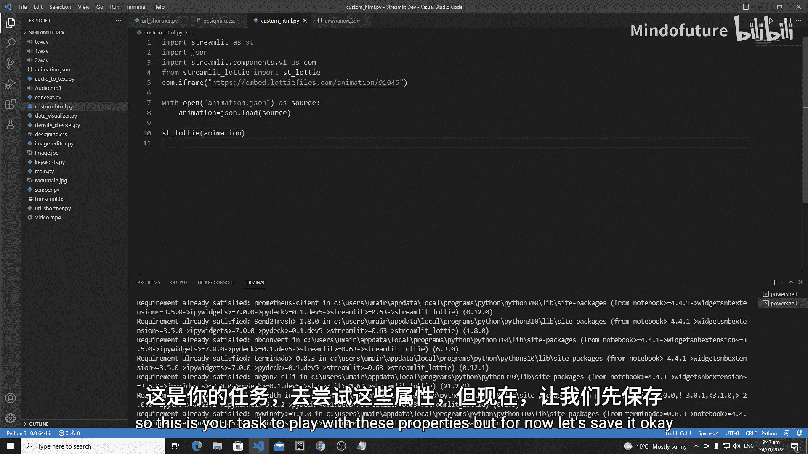
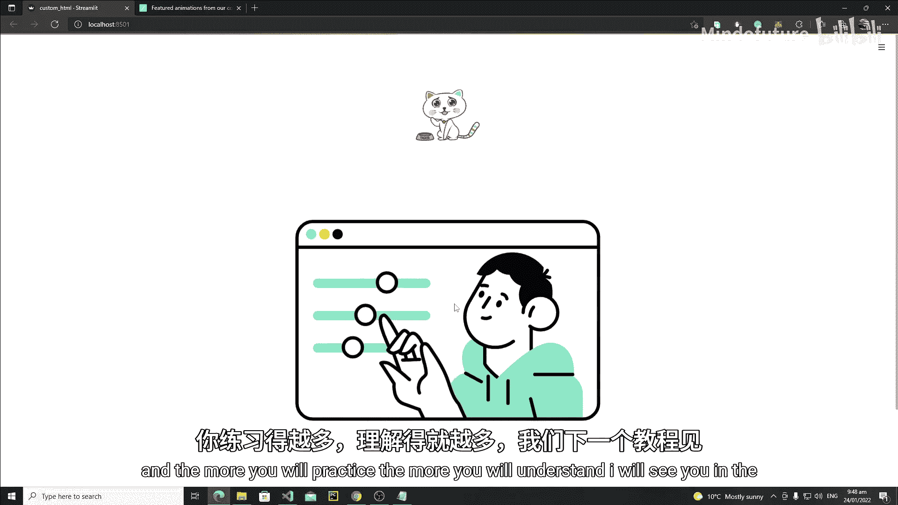

# Python-Streamlit-完全教程-p45-P45-Animations-In-Streamlit---Complete-Streamlit-Python-Course---Streamlit-Tutor--BV1yHVhz1EUD_p45-

Hi everyone in this tutorial， we will talk about iframe function of streamamnet and then we will see how we can add animation in our streamlit web app So first of all let's remove everything And I hope that now you know very well how to embed hml and cS and let's remove this line and let's remove this line as well now first of all let's see how to add animation using iframe function。

 So what is iframe function So iframe function of streamnet basically allow us to embed external hml and cs files in our streamnet web So again we need to import this component Okay so with the help of this component we can access our iframe function so just right here see comp then do iframe okay and then you need to pass here the iframe source so if you go to this Loy dot co Loy file do co So on the Loy file do co you will find free animation。

And it's a great website for adding animation in your streamamlit web app So here you just need to create an account and it's totally free。

 You can log in through Google， I think you can log in through Facebook or Apple account or I don't know but it's a very straightforward process of creating account and then after creating account。

 you will find such type of interface So here on the top we have this discover tab。

 So when you hover on this discover tab here you will find such type of interface。

 So you just need to click on this free animations and this will redirect you to the free animation page and here you will find tons of free animations which you can embed in your streamamlit web app So let's suppose that if I want to embed this catt so I think it's looking fine and I want to embed this cat so you just need to click on this animation there are a bunch of methods of adding lotify。

animation in your streamnet web but in this tutorial I will discuss two of them。

 one is to use the iframe method and the other one is to use the Json file itself。

 Okay so you will find such type of interface and if you scroll down here you will see that this embedded URL and then in front of this embedded URL you will see iframe code so we are concerned with the iframe code。

 so just click on this iframe code and here you will find this code so just copy it and let's open not pair so notpa and let's paste this code so this is my iframe tag okay and inside this tag we have this source but we are only concerned with this source of the iframe okay because we have used iframe function this means that we have completed this step which is adding the tag so now we just need source okay so just copy this source which is present in this double chs I think I will copy the double ch as okay so just copy this。

Copy it and open your VS code again and here you just need to paste your source okay and then you just need to save it and let'sload this application。

 let's reload it and see the output。

And yeah this is my animation as you can see we have a very。

 very cool animation of the cat so this is how you can actually add your lot file animations in your streamlit using this iframe function and now let's talk about the second method of adding animation in your streamlit web app and in this case I just need to install an other module of Python which is streamlit Loify okay so just open new terminal and right here PP INT install and then SR LIT streamlit then underscore L or Te Loti and then hit In and this will install your Lo file extension or whatever you call it but as you can see I have already installed it so after installation of Lo file extension you just need to reload your VScor and after reopening it you need to import your lot。

😊。

Okay so just right here， FROM from STRM streamamlit Loify。

 I need to import import ST underscore Loify okay so I need to import this function actually so now let's save it and here first of all we need to download the JM of this animation So again if you click on the animation on the top you will find this download button so if you click on thisarrow here you have bunch of options So if you want to download this animation inmp4 format we can download it using thismp4 option if you want to download it in give or whatever you can download it using that format but in this tutorial I will download it using this loty JSN so when you click on this Lo jsN this will start download process so I have already download it so just close it and you just need to import let's cancel it you need to import that JsN file inside your this VScor so as you can see where here。

My animation or JO okay so it's a very complicated JSO okay and I will not waste my time in understanding this Json okay so just close it again and after importing your Json file inside your VScor you just need to open it in your custom htl dot Py file okay so just right here with then op and open and then you need to define your file name and in this case my file name is an I animation do JO okay and I will open it use as S U RRC source okay and after opening it I just need to read it okay so in order to read Json file it is obvious that you need to import Json library okay so just write here I or the importO and Json okay and sorry import Json and let's save it and now here I will say JON。

t LD load okay and I need to load this source okay so just write your Src source okay and then I will save my result inside thisM animation variable so you can use any kind of variable name here and now after loading it and after reading the Jesson I just need to write ST underscore Lo okay and I need to pass here my animation data which is obviously Jesson so just write here andM animation okay and here as you can see you can pass some other properties as well like the speed of your animation if you want to reverse your animation you can reverse it if you want to loop the animation you can loop it you can change the quality you can define the render feature okay you can set the height width key everything else okay so I will load discuss those properties because they are very very obvious and I hope that you know very well how this property behaves okay so。

This is are task to play with these properties， but for now let's save it okay and let's reload this egg again and。

Now as you can see we have a cat and then we have this animation okay so I have downloaded this animation okay this one okay and that's why you are able to see this animation this is my cat I have added it using iframe okay and I have added this animation using the JSson so I hope that you have enjoyed this tutorial and I hope that you have understood each and everything you can set the sizing and you can put it in a separate column just play with all these thing just make complicated apps in streamlit and the more you will practice the more you will understand I will see in the next tutorial till that point bye bye。

