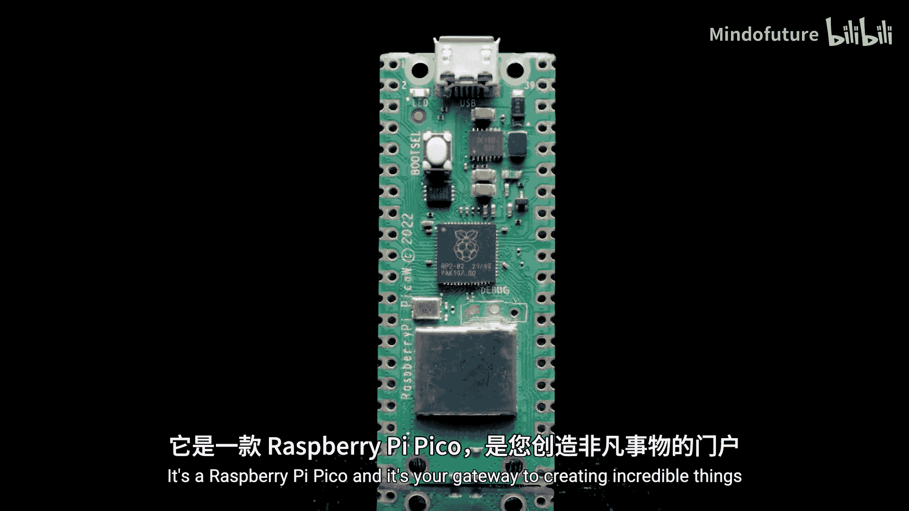
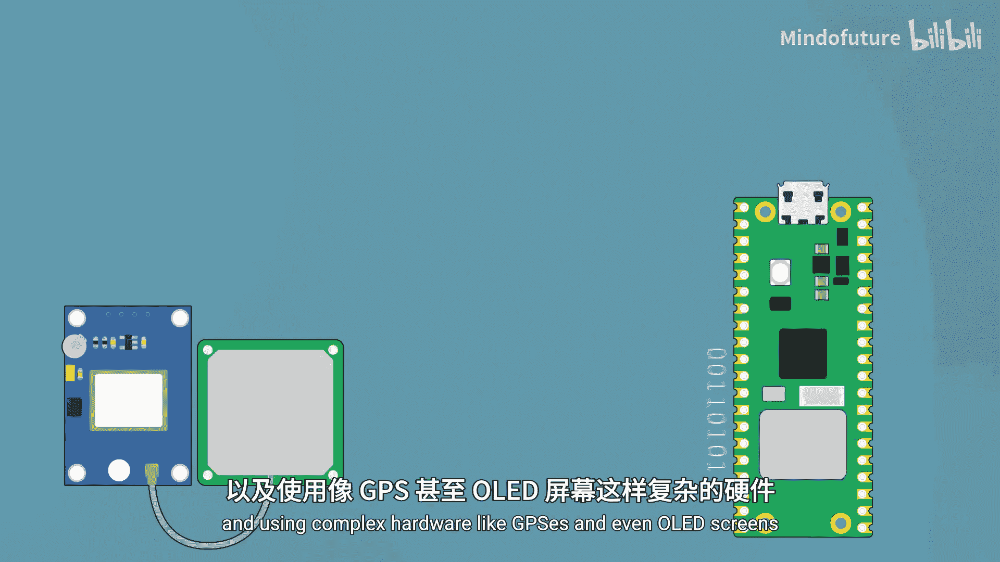

# 中英-•-树莓派Pico初学者入门｜微控制器｜编程｜电子学｜MicroPython-p01-P01-Want-To-Learn-A-Microcontroller-Start-Here.---Intro--BV1eKXLYzEP4_p1-

🎼Hey there， I'm Jared， and we're gonna teach you how to use this microcontrol。

 It's a raspberry Pipeer and it's your gateway to creating incredible things。

 It's a tiny brain that makes everyday objects smarter and you can use it to create things like autonomous robots or automatic plant watering systems all sorts of gadgets and gizmos or even your own smart home devices These little things are the secret source behind most of the modern world and we're going teach you how to use This workshop will take a complete beginner and get them just dangerous enough so that they can go out and start making some really cool stuff The course is comprehensive。

 but we also try to teach you the most amount of stuff in the least amount of time。

 Like when we learn something we make sure that those examples we use are practical ones that will solve problems that you will encounter in the real world。

 And above all it's completely free。 there is no content hidden behind a paywall and we've minimize the amount of stuff that you need to follow along with which is listed on the course page where you'll find all the code and other information you need throughout the course。

 So what lies ahead well we're going dip our toes into the basic。😊。

🎼Of coding and controlling things like light sensors and motors then we'll move on to adding some more intelligent thinking to our projects and then we'll step it up a notch into more advanced topics like hosting websites over Wifi with this thing and using complex hardware like GPSs and even OLE screens So if you want to learn a skill and I'm not exaggerating here may alter the course of your life follow along and we'll get right into。

