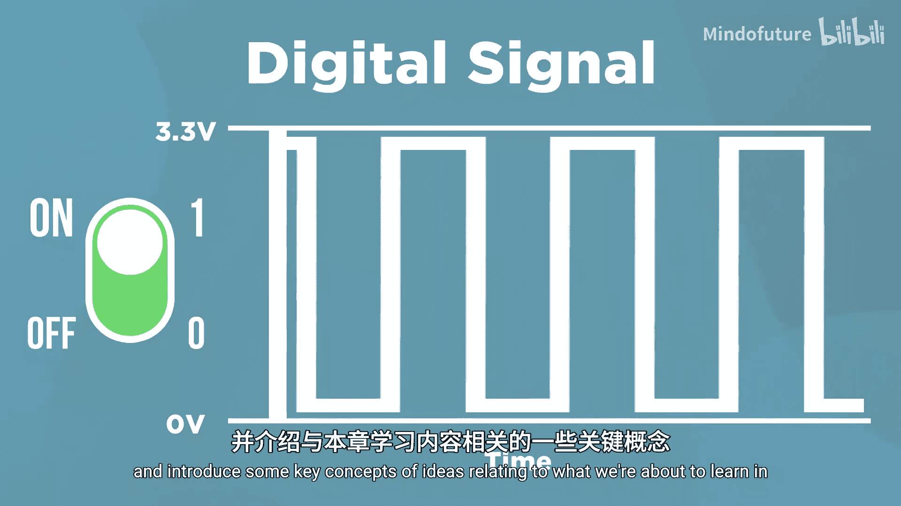
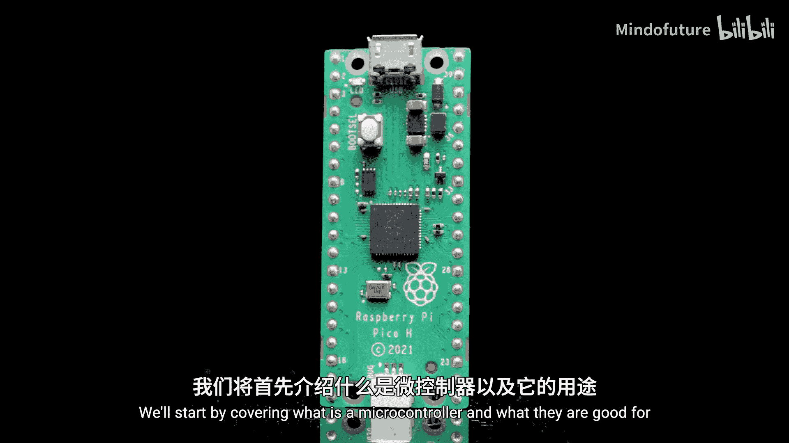
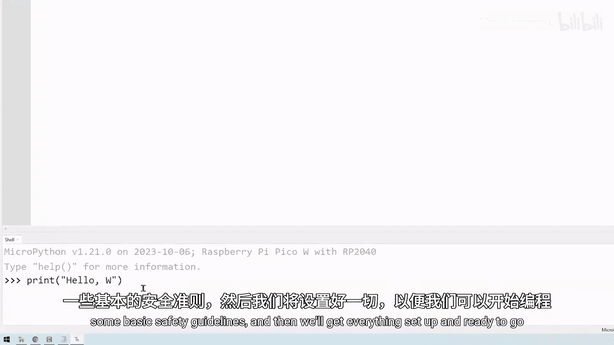
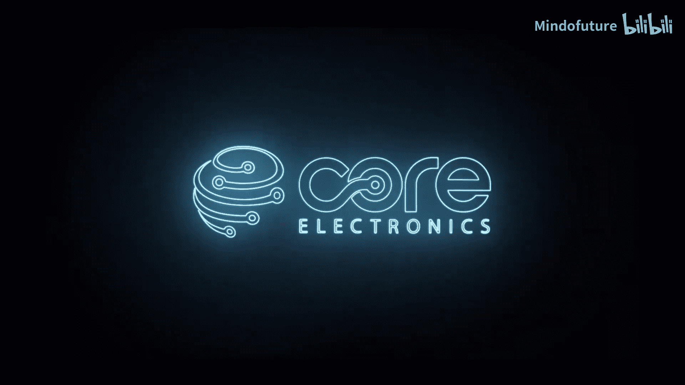
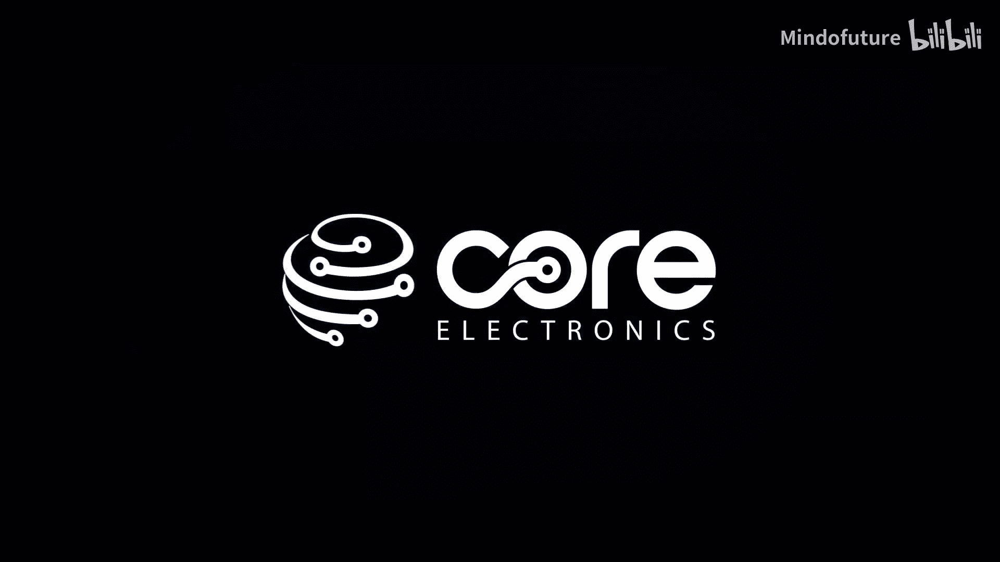

# 中英-•-树莓派Pico初学者入门｜微控制器｜编程｜电子学｜MicroPython-p02-P02-Getting-Started---Chapter-1.1--BV1eKXLYzEP4_p2-

🎼Alright， let's get started with this course。 The first video of each chapter is just going to lay out kind of what's ahead and introduce some key concepts of ideas relating to what we're about to learn in this chapter Chapter1 is nice and quick。

 It's probably the shortest of all the chapters。 We'll start by covering what is a microcontroller and what they are good for and we'll look at the Pco and some of the variants it has some basic safety guidelines and then we'll get everything set up and ready to go so we can go and start programming it and then we're just going go over some tips and tricks to get the most out of this course。

 This chapter doesn't really have much to follow along with besides getting the Pco set up and ready to be programmed so sit back。

 relax and let's get this show on the road。😊。

