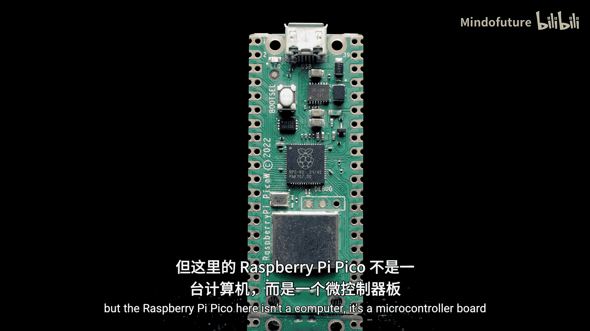
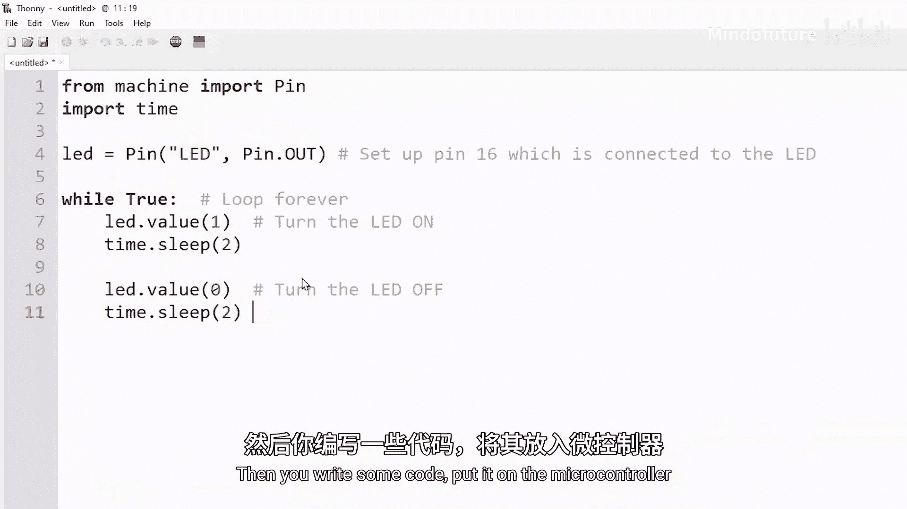
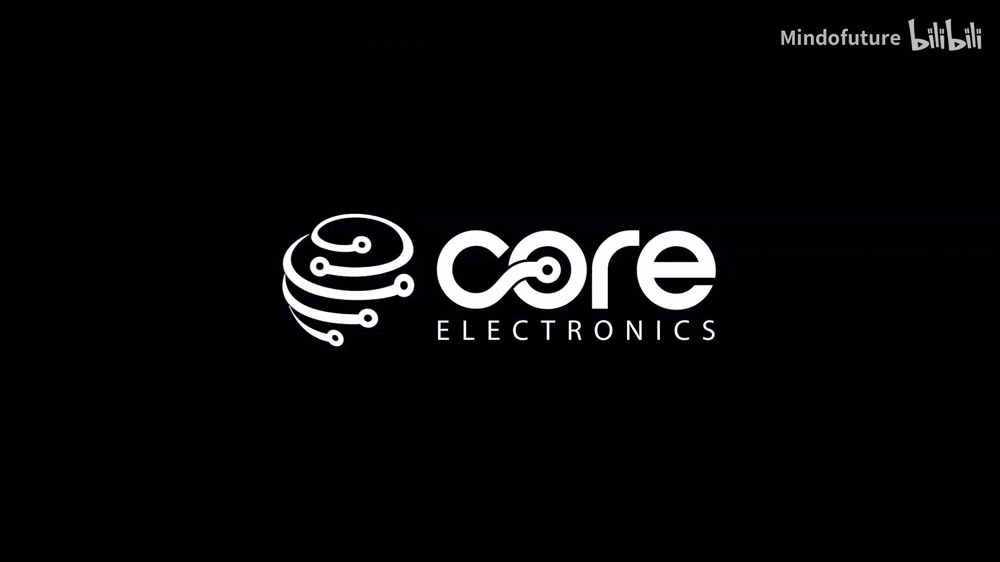

# 中英-•-树莓派Pico初学者入门｜微控制器｜编程｜电子学｜MicroPython-p03-P03-What-is-a-Microcontroller---Chapter-1.2--BV1eKXLYzEP4_p3-

🎼You may know Raspberry Pi from the awesome line of single board computers。

 but the Raspberry Pi Pico here isn't a computer。 it's a microcontroller board。

 which is a completely different game。 a microcontroller still shares a lot of the same types of hardware as a normal computer like a processor a Ram memory it's got all of them So what's the difference between the two Well while a computer like your laptop or desktop is designed to perform a wide range of tasks like browsing the internet playing games or writing reports。

 a microcontroller board like our Pco here is a tiny little processor that we can program to complete a very specific tasks and while a computer runs a fully fledged operating system like Windows or MacOS microcontrollers typically don't have a user interface that you can interact with with a keyboard or mouse Instead they allow you to easily plug hardware into it such as temperature sensors。

 light sensors， motors sers then you write some code put it on the microcontroller and it's。

code that tells the microcontroller what to do with the hardware you have just plugged into it。

 For example， in this project， we plugged in a soil moisture sensor into a pico as well as a water pump。

 We wrote some code for the Pico telling it to use the sensor to check how wet the soil is in that code we also told the Pico if it's wet don't do anything if it's dry though then turn on the water pump and water the plants。

 and the Pico just keeps looping that same task over and over and over。

 Another example this is an automatic garage door and a pico was plugged into it to allow the Pico to send signals to open and close the garage door。

 Some code was written to then use the wfi capabilities of the Pico to allow the garage door to be controlled wirelessly with a phone instead of that jay old remote。

 A really cool example is the Mara elephant project in Kenya they place a little microcontroller that this Pico here with GPS truckers and motion sensors attached to it onto elephants and then they code it to wirelessly report。

Locations of those elephants this allows researchers to gather data on and study the elephants and for local rangers to track down their locations to help protect them from poachers microcrocontrollers are also in everything。

 you'll find them in your washing machine your computer mouse microwaveves， cameras drones。

 electric toothbrushes you'll find them in so many appliances it's not funny they kind of act like a tiny little conductor inside of those devices controlling them but they can only play the songs that they have been programmed too and a microcontroller is ideal for all of these applications over a normal computer because they use less power they generate less heat they're smaller in size much。

 much cheaper and because these applications need specific and simple tasks meaning repeated over and over and over so a microcontroller is perfect and I think the most important thing to understand is that knowing how to use a microcontroller like this peakco here gives you the ability to build your own custom solutions to specific。

Problems ranging from saving a species to simplifying and automating tasks around the house to designing and building your own product and that's what we want to do we want to equip you with a toolbox of skills to allow you to make awesome things。

 but it's all up to you how you use it。😡。

