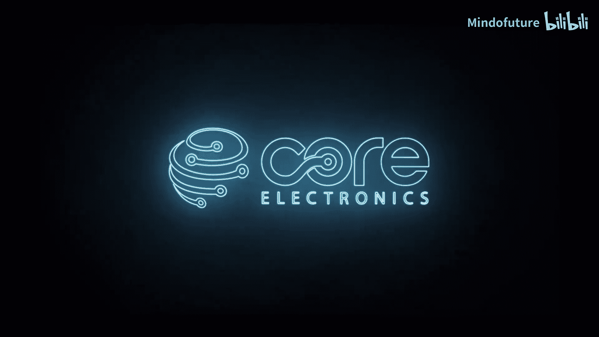
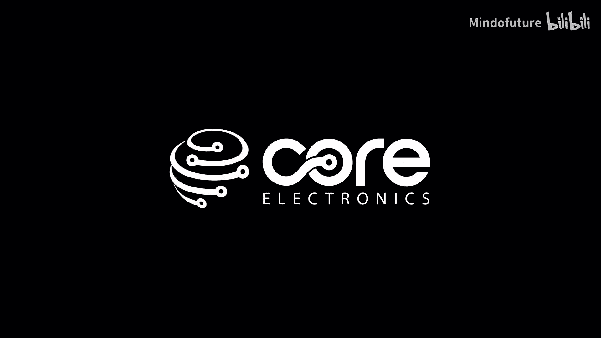

# 中英-•-树莓派Pico初学者入门｜微控制器｜编程｜电子学｜MicroPython-p04-P04-Raspberry-Pi-Pico-Variants---Chapter-1.3--BV1eKXLYzEP4_p4-

🎼There are quite a few pico variants that you will encounter and at first it may seem a little bit confusing but they all follow a nice and straightforward naming scheme So first of all there is the Pco and the Pco2 and it's exactly what it seems like the Pco is the original model and the Pco2 is the second generation model it's newer faster about two to three times faster and it comes with a few hardware improvements here and there Now the majority of this course is completable with both the original Pco and Pco2 and although the Pco2 is faster we very rarely run anything that's too demanding or processing intensive So for the things we do in this course you won't really notice a difference between the two they're pretty much interchangeable but if you want to get something more powerful for future projects get a Pco2 if you want to save a few bucks get the original Pco So these are the base models of the Pcos but there are some additional things that they can come with one of these things is this big silver wireless chip here which gives it wfi and Bluetooth capabilities something。

Base model picos don't have。 and these versions will have a W in their name。

 So the Pco2W and the P OW are just the base models。 but with this additional wireless chip。

 And apart from that fancycied chip， they're functionally the same as the regular ones。

 We will be doing some cool stuff with wifi in a later chapter。

 So we do recommend you get one with the wireless chip Now your pico does need these pin headers solded to it。

 these are what we will be using to connect things to it with if you get one of these base models。

 you will need to buy some pins and manually solder them on yourself。

 or you can save some trouble and buy one that comes with them already solded on。

 if it has a H in its name， it will come with these pins。 So for example。

 the pico no pin headers and you'll need to sold them on the Pco H already comes with them。

 No soldering required。 and this also applies to the wireless ones。

 The P no headers and you'll need to sold them on the Pco W H comes with the headers and wireless so you can。

The Pco generation， the original Pco to save some cash or the more powerful Pco2 if it has a W in its name。

 that means that it's a version that comes with the wireless chip and if it has a H in its name it will come with the headers already sold it on so you won't need to do so and at the end of the day if you don't know which one to get just get one of the WH models that way you can do the wireless stuff we do in the wireless chapter and you don't need to sold anything。

😊。

