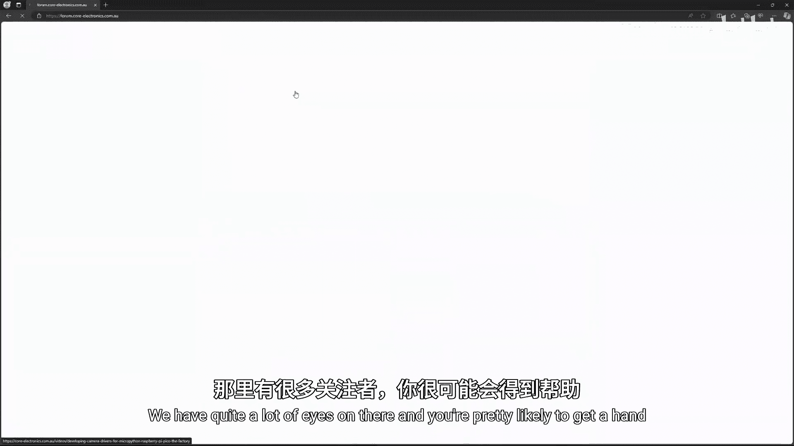

# 中英-•-树莓派Pico初学者入门｜微控制器｜编程｜电子学｜MicroPython-p08-P08-Tips-For-Success---Chapter-1.7--BV1eKXLYzEP4_p8-

🎼Alright， final video of this chapter。 we're just gonna go over some helpful tips for this course and how to get the most out of it。

 First of all， we're going to cover a lot of different pieces of code in this course that all do different things and an important thing to remember is that you don't need to memorize all of it off by heart。

 What I mean by that is you don't need to remember the exact syntax or usage for each piece of code we learn it is far more important to learn how the code works and what each bit does。

 You can always come back to any examples we have here and paste that code over to a project or anything you're really doing I did a whole degree in mechatronic engineering and every single project I did had code copied from an old project that was adapted to the new one but to do that you need to understand how it works first The understanding is more important than the remembering。

 Second of all， when you write code there are usually several different ways of achieving the same result and typically there is no。

or wrong way to do it as long as it works。 there will be more efficient and less efficient ways。

 but feel free to use whatever you are most comfortable with。

 It's not going to matter 99% of the time。 Just be sure that if you do something in a weird or unusual way be consistent with it。

 The only thing worse than trying to follow along with the weird way somebody has written code is that if they change the system that they use in the weird way that they use every two seconds。

 it becomes very hard to follow Another thing is to learn the way you want to if you want to speed through this entire course and get started on your own project。

 then feel free to do so。 if you get halfway through and realize that you have learned everything you need to do for the project you want to do。

 go off and do that project， this course is just a big resource to learn things that you want to that does bring up an important point of interactive learning。

 you will learn a lot more by following along and replicating a demo than just sitting back and watching it happen in front of you。

 And if you want to go one step higher than。Play around with it， tweak it， modify it， mix it up。

 apply it in a different way， maybe apply it to the project you're working on， push it to its limits。

 you are learning in one of the most effective ways possible you don't have to do that but at the very least try and follow along when you can Okay final thing what to do if you get stuck it is likely that you might hit a roadblock or just something comes up that you just can't figure out。

😡，First thing to do is to do it again go back to when it worked or from the beginning and follow along from their chances are you might have missed something。

 A better option is to have access to an expert so if you can find one of them great fantastic whether it's a friend whether it's a teacher someone like that but not all of us have access to someone like that so we can use the second best thing Cha GT 2023 kind of changed coding forever because we suddenly got access to these large language models like chat GT Gemini Mial that understand how code works often better than we do and I would highly recommend for you to gain access to the best one you can a more powerful model is going to be able to help more but that might require a paid subscription at the time of writing chat GT was the dominant large language model and their free GT model should be more than powerful enough to help you with this course Just be aware that you will need to create an account for。

I can ask why is my micropyython code not working， I can paste in the code directly into chatGBT。

 maybe give it a little bit of context as to what I'm trying to do and what's not working and it should be able to help troubleshoot what's wrong with it and you can talk to it like a real human I tried these things and it didn't work any other ideas and it will give you some more things to check it can also generate code for you from scratch For example I can ask it to generate me micropyython code to flash an LED plugged into P15 on my Pco 10 times when I press a button plugged into P16 Also tell me how to wire it up and it will do just that。

Don't rely on this too much， though， to write all the code for you。 It's a great tool as a companion。

 And it's a good idea to just make sure you at least understand what it has written before you use it。

 Let's say you can't get access to an expert or chatgT or maybe chatgibT wasn't helpful。

 Feel free to chuck a post on our community forums。 We have quite a lot of eyes on there。

 And you're probably likely to get a hand。 It's a very community based space with a lot of people of all different skill levels cooperating on maker related activities。

 One more final final thing。 have fun。 Do what you need to do in order to enjoy this course。

 You are much more likely to finish it。 If you are having fun。 So whatever you need to do， do it。

 Now， let's jump into it。😊。

