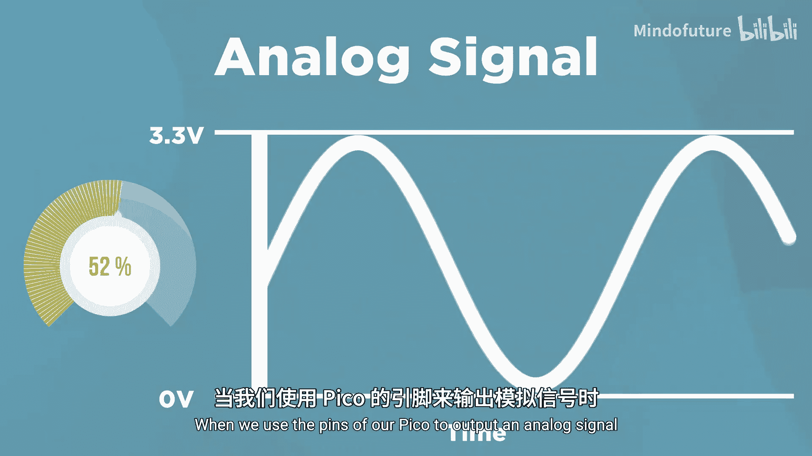
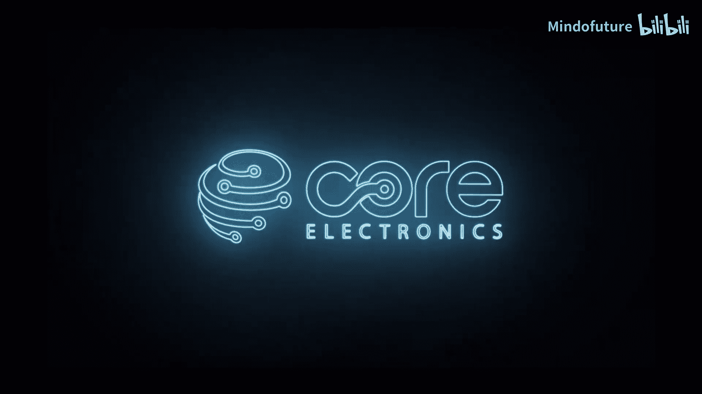

# 中英-•-树莓派Pico初学者入门｜微控制器｜编程｜电子学｜MicroPython-p09-P09-Introduction-To-Basic-IO---Chapter-2.1--BV1eKXLYzEP4_p9-

🎼In this chapter we're going to get the Pco to start observing and interacting with the world around us using basic inputs and outputs or basic IO When we say basic IO。

 we mean that we're going to be inputting an outputting digital and analog signals with the GPIO pins of the Pco starting off digital signals can only be two possible states either on or off and when we use the pins of our Pco to output a digital signal it's kind of like a regular light switch you can either turn power on or off no in between an analog signal on the other hand is a signal that can be any value between on and off or the maximum and minimum values It's a bit different to a digital output in that it can take any of the values between them when we use the pins of our Pco to output an analog signal we use them kind of like a dimable light switch you can set any brightness between fully on and fully off we're just introducing these concepts now and once we dive into them with some examples all of this。

Become much clearer on top of writing code to use the Pcos pins for basic I O。

 We're gonna just weave in a little bit of circuit making。

 a little bit of theory on power and some general knowledge on the Pco so that by the end of this chapter。

 you should have the skills to plug in some basic hardware and get your Pco to start interacting with the world around it。

😊。

