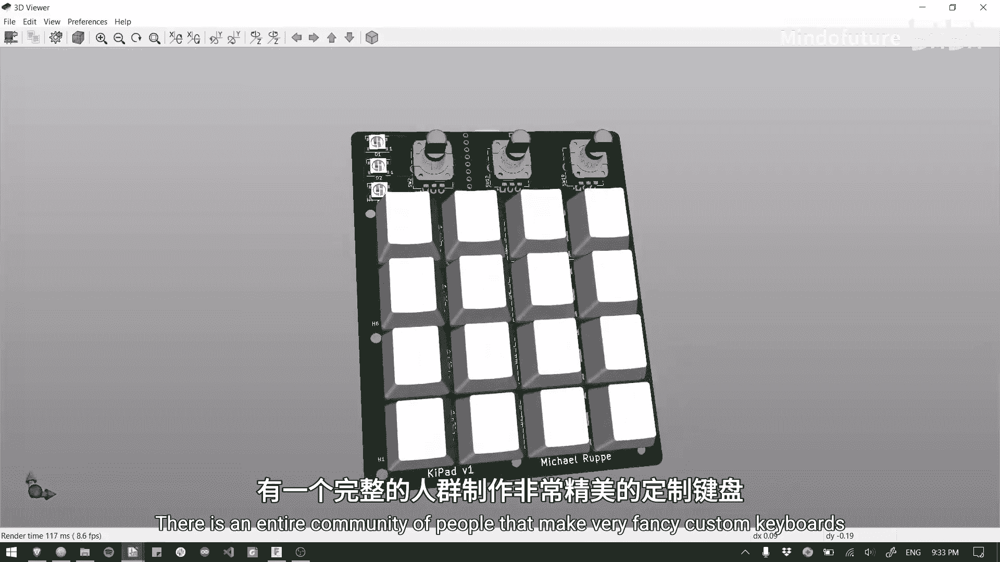
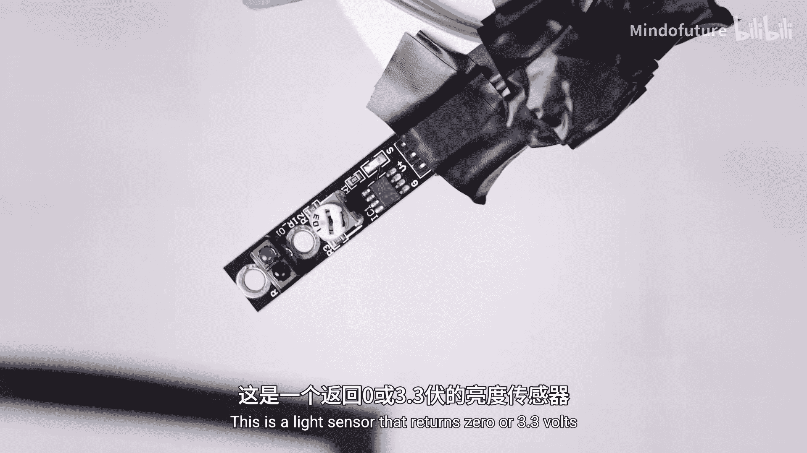

# 中英-•-树莓派Pico初学者入门｜微控制器｜编程｜电子学｜MicroPython-p12-P12-Reading-Digital-Inputs---Chapter-2.4--BV1eKXLYzEP4_p12-

🎼Let's learn how to read digital inputs like digital outputs or 26 of the Pco's GPAO pins are capable of acting as a digital input When we code digital outputs we use dot value1 to set the pin to 3。

3 volts and dot value 0 to set it to zerovols but when we use digital inputs when we read it it's exactly the same but in reverse if we got 3。

3 volts from somewhere and connected it to a digital input pin The Pco will read that as a value of one in our code and if we set it to0 volts。

 it will read it as0 it's kind of just measuring whether the voltage on the pin is 3。

3 or0 volts and it will return 1 or0 depending on what it's currently being supplied with again the best way to learn is through example so let's jump straight into one and take a look we are using a button as it is the perfect example of a digital input device if you haven't already wired up the。

It from last video and you want to follow along， ensure that you have wired this up at least。😊。

So file new and then paste the demo code。 It's on our course on our course page。

 If you're on YouTube。 there's a link in the description below to that code Here is our code beautiful and short because we've stripped it down as much as possible So we're just kind of really getting into that digital read So again we start by importing libraries and modules by importing pin here we're able to use the dot value and the pin setup functions here。

 very important。 We also import time here as it allows us to use the sleep function Then we need to initialize our input pin and we store that in a variable that we called button we use the same command as before but this time in the settings we want to use pin 15 because that's what we've got our button plugged into and we're going to set it to an input this time with pin do in this third setting is an optional setting here where we can enable something called a pull down resistor and we will talk about that in just a bit。

 an important thing worth highlighting here is that a lot of。

So if we change this capital P to a lower case P and if we run that。

 we can see that it gives us a syntax error because it doesn't know what the pin command is。

 what what this pin in here is so。Everything is case sensitive。

 even if I change that capital N to a lower case， it'll still throw out errors for us。

 So always ensure that you have the correct capitalization。

 That is a pretty common syntax error and it's often hard to find in your code Now to read a pin that we have set up as an input we simply use this dot value command here with the empty brackets。

 So here we're saying read the value of the pin that we set up and we called button and then print that to the shell here。

 and that is all inside of this infinite while true loop So it's just going to keep repeating that over and over。

 We also have this very short sleep here for。1 seconds。

 This delay is just to slow everything down a little without it the Pico will check the voltage on that pin millions of times a second but we don't need that and it causes some issues so we choose to delay it by01 seconds。

 which means that it will check the pin 10 times a second which is more than enough for what we need here。

 the way that we have the button wide is that when we press。

down we connect pin 15 of the Pco to the 3。3 volts that's coming from the power rail that we set up and when we don't press it。

 we aren't supplying any voltage to it and this perfectly aligns with the 3。

3volt logic level that the digital input reads at so make sure your Pico is plugged in run the code and if everything is connected up correctly you should see that the Pco is printing the current state of the button with0 being not pressed and one being pressed and supplying 3。

3vols if you want a nice graph view of this you can hit view and then click plotter here and if all is right。

 you should be able to press the button which will connect pin 15 to 3。3 volts。

 which will return a value of one。Now， a question that sometimes pops up here is what happens if instead of 3。

3 volts exactly I supply2 volts or one volt to the pin。 what will it read。

 I've set up some demo code here to show us exactly that as it's a good learning experience don't worry about replicating this though It's just for demonstration purposes So here I'm using a potentiometer。

 which is a kind of variable resistor to manually create a voltage between 0 and 3。3 volts。

 This blue line here you see in the graph is a direct reading of that voltage and we're going to learn how to do this reading in a future video but the orange line on the other hand is what the pickco is going to digital read that voltage and as you can see that's either going be0 or one So you can see that it doesn't need to be exactly 3。

3 or the 0 volts。 you have a little bit of wiggle room on both ends of that I should clarify though this is only for digital inputs when using digital outputs like we did last video。

The pin won't have this wiggle room it will be extremely close to outputting 3。

3 or 0 volts that's for digital outputs I've got a similar setup here again don't worry about replicating this again it's just another demonstration the blue line is the actual voltage and the orange is the digital input state and as you can see when we push the button it behaves exactly as we expect it goes up to 3。

3 volts and it starts reading one back to the peaker but let's see what happens when I disable the pull down resistor which we can do so by just deleting a that like so。

😡，If I stop it。😡，And then rerun it。 We'll be running this new code here and off the bat。

 you can see that something is wrong。 I'm not pressing the button， by the way。

 I'm not touching it in any way here now I am and as you can see it behaves fine but when I let go it's a bit haywire it's kind of floating around that voltage is just floating by itself。

 And the reason for this is that when we press the button we supply a no 3。

3vols to the picos pins and it behaves fine but when we let go we aren't technically supplying any no voltage to it。

 So it kind of just floats around like it does here。

 And that is why we need pull down resistor as it very weakly pulls that voltage down to zero。

 So when we aren't supplying 3。3vols to it it doesn't float around we ground it to something a no voltage Now a lot of the time you need to manually wire up a pull down resistor from the button to ground but the Pico has。

Tinny little ones inside of it that you can enable with code just by putting that on the end of your pin setup whenever you set up a pin as an input that is extremely helpfulright one more example for this video and this time it's one that you can actually follow along with with the circuit that you've wired up let's mix this digital input with the digital output that we learn so copy the second demo code and paste it into a new file So in this code we have our inputs here exactly like before followed by setting up two pins here pin 15 with the button and pin 16 as an output which is connected to our LED now in the wild true loop we introduce some new functions this is an ifL statement and we will be learning more about logic like this in the next chapter but for now how it works is really simple here it checks the value of the button pin and if it's equal to one it will run the code that is inside of it which is this turning on the LG here anything else besides that or。

It's not equal to one， it will run the code in here， which turns the LED off， and as you can see。

 it follows the same syntax as the wild true loop， it needs to be indented in here by。😡。

4 spaces or one tap。 And if we run that code。 and you should be able to see that when you press that button。

 the LED lights up and the code that we have here beautifully represents the most basic application of a microcontroller。

 It reads in some sort of data， the state of our button in this case。

 then does some decision making or calculations without if statements and finally output some sort of signal to control something。

 our LED in this case。 So that is how you read a digital input with the Pco。

 But what else can you do with this。 Well， this button could be a big red emergency kill switch on a robot or any project really。

 if the button is pressed， shut down everything for safety reasons。

 you could string a whole heap of these buttons together and make a keyboard。

 there is an entire community of people that make very fancy custom keyboards and they use microcontrollers like the P code to do so。

 If you don't want to do with buttons， there are plenty of sensors out there that you can use。

 For example， this sound sensor。😊。

We'll return 0 volts if it's pretty quiet and 3。3 volts if it's loud so you could make a set of lights that you can turn off and on with a clap。

 This is a light sensor that returns 0 or 3。3volts you could point it down to the ground and use it to make a robot which follows a line which is a very common beginner project a really cool one is one of these ultrasonic distance sensors it technically uses a digital output and input but what it does is that it sends out a burst of sound that we can't hear and then when it bounces back it returns 3。

3volts you guessed it correctly and with a little bit of math you can figure out how long it took the sound to travel and calculate distances with sound how crazy is that So three key takeaways from this video we need to import modules and libraries to use helpful functions like sleep2 any of the 26 GPop。

Can read a digital input with0 volts returning  zero and 3。3 volts returning81 and three。

 when using components like buttons， you need to use a pull down resistor to keep the voltage from floating around the place。

😡。

