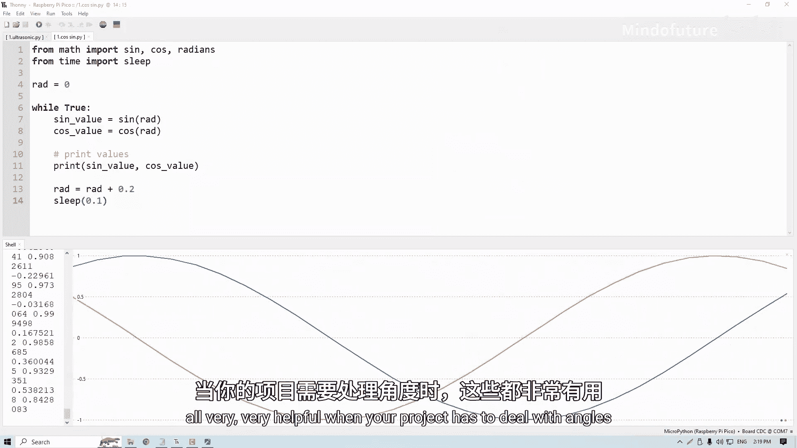

# 中英-•-树莓派Pico初学者入门｜微控制器｜编程｜电子学｜MicroPython-p13-P13-Variables---Chapter-2.5--BV1eKXLYzEP4_p13-

🎼Variables are an essential backbone of programming and we're gonna dive into them now that we have a little bit of familiarity with coding Vas are a way to store data and information in your code。

 an easy way to think of variable is like thinking of them as a box which we can store numbers or words or any sort of information in Let's say that with code we wanted to keep track of how old a dog is we could create a box called age and let's say this year my dog is three years old we would start by storing the number3 in it then every birthday we would go okay whatever is in the box。

 add one to it and every year we would keep adding one to it without having to keep a track of what number is inside the box we don't need to know what's inside we just add one to whatever is in there then at any time we could check how old my dog is by just checking the number in the box we don't need to do any calculations or remember how long we've been counting for anything like that because we've kept track of that with a。

Now， that example might seem a bit easy， but when you have to keep track of dozens of variables and numbers and states and countdowns on a microcontroller that can perform millions of calculations a second。

 variables become an incredibly important and simple way to keep track and use data in your code and there are also many different ways to use variables。

 that was just one example We've already been using variables when we set up pin 15 as an input。

 we store that pin instance in a box called button。

 And then when we wanted to read the value of that pin we kind of read the box called button which has the pin instance inside of it。

 Now that's just another way that we use variables。

 And the best way to learn is through some examples and to see them in action。

 So let's get into some So copy and paste the example code into a new tab and save it。

 The example code can be found on our course page on our website linked to that in the description if you're on YouTube Now this code is very similar to the dog's age example。

Doing hearers we're simply counting how many seconds the button has been pushed down for。

 So we import our libraries as usual， set up a button on pin 15 and then we create a variable here called timer And as you can see it is super easy to create one you just type a name for the variable equals then and then whatever data you want here we will be going over some of the rules on creating a variable in a bit though then in our while true loop we start with a one second delay then after every second we check the button and if that is equal to one。

 meaning that it's been pressed it will set the variable called timer to timer plus one we're just increasing the count of timer here by one really straightforward。

 then we just print whatever number is in the variable box called timer Also worth noting is in this print function here we don't need the inverted commas and we don't need them whenever you're printing a variable or a number directly we only need that if we want to print some text directly with like hello world or something plug in yourpeco and。

We run our code， you can see that every second the Pco will print out the current value of timer we aren't pressing the button so it's not increasing and if we hold it down。

It will count how many seconds it's been held down for。It'sVery slow。 It's a little bit slow。

 if we let go。It'll stop counting。 Let's do another example by modifying the button and LED code from the previous video。

 the sample code is also found in the same place。 If you already don't have that in this code。

 we turned on an LED if the button was pressed very， very straightforward。

 But let's say on top of that。 We also wanted to print the state of the button to this shell as well。

 We would just add this print statement here， with the associated time to just slow it down a little bit。

 Now， this code is perfectly fine and you can run it and you can see that it lights up the LED and it prints the value of the button to shell。

 But there is a better and more efficient way to write this code by using variables。

 to explain why it's more efficient。 I want you to imagine that instead of the P code reading the button。

 the P code is you and you are checking if there are clouds in the sky or not。

 So the first line would be if there is a cloud in the sky， Turn the LED on。

 You would need to get up， go outside， check for a cloud and then come back in。😊。

IfThere are clouds you turn the LED on。 Then immediately after that。

 we have a print function here and this command tells you again to get up and go outside and check for clouds and then print if there are clouds or not。

 but you literally just checked you already know what it is right You're not being very efficient your P code is so fast that the time between the two button checks in the if and the print statement is probably about a millionth of a second。

 the state of the button isn't going to change in that tiny amount of time。

 I'm going to modify the code now to do it the better way instead and I'm going to start by creating a variable called button stamps calling it B state for short and I'm going to set that。

😊，To our digital read。 So now we're going to take the digital read and we're going to store it in B state and then I'm going to modify our youth statement to just use B state and our print statement。

To use B state as well。 So now we start the loop by checking the button and then storing in a variable and now our if and print statements just use that variable instead。

 And this is way more efficient， right， If you had to check for clouds。

 you would go outside once and check and in your head。

 you would store it as a variable and remember whether there were clouds outside or not。

 It's not like that the amount of clouds in the sky is going change and the 10 seconds。

 it takes you to do those things And exactly like you having to get up and go outside and check for clouds。

 it takes the peak code。 time and resources to read the state of its pins。 In this case。

 it doesn't really matter whether we use variables or not like this。 The code will work the same。

 But when you start to get more complicated and lengthy code telling the peak code to check every time the state of the button can slow it down quite a bit。

 But I would say the way we've done it with variables here is technically the better way to do it。

 it's also better practice。 and it helps to make it a little more。😊。

Han readable something really important worth mentioning here is that variables are temporary。

 If you turn off the Pco all the data stored in those variables is lost completely wiped and you will start fresh again when you turn the Pco back on a really great thing about micropython is how easy it makes using variables and because of that you can kind of get away with not knowing the thing that I'm about to talk about。

 but we're gonna quickly cover it because it is very important and that is that variables have different types and these types matter a lot There are quite a few different types of variables but just to introduce them we have three extremely common ones Integers floats and strings strings are easy you can think of them as a box that only stores words and sentences or anything you can type on your keyboard really so I'm going to create a string here and I'm just gonna go this is a string there it is。

And I put it in those inverted commas and I'm going to store it in the variable called X。😊。

And then we can just print X。 And if I run that， it prints it to the shell。 again。

 I don't need to put inverted commas if I'm printing a variable。

 even if I'm printing a variable that is a string。 But if I'm printing that string directly。

I need to put it in。Inverted commas like so。 Integers and floats， on the other hand。

 are types of variables that store numbers。 And the way to think about them is that integers store whole numbers like 1。

3，5， nice whole numbers。 While floats store numbers with decimal points like 2。3341。 Now。

 knowing what variable type to use is a bit confusing for beginners。

 But when we create a variable in microcropython， it automatically chooses the correct variable to use for the data we want to store。

 So if I just go X is equal to 2。5。 Micropython is going to automatically assign that as an float。

 We can also override that and manually set the variable type with something like。😊，Int， and then。

Brackets， and if I store 2。5 as an integer and here I'm just going to click run and now I'm just going to punch X into the shell。

 which is going to print the value stored in X。It prints us2。

 and that's because we're trying to fit 2。5 which is a float value into an integer box and the decimal just gets cut off。

 So strings hold words and sentences。 Integers hold whole words and floats hold numbers with decimal points。

 but micropyython automatically assigns the right variable type。

 which is another reason why micropython is so easy to use。

 So far I have been saying you can name variables anything you want。

 but that's technically not true because there are some rules about naming them。 First off。

 they can't have spaces。 they can only have letters， numbers and underscore。 For example。

 when we use the variable called B state。 we used and underscore for that exact reason。

 variables also can't start with a number。 they must start with a letter or an underscore。

 they're also sensitive。 So B state and B state with a capital B are not the same variables。

 and you can't use a name that is any of the。pyython keyword so you can't name a variable import because micropython won't know whether you're talking about a variable called import or you're trying to import something。

 you can't collide with existing words or phrases or anything like that micropython One more thing in the first example when we were counting for how long the button was pressed down we use the plus operator to increase the variable called timer but micropython also gives you access to a variety of other math operators。

 If you want something to do， go back to that example and change it to a minus or you could use divide or multiply exponential modulus If you import the math library。

 you can access trigonometry functions like co and sign and tan or very。

 very helpful when your project has to deal with angles you don't need to know how to use all those math related things we're just making you aware that if you need to do math on your P code to process data。

 there is definitely a math function to do so and math and variables kind of go。

Hand in hand， Allright， three key takeaways one variables are a convenient way to store and keep a track of data in your code2 variable types do matter。

 but thankfully microcropyython does a really good job of managing them for you and three variables can only have letters。

 numbers and underscores， they can't start with a space。

 They are case sensitive and you can't call them something like import。😊。

