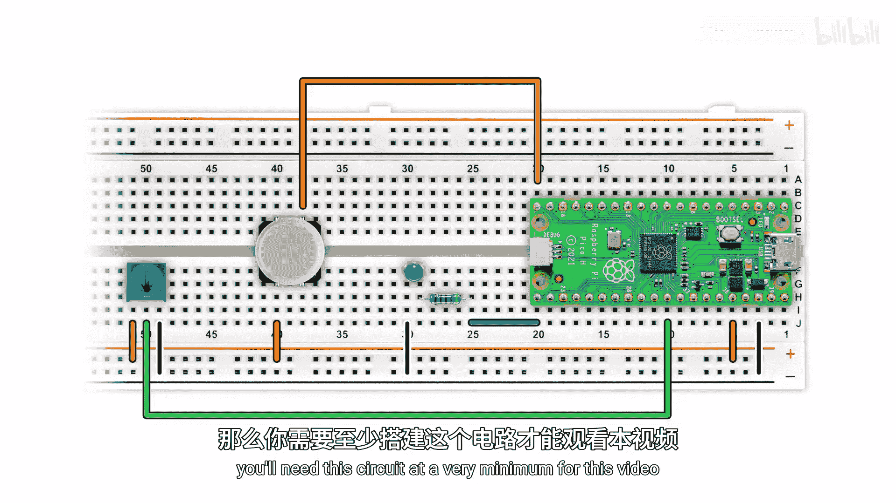
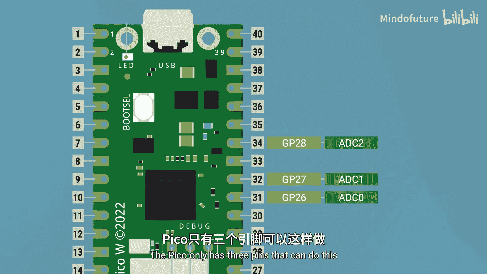
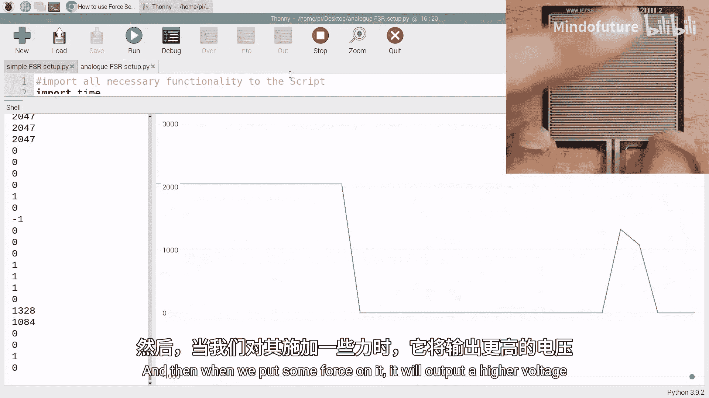
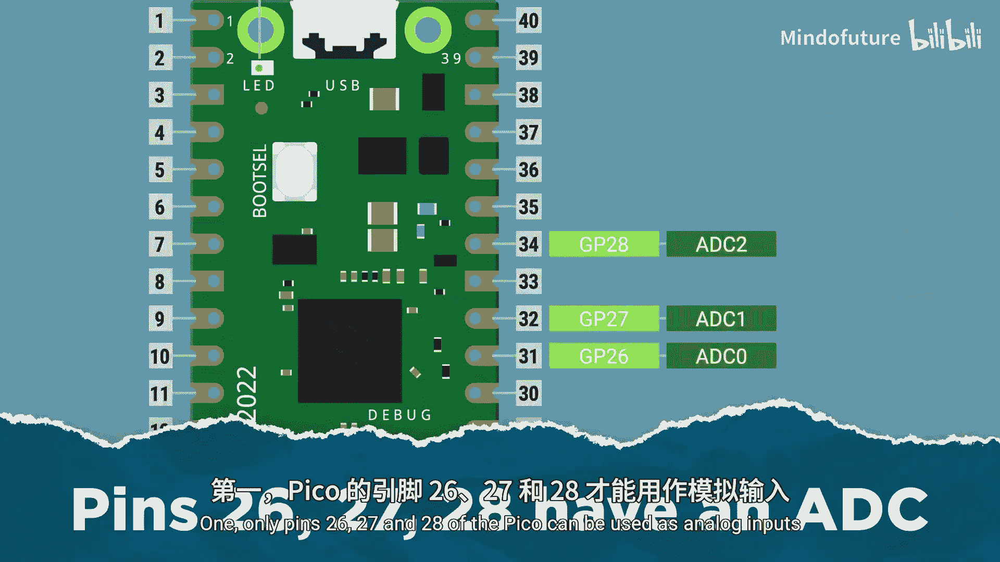
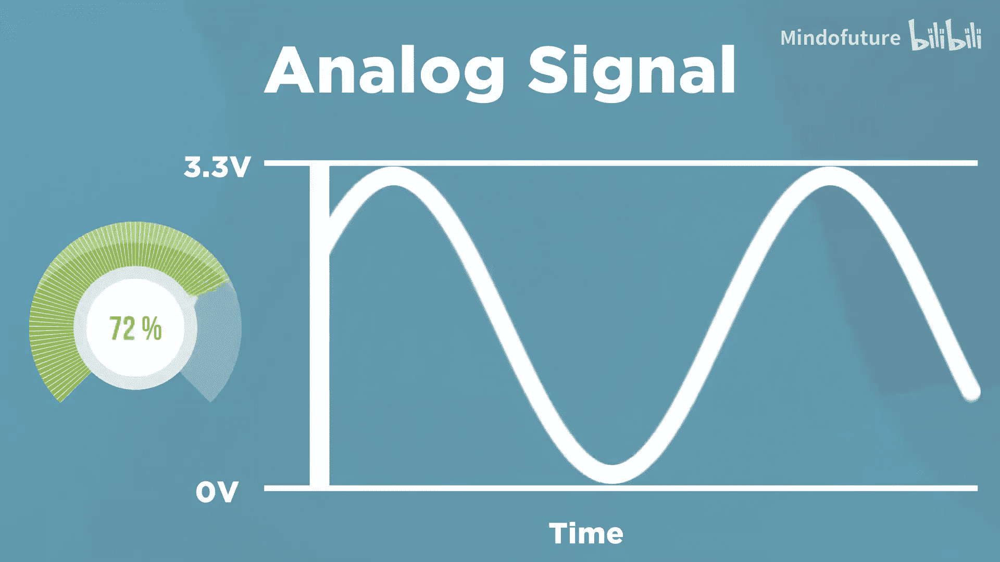

# 中英-•-树莓派Pico初学者入门｜微控制器｜编程｜电子学｜MicroPython-p14-P14-Reading-Analog-Inputs---Chapter-2.6--BV1eKXLYzEP4_p14-

🎼We finally arrive at analog signals。 This is where we really start to get into some cool stuff Now analog and digital signals are completely different things If we use the examples of clouds in the sky again。

 a digital input would be like asking are there clouds in the sky there is only a binary set of answers to this question In other words the answer is either going to be yes or no and you could write this answer as a1 or a 0 to represent that and analog input of the same kind of question would be like asking what percentage of the sky is covered by clouds there is way more than one answer to that and they will range between 0 and 100% The answer to this could be 42。

371 it could be 99。2 it can be any number between 0 and 100% and what this means for apicco is that when we set up a pin as an analog input。

 we can read the exact voltage on that pin between 0 and 3。3vol。😊。

If you remember this example from a couple of videos ago where I was manually adjusting a voltage on the pins。

 the orange line was the result of reading a digital input of this voltage and could only return one or0 and the blue line was actually just the analog reading of that voltage and we got from 0 to 3。

3vols it was just reading whatever voltage I was supplying to the pin。

 It's that easy Well not quite that easy。 there is a little bit more on that but we'll get stuck into that later。

 You should be able to guess by now we're going jump straight into an example and go over it sample code can be found on our course page on our site link in the description for our YouTube audience。

 And if you haven't already wired up this chapter circuit。

 you'll need this circuit at a very minimum for this video we start with our inputs as usual but this time we're going to import aC which stands for analog to digital converter which will allow us to set up our analog inputs Now here is where we set up pin26 of the peak as an analog input which is。

To the potentiometer on our breadboard。 a very important thing here is that only pins 26。

27 and 28 can be used as analog inputs。 The pico only has three pins that could do this。

 This is because converting analog to digital signals needs a special piece of hardware called the AD to digital converter。

 And only those three pins have access to that piece of hardware on the pico。

 If you try on any of the other pins， it just won't work。

 Then we also have this variable here called conversion factor。

 and I'm just going ask you to ignore that for now it's going be the elephant in the room we will get to that in a bit。

 Then in our while true loop we read the potentiometer with read dot underscore u 16 with empty brackets on the end。

 This is where the actual magic of reading the analog inputs happens For now we're just going to do a little bit of math here and multiply our reading by conversion factor and then store in a variable called pot voltage which stands for potentiiometer voltage。

 It's just a naming。😊。

we're using here We then finish with a print and a quick sleep plug in your P code run the code and you should be able to see that when you twist the potentiometer。

 the voltage reading in the shell should change to report whatever voltage is currently being set on that pin and you can also enable the plot which is really cool in this example as you twist the potentiometer and see a line moving on your computer and you can see that signal has a little of noise as a jitters around a little how our potentmeter works here is that we have one side of it connected to ground and the other to 3。

3vols when we turn the knob in the middle you can see it kind of mixes these two voltages Now we are cheating a little bit here analog inputs on the P code don't perfectly read between 0 and 3。

3vol The conversion factor here is modifying it to this nice voltage range before we print it and this highlights another cool way to use variables using them as constants like this。

That will never change like you can assign gravity to a variable and call it G And whenever you need to use gravity。

 you just go something times G。 Let's now remove that multiplying by the conversion factor to see what the raw data input is you can see that it's kind of behaving the same but instead of printing between 0 and 3。

3 it's just reading in the range between0 and 65535 and this is because of how the ADc and micropyython works。

 The Pico is a digital device and the world around us is very analog voltage for example。

 is an analog thing。 So in order for digital devices like the Pico here to read analog signals like the voltage on one of its pins。

 it needs to use an ADC analog to digital converter and it does exactly what the name implies it takes an analog voltage on one of the Pico's pins and turns into something that can be used by the digital Pico but the way it does。

This is that it turns that voltage into a nice whole number， nice integer number。 It's a bit weird。

 and it's just kind of how digital devices work。 But a reading here on our pico of0 volts will return a number of0 and a reading of 3。

3 will return 65535 halfway between 0 and 3。3 volts will return halfway between 0 and 65535 a quarter of the way will give a quarter of the way it maps perfectly between those two ranges doing a little bit of math。

 you can find that if you multiply by the number that we store in the conversion factor variable here。

 it will turn it back to ranging between 0 and 3。3 You don't always need to do this but our goal here is to read the voltage on the pin and it makes it more human readable in this case so we will choose to do so but you should do whatever your project calls for or you find most comfortable so we can read a voltage on a pin of our Pco as long as it ranges between。

and 3。3vols。 What else can we do with this。 Well， we can read sensors。

 The world around us is very analog， which means that a lot of the sensors you encounter will provide you with an analog signal and they are usually a lot more interesting and give you a lot more information than their digital counterparts。

 For example， this is a microphone sensor board and it has two outputs The digital output returns0 if it's quiet or one if it's loud。

 but the analog output returns a voltage that corresponds to how loud the room is so you can get more data than is it quiet or is it loud。

 you can figure out how loud the room is This little thing is a temperature sensor and it has an analog output as well。

 at negative 50 degrees。 It outputs 0vols and at 125 degrees， it outputs 1。7vols。

 So you can plug that into yourpeco do some analog reading and then you can do a little bit of math to convert the voltage。

😊，You read to the actual temperature this is a soil moisture sensor and it outputs a voltage depending on how much water it kind of detects in the soil。

 you could place it into dry soil and see what voltage it reads and then place it into some freshly watered soil and then see the voltage read higher and then you could use the pico to monitor the voltage level that the sensor is outputting and then turn on a water pump when it gets to dry We do exactly this in a cool self-watering plant kit。

 Another idea is using this it's a force sensitive resistor and we can wire it up so that it reads zerovols and then when we put some force on it it will output a higher voltage We could then place it under a mat and then use a pico to measure the spikes in voltage as people step on it you might even be able to detect whether it's a pet or a human a cat or a dog would put less pressure on it and will result in a smaller change in voltage while a heavy human will result in a larger signal What I'm trying to say here is there is just an incredible world that opens up。

Now that we can use analog sensors Allright， three key takeaways， one， only pins 26。

 27 and 28 of the PCO can be used as analog inputs2 to read an analog signal you will need to import ADC then set up the pins using ADC and read it with dot read underscore U16 and three the analog reading will input a number from 0 to 65535 which represents a voltage of the pin from 0 to 3。

3 volts。

