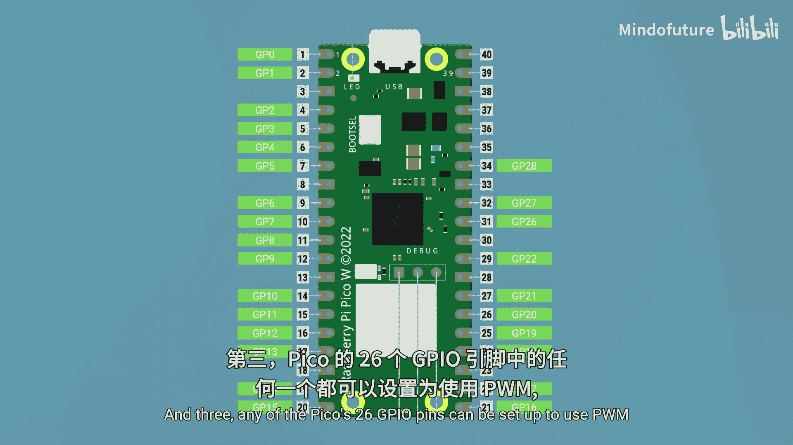

# 中英-•-树莓派Pico初学者入门｜微控制器｜编程｜电子学｜MicroPython-p15-P15-PWM-Outputs---Chapter-2.7--BV1eKXLYzEP4_p15-

🎼We've just covered analog inputs so we should now be covering analog outputs right Well about that long story short going from analog to digital is not too hard but it turns out that going from digital to analog is a lot harder to the point where most microcontrollers can't natively output a true analog signal meaning they can't output a constant voltage between 0 and 3。

3vols however we can use a little bit of trickery to create a replica or an imitation of an analog signal with something called pulse with modulation or PWM the pins of our pico can only output 3。

3 or0volts no in between but we can switch a pin on and off and on and off and off very fast as in thousands of times a second fast to create an average voltage somewhere between 0 and 3。

3volts if we had a pin on for1 millisecond then off for another millisecond than on for another。

And off for another and we keep repeating that pattern over and over。

 we create an average voltage and because we have that pin on for 50% of the time in this situation。

 we create an average voltage of 1。65 volts which is 50% of 3。

3 vols The percentage of time we keep the pin on in this on and off cycle is called the duty cycle a cycle of 100% would be on all the time and would give us 3。

3volts a duty cycle of 10% would be on 10% of the time and would give us 0。

33vols a duty cycle of 20% would give us 20% of 3。3 which is 0。

66 vols and on and you can calculate any voltage between 0 and 3。

3 for any percent duty cycle and this is how we can create our fake analog output we can use a PWM signal and set its duty cycle to output the average desired voltage that we want Now it's not a perfect replacement but it's usually a good enough。

😊，Imitation and a lot of other digital devices won't notice the difference between PWM and a true analog signal。

 Let's copy and paste the demo code and go through an example of this。

 The code can be found on our course page on our website link in the description for our YouTube audience。

 So this is just the bare bones code to get our Pco to set a PwM signal on pin 16 which we have an LED and resistor connected to to use PwM will need to import it from machine and then initialize the pin that we wish to set up as an output and this syntax is very similar to setting up a pin to use ADc。

 One thing different though is that any of the Pco's 26 GO pins can output a PWM signal。

 which is actually quite a lot for a microcontroller。

 Now on this line we're setting the frequency of our PWM signal。 This is not duty cycle。

 It is how many times a second the pin is turned on and off。 Not what percentage。

Of the time the pin is on setting the frequency like this is entirely optional and you can remove this line and it will still happily work。

 it will just default to whatever the default PwM frequency is There are just some cases where you will need to manually set this frequency so we've included it but I'd like to stress again this is not the duty cycle it's more so how many times a second the duty cycle is pulsed on the pin play around with it if you want it can go all the way down to8 but usually you should leave it at about 1000 Then here we set the duty cycle on the pin with duty underscore U16 but we have the same issue as analog inputs we can't just directly put in the pwm duty cycle that we want we can't just put in zero to 100 It has to be a number between0 and 65535 which linearly represents zero to 100 percent duty cycle that's why I've got this variable called max here it's the maximum value that corresponds to 100 percent duty cycle or 3。

3t。And the way I have it set up makes it easy to set a duty cycle In this example I'm setting up a 50% duty cycle with 0。

5。 If I run this code， the LED should light up， but a little bit below full brightness and using a multimeter we can see that it reads about 1。

65volts If I change the code and set the PWM to 20 duty cycle you can see that I measure 0。

66 volts on my multi let's finish this video by taking a look at the second lot of example code This code will read the voltage from the potentiometer and output it onto pin16 of the P code a nice and simple example that kind of nicely demonstrates analog inputs and pwM outputs in an interactive example here we're just reading the raw analog input value of the ADc some number between 0 and 65535 Storing it in a variable called pop value and then outputting that exact value onto our PWM pin We also print to the shell。

😊，So we can see what's going on run the code and you should now see that the LED brightness is now being controlled with the potentiometer and this is a really cool ability we have unlocked with analog inputs and pwM outputs So now we know how to use pWM to set an average voltage between zero and 3。

3vols on the pin of our Pico but what can we do with this what we can do most of the things that we can do with digital outputs but now with a little more control and finese as we've seen we can now control the brightness of an LED which gives you way more abilities than just turning it off on Rgbs are really fun to use they can take3 pwM outputs to control the brightness of the red green and blue LEDs inside of them to make any LED color you want Mosvets and transistors work with PWM as well here we are using the pwM of the Pico to control the brightness of a car headlight but I think one are the most powerful things that Pw。

Enables is the ability to now control motors Ob examples are in things like RC cars and planes and drones which need accurate control of the speed of their motors through pWM fans have motors in them you can now use an analog temperature sensor and write code to increase the speed of the fan as the temperature rises There are also a variety of motorbased auators to use linear auators to push and pull things around stepper motors for accurate rotation and servos which are amazing little devices which let you control things with very precise angles All of these being controlled with a PWM signal from the Pco three key takeaways pulse with modulation or pWM can be used to imitate an analog output by rapidly switching a digital pin on and off we use the term duty cycle to describe the percentage of the time that the signal is on and this is how we control the average voltage of the pin and three。

😊，Any of the PCO's 26 GPAO pinNs can be set up to use PWM， which uses a value between 0 and 65。

535 to represent zero to 100% duty cycle。😊。

