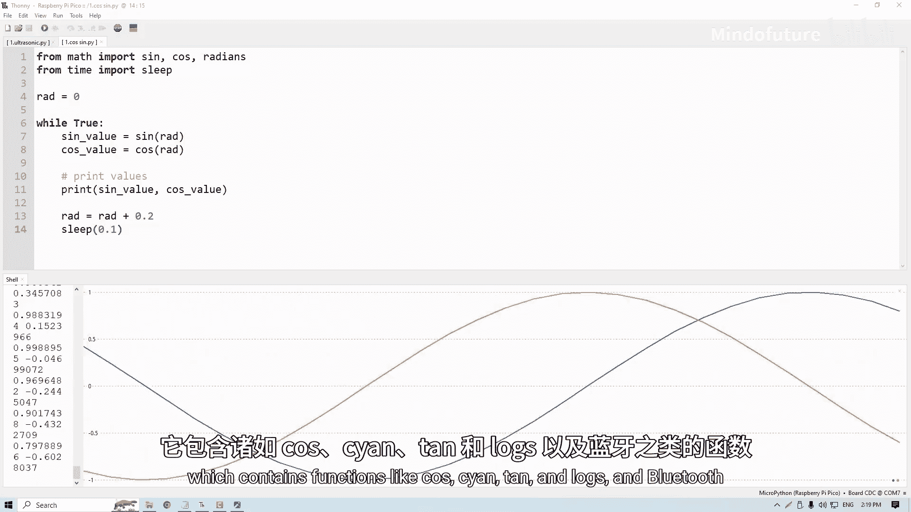

# 中英-•-树莓派Pico初学者入门｜微控制器｜编程｜电子学｜MicroPython-p16-P16-Importing-Libraries---Chapter-2.8--BV1eKXLYzEP4_p16-

🎼Libraries are an incredibly powerful tool that can make life a lot easier because they're kind of like just prewritten pieces of code that can do a lot of the heavy lifting so you don't have to We've actually already been using some libraries mainly for sleep and for the setting up of the pins When we use time dot sleep we don't need to see what's going on behind the scenes but there is an incredible amount of things that happen to get the Pco to go into that sleep what happens on a hardware level is quite complex and very involved but thankfully you import the time library just a single line of code timet sleep and it does it all for you libraries let us use prewritten code to make our life easier Now let's get practical microcropyython has something called standard libraries when you install micropython onto your Pco these libraries come inbu with it and to enable it all you need to do is import and then the name of the library to name a few of these libraries we have。

The machine library which lets us use ADC， PWM and pin。

 which lets us set up the pins of our Pco we have the time library which we've been using for the sleep function。

 There's also the math library which contains functions like cosentan and logs and Bluetooth Bluetooth lets you use Bluetooth functions on your Pico there are quite a few standard libraries and a quick Google search will let you know which ones you can use So we have standard libraries but there is also a world of external libraries and there is a mind boggling amount to them often for very very specific and niche applications a lot of the time when you buy a module like this really cool OLED display here you will find links to an external library to help you use it or if it's a common module you'll be able to find some with a quick Google search and when you start using more complex modules like that OLE module where it's quite difficult to interact with it you're gonna be using a lot of libraries and a lot of the work you're doing is gonna be very library。

But these external libraries need to be downloaded and installed onto your Pco they don't come standard with micropyth and so let's go through an easy example of a library that you might commonly use the servo library so we're just going to go through the real worldd process of looking for a library to help drive a servo and adapting it into the code and figuring out how to use it So Sers are a little device which let you control the exact angle of this arm with PWM but they are a little complex as they aren't controlled directly with Judycycle more so how long between each pulse and it's not too difficult but there is a little bit of calculation required to figure out what PWM at what frequency to send to the ser so it's usually just a lot easier to just use a library for that So to do so we're going to need to start by downloading and installing the library onto a Pco which is a piece of cake in thumbmy ensure that your Pico is plugged in and that you have the correct comp。

lect it then go to tools and hit manage packages from this window that popped up we can search and install libraries from the Python package index or Pipe and this is the largest repository or collection of Python and microcropyython libraries out there so we're going to be looking for the microcropyython Servo libraries so we're just going to punch in Servo that might get us set if not we need to punch in microcropython Servo No we're going to need to type in。

My current。S。And there it is click on it and then just hit install and that is going install the library for you。

 Something worth mentioning that light micropyython this is only installed onto this Pco。

 So if you use another pico you'll need to reinstall all the libraries onto it again from here we can see that it's actually installed onto our Pco and if we go back and then we go into files and then into our library folder we can see that we now have it in our library folder on our Pco cool we're going to installed but how do we know what functions this library has。

 how do we know how to use it this is where we're going to have to rely on the creator of the library to give us some documentation on how to do so。

 a good way to check is to go back into manager and then we can go click on there Wait to load a second and then we're going to be able to open up the Pipy page which hopefully has some documentation for us like it does sometimes you may have a specific web page or guide with documentation on it already。

Maybe a quick Google search of the library can give you something。

 Whatever is available is best here we can see that the creator of this library has already given us some example working code。

 which is really helpful in this situation as well as we've got something called an API which is kind of how to actually use this and this can be a little bit technical and complex sometimes to read especially as a beginner so if you can find working example code to copy and paste and adapt。

 That's usually a bit easier。 librariesries might have really terrible documentation and you might struggle to figure out how to use that library some might have really great documentation and it's a walk in a park and I would usually select a library that has good documentation just to help us make just just for it to all be a lot easier and nicer to use So this looks really straightforward I'm just going copy and paste it into thny just as a starting point to see what happens。

Alright， let's plug in our 9 gra server so we can see what's up。

 Now there is two common colour schemes for the three wires on the end here。

 So we're just going to go through both of them。 Okay， so for our power wires。

 you're gonna have a red and then maybe a black or brown one so plug ground into ground。😊。

And then we're going be powering it off of Vbu this time， which is the one on the top right here。

 This is because this servo runs on 5volts and not 3。

3 volts and it can draw up to 600 milliamps of power。 We'll talk about this in a later video。

 Then we're gonna grab our signal wire， which is either going to be orange or white and plug it into GP0 at the top there this is just for our example。

 any pin that can create a PWM is one that we can use for a servo。

 Okay we're going go back into our code now and first things first I can clearly see that that is how they're setting up the pin。

 So we'll set it to pin 0 which we're plugged it in with importport time import the library So from Servo they're importing the Servo library we just installed。

 And if we run that sample code。We can see that the ser twists。

Now from here I can modify this code however I want like here I've put it inside of a wild true loop and then I've changed the sleep to1 seconds and then I could change this to 0 degrees 90 degrees and18 degrees and if I run that we can now see that it is swinging 90 degrees each time here I've just found the most important things which is the command to actually set the angle of the servo and the actual setting up that's required to get to that point and this might need a bit more investigation depending on what library you're doing but it's a process that you're frequently going to do and the experience is going to be different every time There is also another way to import a library Sometimes you might get the library directly as a dotfi you might be following along with a tutorial and then it just throws you the library directly as a file like this so to upload it to the board you're going need to obviously plug it in and then open up the file Expr in thny then under your computer files you're gonna need to navigate to the location of the library so here it is for me and then on your。

You want to open up the library folder and then just simply rightcl and upload to library and then that's just gonna put it on the board for you to be able to use and this works not only for libraries but any microthon code so if you wrote something really cool you can take it off your board and then put it on the internet and then somebody else can take it from the internet and put it on their board exactly just like we did here something important worth touching on here as well we might have seen two ways that we've been importing library so far so there is just the import which we're doing here and then we've also got the from something import something and they're both importing a library but they're doing it in slightly different ways let's use the time as an example when I say import time I'm telling it to import the entire time library with all of the functions that it contains and if I want to use the sleep function I have to say in the time library sleep use the sleep function the other way to do it is that I could say。

Wrong time imports sleep。 And what this does is it only imports the sleep function from the time library。

 When I do this， I have to change how I use sleep in my code because we don't need the time dot prefix anymore。

 I can just use。Sleep this also means that if I only just imported machine， which imports pin， ADC。

 PWM and every other thing under machine， when I call pin here。

 I have to specify machine dot pin with the prefix and also in here。😡，Machine do pin。

 and then I'd also have to do it。If I can copy past there as well which gets really lengthy So if you import the whole library when you call a function you need the time dot or the machine dot prefix on the front there if you just import that specific function from the library you don't there is no right or wrong way to do this or how you import libraries and you should do whatever you are comfortable with whatever the project requires so three key takeaways libraries are prewritten pieces of code that can make life much easier for us two there are standard libraries that come with micropyython and external libraries that you can go out and find and install onto your peak and three when using external libraries you will need to look for documentation in order to figure out how to use it and you often have to rely on the creator of that to make good documentation。

