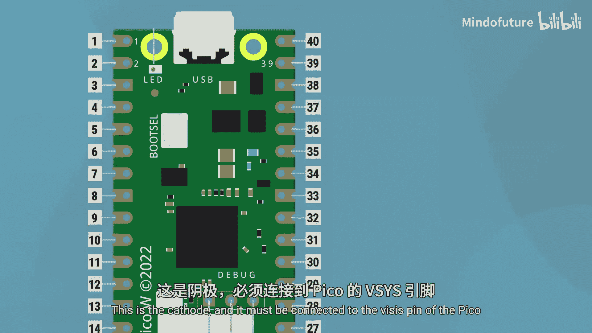

# 中英-•-树莓派Pico初学者入门｜微控制器｜编程｜电子学｜MicroPython-p17-P17-Running-a-Pico-Without-a-Computer---Chapter-2.9--BV1eKXLYzEP4_p17-

So far we've been running our Pco off of our PC both by powering the Pco off of it and by running code stored on the computer but running it on the PCO and this is fine when you're developing code but most of the time your projects will need to run without a computer so in this video we're gonna go over how to run code off the Pico itself and how to power the thing In Tny if your Pico is connected and the right comp is selected you're able to hit view and then click files and you'll be able to see on this top tab here you'll be able to see your computers files and on this bottom tab you'll be able to see the files stored on the Pco itself your Pico might be rather empty Min here is a bit chos full of files from some previous projects and all of these do P filesfil are actually micropyython code which we can open exactly like if they were on a PC except we're just kind of storing the files on the Pico like a USB stick and as you can see we can open up a file we can edit it work on it。

 save it。Put it back on the Pco Now if you see here I have a file called main dot Pi and this is a very special name as it's the file that the Pco will run automatically whenever it is powered on for example。

 this USB is not plugged into a computer just a phone battery bank and if I plug it in the LED RGb code works because I've saved it as main dot Pi。

😡，And that's how we run code without the computer。 You get it all written up。

 Store it in main dot Pi and the Pico will always run that file if it's stored on it。

 If you want to edit the code， then you can do so by plugging in the Pico， go back into Tny。

 open up main dot Pi， edit it， saveve it， put it back as long as it's called main dot Pi。

 it's gonna run it when it first gets powered on super easy Now we need to power and to do that there are two common ways to do so。

 The first is the way we've been doing with microusB。

 And the second is by connecting our power directly to theis。

 Let's start with the micro USB because it's probably the easiest to do very straightforward。

 plug the micro USB into the Pco。 And the other end into some sort of USB power supply like a phone charger one of those bricks that you plug into the wall or a power bank like this。

 Any 5volt USB power source that you can charge your phone off you should be able to power your Pico off quite happily。

 Something worth noting here is that while powerbank are a really great way to easily power your Pico with。

Battery power， they may have some issues doing so。 Long story short， the Pico consumes a very。

 very small amount of power and many power banks are designed to turn off if they don't sense enough power being drawn from them。

 it's just a power saving thing For example here I've got my pico plugged in and if I plug in this you can see that it powers on and it's not detecting enough power being drawn and it shuts off and it's no longer supplying power to the Pico Not all of these have that power saving feature。

 And if your project draws a bit more power， you may be able to satisfy that power saving requirement mode like this Rgb LED here is actually drawing enough to keep it on。

 if you've got one lying around， just plug your project into it and see if it will keep it power。

 Another great way to power your Pico is with one of these it takes3s and it has a microusB cable that you plug into your Pico and the 3a should happily output about 5vols for your pico So besides powering it via。

USB we can power it through the Vces pin on the pier to do so you're going to need a power source that can provide 1。

8 to 5。5volts which might come in the form of some doublea batteries a solar panel a lipo battery or a bench top power supply as long as it's between 1。

8 and 5。5vols then you plug the ground or the negative of your power supply to the pico's ground and then the positive terminal to Vs and it should power up nicely now there is something extremely important to remember here do not plug in USB power and Vces power at the same time because you're most likely going to damage or destroy something The voltages are probably going to be mismatched and you have voltage backfeeding to a power source and that's not good something will break or go bang That's why we recommend when using Vces to power your project you use a diode for an extra level of protection here I aming Vces but between the positive。

my power supply and thisis I have put a diode which only allows power to move in one direction。

 It creates kind of a oneway street for electricity and if the diode is placed like this I can safely power it with two power sources at the same time I'd like to repeat only with this diode here Can you power it with two power sources at once diode's a poll which means they have a correct orientation There is a line on one side of the diode this is the cathode and it must be connected to the Vces pin of the pecode but what diode should you use well a shotkey diode or a general purpose rectifying diode should work as long as it can handle up to one amp of forward current We have one linked in our course page on our website that is suitable for this application link in the description for our YouTube audience。

This is only a recommendation though if you don't want to use a diode you can do so if you wish just be extremely vigilant that you don't plug both power sources in at the same time For example I've got it powered with Vcess right now and I want to update some code and so I'll plug it into my computer and open up thian os I accidentally forgot I've got both power sources plugged in at once by accident and maybe my USB port on my computer is damaged if only I had a diode to protect me from this exact situation so three key takeaways you can store files on the Pco and main dot Pi is the code that the Pco will first run when it is powered on2 the Pco can be powered through microusB and through Vs and three you cannot power the Pco through both of these power sources at once without a diode for protection。

😡。

