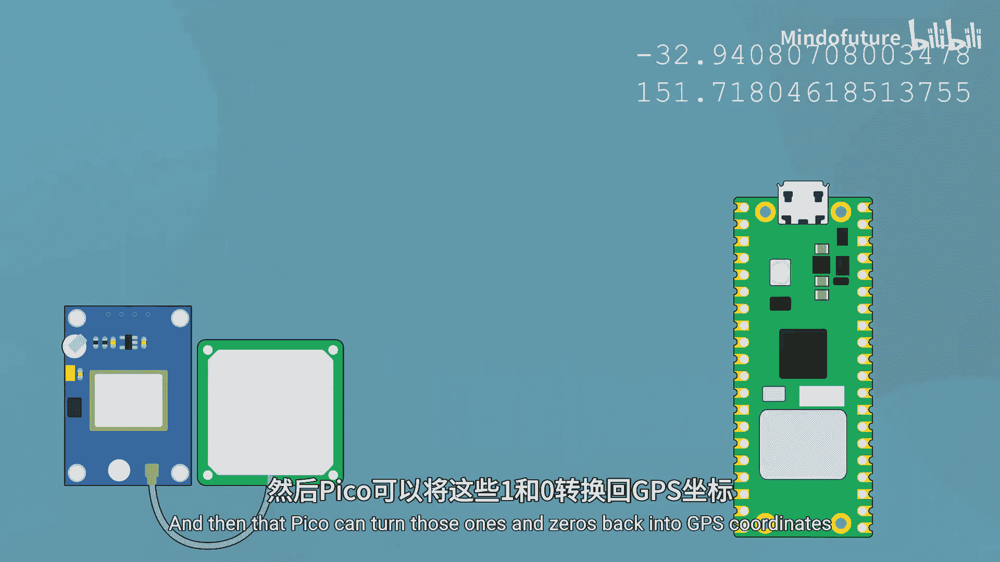

# 中英-•-树莓派Pico初学者入门｜微控制器｜编程｜电子学｜MicroPython-p25-P25-Introduction-to-Advanced-IO---Chapter-4.1--BV1eKXLYzEP4_p25-

🎼So we know how to read digital and analog signals and these are great they're really handy but what if instead we wanted to use some more advanced sensors like this GPS module here how on earth do you read GPS coordinates with a digital or analog input Well this is where we're going need to use something called a communication protocol communicationic protocols use ones and zeros or bits to send information between devices in binary and our Pco here does this by setting the voltages on its pins 0volts is a0 and 3。

3volts is a one so the Pco can set those two voltages very quickly to send bits of ones and zeros to another device so we can take information like a GPS coordinate turn it into ones and zeros then send it over a wire to another device our Pco in this case and then that Pco can turn those ones and zeros back into GPS coordinates We're kind of just turning data into voltages and then on the。

The device turning those voltages back into meaningful data Now both of these devices must speak the same binary language and they also must agree on a system of how they are connected to each other and how they transfer data to each other and this system they both used is called a communication protocol we will be covering the three most common of them you are S and I squared C and all of them have their own uniquequirks and different applications but we'll get into that later we're going learn how to use modules with Pco For example this is an atmospheric sensor with an onboard temperature sensor you connect 3。

3volts and ground to power and then you connect these two wires back to your Pico and from these two wires it's going to send the exact temperature reading back to your Pico remember if we were to use a temperature sensor through an analog input on our Pico we would only get back a voltage and then we'd need to look at the data sheet and use some equations to figure out what's the temperaturebased。

On the voltage that the sensor is reading and that's fine there are situations where you would do that but you could also just grab one of these sensor modules and that would do all the work for you and it just reports back the final temperature and then is a huge advantage of these modules they are easy to wire up easier to use and most of the time they're going save you a lot of time and you can find a module for basically anything Here is an OLED screen that you might have seen as' been using already and here is one to control sers on you can plug four servers into it and then control that with just two wires Here is an ultrasonic distance sensor color sensor atmospheric pressure sensor compass there is a lot of different sensors and peripherals that come on modules I'd like to finish here by saying that this world of U S and i squared C opens up some very deep rabbit holes that get very complex very quickly The ind depth details of what fully goes。

With these communication protocols is way， way way beyond the scope of this course and it's not beginner friendly at all。

 but thankfully using UA SI and Iquad C with modules is actually extremely easy with the help of libraries which is how you're probably going to use them 99% of the time in fact they're probably as easy to use as basic IO because the library let a lot of that complex wizardry happen behind the curtain and we're left with a relatively plug and place set up using modules。

😡。

