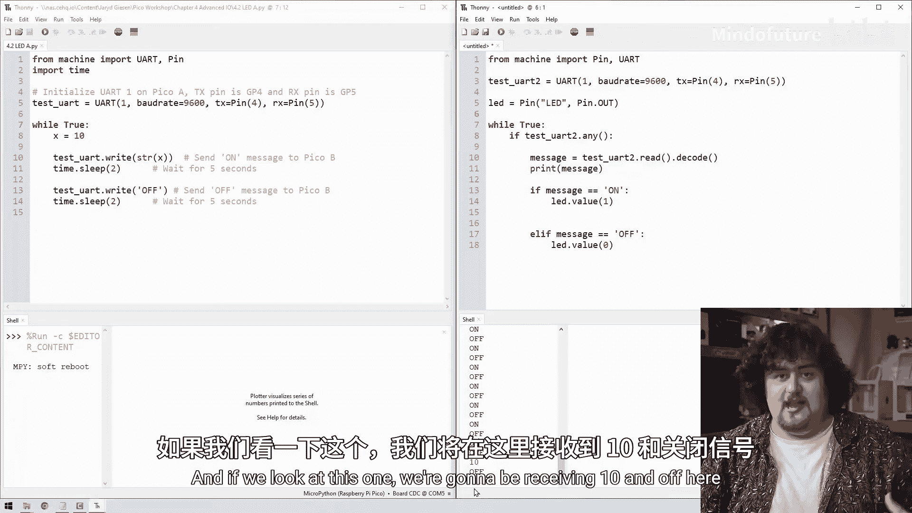
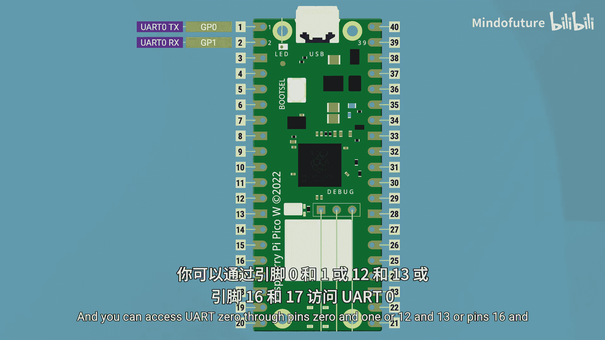
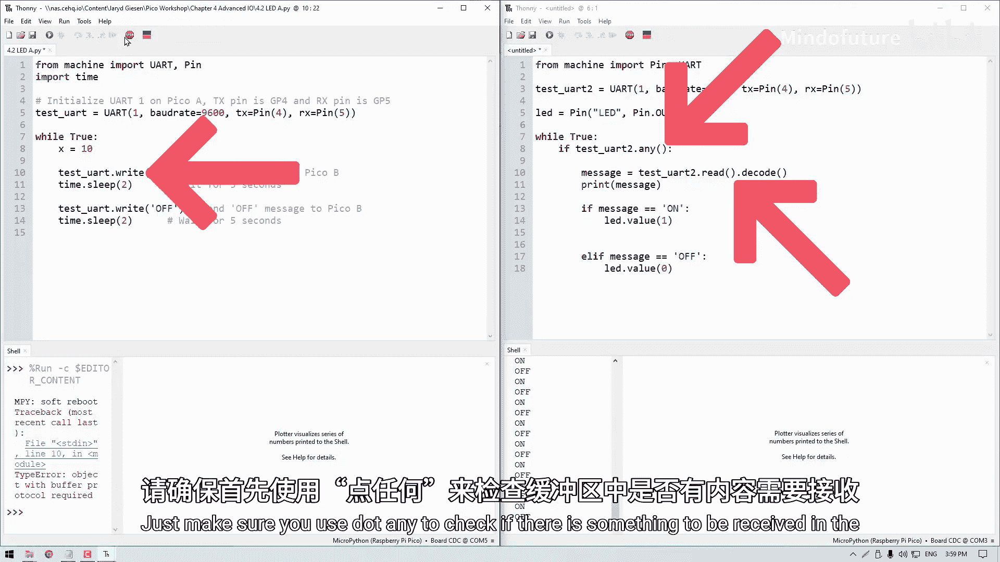

# 中英-•-树莓派Pico初学者入门｜微控制器｜编程｜电子学｜MicroPython-p26-P26-UART---Chapter-4.2--BV1eKXLYzEP4_p26-

UA or universal asynchronous receiver transmitter， what a mouthful is one of the most commonly used device to device communication protocols out there。

 UA is a great tool which allows us to get two devices to talk to each other and you can get them to work together in tandem to do things that you can't do on only one to get two devices to talk to each other with UA you're going to need two connections on each device One wire to send data on and another one to receive data on these are called the transmitmiter pins TX or the receiver pin RX Now UA is something called a full duplex system which is a really fancy way of saying that both devices can communicate with other at the same time they can both send and receive data simultaneously and we will see that in a future video this is not the case for all communication protocols because with something like I2C you can only have one device talking at a time Now both devices need to agree on how fast they're going to send and receive data between each other。

😊，This is called the board rate and so when we set up our devices。

 we need to ensure that they share the same board rate and there are a whole bunch of standard rates out there。

 but you most commonly encounter 9600 and 115200 now there are many different ways that you might use viewer in your projects but we're going to jump into a really great example of getting two picos to talk to each other so we can see what's going on in a micropyython environment。

 If you want to follow along you're gonna to need two picos any variant will do and some jumper wires and that's it we're just going to go ahead and code everything from scratch but if you want the final code it can be found on our course page on our site link in the description for our YouTube audience first we're going start with our hardware connections'm just going wack them in there for now and all we're going need to do is connect up the Tx and Rx pins and this is something that catches a lot of people off guard but you plug the Tx pin of one pico into the Rx pin of the other and the Rx into the Tx This is because if one。

transranmits on the Tx pin， you want to receive it on the Rx pin on the other one and vice versa。

 so we're going to be using GP4 and connect that to GP5 like so。😡，So rx to Tx。

 and then we're going to connect GPp5 to GPp4， so Rx to Tx。Like so and very importantly。

 we're going to need to connect a ground pin of one pico to the ground pin of another pico。

 And this is going to ensure that they share a common ground。

 A voltage is generated with reference to ground。 So this ensures that if one produces a 3。

3volt signal。 it measures 3。3 Vs on the other one because they share a common ground。

 Now I've gone ahead and plug both of my picos into my computer and opened up two instances of thny One here is connected to one of the picos and the other one is connected to the other one。

 and this is going to allow us to program both of these at once。

 Now what we're going to do is we're going to control the LED of this pico with a signal from the other one。

 So we will write some code for this one to send commands over you。

 and then we're going to write some code on this one to receive those commands and control the LED with them。

 So starting with the one that will send the message we're going to import our libraries。

 we're going to import。Pin and also U。 And then we're also going to import time because we will be needing that。

 Next， we're going to initialize our Uar with very similarly how we set up most of our pins。

 And in our setup options， we're going to first specify the Uar peripheral we're going to be using。

 as well as the board rate， very important here。As well as the Tx pin we're using。拼肤。

And we're going to specify the Rx pin， which is oh。P five。Sway。

So next we're just going to create our wild true loop。

 and then all I'm going to do is I'm going to send a message with U。

trite and then I'm going to write on。And then I'm going to sleep it。For two seconds。

And then I'm going to do exactly。The same。But I'm going to write。And that's it。

 that's all we need to do to send messages over U micropython it's really simple。 And if we run it。

 nothing's going to happen because we're sending that data over， but we're doing nothing with it。

 Now let's write the code to receive it。 So I'm just going copy and past what we had there。

 I'm just going to delete all that。 And then we don't need time。 So I'm just going to get rid of it。

 And I'm just going to call this one test Ur2 to stop it from being confusing so we can refer to it。

 And very importantly， we want to ensure that it shares the same board rate。

What I'm also going to do is I'm going to set up an LED with pin。And we've set lots of LEDs before。

 so this should be pretty straightforward。As we're going to set that as an output sweet。

 Now to start with， we're going to need this。Test you are to dot any line。 Now。

 we're going to need this dot any line here， because when the pico sends data to the other one。

 that data is going to get stored in something called a buffer。

 which just kind of holds the data till it's ready to be processed and what this dot any does is it just checks if there is data in the buffer。

 And if it is， it will return true logic。 So if there is something in the buffer。

 we're just going to assign it to a message。And。We can read it with just test you art to dot read。

 then to make it easier on us， we're just going to print message to the shell。

 and then we're just going to set up some logic here。 So if the message is on。

We are going to set the LED to。On， and。If it's off。We are just going to set the LED。

Off and I forgot to put my Cols on the end off all my if statements。

 we'll just whack that in there now if we run the code that sends it on the sender board and on the other one。

 if we run the code that receives it，😊，We can see that we are now printing off our off and on strings。

 and that data is being transferred from the sender board to the receiver board。

 But something is wrong here。 We are not getting a flashing LED on this board。

 We are printing our messages through the shell here。 just in a weird format。

 This is a bit of a technical thing。 But U art sends something called a byte string。

 which has this format with the B and the quotation marks and the actual string we're sending inside of them。

 This is just something that happens with Uar， and it's very easy to fix on the end of our read statement。

 We're just going to put dot decode。 And if we stop and run that。

 We can see that we are now just going to receive that raw message， not in that weird format。

 And if we look at our LED， it is flashing on and off。😊，Well， that's a pretty darn cool thing。

 We are literally sending words from one pico to another。 But how does that work？ Well， on this pico。

 when we use the dot right command to send a string。

 that string gets turned from words into ones and zeros using something called assie encoding。

 AsssI is kind of just a universal set of rules for representing a letter with something called a byte。

 don't confuse a byte with a bit though， a bit is just a one or0 and a byte is just8 of those bits put together。

 So when we use the dot right function， Each letter of that on and off string gets turned into a byte。

 Then the pico rapidly changes the voltage on the pin to send those ones and zeros to the other Pco。

 And then when we dot read on the other Pco， we use the same assy rules to turn those bytes back into strings。

 And that is pretty ingenious words to ones and zeros through a wire and then turned back into words on a completely different device。

 Now， an important thing is that you can own。😊，Send strings， no integers， no float。

 So if we create a variable called X here and assign it the integer 10 and then try and send that it's going to give us an error。

 What we must do is we have to turn it into a string with the string command before we send it over。

 and if we look at this one， we're going to be receiving 10 and off here。

 Now the Pco only has two U channels or peripherals as they're called U0 and U1 and you can only have one device connected to a U peripheral at a time。

 but there are multiple pins that you can use to access these U peripherals here we use pins 4 and5。

 which are the Tx and Rx pins for U1。 but there is another way to access it。

 you could instead use pins 8 and9， which are also connected to U1 but you can't make two different U connections with these pins as they're both connected to U1。

If you wanted to make another U connection， you would need to use the other peripheral U0 and you can access U0 through pins 0 and 1 or 12 and 13 or pins 16 and 17 These are all kind of just different routes that you can use to access the same U hardware and in our setup we need to specify what U peripheral we're using and what pins we're using to access it So instead of14 and5 we could access U0 through pins 12 and 13 for example you can always check a pinout diagram to see what pins can be used to access what U peripheral right we can make a U connection but what can we do with it we can now connect al pico to something else and get them to work together you could not only connect your pico to another Pco but other microcontrolls like maybe you could connect your Pco to an artdo weino or you could get your pico to work together with a raspberry pi computer you can make the。

Pi do all the hard number crunching and all the calculations because it's really powerful and get it to tell the pico to control some motors through UA。

😊，Just be wary， though and check what logic level they use because the artdo winner。

 for example uses 5volt logic to create its ones and zeros， not the 3。3 Vt logic that our Pco uses。

 but this can be fixed with a really inexpensive logic level converter like this you can also connect your Pico to Ur enabled modules and sensors like this GPS here。

 I'm using the exact same code from the demo to receive live GPS coordinates over UR All the processing is done on the GPS and I just get the final result through UR and all I've had to do is plug power into the device and connect the Tx and Rx pins to my Pco Now your experience using a U module might not be exactly the same as this。

 though you might need to install and user library。

 but it shouldn't be too dissimilar So three key takeaways1 Ur is a communication protocol that allows two devices to talk to each other at the same time2 it only needs to use two pins T。

😊，RX and you connect TX to RX and RX to TX and three。

 we can use the dot right and the dot read to send and receive strings over a UA connection Just make sure you use dot any to check if there is something to be received in the buffer first。

😊。

