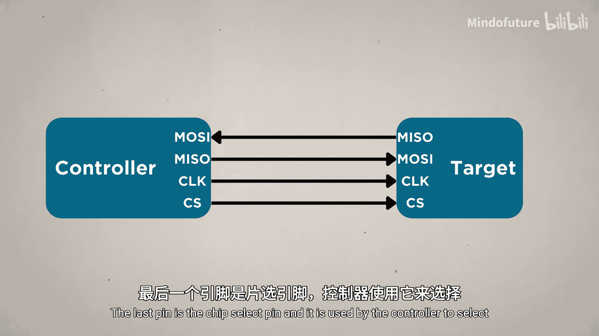

# 中英-•-树莓派Pico初学者入门｜微控制器｜编程｜电子学｜MicroPython-p27-P27-SPI---Chapter-4.3--BV1eKXLYzEP4_p27-

SpiI or serial peripheralal interface is a little bit of a step up from UA in terms of complexity and this is because we now have four wires to deal with and we can have multiple devices all talking to each other over those same four wires and that is one of the advantages of S being able to have multiple things connected at once but it biggest advantage is that it is the fastest of all the three protocols in this chapter by far this means that it's great for things that need high data transfer rates like this microsd card reader which will be setting up in this video Now this multiple devices all talking at once thing isn't a complete free for all It's ordered and managed with something called controller target architecture you may have also heard the master slave terminology use but those terms are being phase out and you might hear a few other replacements for these terms primary secondary controller worker initiateator responder it all describes the same thing。

The Pco will be the controller and any modules that we plug into it or any other devices will be the targets and this means that the controller our Pco is just going to be the one that initiates and manages all the communication between the devices just like how an airport control tower manages all the aircraft let's dive into an example of wiring up and using this S card reader and logging some data from our Pco onto an S card Now U was great because we can write all the needed code with just standard micropython libraries but chances are with SI devices like this S card reader you're going to need to use a library and each device will probably need a different library so if you have the S card reader you'll be able to follow along with what we're doing here but if you have a different device you'll be needing to use a different library and we'll have a completely different set of code but you'll still be able to follow along with the important part of this video which is how to wire up an SI device and how SI works。

So like you are， there are two SI peripheralrals that we can use SI1 and SI0 and there are also multiple GIO pins that we can use to access that hardware on the Pco for this you probably need to check a Pco pin out because nearly every single GPIO pin can act as one of those four required pins for an SI perral For this example though we will be using pins 12 to 15 which are connected to S1 so let's make our first connection the serial clock wire SI is a synchronous protocol。

 meaning that all devices that are connected together need to interact with each other in sync when using SI the Pco is going to create something called a clock signal which is just a digital rhythm that everything uses to synchronize to So we need to connect the serial clock of our reader to the serial clock pin of our Pico which is pin14 Now we need to connect the two data lines and each of these are like a one way street。

Data to flow One is going to carry information from the Pco to the target devices or just the target devices okay so we've only got one and another will carry information from the target devices back to the Pco or the controller but we' run into a bit of an issue here of a lawless naming scheme for these pins on my SD card reader these pins are labeled as Mosy and misso and these are the most common names for these pins but they're being phased out as they use the older terminology and there hasn't really been a standardized replacement for them so you might find devices with these pins labeled as Din and Don SD SD Pco Poy there is a lot of different names that you'll encounter The key thing though is to check what naming scheme your device uses and know that one will be used to send data to the controller and one will be used to receive data from the controller One consistent thing though is that our Pico calls these the Tx and Rx pins。

Like you are。 So P 15 is the transmitter pin for us。

 and I'll connect that to the Mosy pin of our card reader on target devices with this misso and Mosie labeling。

 you can just look at the last letter to see if it's an input I or an output O。

 So this wire it goes from Tx which transmits data from the Pco and it goes to the Mosy pin。

 which inputs that data on the reader。 Then from the misso pin we want to output data and receive that on the Pco。

 So we'll plug that into pin 12 the Rx pin。 The last pin is the chip select pin and it is used by the controller to select which target device it is talking to because if we had another target device connected along here and our Pco were to send out some information because both of these devices are connected by the same wires。

 How would they know which one was meant to receive that message。

 This is where the chip select pin comes in。

So we're going connect the CS pin of our card reader to P 13 of our Pco Now when the Pico sends or receives data。

 it will use a digital output on that pin 13 to tell the S card that it is meant to be receiving that information You don't need to worry about coding that though it's all going to be handled by the library if we had another target device we would need to connect its CP to a different GPOP and any GPO will work with the chip select it's just using a digital output and as always with any module we need to give it power This is a5volt device So I'm just going to plug it and power it off of Vbu like so and that is how we make all of our SI connections Now this is where it becomes different for every device I'm just working off the documentation page here that's compatible with this S card reader And if you have another device you'll need to go out and source a compatible library and find out。

How to use it。 So I'm just going to go along here and look for the library to download that looks like it's it。

 I'm going to save it。Sweet I plug in the Pco and then I'm just going to go ahead and upload that to the Pco。

Sweite。And down here it looks like we have some sample code that we can use。

 and I'm just going to literally copy and paste that over directly and use that as a start。

 So it looks like this code analog reads and then just stores it with some time to the SD card I'm just going modify it real quick。

 I think we'll just import random and just kind of create some random numbers and just store that on the SD card instead and you could store whatever you want on this。

 So I'm just going generate a random integer between0 and 100 with the random library and I don't think we need to use that T。

 I don't think we need to write the T or that we do need to write the string that creates a new line that looks like it pushes it to the SD card and we don't need to print X there that looks pretty neat。

 So some important things you might need to do in your library is up here we initialize the SI object。

 We're using peripheral。One and we set the clock pin。

 the Mosie pin and the meso pins and we also designate the chip select pin here。

 which can be any other GPIO and then it looks like we pass it off to our library here and that sets it all up for us I've got my SD card here it's formatted as fat 32 I'm just going to plug it in and then I'm going to run the code and you can see we are starting to generate some random numbers I'm just going stop it control sees a nice little shortcut for that。

And I'm just going to quickly unplug it。😊，And I'm going to open up that S card And if I open that file。

 you can see that we have our randomly generated numbers here and it's in the file name that was created here。

 All right we know how to plug an SI device into the Pco What can we do with it Well SI is in a bit of a niche if we only wanted to connect two devices together。

 we might opt for UA for its simplicity and just compatibility with so many things and if we wanted to connect lots of things together like lots of sensors together as we'll see in the next video Iquad C is often a better and easier choice to do this That's why SI is great when it plays to its strengths its high speeds S card readers we want to transfer data as fast as possible so they will often use S High resolution displays also commonly use S OLED screens andk displays need those faster speeds to update all of those pixels You'll also find SI modules used in things like。

😊，This camera module， this one is plugged into the other SI peripheral。

 and the Pcode takes a photo and then transfers it onto the SD card。

 We can just do a real quick test here。And it does take a few seconds though。

 because capturing photos and processing images like this really starts to push microcontrollers like the Pico to its limits。

 But this is not to say you can't use SI for things like sensors because sometimes you may not even have a choice and may have to use an SI sensor。

 but more often you'll find them in these highpe applications。 Allright， three key takeaways。

1 SI is a comp protocolto that can connect multiple devices together and uses the controller target architecture2 to use SI。

 you'll need four wires。 A clock wire， two data transfer wires and a chip select wire and three SI is much faster than you art an I squared C and is often used into highpe applications。

