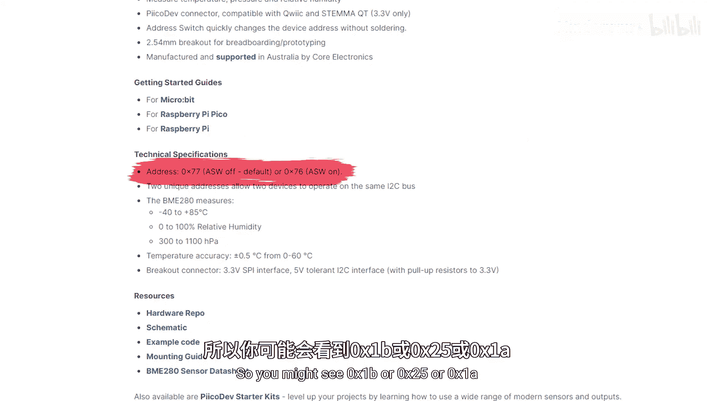

# 中英-•-树莓派Pico初学者入门｜微控制器｜编程｜电子学｜MicroPython-p28-P28-I2C---Chapter-4.4--BV1eKXLYzEP4_p28-

🎼Iquad C or integratedrated circuit is the last， but certainly not the least protocol on our list。

 It only uses two wires， one for a clock signal to keep everything in sync like SI and one to send data between devices but with only these two wires you can connect a ridiculous amount of devices together when using SI you're probably only going to be connecting two to maybe eight devices together。

 usually single digit numbers but iquad C can connect over 100 devices with just two wires Now you're probably not ever going to connect that many devices together。

 but if you had to connect six or so devices together Iquad C is going to be far easier than S like SI it also uses the controller target terminology your pico will most likely be the controller and the modules that you plug into it will be the target Now you will probably hear the term bus thrown around in comp protocols especially with iquad C and a bus is just。

A connection or a pathway that data is sent along。 And so I might say that on my iquad C bus。

 I have a Pco connected as a controller and some sensors connected as targets。

 It's just some helpful terminology to know that you might just get randomly throwing at you One of the downsides to Iquad C is that it is only half duplex。

 And what this means is that only one device can talk at a time on the bus Two devices can't send and receive data at the same time。

 It's kind of like walkie talk is where only one person can speak at a time。

 And if two people speak at once。 Their voices get muddled together and you can't understand anything。

 This just means that devices have to take turns talking to each other。

 That's all handled by the library， you don't have to worry about it。

 And a lot of the data transfer and iquad C happens so fast that it basically seems like they're talking to each other at the same time。

 All let's jump into a demo and hook up some iquad C modules。

 We are running into an issue again here where a lot of this is very light dependent。

 And a lot of the iquad C setup is。Behind the scenes with a library to show you the process of using some iquad C devices。

 I think we'll just make a little thing where we'll connect some sensors together and connect the display and just show that sensor data on that screen。

 So we're going get started by connecting this very generic Oled display to our Pico these are just tiny little black and white screens there really low power and there are really great addition to any project。

 So our display has four pins here till on the left of a power and then we've got our serial clock and our serial data or and S。

 and these are our iquad Cwis。 you connect S of your device to S of the Pico and S to S it's really straightforward。

 Now like you aren't an S the Pico has two peripheral devices that we can use I squared0 and one and there is a whole bunch of ways and different pins that we can use to access them In fact。

 nearly every single Gop pin on the Pico can access one of the Iquad C peripherals for this example。

Although we will be using pinNs 8 and nine because that's what the library we will be using needs and if your library doesn't let you choose the pins。

 you'll need to check which ones it uses by default。

 so we're going to plug SDA into the PCOs SDA pin which is P8 and plug SEL into P9。

 which is the SEL pin of the PCO。😡，And then we're just also going connect it to ground and the 3。

3volt out because this is a 3。3 device。 And that's it that's how easy it is to wire up an I squared C device。

 So this OLledD display we're using is just a really generic one。

 It's called the SSD 1306 It's really common。 And first we're going need to find a library to drive it and some sample code。

 And I've just gone ahead to the product page here and I found the sample code and a link to the library on GitHub S。

 and I've gone ahead and it looks like to install this we're going to need SSD 1306 dot pi。

 I'm going to go to here。😊，And then I'm going to download that file。We've got to plug it in first。

 that might help。And then I'm just going go ahead into our libraries folder and I'm gonna upload that to our libraries on our board suite。

 So just as a starting point， I'm gonna copy over the sample code from the documentation into our thnic script and I'm just going to run it and we can see that we are printing hello world on our display and'm just taking a look at the code it looks like we set up our library there。

 then we import time and then we import pin and I squared C。

 which we use to set up our I squared C behavioral down here and this demo code declares the pins here as variables and then feeds them into here but I'm not a big fan of that as this is just personal preference here but I'm just going change this to set it all up in one line instead we can now delete them and if I copy that into here I'm basically just directly putting the number and instead of declaring the variable and then feeding that variable and I just like it this way it's all in one line and it's nice and neat the way these OLEDs work is that first we need to completely wipe everything off the screen with this。

OLED fill0 fills it with just black pixels and then that OE dot text is going to write text on it。

 and it looks like we've got an excellent Y coordinate here of where to actually place it on the screen And then when we call OLED show we push that change and we kind of update the display with what we've written on it And something we're going do preemptively here is I'm just going to add a wild true loop here and set all of that inside of it like so And if I run that。

 we can see that it's still printing hello worldd。😊，Next。

 we're going to connect this atmospheric sensor module， which will allow us to read temperature。

 humidity and pressure。 Now， we could sold us some pins onto the board here and connect it like we did with the OLED。

 for this module gives us an option to use a nice and convenient connector that we can use to plug it in like so。

 And this connection gives us our power pins。 and our I squared C pins to plug in。

 And it is exactly the same process。 We're going to plug our SDA into the SDA of the Pico and the SL into the SL of the Pico and then plug that into 0vols al ground and 3。

3 Vs。 and that should power up。😊，Like， so we've got a little LED status there。 Now。

 let's say we wanted to plug in another sensor。 We are kind of running out of space on our breadboard here。

 But this sensor is part of the same pico dev ecosystem as this sensor。

 and it shares the same connector。 And this is going to allow us to daisy chain them together like so。

 And so this sensor is connected to the same I squared C as this LED module and this sensor and that sensor。

're they're all sharing the same bus。 Both of these sensors are part of the Pico dev ecosystem。

 which is just a series of I squared see devices that we make in house here。

 And if you've got something like this Pico dev adapter。

 you could go one step more convenient and place your pico into it like so。

 And then just daisy chain them plugged them in。 Daisy chain them all off like so without having to plug anything in。

 And each big brand like Addaf fruitit and seed studio and spark fun。

 have their own ecosystem of connectors that can be used like this to really。😊。

as put everything together so Iquad C devices you probably have a few different ways of wiring them up but as long as they're all connected together。

 it doesn't matter which way you use Now let's get this atmospheric sensor going and it's basically the same process of find a library。

 find some sample code and adapt the sample code to your needs so I've gone ahead to the documentation page and seen that I need to download these two libraries here like so。

😊，お。And then I'm going to upload them to our libraries folder on the Pco like so and then I'm just going to go ahead here and look for this sample code and looking at this it looks like this is a very important one because we're importing the library。

😊，And then here it looks like they're importing sleep M from the unified library instead of the time library like we usually do so。

 I don't think we're gonna need sleep M。 so we'll just leave it there。

 Then we set up our sensor or initialize it with that that looks very important。

 Here it looks like they're getting an initial altitude reading for something that we're not going use。

 So we'll skip it and here it looks like we have the beef of our code。

 which is actually reading to sensors and we'll just paste that in there like so inside of our while Tru we'll close that give us a bit more room。

 in here it looks like we're just converting our pressure and then we're printing it。 and the rest。

 I don't think we'll need any of that。 So back in our code we'll just run it to make sure that everything is working。

 and it seems all right。 Now we're going modify it to start printing that data。 So to start with。

 I'm just going shift this over a little bit like so I'm just going kind of position it there。

 I'm just trying to lay everything out here。 So it's nicely put and lay out on the screen。

 And then here I'm going to。😊，Print our first value， which is T C。

 And I'm just going to shift it over maybe a little bit like sew just across the screen。

 And before that， we're just going to print temp。And if we run that。

 we can see that we need to convert it to a string first because this can't take a float， Run that。

And。We can now see that we are printing out our temperature on our OLED display and here we've gone the first string which is temp and the second string which is just printing out that variable but converting into a string first and the rest of this looks pretty straightforward All I'm going to do is copy and paste that a few times like so and then this one I'm going to say pressure is something and this one I'm going to say。

😊，Humidity is something， and I'm just going to change where these are positioned。

 I'll move this one a few pixels down， and then I'll move this one a few more pixels down like so oh and I nearly forgot we need to actually update our variables。

 So here I'm going to print the pressure。Like so， and then here I'm going to print the humidity。

Like so。 And if we run that， we can now see that we are printing out our values on our OED screen。

 and we are achieving quite a lot quite easily。 if you think about it。

 a few lines of copy and pasted code。 And we're reading a whole bunch of sensor data and printing it on an OED display。

 We've built kind of like a nice little weather station here。

 if you wanted to take this even further， you could draw some lines and make some I don't。

 like a nice little Ui design or repeat this process and add some more iquad C devices。

 you could control some RGB LEDs or maybe add an ultrasonic sensor or control some servos or even add some motion detection with an accelerometer or I don't know。

 even add a compass to it。 There is a crazy amount of things that you can find that use iquad C。

 And it's really easy to daisy chain them together like we have here。

 especially when they're from the same ecosystem。 Let's end this video by talking about icequad C addresses because it's pretty d。

😊，Important， every target device that we connect to an Iquad C bus must have a unique identifier known as an address。

 When you purchase a module， it will come with the address already assigned to it。

 and the address is just a number in hexadeimmal format。

 So you might see 0 x1 B or 0 x25 or0 x1 a just for example。

 we won't be going into hexadecimal its just a different way of counting numbers。

 you just need to know that these are addresses of the devices。

 So when our Pco here sends information， it sends it to every single thing on the bus。

 So both the display and the sensor here， receive that message。

 And this is where Iquad C gets really clever in that message。

 it also sends the address of the device that it's trying to actually send the message too。

 So if the sensor receives a message。 but it is addressed to the display。

 it's just going to ignore it。 And that's how we can have so many devices talking only。

two ways they use this addressing system to choose who to communicate with。

 But this means that there can't be a doubling up of addresses。

 Two devices can't share the same address or this system won't work。 Now。

 if I bought another one of these displays， chances are it's going to come with the same address as the other display and it won't work。

 And the problem is that these addresses are kind of hardware bound。

 you can't just go into the software and change their address。

 if you're lucky though your device will probably have these sold terminals on the back。

 If you desold this resistor and moved it over you can change the address of this device So on this one you can have two separate address and have two devices on the same iquad C bus if you're even luckier。

 your device might have some switches on it like this ser driver does。

 This one allows us to change the address based on the positions of the switch。

 and it's way more convenient than having to desold and resolder a little resist。

And if you're still out of luck after these options， you can find an Iquad C multiplexer。

 we won't be covering in this video， but it will allow you to use multiple devices with the same address just in case you're in a real pickle there and all of this is leading to an important thing Before you purchase modules for your project。

 Check the Iquad C addresses and make sure that you won't have any address conflict or that you can at least change the address of some devices to avoid it。

 Allright3 key takeaways Iquad C is a communication protocol that allows you to connect many devices together with only two wire2 when using a device。

 you always connect SL to SL and SA to SA and you'll probably need to use a library to interact with it and three each device on an Iquad C bus must have a unique address and there may be ways to change a devices address。

