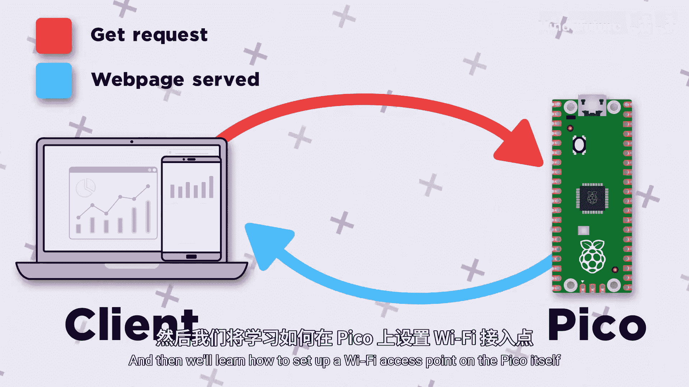

# 中英-•-树莓派Pico初学者入门｜微控制器｜编程｜电子学｜MicroPython-p29-P29-Introduction-to-Wireless-Connectivity---Chapter-5.1--BV1eKXLYzEP4_p29-

So far， our precious data has only been sent and received through physical wired connections。

 but in this chapter we'll be taking a look at how to use some of the wireless abilities of the PCOW to do some really cool things。

 things like connecting the Pco to the internet and controlling it with the computer over a wfi connection Now this world of microcontrollers and wireless connectivity may be a little bit different to what you're expecting。

 We aren't going to be able to watch YouTube video on the Pco at all not even close this hardware will not let us instead we can use wireless networks and the internet to send or receive textbased data think more so along the lines if using the Pco to make a smart wficontrolled light or wireless mailbox sensor or connecting the Pco to the Internet to get realtime coordinates of the internet space station Now this might sound a little difficult and we have definitely moved from beginner levelve skills to more intermediate but thanks to the use of libraries even these really cool complex tasks are really easy to do on our Pco。

Again， really amazing how we can do so much with so little and simple code This chapter is kind of one big video that we've split up into smaller ones in that every video kind of builds on the last one is stepping stones to get to an end goal we'll start by connecting the Pco to a local wireless network and then we'll use the internet to connect to some sites and pull some useful data from specific website then we'll learn how to host a page on the Pco itself which we can then interact with through a phone or a computer to control the PCO and then we'll learn how to set up a wfi access point on the Pco itself which we can use to host that page and all you need to follow along with this chapter is a POW or WH and a wfi network to connect to which can be your home network or even a mobile hotspot from your phone Let's get into it。

😊。

