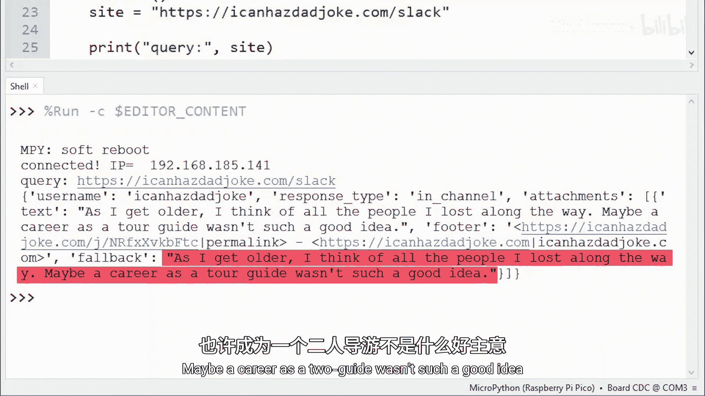

# 中英-•-树莓派Pico初学者入门｜微控制器｜编程｜电子学｜MicroPython-p30-P30-Connecting-To-The-Internet---Chapter-5.2--BV1eKXLYzEP4_p30-

🎼In this video we're going to start simple and just connect our Pco to a local wireless network and then query or connect to some websites through the internet This isn't going to let us browse the internet like we do through a normal computer that Pco is nowhere near powerful enough for this and just three frames of this video is nearly enough to completely fill the PCO's RA and crash it。

😡，So we can't browse the web， but we're going to be able to send or receive textbased data from specific websites。

 All right， let's get into it。 We aren't going to need any additional hardware。

 obviously just a PW and a cable to connect it to the computer。

 and we're going to go ahead and code this up from scratch and kind of just explain what everything does along the way。

 and as always， we'll have the full completed code on our course page link below for our YouTube audience。

 First of all， let's import the libraries that we need。

 we're going to need network and we're going to need micro requests。

 which are both part of the standard micropyython library and we're also going to import time。

 So starting off I've gone ahead and credit some variables with our wfi details in them。

 And this is just the details to your wifi network it might be your home router or you might be using a wireless hotspot。

 Both work as long as you have an internet access through them Next。

 we're going to create a function which is going to connect us to the internet。

 Now wireless code is going to get very messy very quickly。 So it is always a good idea。😊。

use functions wherever you can So we start with these three lines。

 which are doing the heavy lifting of connecting the Pco to our wireless local network So we start by setting up an instance of it similar to how we might set up a pin as pw or an ADc input we turn on our hardware with active true and if you wanted to turn it off for maybe power saving reasons you could use active and then we tell the Pico to connect to our wifi using our credentials that we put up here Now another very important thing when using wireless on the Pco is using print statements to debug or to see what's going on because there's a few steps that it can fail at and by putting print statements in our code we can see where it fails So here we're saying while still trying to connect it's going print please wait and then go to sleep and then once it has connected itll break this loop and print connected and this is easy to develop through a shell but it might be a smart idea to pop anE screen on so you can see what your wireless project is doing this line here is going to be especially important in the。

V because it's the IP address of our Pco on the wireless network If Config is a list that holds all of our connection data and the zeroth element of that is the IP of the Pco。

 Now let's test that function by just calling it like and if we hit run we can see that we're going be printing connecting connecting wait and with that print line。

 we know that our Pco has successfully connected to our wfi network Another really handy thing for when dealing with wireless on the Pco is something called error handling and we're going do this through the try and accept functions So what this try and accept is going to do is it's going to try the code that we put in the try And if there is an error with it or something happens in the Pco crashes it's going to run whatever we put in the accept So if we try to connect and that fails or gives us an error it's going print that there was an error so we can see what's going on and this is not only a handy tool in wireless related things but any code you write can really benefit from this try。

So now we've got a Pico connected to our local network。

 let's get it to then send out a request to a website on the internet itself。😊。

So let's start by creating a variable with the site that we want to query。

 I'm going copy and paste that and we're going talk about what sites you can use later in the video。

 So here we tell the pico to make the request to the site and all the information that we get from that is going to be stored in this variable R here and then all we do is we just print out R Now when that data comes from our site it's going to be in a adjacent format And this dot Jason here just turns it into nice python readable strings。

 It's very similar to how we use dotdecode in our U video and then we end our request with dot close and we also put it in our accept to just close any loose ends in case it throws us an error。

 and something else I just want to add in here。 I just want to add some more print statement so we can see what's going on and I'm just going say we are querying the site and just print out like So and if we hit run。

 we should be able to see that it connects and that it's querying and that we get that information back how cool is that we got our $10 microcontroller connecting to。

😊，AS over on the other side of the world pulling information back and storing it as a data that we can use that is mind boggling and this site that we're querying just returns the exact date and time to our Pco and we could use some string manipulation to extract the data that we actually want from it and this can get a bit technical it can be really easy or hard depending on what information you're getting back and with that we have just completed our first stepping stone in our wireless chapter now that might seem a little bit contrived or a little bit obscure just querying the time from a site but there is a wealth of websites out there that you can query to get really useful information for your project but we can't just connect to any random site it needs to be a very specific one that returns some sort of Jason string so for example if we tried to connect even just Google for example let's run that the Pco is probably going to crash because it's not as you can see it doesn't like doing that。

But you find tons of sites that can return this information like how about a random dad joke that as I get older。

 I think of all the people I lost along the way， maybe a career as a two guide wasn't such a good idea。

Or a random cat fact。😡，Maybe you can get a random Zen quote and connect a display to the Pco to have random quotes just floating around your house Outside of random jokes and facts there are also sites that have useful technical information like how about the position of the ISS in real time or global exchange rates to a specific currency or how about all the earthquakes detected by the USgs in the last hour。

 we will have a link to all of these and some more on the course page。

 but if you find any or no of any cool or helpful sites to get information with a Pco let us know so that other people can find them So three key takeaways1 we can use the network library to connect the Pco to a local wireless network2 when programming to use the wireless capabilities on the Pco it's always a smart idea to use error handling with try accept and use print statements to help debug your issues and maybe also using functions is a smart move and three as long as your wireless network。

Has internet access the Pco Con query websites to receive useful information。😊。

