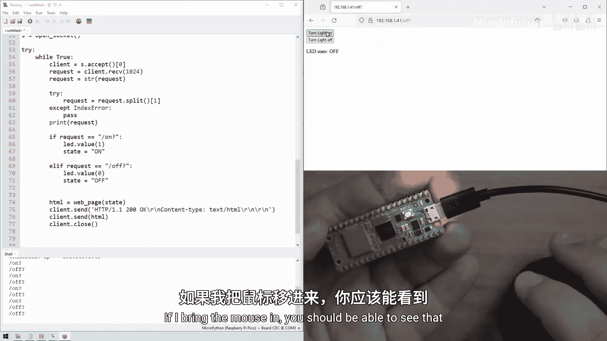
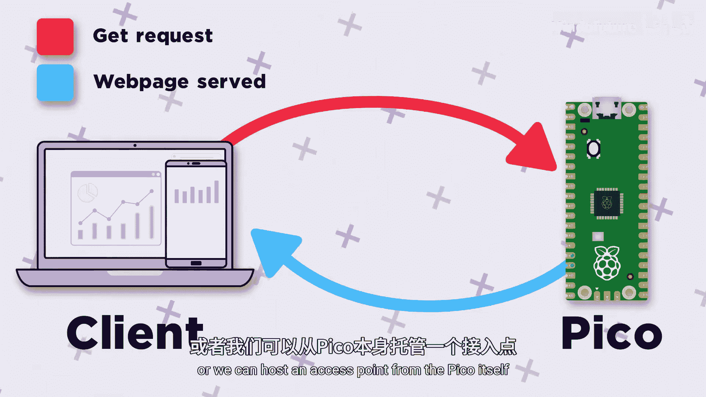

# 中英-•-树莓派Pico初学者入门｜微控制器｜编程｜电子学｜MicroPython-p31-P31-How-to-Host-a-HTTP-Webpage-on-a-Pico----Chapter-5.3--BV1eKXLYzEP4_p31-

In this video we'll be hosting a simple web server locally on our Pco and connecting to that server both through an existing wireless network and by hosting a wfi network directly from the Pco itself this is going to allow us to host a simple web page on a Pco that we can access through a browser on a phone or a computer and from there we can interact with the Pco through that webage so we're going to do this two ways the first is through an existing network like your home Wifi we' connect the Pco to an existing wireless network and then we'll host a webage that we can connect to with a client which will be your phone or your computer the Pco will serve the connected client a webpage which might have buttons or sliders or pictures or even send some sensor data and then on the device we can interact with this webage say if we press a button that device will send something called a request back to the Pco which contains the information saying that the button was pressed and with that information on the Pco we can do whatever we want from there。

😊，For example， we'll be creating a web page with an off an on button to control the Pcos onboard LED Now an important thing here is that the way that we're setting this up even if your wireless network has access to the internet the Pco will only serve its web page locally meaning that you can only access the Pco from a device connected on the same network and then once we've got that setup we'll go ahead and modify it to kind take out the middleman and host the wireless network from the Pco itself which is extremely easy and of course you can find the final code for all of this in the course page linked below So starting off we're going to need to import network and we're also going to need to import Soet and we'll import time because we'll be using some sleeps as well I'm going start by copying over all the things from last demo'm just going quickly briefly go over how they work so if you want to understand that fully go and watch our previous video where we connect our Pco to the Internet and query web service So starting off we declared some variables that held the credentials。

Wfi network we'll be connecting to and then we will copy over the function that actually connects our Pco to our wireless network and again this is really straightforward。

 The first line sets up an instance of it the second line turns on the wireless hardware on the Pco the third one tells the Pco to connect to the wireless network with the credentials we gave it and then here we basically have some visual representation showing us what the Pco is doing it's gonna keep printing that is connecting until it's successfully connected to our wireless network and then where our code starts we're just going to try and connect and leave it on that let's give this a quick test it's always good to test it in stages to isolate any errors you might have and as you can see we've successfully connected to our local network I'm going go ahead here and create a function to open a socket on the Pco Now we are getting into some really technical and dense networking terms here but a socket is something that the Pco uses to allow other clients and devices to extend and receive information with So first we start。

Getting some address information for our socket that we use to set it up with and then we'll create an instance of our socket and assign it to a variable similar to how we set up a pin Then when you take that address。

 bind it to the socket and tell the socket to start listening and this means it's going to start listening for any incoming connections and this number here that we put three and just for this example is how many connections can be queued up while it's trying to connect to the socket and then after all that we're just going to return our socket which is the variable S Now let's go ahead and just call that socket in our main part of our code。

called open socket and that is going to open up the socket for us。

 So now we're going to start handling devices connecting to our Pico and sending and receiving information and we're gonna pop all of these inside of a try and accept structure just to deal with any errors that might arise So our code' is going start by trying to accept a client and the way that we're doing it here a micropython is known as a blocking call and long story short it's not going to progress past this client equals s accept until a client connects to our Pco and starts this Then we're going receive the request from the client store in a variable code request and then turn it into a string print it out close the connection to backtrack a little I've just realized I've made a few spelling mistakes mainly in address I can never spell that word correctly' forgot to put a semicon there down here I have spellt except incorrect again So now that we've set up our socket on our Pico to handle clients connecting to it we should be able to test that through a browser on any device as long as。

It's connected to the same network that the Pco is on。

 so I'm going to go ahead and run that code and we connect it to our local network and if you just punch in this IP that it gives you。

😊，We can see here that the Pico has printed out that request。

 we can see that something has tried to connect to Al Pico。😡，So starting off。

 let's create a function that's going to hold some H code that will be the web page that we're going to serve to a client。

 Now I'm not actually going to write this H code from scratch。

 I'm going steal it from another guide we may do a very similar thing with the P code。

 and this is just an extremely simple page。 No bells and whistles。 we have two buttons here。

 This first button turns the light on and this second button turns the light off。

 and then we also have some text that's going to be displayed on the page。

 and this is going to display the variable state， which I'm also going to need to put up in here in our function。

 And then after all that， we're just going to return the string of H。 just like so。

 Now if we come down to our main part of the code， let's call that function to generate the web page。

 and we're going feed in state and then let's send that H code to our client just like so。

 and then we're going need to go up to the top。😊，Here and declare the variable state just initialize it so we have something to send to the page on the first run of it。

 We're also going need to plug in one more line to this and I'm just going copy and paste it because this is probably the most technical part of this entire chapter and long story short this is going to send a response headed to our client because some web browsers need this line to work without it we get some error and we could spend an entire video dissecting how this works but for now we're just going leave it as a black box it just works and it's part of the code and also if that fails we're going want to close our client like so in our error handling try accept structure Now if we test that code we can see that we get this dreaded error address already in use Now wasn't really an issue last video but when we're dealing with sockets and everything you'll encounter these errors very commonly especially if you maybe put like a Hl error in your page and you try and serve that but it's very fix you just unplug the Pco。

10 to 15 seconds and plug it back in and you might need to do that one or two times and powercycl it a couple of times to get it working again。

 But if the Pico is completely off and fresh and it's been unplugged for a few minutes。

 you should be able to plug it in and it should work as long as the code is not work as it not throw any errors at you and there's one more thing we need to do before we can test it and that is that we're gonna add a while true loop here because without it。

 this is just gonna run through once， serve the page。

 close the connection and that's that we can't interact with it So I'm just going nest all of that in or if I can spell it correctly as well in a while true loop like so So we'll plug it back in and then if we run the code and let it connect to wireless network come on there we go that is the same I as before punch it in and we can see that we are now being served web page from our Pco and as you can see here。

 if we press a button for example， the on button a request is sent to the Pco and if we take a look at it。

There is a lot of information here nested in here somewhere right there is the request。😊。

And if we hit the off button， you can see that it changes to off and these buttons sending these on and off phraseers to our Pco to the shell here can actually be controlled through our H code。

 which will be changing in a later video to do some more complex things。

 But for now we can send an off or ons to our Pco through a web page which is pretty dar cool So let's do something even cooler with it and start controlling hardware with it。

 So first of all， let's clean up that request All we really care about is this slash off here。

 So let's kind of remove everything that isn't part of that。 we're going split up that request。

 and then we're going try and grab the second element of it。

 which should be the slash off or the s on the actual request part of it that we want Now that's not always going be there for example。

 when we punch in the IP and we connect and we receive that web page So we're gonna need that try and accept because it will throw an error if it's not there and that will crash our Pco And in the accept if it's not there we're going use the past keyword which is gonna do nothing。

😊，So ever now we're going to print it Now if we run this code and let it connect to our network。

 now if we punch in the IP。😊，And if we press the on button。

 you can see that we just get this slash on command。 if we press the off button。

 you can see that we also get the off command and you can ignore this fcon i it's sometimes depending on the browser you're using or pop up it's basically requesting this little tiny image here that it uses for the web page you can write code to filter that out if you really need to but we can just write code around it and ignore it。

 Now this split function is a mighty helpful little tool to use。

 And I think the best way to demo it is just in the shell here。

 let's say this is a string like so I'm just going assign it to a string called S now if I call S do split whatever I put in the brackets here。

 it will split this string into different elements into a list。

 So if I say I want to split it along this R here I'm going say split S along R。

 And as you can see it split it before and after the R but it does remove the R what we're doing however we're calling。

😊，Split with empty brackets。 And what this is going to do is it's going to split it along the space。

 So if I press that it's going split it into different elements of this is a string。

 And in here we're just going grab the second element of it。

 remember it's indexed at0 which is going to be the request So now that we've done some string manipulation to get the request in this nice short and compact format we now have a system where we press a button here and it updates a variable on the pico And from here it's very easy to check if that variable request equals this。

 then do something So let's do that and control the onboard LED And it should hopefully be very familiar by now we import pin set up our LED instance and then all we're going to do is we're going say if request equals on on with the question mark。

 make sure that that string exactly matches the request that is being received。

 we're going turn the LED on and we're going to set the state on which is what we're sending to the web page else if the request is s off question mark we're going to do exactly the opposite and if we run。

And let it connect to our Wifi network。Oh， there we go。 That is the same IP。

 If we press the on button， the LED turns on and if we press the off button。

 the LED turns off and we can kick doing that and it's pretty darn responsive if I bring the mouse and you should be able to see that。

😊。

There's about a 300 millisecond delay between pressing the button on a computer that request being sent over the wireless network to the Pco and then turning on the hardware。

 Now， a common question asked right about now is I can connect to this web page through my local network。

 How can I connect to it outside of the network through the Internet。

 and while this is possible through port forwarding。

 it opens up a can of worms relating to network security and all of that is outside the scope of this course。

 If you want to use the Pco to send or receive data through the internet。

 the easiest way that provides you with a level of protection is through services like the things network or other fruitit IO which uses MQTT if you are interested。

 we have an MQTT guide linked below it doesn't allow you to serve a webage like we're doing so here with the Pco but you can get the same project and goals using it and of course through the Internet。

NowSe up a wireless access point from the Pco itself is incredibly easy and you could actually modify the connect function just change a few little things there and it will work but we're gonna to go ahead and create a new function for that and I'm going copy and paste a lot of the existing code from the connect function So the first line is pretty much the same it goes ahead and creates our instance but this time it's for an access point instead then we tell the Pico to configure our wireless network and the reason why we have to do SSI equals SSI and password equals password is because there's a lot of parameters that we can pass into this and by specifying these parameters here we don't have to give the full chain in the correct order then we activate our wireless hardware and we have the same while is it connecting loop just for a little bit of debugging to see what's going on and then all we need to do is go down and instead of calling connect we call a setup instead and if we run our code you can see that very quickly sets up that access point that's one of the things I like about using an access。

😊，PoinInstead because it instantly turns on。😊，Let's paste our IP address in， but first of all。

 we need to connect to that wireless network by wfi and punch in the password that we specify。😊。

Sppell password one， sweet。And connect to that network and as you can see。

 we're connected but we obviously have no internet because this thing doesn't magically connect to the internet by hosting an access point and if we enter that IP address we get the same web page if I grab the Pco。

And it behaves exactly as it did before， but now obviously we're not using a existing wireless network。

 We're coming directly from the Pco and there's pros and cons of connecting to an existing network first hosting your own access if you connect the Pco to an existing network you can go from browsing the internet to connecting to the Pco's IP without switching wfi if you host it on the Pco you obviously need a swap over to that noninternet connection wifi to use it but that does come with advantages in that you don't need an existing wireless network you just connect directly to the Pco and we've actually created some projects where we've controlled the Pco with a phone just by connecting to the access point that it hosts Another thing is when you host it on the Pco IP address here ending in 04。

1 it's going to be the same every time it's the default address of the Pco that was quite a lot of new code and information So for now I think we'll leave it there but currently we have the important framework of being able to connect to or。

A network and then serve a web page from the Pco to a client。 And next video。

 we will finish this off by providing some more advanced functionalities to that web page。

 maybe adding some sliders and control some PwM values with it All right three key takeaways we can utilize sockets to send and receive information between the Pco and clients2。

 we can make the Pco serve a web page。 and then we can use the request that the client returns to control the Pco and3。

 we can choose to run this connected to an existing network or we can host an access point from the Pco itself。

😊。

