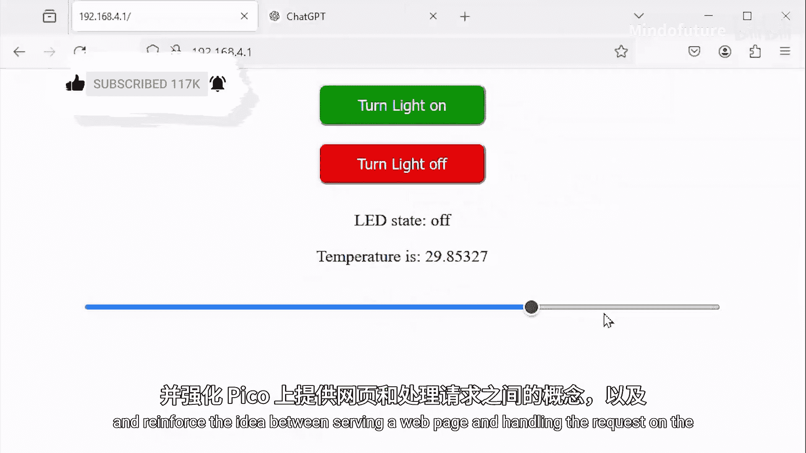
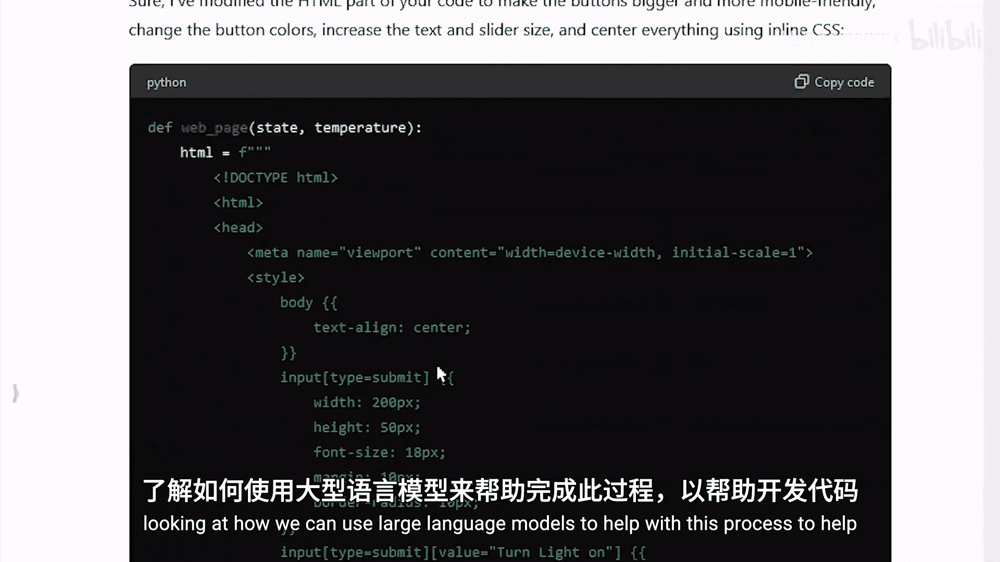
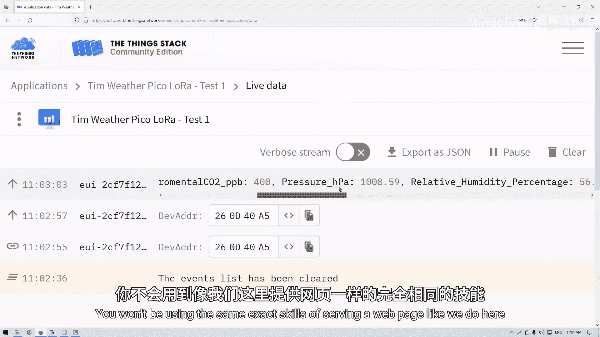
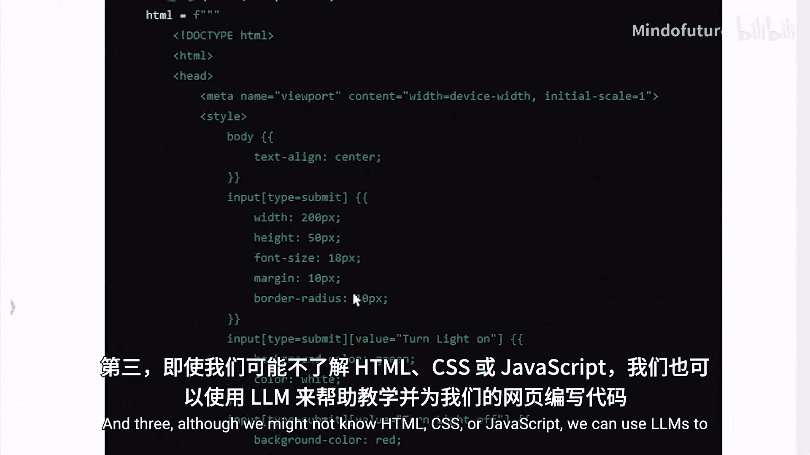
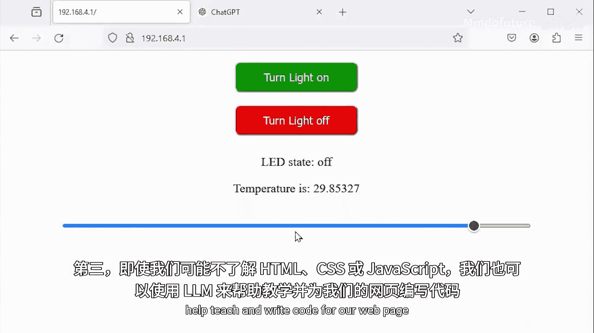

# 中英-•-树莓派Pico初学者入门｜微控制器｜编程｜电子学｜MicroPython-p32-P32-Improving-Web-Page-Functionality---Chapter-5.4--BV1eKXLYzEP4_p32-

So far， we've sort of built this template for the Pco to host a web page over either an existing network or with its own wfi access point。

 And in this video， we'll start to add some more complex functionality to that page and reinforce the idea between serving a web page and handling the request on the Pco as well as looking at how we can use large language models to help with this process to help develop the code for it If you don't already have the code we've been making。

 you can find the template on our course page and you'll be able to find what we'll build in this video there as well Let's start by sending some more data to our web page。

 Now we've just been sending the state of a button but let's read an actual sensor and put that data on the web page。

 we're just going to use the inbuilt Pco's temperature sensor which is actually ADC4 there is a fourth ADC channel on the Pco but it's plugged onto the onboard temperature sensor So a start off let's import ADC because we are going to need it and then let's set up an instance of our temperature sensor and that is going to just be。

ADC 4。 and then I'm going to paste in this function。

 which just takes in the reading from the ADC and turns it into an actual temperature in Celsius。

 We've done things like this before you can find this code on our course page just taking this from another project。

 Now that we've got the hardware setup up and a way to read the temperature。

 There's really only two sections that we need to worry about。

 The first is changing the web page and whether we're changing it to display the data that we're reading or we're adding another button or an element to take in an input。

 we need to change the web page to be served so that we can interact with it。

 And the second is changing in the wild true loop。 if we're adding an element that adds a new request。

 we have to change what the Pcode does with that request。 And if we're sending data to the web page。

 we have to update that data and feed it through into the web page。

 which is what we're gonna to do here。 So we're just gonna say temperature is equal to read。

Temperature like so， and then I'm going to feed it into our web page function like a so。

And obviously up here， I'm going to also put in temperature so that it comes in and we don't get an error so updating the page here is really easy because we're already printing out a very poor called state and we can pretty much just copy that and paste it and this is going to create a new paragraph and we can just change that to be。

 let's say。Temperature is。Dot dot and feed in our temperature variable there。

Swee and we should be able to run that code and let's connect to LP code and punch in that IP address and you can now see that we have a temperature readout on our page and to test if it's working I should be able to blow onto it and update the page。

😊，And the temperature goes down Now this is only going to update when we interact with or refresh the page because the page is only generated each type a client requested。

 Now let's go the other way and add an input element onto our web page we're going to be adding a slider that's going to set a Pwm on one of the pins of our pico something really practical。

 I think it's going be easiest to work in reverse So let's start by adding element I'm just gonna to paste it in because it's way too long to type out and you'll find this on the course page。

 So we've got an input type which is a range or slider and this is going range from0 all the way to 100 and it's going default to a value of 50 every time you'll see what that means in a sec and when we change it it's going to send to the Pico slider1 question mark with the value of the slider tack on the end of it and we should be able to run it and do our little dance of connecting it to the Pco and punch in that I and can。

😊，See that we now have our slider element if we change it。

 you can see we have exactly what we just said would pop up。

 We change it around a few times and we can see that slider1 is being changed and the value that it's being set to。

 Now we're going have to get clever here and do a little bit of string manipulation because if we carry on like we've been doing here where we've been saying if the request is this then do this we're going have to have 100 different if statement saying if request is one set the pwM to1。

 if it's2 set it to2，3 and on on on Now we're going to break down this request into two parts So the first part before the question mark is called the path and the bit after the question mark is called the parameters of the path just some really helpful jargon So we'll start by accepting any error。

 not just an index error and then we're going to move our print statement into here just so we can see what's going on and then we're going split this with request do split。

And we're going to split it along that question mark like so， and then we're just going to say that。

😡，Path and parameters。Pam mes， if I can spell it correctly， is equal to the split of the request。

 So it's going to take in this remove the question mark and path is going to be equal to slash slider 1 and the parameters is going to be equal to the number that the slider actually is。

 And then I'm going to print that out like So and we can just give that a test to see if it's working punchun in that there you go。

 you can see that we now have our two separate variables being printed。

 And if I change it around You can see that slider1 remains the same。

 And we have now got that number as its own little isolated bit that we can work with。

 Now that we've got the number it's really easy to set a PwM on a pin of the pi we've done it many times before。

 So I'm going to import PwM。 And then I'm going to go ahead and set up a PwM pin and I'm going call test's just set it to 16 because that one's easy to access。

Like so。 so now all we need to do in our world true loop is check。

 does the path equal slash slider 1。 And if it does。

 we're going convert that 0 to 100 range into 0 and 65535。

 which is the maximum PwM value for the pico。 And then we're just going to set that PwM value on the pin and printed out for deepbuging purposes。

 And so I've gone ahead and plugged an LED into pin 16。

 And if I set the brightness to something near maximum， we can see that it turns on。

 And if I set it to something near 0 or the set of 20， it's off and about1 quarters。

 it slightly comes on And as you can see as we give it different levels of brightness。

 it changes brightness like so Now for the sake of uniformity。

 we're going go ahead here and just change these buttons to if the path is equal to off or on instead of the request just to standardize what we're doing here。

 And the important thing to remember is that when we split the request along the question mark。😊。

Removes the question mark so we're going to remove them from here and now that's all a bit more uniform instead of oh do I handle the request or do I handle the path and we're going to pop in at the start of each loop to say that the path is equal to empty and we're also going to say that the parameters。

😡，Es empty and this is just gonna make our code a little bit more robust because sometimes you can get a request that is empty And when you try to split it here。

 it's going to fail and when you come down here to say if the path is something and it's failed in here and didn't split it it's going to return us an error So we have some basic HTML elements here on our page already and we can copy and paste them if we want but if we want to maybe make the page look a little bit nicer or add some funky elements or maybe improve the functionality to them we're going need to use some more advanced HTML and jascript and CSS but I'm actually not very well versed on them this is a micropython course we don't expect you to know those languages So I thought we'd end this video by using an LLm like ChagBT or Lama or Gemini to help us write some web page code So I'm in the free version of G3。

5 here and I'm just gonna give it a little bit of context and say here is some code for a Pcode or host a web page Can you change to HTML to make the buttons bigger and more mobile friend。

Make the onbut green， the off button red and make the text and slider bigger and center it all and this is the important part here you need to tell it to use inline CSS This is an important thing specifically for this web page function for the Pco and then I'm just going go ahead and paste all the code onto it hit enter and as you can see it's giving us a giant web page function that is nearly as long as the rest of the code that we're using to serve the actual web page and I'm just going go ahead and copy it and we should be able to replace our web page function and we can give this a go by running it and connecting to Pco again' going to be doing that quite a few times。

😊，And let's punch in our IP and as you can see it is a lot nicer now it's a bit easier to use and we can see that our on and off buttons still work as before and our slider is all good。

 that's probably a good thing to check after getting an LM to write it and if we've blowning it。😊。

That temperature goes down。 Everything looks to be working。

 We can also use this to fix more technical issues。 for example， when we change the slider。

 it always goes back to the middle position and we can just ask it to help us fix this。

 I'm just gone ahead and done this in a new chat and I'm just saying this is some code for a picket to host a webp page The slider changes back to the centre every time I change it。

 Can you make it keep its position when it changes use Inline CSs paste the code and it should give us something helpful back sweet。

 let's punch that in and see what it gives us。😊，We can now see that when we change the slider。

 it is holding its position and it doesn't look like it's broken out request at all。

 And we could keep doing this all day， but I'm going to leave it there。

 And you could go home and use an L if you want to add functionality to your page make it look nicer or how about that refreshing issue we had where the temperature only updates when we press a button or refresh the page。

 and L could help you fix that issue。 whether about wraps up our venture into web pagess at the Pco。

 So what can we do with all of that which we've just learned Well。

 the big reason we introduce the sliders just then is because you can add another one and make a remotecon car。

 This is actually how we controlled a project of ours where we made an e on wheels。

 and doing it through the Pco's wireless interface isn't the best choice It might be a little bit unreliable at times。

 but it requires no additional hardware and it's the cheapest and quickest to set up。

 you also now have the ability to send data from the Pco to。😊。

A web page so any senses you can place around you can now wirelessly check through a webage interface。

 maybe you create a P code that reads if there's mail in the mailbox and you can check it from your phone or you can also go the other way and control things around the house through a web page maybe a series of lights and lamps around that you can control from your computer this ability of serving web pages of just tax on functionality to any projects and the possibilities are quite literally limitless there are also lots of tangentially related places that you can take this we mentioned it before but if you want to take the Pco and wireless to the next level take a look at some internet of things platforms and protocols you won't be using the same exact skills of serving a web page like we do here but you definitely have the skills to go out and learn to use things likeqTT which will allow you to interact with the Pco from anywhere in the world through the internet Defite recommend you checking it out。

 It's awesome and we'll have a link to a。

that So three key takeaways for this video One， we now have a template that we can use to host a local web page from the Pco。

 either connecting it to a wifi network or making our own2 to use this template。

 there are two key things we need to update the web page that is being served under the web page function and the wild true loop to prepare information to send to the Pco or to handle requests coming from a client and three。

 although we might not know HTML CS or jascript， we can use LLMs to help teach and write code for our web page。

😊。

