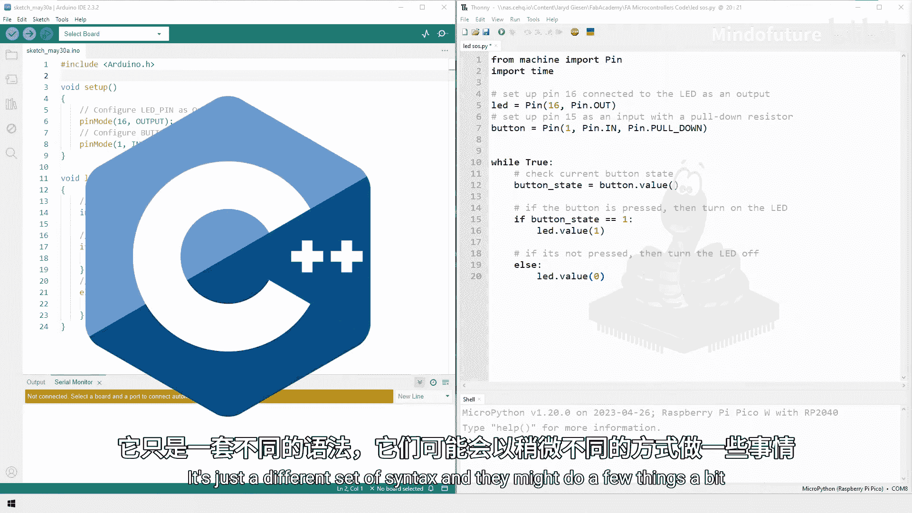

# 中英-•-树莓派Pico初学者入门｜微控制器｜编程｜电子学｜MicroPython-p33-P33-MicroPython-You-Should-Know---Chapter-6.1--BV1eKXLYzEP4_p33-

🎼Al right， we're on the home stretch now。 No intro to this chapter。

 we're just gonna get straight into it In this video we're just gonna to look at a collection of helpful bits and bobs。

 There's lots of helpful things that we've tried to weave in along the way throughout this course。

 but there's still a big list of things remaining so let's take a look at them and these things you might not use in every project but a really helpful tools to have in your toolbox as a maker so let's start with some helpful micropyython features we're just going to look at some simple demo codes which you can find on our course page linked below let's start with Tm。

 Now we did look at it in the while loops video but it's definitely worth another look at because we didn't really explain it too well TMS just measures the time since the Pco has turned on and it's great because it gives you a reference point that you can use to measure the time between two events happening Here's our sample code super easy。

 We need to import the time library We're going start by assigning the current time to a variable ch start then we're just going put the Pico to sleep for。

😊，Random time between0 and 1 seconds。 Rand do random just gets a number between 0 and1。

 And then after that， we're gonna say the current time minus the time we measured up here is the elapsed time。

 And with this we're going be able to measure the time between this line here and this line here。

 And if we run it， we can see that that sleep was 535 milliseconds long。

 And all we're doing here is measuring the time between event A and event B。

 which is a really helpful thing in your project。 Let's talk about interrupts。

 And the best way is with an analogy。 Let's say that you wanted to detect a button being pressed。

 This is kind of like you sitting at home and waiting for a package to be delivered。 So far。

 the way that we've been checking for button presses is using time dot sleep and do value to essentially go and check the door every minute to see if the package has arrived。

 But this is terribly inefficient in the real world。

 we would just instead wait for the delivery person to come knock on the door。

 And then when we hear that we would go and check for the package right This knock on the door is an。

So starting off， I've got some random code in my world true loop here。

 And this is just obviously gonna print hello every two seconds。

 No checking of a button in here whatsoever。 And I've gone ahead and set up an interrupt request on a button that we've set up here。

 And now whenever we press the button， it's going to call a function and run what's inside that function。

 So the handler here is the function that's going to be called and all that's in the function is LED do toggle。

 And if I run this code， you can see that hello is being printed every two seconds。

 But if we go over to the Pco and press the button。 you can see that it toggles the LED。

 Now something you might notice here is that when I press the button。

 it doesn't always turn off and on you can see that it sometimes it stays on。

 and sometimes it's acting very strangely。 And that's because buttons aren't perfect。

 And when we press them， they might actually trigger a few times。

 And to this we need to create something called a D bounce。

 which you can actually use tick M to create。 And we'll have some sample code for that in the course page if you want time is。

Another form of interrupt， But instead of being triggered by a GPO P they instead triggered by a time。

 So here I've got a very similar script every two seconds in my world true， I'm going to print hello。

 but then I've gone ahead and created this timer here It's periodic and every 1000 milliseconds or one seconds it's going to call the function toggle LED and in that toggle LED function we can put whatever we want but I'm just going to call LED do toggle。

 And if we go ahead and run that we can see that hello is going to be printed every two seconds and our LED is going to flash on and off every second。

 there's also another type of timer we can use。 the last one was periodic meaning that it keeps looping over and over。

 but this one is a one shot， which means it only activates once from when we call So I had to go ahead and create another instance of a timer and then I've initialized it but I've initialized it as a one shot that will activate in 5000 seconds and call the function5 seconds which is just going to print out 5 seconds has passed And if we run that。

Hello is printing lights are flashing and after5 seconds the Pico is going to print5 seconds has passed。

 And this is super helpful because it kind of lets us run two lots of code at once one in your wild true loop and another lot of code on a timer and these timer interrupts are really accurate and precise。

 And an example of its application might be checking a sensor at an exact and fixed time interval。

 Asncchio might just be one of the coolest things to learn because it allows you to run multiple while true loops at the same time。

 Now this code does exactly what the last one did but using a cchio instead。

 So starting off we define two functions here and in them is a while true loop one print hello and then sleeps for two seconds and the other one toggles the LED and sleeps for one second。

 and very importantly see that we're using a weight as cchio do sleep that allows us to run these two wild true loops with their sleeps without conflicting with each other。

 And then all we do is we get the event loop and assign it to an instance of some variable we're。😊。

Call it loop and then we create the asynchio tasks and tell it what functions we want it to run at the same time。

 And then we just start running it。 And if I run this code。

 you can see that it's printing hello and the LED is flashing at the same time。

 super powerful stuff and just remember you can have more than two while true loops。

 you could have a dozen if you really wanted to Now this one's a bit special we're going sort look up to the summit of the mountain and there we will see PO programmable IO everything else we've mentioned that this video around the intermediate level but PiO is definitely at the more advanced skill level Now PO actually has its own dedicated processing course in the R240 chip this is separate to the ones that we've been using so far and this is one of the cool things about it。

 we have our own dedicated hardware specifically for IO interactions PiO is unique to the R2040 and its main use is in making custom communication protocols The P doesn't have canvas。

 which is another common communication protocol。😊，Instead gives you the building blocks to make your own canvas。

 Let's say you wanted to have four U channels connected。 The Pico only has two peripherals for it。

 You could make another two with PO if you had an ancient piece of hardware with a weird protocol from the 80s you can use PiO to interface a Pico with it for us modern day makers though the most common application is in driving Ws212s or neopixels Now this isn't code to drive neopixels。

 this is just really simple let's take a look at how it works All we're going do is we're going flash the onboard LED at 10z This is our main chunk of PO code and there's a few different sets of instructions that we can give it and target and rap hereote that this is a loop anything we it is going to be looped over and over and this set here sets the state of the pin to a1 or a0 So we start by turning the pin on and then we've got this 31 here in the brackets and this is actually a delay but not in seconds in cycles It gets a。

with how the hardware works， but long story short， we can only feed it 32 instructions at a time and all we're telling it to do is set the pin which is one instruction and then 31 instructions of do absolutely nothing And then in the next line we give it another 32 set of instructions and this just means no operation so do nothing for one delay for another 31 and we keep doing this until we turn the pin off delay for 31 and on and on and on and if you add all of these up this is 256 cycles in this loop and when we initialize it here we're going say we're going run it at a frequency of 2560 cycles a second divide that by 256 you get 10 Hz and then we're going to turn on this state machine for5 seconds and then turn it off and that is quite a lot of work just to get a pico to flash an LED at 10 Hz but something to keep in mind is that a comp protocol is doing the same thing just with specific timings instead of a continuous 10z signal Now that's not typically how you use PaO and as you see it's a little bit on the more difficult。

S and it might be a bit more niche， but it is definitely worth coming back to in the future because it opens up a cool new world of possibilities。

 Now there are definitely things out there that we haven't covered。

 maybe they were too niche or maybe they didn't even exist at the time that this course was made microcropython isn't static。

 It's a living and breathing language that is constantly getting new additions and updates So on our course page for this video you'll find some more things that we think are worthwhile knowing just those extra few tools in your toolbox Another thing worth knowing about is the micropyython org documentation。

 So this place holds all the documentation of how to use pretty much everything we covered in this course as well as examples。

 and what we covered in this course might only be scratching the surface of all the setup options and commands that you can use with micropython functions。

 For example， if we go to the documentation page for aschio we can see that if we call loop dot stop we can stop the asynchio loop in its tracks and on this site。

😊，Also find the RP2 reference sheet， which beautifully contains a quick reference list of all the code pieces that you need for the Pco in one place。

 One more thing to expand your horizons before we finish。

 there are other Pco boards and other languages that you can use。

 Micropython isn't the only language that the Pco can be programmed with。

 you can also use C plus plus and now that you know microcropython。

 it's really easy to learn another languages It's just a different set of syntax and they might do a few things a bit differently。

 and there are times that you might want to switch over microcropyython is actually pretty inefficient and there are times where C plus plus might make a job easier。

 For example， when this video was released microcropython's low power saving functions。

 don't work very well。 but in C plus they do。 But for 99% of projects。

 microcropyython is going to be perfectly fine。 There are also other boards out there that use the R240 chip and can be programmed in microcropython basically the same。

 you can find boards with cool custom。😊。

on it， maybe a pico that has an ethernet port or how about one that's inbuilt into a round display like a smartwa or how about even a tiny board that's about the size of a bread clip。

 You may not use them， but it's definitely worthwhile knowing that there are other boards out there for very unique applications。

 And that about wraps that up again， you don't need to go out and master all these things right away that just more so tools in your maker toolbox that you might find really helpful one day。

