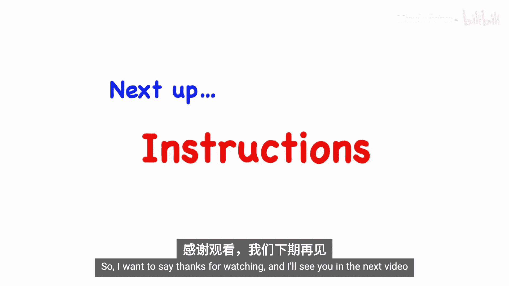

# RISC-V处理器架构，RV32指令集架构，汇编语言，Verilog-FPGA-p01-P01-RISC-V-Assembly-Code-#1---Course-Intro,-Registers--BV1aQ3nztE7J_p1-

Hello and welcome to a multipart video course on Risk 5 assembly language programming。

If you want to program the riskk 5 in assembly language。

 or if you just want to know more about riskk 5， then this is the video playlist for you。

I'll begin this series with a thorough introduction， starting with the architecture。

 the risk5 processor， the various registers and so on。

 and then I'll describe each of the instructions in detail。

The first videos in this series are more basic with an introduction that's appropriate for beginning risksk5 assembly language programmers。

But as the series goes on， the later videos will move faster， getting progressively more detailed。

Later videos will cover topics that are more appropriate only for more experienced programmers such as trap handling。

 virtual memory and various optional extensions。Okay， with that introduction。

 let's go ahead and get started。I want to begin by making a distinction between assembly language and machine code。

Machine code consists of the binary code。 that is the bits that are stored in the computer's memory。

 And these are the instructions that are executable directly by the hardware。Assembly code。

 on the other hand， is human readable， and ideally。

 there is a one to one correspondence between the machine code and the assembly language instructions。

Now， every architecture has its own machine code and therefore its own assembly language。

And I'm not going to assume you have any familiarity with any of these different architectures。

 And we're going to be focusing on risk 5。So where shall we begin？

The first question to ask about any processor core is what registers does it have In the case of risk 5。

 there are 32 general purpose registers。There are two main risk 5 variants。

 There's RV 32 and RV 64 in RV 32， the registers are 32 B in size， and in RV 64。

 they are 64 B in size。These are general purpose registers。

 which means that for any instruction that uses a register。

 we can provide any one of these registers。 None have any special functionality。

 as far as the hardware is concerned。With one exception that we'll talk about later。Now， of course。

 there are conventions that exist， and so programmers will use certain registers for certain things。

There's also a PC or program counter that gives the address of the instructions that are being executed。

 And there are a number of so called control and status registers that are used to control the operation of the processor coreps。

Before going any further， let's go over the basic terminology of data sizes。A by is， of course，8 B。

 and a word is 4 B or 32 B in size。 We can also define a half word as 16 B in size and a double word as 64 B in size。

So here are some examples and hex of those different sizes。So you can ask。

 what's the size of a register， Well， it depends on whether we're dealing with RV 32。

 in which case the registers each contain a word or 4 bys of data， or RV 64。

 in which case the registers are 64 Bs in size and contain 8 bys of data。

So what does the data contain or represent， Well， it might be an integer either represented in signed notation or unsigned representation。

 or it could be a character， particularly if we are looking at individual bys。

 or it could be a string of bits。There are two ways to represent integers。

 There is signed representation， and there is unsigned representation。

And so here I'm showing the ranges for bytes， half words， words and double word integers。With bytes。

 we have 8 bits， so we have two to the eighth different values or 256 different values。

With a signed representation， we split that between positive and negative numbers roughly equally。

 but with unsigned representation， we get rid of the negative numbers。

 and our maximum value is roughly twice what it is with signed representation。

Let's take a look at word sized integers。 So with 32 Bs。

 our side representation goes from about 2 billion to plus 2 billion。 And with unsed。

 we get rid of the negative numbers， and we increase our maximum value to a little over 4 billion。

With 8 by integers that is double word or 64 B values， our signed representation is truly huge。

 It's roughly plus or -10 to the 18th。Generally speaking。

 you should use signed representation whenever possible。

Eliminating negative numbers is anti mathematical， but sometimes you' are trying to squeeze an integer value into a particularly small space。

 such as a byte or half word。 And it may make good sense to eliminate your negative number so that you can get a slightly larger。

 positive number。We also see the unsigned numbers being used for addresses and pointers and also bit vectors which are not really representations of integers at all。

This is particularly common with 32 B word sized values。 When it comes to double words。

 the range of sine values is just gigantic。 for example。

 you can represent the distance from the earth or the sun in microns。

 So I would say there is never a reason to use an unsigned double word。

 I do see that being used out of habit for addresses and pointers because those things don't go negative。

 but I think there is really no excuse for unsigned double words。Risk5 has two instruction sets。

 the full sized and the compressed instruction sets。

Full sized instructions are mandatory and always included on any risk5 core。

Every full sized instruction is a word or 32 B in size。

 And that's regardless of whether we're looking at a 32 B processor or a 64 B processor。

 Maybe the registers are 64 B in size， but the instructions are still 32 B long。

Every assembly language programmer must learn the full size instruction set。

 and that would be the focus of this video。As for the compressed instruction set。

 it's optional and will not be included on some risk five processors。

Compressed instructions can be considered an abbreviation or a shorthand form of the most common full sized instructions。

So every compressed instruction is half the size of a full size instruction。

 they are 16 bits or two bytes in size。And every compressed instruction is equivalent to a single full size instruction。

 But， of course， not all full size instructions have compressed versions。

And the purpose of including compressed instructions is to increase the execution speed。

As far as assembly language programming goes， the compressed instructions can be identified easily because they all begin with C and a period。

 and here's an example of the addd instruction with the compressed version shown here。

The programme counter is not a general purpose register。 Instead。

 it holds the address of the next instruction to execute。 So as instructions are executed。

 one after the other， the program counter is incremented。

 and the core uses the program counter as the address to send to the memory unit to fetch instructions。

The size of the programme counter is the same as the size of the general purpose registers。

 so for RV 32 cores， it would be 32 Bs or4 bytes， and for RV 64 risk 5 cores。

 it would be 64 Bs or 8 bys。Actually， the program canner might be slightly smaller than this of if memory size doesn't require all the bits。

 then the upper bits may not actually be implemented。

 and that's particularly true for 64 bit systems。In addition to the program counter。

 we have 32 general purpose registers， which have names x0， x1 and up to X31。Okay。

 here is our first example， Rik 5 instruction。It's an add instruction， and in this example。

 it's adding the contents of registers X6 and x7 and placing the result in register X20。

Like every instruction， it begins with an op code， in this case， it's addd。

 and then we have some operas to that instruction， and we have an optional comment。

With assembly language programming， every instruction is on a separate line。

 and there's at most one instruction per line。We can also have an optional label in front of the instruction。

 which gives a symbolic name to the address into which the ad instruction will be placed。

Labels are identified by a colon， which is not actually part of the label。So more formally。

 here's a syntax for every line of an assembly language program。We see an optional label。

 I'm using brackets to show optional material。If the line contains an instruction。

 it must have an op code， and some instructions have no operarans。 So the opera ends are optional。

And we can also have an optional comet， which begins with a pound sign and goes through the end of line。

As I said earlier， there are 32 general purpose registers with names x0 through X 31。

Each of these registers has an alternate name， which is shown in the second column。

The assembly language programmer can use either the name that begins with X or one of these alternate names。

 And it's probably recommended that you use the alternate name since they are more descriptive。

 So we see the 0 register。 We see the return address register。 We see stack pointer， Global pointer。

 thread pointer。 We see some temporaries with names like t 0 T1 and so on。

 We see some saved registers with names like S 0 S1 and so on。

 and we see some arguments with names like a 0 through a 7。

 And then down here we have some more saved registers， and we have some more temporary registers。

Now we're going to look at each of these registers in a little bit more detail and see how they are used。

The register X 0 has the alternate name of simply 0。

 This register is particularly interesting because it's the only one that is not general purpose。

It's treated specially by the hardware， and in particular。

 it's hard wired to always contain the value 0。This register can be used as a source register in any instruction where you want the value 0。

 which is often quite useful， and it can also be used in instructions as the destination register when you don't want the result。

 in which case the result of the instruction is simply discarded。

The next register to look at is the return address register。 The alternate name is simply R， A。

 and this is used for call and return instructions。With risk 5。

 the call instruction does not actually push the return address onto an in memoryory stack。Instead。

 what it does is it saves the return address in the R A register， and then the return instruction。

 instead of going to memory can simply jump to the address that's saved in this R A register。

The benefit of doing it this way is that the call and return instructions don't need to go to memory。

 and thus， they can execute quite quickly。The downside is when you have a nested call。

 that is one function to call another。In that case。

 you're going to have to insert additional instructions to save and restore the return addresses from memory。

 That is you're going to have to actually push it onto the stack and pop it from the stack。

But a leaf function， which is in a function that doesn't call any other function。

 can be called and returned from very quickly。 And so that's a great benefit。

Now let's look at the stack pointer or S register。In many computer architectures。

 there's a dedicated hardware register that will be pointing to an in memoryory stack。

 but that's not the case with Ri 5。In riskk5， we use a general purpose register。

 and by convention it will be register x2。The name that we're giving it。

 namely S P supports this programming convention。 But in reality。

 we could use any general purpose register for the stack。

 and we could use register X2 for any other computation that we wanted。

 This is a programming convention， only。Now I do want to mention that for the compressed instruction sets。

 there are some of the instructions that assume that X2 is going to be used as a stack pointer。

 and here's an example that loads a word， and the instruction has a field for the destination register and an offset from the stack。

 but the fact that X2 is used is implicit in the instruction。

So we're going to be focusing just on the full size instructions。

 and so X2 will always be used by the programmer for pointing to a stack。

 but that's by convention only。In order to pass arguments to functions， there are， by convention。

8 registers that are dedicated to that， and these have alternate names of a 0 through a 7。

So whenever we have a function that has eight or fewer arguments。

 these can be passed directly in registers。If the function takes more than8 arguments or some of the arguments are larger than the size of the registers。

 then you're going to have to pass them on the stack somehow。

 but most functions can get by with just these eight argument registers。

If the function returns a result， then by convention， it would be returned in register a 0。

We've also got seven temporary registers with the names T0 through T6。By convention。

 these are used as work registers that is within a function。

 you can use them for any computation that you need to do。

But the standard programming convention means that these can be modified by any function that is called。

 So if you're using them within some function， you better watch out if you call some other function。

 because they make it trashed or modified by the called function。

 So we say that these registers are caller saved。 if you want them to have values that are preserved across a call to sum sub function。

 than it is a responsibility of the call function or the caller function to save them somewhere。

 presumably on a stack。The argument registers are also said to be call or saved because they would be used as arguments to the called function。

There's also another group of registers called the Sa Regs。

 and the saved registers have names S 0 through S 11。

These are very similar to the temporary registers in that they can be used as just general work registers for whatever computation your function has to do。

But。Unlike the temporary registers， these are said to be callee saved。 They're not collar saved。

 They're callee saved。 So there's a cost to using these registers。 Okay。

 if they're going to be used in some function。 then that function must save the previous value of the register。

 and then before returning， it needs to restore that old value。 Okay。

 so the standard calling convention says that every function will preserve the values in registers S 0 through S 11。

 they are callee saved。Okay， if you call a function。

 you can be guaranteed by the calling convention that that function will preserve the value of the S registers unlike the T registers。

 So if you need something that's going to be preserved across a function call。

 you might want to use an S register for that。And you know that if the function respects the conventions。

 that if it uses those S registers。It will first save the previous value and then restore that before it returns so you can rely on any called functions。

 not modifying the S registers。Finally， I want to mention the global pointer and the thread pointer registers。

You might not ever need to use these registers， but I want to mention them just for completeness。

The global pointer or G P register points from an area where global or static variables will be kept。

 And the purpose of this register is to make addressing those variables easier。

 And here's an example。 The load word instruction is going to copy a word from memory into some register。

 In this case， T 0。 And it takes an offset plus a register。

 And so we could use the G P register to get at the global or static variables。

Like the global pointer， the thread pointer register or T P will point to an area where variables are kept and is used to make addressing easier。

But in the case of the thread pointer， these variables are thread specific。

 and they could include things like the thread identifier or parameters to the thread or global variables that are local to that thread。

Okay， that concludes the introduction and description of the 32 General purpose registers。

 and I think that's enough for this video。In the next video。

 we'll be getting into the risk 5 instructions， so I want to say thanks for watching and I'll see you in the next video。

