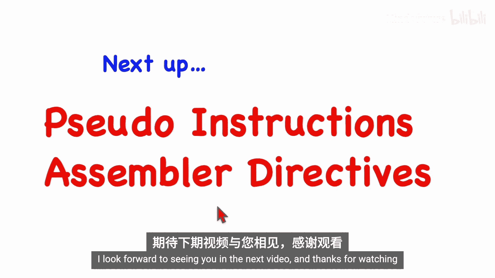

# RISC-V处理器架构，RV32指令集架构，汇编语言，Verilog-FPGA-p03-P03-RISC-V-Assembly-Code-#3---Branch,-Jump,-Call,-Return,-etc--BV1aQ3nztE7J_p3-

Welcome to another video in a series in which I described the riskk 5 core and the Rik 5 assembly language。

😊，In previous videos， I discussed the registers and described the instructions that manipulate data。

 including the various A U instructions， as well as the load and store instructions。In this video。

 Ill be covering the instructions that change the flow of control。

 including conditional test and branch instructions and the jump， call and return instructions。

I'll also describe how four somewhat unusual machine instructions named jump and link。

 jump and link register， load up immediate， and add up immediate PC。

Can work together to provide a wide range of functionality。

I'll also describe the load immediate and the load address instructions。

 and I'll discuss the E call instruction， giving a small sample of code that makes a system call to the colonel。

Okay， so let's get going。There are a number of conditional branching instructions。

 and each one takes two registers， performs a test， and then optionally jumps to some target address。

 And here is an example with branch on equal。 and down here in this code example。

 we have a branch on not equal。In this case， we are decreing some counter in register t 0 and then comparing it to the0 register。

 And if it is not yet 0， we're jumping to the My loop label。

So the target address is PC relative the instruction has room for an immediate 12 bit value。

 and the target is computed by adding that to the program counter。

So the immediate value in the instruction is the distance between the branch instruction itself and the target address。

And the asmbler and or linker will know both of these addresses and therefore can compute the difference that is the offset and figure out what exactly to place into the instruction。

So we just saw the branch on equal and the branch on not equal。

And we also have a branch of less than a branch of less than or equal。

 a branch if greater than and a branch if greater than or equal。

 So these just compare the values using signed comparison and a jump if the condition is met。

We also have a number of。Branch instructions that do unsigned testing。 So branch less than unsigned。

 less than or equal unsigned and so on。 And so these perform the test。

 assuming that the values in the two registers are unsigned values。

Risk 5 has these three very important instructions that you'll be using a lot。 The jump。

 the call and the return instructions。The jump in the call instructions take a target address。

 which is usually specified symbolically。 So in this code example down here。

 we see some code and a call instruction that calls a function named F。 So that's a symbolic label。

 And down here， we have the code for F， which ends with a return instruction。

 The return instruction has zero operas。Now， the call instruction will save the return address in the RA register。

In this example， the return address is the address of the branch， not equal instruction。

And the return instruction will use the address that it finds in the RA register as the target to jump back to。

Both of these target addresses for the jump and the call instruction can be specified symbolically。

 and they can be any address in memory。With an RV 32 processor， this is a 32 B address。

 and with RV 64， we could have an address that's even larger than 32 B。

 So I think it's clear that you can't put just any 32 B address into an instruction。

 which is itself only 32 B in size。So in fact， these three instructions are what we call pseudo instructions。

 they are not machine instructions。The asmbler will translate these into machine instructions。

 and it will look at the target address and perhaps the location of the jump or call instruction。

 And it will determine which machine instruction or which machine instructions are required。

 and it will replace the pseudo instructions with one or more machine instructions that will perform the desired operation。

 We'll talk about that more later。 But first， let's look at two other pseudo instructions that are very important。

Here is the LI or load immediate instruction， and the LA or load address instruction。

Both of these will move a value into a destination register。In the case of load immediate。

 we're moving an integer value that's known at assembly time into the destination register。

 and the load address instruction is used to move a target that is a memory address into some register。

Both of these instructions are pseudo instructions。

 which means they will be translated into one or more machine instructions。

 depending on the actual value that's present。And so that value could be a 32 bit value。Now。

 I have to remark that it's not quite clear to me why Rik 5 uses two different instructions for doing essentially the same thing。

But it probably has to do with the fact that the asmbler doesn't make a clear distinction between relocatable and absolute addresses。

In any case， you should use the load immediate instruction when the value is something that the asmbler knows and for addresses。

 well， addresses aren't going to be known until the linker runs after assembly。

 the linker will be run， and that will be placing the different parts of your code into memory。

 and only at that time will the actual value of symbolic labels be known。

Only at that time will we actually know what the memory addresses are。

 So the linker will have to deal with the load address instruction。We've seen the call instruction。

 but if you want to invoke an operating system kernel function from user code。

 you need to use a different instruction。 You need to use the E call instruction。

 E stands for Environ。In this code snippet here， we see an example where E call is being used to perform a system call。

 This code would work on a risk 5 based Linux system。

 and we are calling the right system call to print a little message in this code。

Now in a risk five Linux based system。The system calls follow the calling conventions。

 so the arguments are passed in the A registers as shown here。

So the first argument to write would be a code number for the file。

 and we'll use one for standard out。 So we see a load immediate instruction here。

 The second argument is the address of a buffer in memory where we find some bytes。

 So we use a load address instruction here to load register a1。

And the third argument is the number of bytes that we want to send to the file。

 And so we load that into register A 2。And for system calls。

 we use a code number to determine which system call to invoke。 And if you consult the documentation。

 you'd see that the right system call is code number 64， and we put that in register A 7。

The E instruction itself has no operarans。 So if you execute this code on a risk based Linux system。

 it's going to print hello with a new line on standard out。So somewhere in memory。

 we have these characters， and here we see the use of an asemler directive called ASCI。

 and ASCI is just used to put a string of characters into memory。Now。

 if you want to print out a message， there's an easier way to do that。

 and that's to call the print F function。So print f can take a variable number of arguments。

 but in this case， we're just providing one argument， and that is in a0。

 and that's the address of a print F type string。 And that string must be null terminated。

 So I've added a null character to the end of the string。

Being able to call this with a regular call instruction assumes that our program contains a function named print F。

 And so we would get that in the linking phase when we link in the standard library that would include any functions that we happen to call。

 such as print F。Now I also want to mention that there's another assemmbler directorive called ASI Z。

 and that implicitly includes the it would actually be a backslash that implicitly includes the null character in the string。

So here's the jump and link instruction or JAL。You might not actually be using this instruction very often。

 Instead， you should use pseudo instructions for calling and jumping and so on。

 But those instructions may be translated using the jump and link instruction。

 depending on the actual values involved。So the jump and link instruction has a destination register and a 20 bit immediate value。

 and I'm showing how it's encoded as a machine instruction down here。

What it does is it first saves the return address into the destination register。

 That would be the address of the instruction following the J A L。And second。

 it performs a PC relative transfer of control， a PC relative jump by sign extended in that 20 bit field and adding it to the program counter。

Remember that all instructions must be halfward aligned in risk 5。 So actually。

 this 20 Bs is extended with an additional0 bit， and that gives a range of plus or-1 MBby。

So for a call instruction， that would be translated into a JAL instruction when the address is within a megabyte and the destination register would just be the R A register。

For jump instructions， if the target is within a megabyte， then it would be translated similarly。

 except for the destination， we would just discard the return address by using the0 register as the destination。

We've also got a very similar instruction called the Jump and Link registerister instruction。

 or J A L R。Like J A L， it begins by saving the return address in the destination register。

That's the address of the instruction immediately following the jump and link register instruction。

And then it takes an unconditional jump to a target。

 The difference is that the target address is computed by adding the contents of a source register with an immediate value。

 and that immediate value is a 12 B value that's signine extended。

 which gives a range of plus or -2 kby from whatever Rs 1 points to。

The J A L R instruction is used for a number of pseudo instructions。 For example。

 if we want to do an indirect call。We would use the J A L R instruction。

 An indirect call is not when we， when we don't know the address of the function at a simple time。

 but instead， it's somehow computed。 And in this case， it would be loaded into register T 5。

 So we're going to call the function whose address is stored in T 5。

We have a similar thing called an indirect jump where we compute the address that we want to jump to。

 and in this example that would be in Reg T5， and we discard the return address by using the zero register as the destination that might be used for case or switch statements where we compute which case we want to jump to。

And finally， we use the J AL R instruction for the return instruction。

 Return is actually a pseudo instruction that would just be translated into a jump and link register instruction。

And in that case we have a zero offset and for the source register， we use the RA register。

 and as a destination， we just use the zero register and discard that。In all these examples。

 we have a zero offset， but the jump and link register instruction can be used in other ways as well。

 And in order to understand the usefulness of the jump and link register instruction。

 we need to introduce and describe the load upper immediate instruction。

So the load upper immediate or L U I instruction takes a 20 bit immediate field。 It shifts it。

 and it moves it into the destination register。Here's how the load upper immediate instruction is encoded in machine code。

 We see the 20 bit immediate field。 We see a 5 bit field for the destination register。

 And here we see the op code。 And what it does is take these 20 bits。

 move them into the upper 20 bits of the register， and then it zeros out the low order 12 bits of the register。

Previously， we talked about the jump instruction。 The jump instruction is a pseudo instruction。

 and with pseudo instructions， the asmbler and or linker would translate it into one or more machine instructions。

If the target of the jump is within a megabyte of the jump。

 then the asmbler and linker can use a jump and link instruction。

 But if the target address requires 32 bits， then they would need to use two instructions。

 And so the idea is that the target address is broken into 20 bits and 12 bits and we use or the asmbler uses a load up immediate and a jump and link register instruction。

 So here I'm symbolizing the upper 20 bits of the target address this way for the load up immediate instruction and it would use some register。

 such as。T 0， a temporary register， and I am symbolizing the lower 12 bits of the address with lower 12。

 And we add that as an offset to t 0 and use a jump and link register instruction with a 0 return address。

The same idea can be used for calls that are so called long hauls。

 that as they are further away than1 megabyte from the call instruction。

 The only difference is that the jump and link register instruction would save the return address in the R A register。

We've also got this rather unusual instruction called add Upper Imediate to PC， or A U I PC。

Let me first describe what it does and then talk about how we can use it and why it's so useful。

It's got an immediate 20 B field， and that is shifted to the left。

 And then we add that to the program counter and store the result in the destination register。

It's encoded pretty much the same way as the load upper immediate instruction is encoded with a slightly different op code。

And so this is useful because it we can use it to make long jumps and long calls。PC relative。Right。

 so with a PC relative jump， the target is computed by adding an offset to the program counter。

 and we can use it when our offset is 32 Bs in size。

And the benefit of PC relative code is that the code is relocatable。

 as long as the distance between the jump or call and the target remains constant。

 We can move the code around。 We can place it in different places in memory， and it will still work。

So that's code relocation， and it can be important because you might be dynamically loading code at runtime and you don't have time to run the linker and figure out what all the addresses are。

 So if the code is relocatable， then it doesn't matter where the code is placed in memory。Okay。

 so let's see how this instruction is used for both long hauls and long jumps。

 So it's used the same way。 instead of the load upper intermediate。

 we use an addd upper intermediate to PC。The asmbler or linker would compute the 32 bit offset from the JALR instruction。

 and it would figure out what the upper 20 bits of that are and the lower 12 bits and then use a temporary register and a long jump would be implemented with these instructions and a long call would be implemented similarly。

 except we would use the return address register RA as our destination。Okay。

 we've now covered the instructions that alter the flow of control， namely the jump。

 call and return instructions， as well as the conditional branching instructions。

Several of these are pseudo instructions， and we've also learned about the jump and link。

 the jump and link register， the load upper immediate。

 and the add upper immediate to PC machine instructions which are used to implement several of these operations。

In the next video， we'll be looking at more pseudo instructions。

 and we'll describe and discuss the asler directives。 So that's it for this video。

 I look forward to seeing you in the next video。 And thanks for watching。😊。

