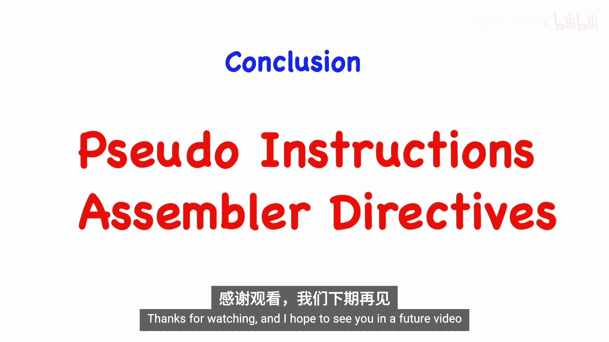

# RISC-V处理器架构，RV32指令集架构，汇编语言，Verilog-FPGA-p04-P04-RISC-V-Assembly-Code-#4---Asm-Directives,-Pseudo-Instructions--BV1aQ3nztE7J_p4-

Welcome to another video in a series about the Risk5 Asly language。

In previous videos， I described instructions that changed the flow of control。

 namely the conditional test and branch instructions and the jump， call and return instructions。

I also described how the jump and link， the jump and link register， the load upper immediate。

 and the add upper immediate to PC instructions work。

 and how these four machine instructions are used to implement a number of pseudo instructions。

In this video， I'll continue discussing various pseudo instructions。

 and I will describe the main asmbler directives that you're likely to encounter or need。 Okay。

 let's get started。So what exactly are pseudo instructions？

We can contrast pseudo instructions with machine instructions。

 A machine instruction is implemented directly on the hardware。

 whereas a pseudo instruction is not actually implemented in hardware。 Instead。

 the assembler will see the pseudo instruction and will translate it into a real machine code instruction。

We've already seen one example， and that's the return instruction。 Doesn't take any our operarans。

And the asmbler is going to recognize the return op code and automatically translate it into another real machine instruction。

 and in particular， it would translate it into the jump and link register instruction。

 and it would provide the R A register as the source， which contains the address to jump to。

 and it would provide the0 register as the destination。

So the asmbler will recognize and accept pseudo instructions and then translate them into real machine instructions that can actually be executed by the hardware and that will do the exact same thing that will achieve the result we want。

And the benefit of this is that the programmer gets to use the instruction as if it truly exists。

 whereas the hardware doesn't actually have to implement the instruction。

So let's look at several simple pseudo instructions。

 we just looked at the return instruction which is translated into a jump and link register instruction。

There's a negate instruction which negates the value in a source register and puts it into a destination register。

 and that is just translated into a subtract instruction。

 So we subtract the value from 0 and that negates it， and we'll move that into the destination。

We've also got a register to register moveve instruction。

So that moves the value in Rs1 RD into the destination register。And that's just an ad immediate。

 We add nothing to the source and put it into the destination。With the Rik five。

 we've got a lot of registers and they're all general purpose。

 so typically we just use the register that we want and there's no real reason to move it。

 so we don't really see a whole lot of move instructions in the Rik5 assembly programming。

We've also got a logical neigation operation which flips the bits in the source register。

 and we do that by exclusive oring the value in the source register， R S1 with a word of all1 Bs。

And then we've got an indirect jump， the jump register。 And here。

 the target address is something that has been computed and placed into some register。 And again。

 we use the jump and link register instruction for that。When it comes to the branch instructions。

 it turns out that the risk hardware only implements two compare instructions。

 and the other two are actually pseudo instructions。So in hardware。

 we have a branch of less than and a branch of greater than or equal instruction。

 and the branch of greater than instruction is actually a pseudo instruction that's translated by the assembler into branch of less than or equal。

 And you can see what we're doing is we're just taking the two source registers and reversing the order。

😊，And likewise， the branch of less than or equal instruction is translated into a branch of greater than or equal instruction。

 and the two source registers are just reversed。These are both signed or these are all signed comparisons。

 and we've got the same thing going on for unsigned comparisons。

The hardware implements two instructions， Bra less than unsigned， Bra， greater than or equal。

 unsigned。 And these are used by the asmbler to create the two pseudo instructions。 Bra。

 if greater than unsigned and branch， less than or equal， unsigned。

The asmbler also provides these pseudo instructions。

 which are useful if you want to compare a source register against0。

 so these are branches if equal to0， not equal to 0， less than 0。

 less than or equal to0 greater than 0 and greater than or equal to0。

 and these are all translated using the s comparisons less than greater than or equal。

And the equal and not equal， where one of the registers is the0 register。Next。

 I want to talk about a very common and widely used pseudo instruction。

 the load immediate instruction， which just moves a constant value into some destination register。

The translation will depend on the actual value that appears right here。

If it is a 12 bit sign number， that is， if it's a number between negative 2048 and positive 2047。

 then the asmbler will translate the load immediate instruction using an add immediate instruction。

 right， It's just added to 0。On the other hand， if the value is larger， but still 32 bits。

 then it can be translated using a load upper immediate and add immediate instruction。

 we break the value into the upper 20 bits and the lower 12 bits and use these two instructions here。

Now， if the value is even larger and we're running on a 64 bit risk processor。

 then the asmbler will use other instructions， and I won't get into what these are because it doesn't really matter you will just be using the load immediate instruction to put values into registers。

Now I do want to point out that this expression here。

 this can be an arbitrary expression possibly involving symbols。

 but the asssembbller seems to require that any symbols that are used must have been previously defined that is defined at an earlier line in the same source file。

 so you can't define a symbol later in your source code and use it。

 so the asler seems to be making a single pass through the assembly code source file。

I just want to mention that in case you run into a problem and the asmbbller is complaining that this expression here has a problem。

 try moving the symbols to a line that occurs before the load immediate instruction itself。

Here we have three more instructions， the load address， the call and the jump instruction。

 which are also pseudo instructions。The load address instruction is very similar to the load immediate instruction in that they both move a value into some destination register。

The difference is that with the load address instruction。

 we're moving a memory address into the register， whereas with the load immediate instruction。

 we're moving a constant or absolute integer value into some register。Now， typically。

 with these instructions， we just have a simple label。

 and that label would be on some instruction or some data definition somewhere。 But in fact。

 we could have more complex expressions。I'm not showing the translations because the actual translations could vary。

 You know， sometimes there would be one or sometimes several instructions。

 and that would depend on the actual value appearing in the instruction。

Sometimes the asemmbler may use PC relative addressing and sometimes not even within the same program。

In addition to machine instructions and pseudo instructions and possibly compressed instructions。

 any assembly language program is also going to have a number of as directives appearing in the program。

And you can always spot an asmbler directive because it begins with a period。

 This period is actually part of the directive。 In other words。

 you can't have a space between the period and the first letter。

The ones I'm showing here are concerned with allocating memory。

 and they would be used to create variables。 And so let's go through these。

The dot byte directive is followed by an initializing expression。

 and this is going to allocate 1 B of memory and initialize it with some particular value。 Often。

 it would be 0。 We've also got the dot H word and dot half。 These both are exactly the same。

 You can use whichever you want。 And these allocate two bys with an initialization value。

And then we've got dot word， which allocates4 bytes， and then we've got dot D word。

 which allocates a double word or8 bytes。And then we've got Dot ASki。

The opera end here would be a sequence of characters of ASi characters enclosed in quotes。

 And this would allocate as many bys as the string has characters in it。

Then there's a variation of that called ASi Z。 And it's exactly the same。

 except it also adds a null bite after the last character in the string。

And then you might see dot string instead of dot Askis Z。

 They're both the same and work the same way。And finally， we've got dot skip。

 and here the operaand is an integer that specifies the number of bytes to allocate。

 and this would be useful for example， if you wanted to allocate an array of 100 bytes。

 then you could use a dot skip。Now， these would typically or almost always be preceded by a label。

 right， If you want to create a variable， you want to have a name for that variable and you want to be able to use a load address instruction to load the address of that variable into registers and。

Use it in loads and stores and so on。 So all of these would presumably have a label in front of them。

 but that's not really required。And another thing I wanted to mention is that for all of these。

 except Sip， I suppose， you would have a list of initializing expressions， so for example。

 if you wanted three double words in a row， you could have three comma separated integers to tell what those three double words would be initialized to。

Next， I want to describe the dot global， a similar directive。 And that's the way it's spelled。

 There is no A in the word global。In order to understand how this thing works。

 we need to talk about the compilation and assembly and linking process。

 So let's imagine that we've got a gigantic program with a bunch of different pieces。

 and this particular program has three C files， so we've got three files， A。

 B and C that contains C code， and we've got three files， X。

 Y and Z that contain hand codeed assembly code。So C programs end in a dot C extension and assembly code files end end in a dot S。

 that's a capital S extension。And we've also got object files， object files。

 end with a dot O extension。Now， the C code files and the assembly code files are human readable。

 but the object files are not human readable。 They contain a bunch of bits in a special format。

 and they can't really be read easily by a human， although there is a tool called object dump or O BJ D UM that can be used to see exactly what's in an object file。

Anyway， the compiler is used to produce an assembly code file。

 so your C program is first turned into assembly code。

 and then the asmbler is run and it's turned into an object file and then the linker is run。

 and it's turned into an executable。Now， typically when you use a compiler like GCC。

You are unaware that all of these steps are happening because they're implicit。

 They're done automatically。 So your simple C programme is compiled and the asmbbller run and the linker is run。

 and the executable is produced。 Possibly the linker will also combine stuff that comes from library files to create your executable。

The Lier program is called LD。 the simpler program is typically called AS。

But sometimes you've got a gigantic program like here， and you want to do these steps independently。

And so if you change one file， for example， we go in and change B。You would only need to compile B。

 assemble B， dot S， and then run the linker to build your executable。

And in the old days of computers， the compiler and asmbler and linker were slow。

 and they took a lot of memory。 so it really made a lot of sense to do these steps independently。

 so you would build a make file that would only do whatever is necessary。

 depending on what files have changed。So let's assume that in one of these files。

 you want to invoke a function that's defined in another file。Now in your hand coated assembly files。

 you're going to have a lot of labels and symbols that you define。But those are by default。

 private to the file in which they are defined。 So， for example， the X file， the X dot S file。

 would define some labels and some symbols that it uses。

 but the code in Y and Z and these other files over here could use those same symbols for different reasons and different uses without any problem。

But let's say that you want to create a function with an X that you want to make available to the other components in this large program。

 So you're going to define some function and you're going to have a label on its first instruction。

 maybe the function is calledF。 And so you want to make F available to all of the rest of the program。

 So you would use a dot global a simple directive and you'd list the symbol that you want to make available to all the other pieces of your program。

And so that label would be exported and made known。

 And so what happens is the asmbler will just put that label and information about it into the object file。

 And then when the linker runs， it's going to know that label fo is a particular memory address within the code that was created from the X dot S file。

 And so if if code and Y or Z or ABC call that function。

 the linker will automatically adjust those call instructions to refer to whatever address the F and code was placed at by the linker。

 So what the linker is going to do， it's going to take all the code that's in these object files。And。

 you know， and it's going to combine it into one gigantic memory image， one executable program。

And that executable program will then have final addresses for everything。

The asmbler doesn't know what the addresses are， And so those addresses aren't pinned down in the object files。

 They're just kind of free floating code， if you will。

 and the linker has to be run to actually determine what the addresses are and to adjust all of the instructions that use addresses and so the dot global symbol the dot global directive is used to make a symbol available in other object files so that other code can call and use the function and again it can also be used to export variable names so if your label is on a piece of data that can also be exported。

Now I also want to mention libraries， sometimes you will link your code with a library and what is a library。

 Well， a library is a single file that contains a bunch of different object files。

 and the linker will go through your code X， Y and Z， and it will see which symbols you use。

 for example， if you call a square root function。But don't define any square root function。

 Then the linker will go to the library file， and it will look for an object file that contains and exports the square root symbol。

 And if it finds one， it will include that into the executable automatically。

 So the linker will look at the library and it will include whatever object modules are required by the code of the object modules of your program。

 So that way， you can include something that you use like the square root function。

 but not include something that you don't use， like the sign function。For example。

 you constantly will be using the print A function in any C program and that would be a library function and the printf function itself will call other sub functionss。

 for example， if you do formatting of floating point numbers。

 it might include additional subroutines from the library。

 and you might not even be aware that those additional functions are being included， but they are。

Now。What if you call something that's not defined？The aslers not going to know that。

 It's not going to complain。 It's only the linker that will know that you tried to call something。

 and it searched all around， and it couldn't find any other object module that exported that。

 For example， if you misspell the name square root and call square root。 Then the linker will say。

 I can't find anything that exports the symbol that you're using。

 And the linker will then give you an error message that a symbol is undefined。

 So you've either misspelled it， or you failed to export it in one of your object files。

 So maybe you forgot to write the square root function。

 or maybe you forgot to include a dot global a simple directive to export the symbol。Now。

I should point out that you can the asmbler doesn't really check these global similar directives。

 You should only use a global symbol where the symbol is something you've defined in that same file。

 but the assmbler is not actually going to check that， it turns out。

 so make sure you spell things correctly。Now I also want to mention a special symbol called underscore Start。

Okay， so one of your object files must contain and define this symbol underscore start。

 its spelling is special， and that file should also export that symbol using a dot global directive。

 Okay， that will be the entry point of the program。 The linker will look for the underscore start。

 and so it must be defined in in one of these files。

 and that will be the entry point that the linker uses。That will go into the executable file。 right。

 The executable file contains all the bytes that will get loaded into memory。

 and it also contains a header that contains additional information。

 like which address to start execution app。The address that we start execution at is called the entry point。

 and it has the name dot start。 So you better define that somewhere。Now， when you write C code。

 you are going to be including some additional functions。 you might not really be aware of that。

 but you will include something that has the underscore start label in it。

 and the code there will do some initialization， maybe set up the stack and so on。

And it will then call a function named Main。 And hopefully， you've defined main。

But if you're not using that， then you're writing everything in a simply code。

 you don't even need to have a main function， you could just have a。

 but you do have to have this underscore start label being defined。

So I hope that explains everything and how the Dot Global Asmbler Directive works and how the compiling assembling and linking process works。

Next， I want to talk about the dot E Q U and dot set asler directives。

 These are both the same things。 They're just different spellings。 They operate exactly the same way。

 And what they do is they associate a value with some symbolic name。 So in a way。

 they're sort of like a poundine define。The value has to be evaluated before execution time by the asmber or linker。

And the value can be expressed as a simple integer or maybe another symbol。

 or maybe an expression that involves symbols and integers and so on。

And that symbol that is being defined can then be used anywhere in your program below where the as simplembler directive occurs。

We also have a dot aligned directive， and the idea here as is that certain things require proper alignment。

 and this assmbler directive will include enough bites to force the next thing to be properly aligned。

To be honest， I can't quite figure out exactly how this thing works。

 So I'm just going to leave it at that。And then we have dot text， dot data， dotbsSS and some others。

For these， in order to understand these， you need to realize that your program is broken up into a number of so called sections or segments。

 you can say whatever you want， section segment。Any instruction or any data definition needs to be in a segment。

 and so you will see one of these things occurring first in your program and then everything after it will be in that particular section so we can have a text segment then that would be where we put all of our code。

 So our assembly language program would typically begin with a dot text directive。

 then we'd have a bunch of instructions。Dot data is usually used for data that can be read or written。

 and so after the text segment， we might see a dot data directive followed by a bunch of。

 you know like dot byte or dot word directives where we set up our data。

And we can have multiple text segments and multiple data segments within the same assembly code file。

We also have something called a BSS segment。And this segment is restricted to containing only data that evaluates to0。

 So with a B， S S segment， the object file is sort of optimized。

 And since everything is going to be initialized to 0。

 the object file doesn't need to contain the actual bytes that initialize it。

 it just needs to contain a link。 So， for example， if your program needs an array that's say a million bytes in size。

You should put that into a dot B， S， S segment because you don't want your object file to contain a million。

Useless zero bytes。 So it's a way to establish a segment that contains only zeros。

We have some other segment types that are seen in different architectures。

The riskk5 doesn't really use the read only data segment as far as I can tell。

So the date your program is going to be loaded now if your program is a user levelve program。

 which most are， then the operating system will be moving your executable code into pages in memory and those pages will be marked or flagged as virtual pages and for text segments。

 they will be marked as executable and for data segments。

 they would be marked as not executable but upable。

 readwriting is allowed reading and writing is allowed。

 and so this offers a level of protection for user level segments。

Things are a bit different with a kernel program because it's usually not being paged so the pages aren't necessarily marked。

 but that's another story for another day。Okay， that concludes my discussion of pseudo instructions and as simpleler directives。

 This video covered the basics， but there's a good bit that I did not cover。

 especially with regards to the linking process。Nevertheless。

 this should give you a reasonable introduction and enough to get you started programming。Anyway。

 that's it for this video。 Thanks for watching， and I hope to see you in a future video。

