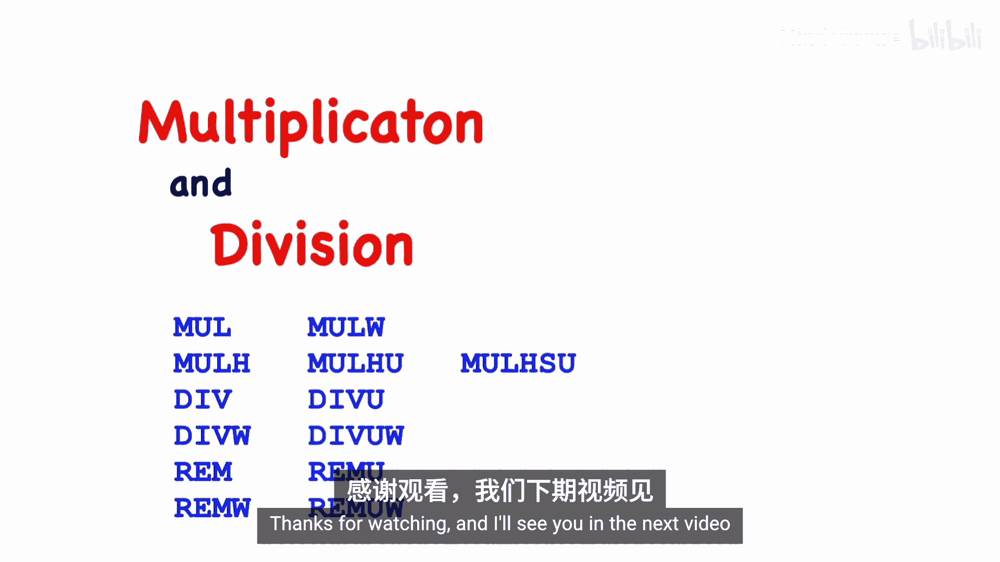

# RISC-V处理器架构，RV32指令集架构，汇编语言，Verilog-FPGA-p06-P06-RISC-V-Assembly-Code-#6---Multiply,-Divide-Instructions--BV1aQ3nztE7J_p6-

Yeah。

Welcome to another video in a series on the Risk5 architecture and its assembly language。

In this video， I'll be discussing the instructions for multiplying and dividing integers。

 There's also an instruction to compute the remainder after division。Before we get started。

 I wanted to mention that the risk 5 processor specification can be thought of as a menu of design options and potential extensions。

 and hardware designers can pick and choose which options to actually implement。

The Risk 5 project uses a set of letter codes to indicate which options and extensions are actually implemented on a given processor core。

As a programmer， you need to be aware of this code system so you can know what your core can actually do。

At first， we have either RV 32 or RV 64 to indicate the register size。

 and that can be followed by additional letters to provide more detail。

The eye just means that the basic instruction set is implemented。

 which is really the minimum you'd ever want。This can be followed by additional letters to indicate which optional functionality is implemented。

Many very useful instructions are actually optional。For example， the compressed instruction set。

 which is indicated with the letter C， is entirely optional。In this video。

 I'll be discussing the multiply and divideide instructions。

 which are indicated by the M code letter。M also includes the divide。

 as well as the multiply instructions。There are many other options which I plan to describe in future videos。

So what if your core doesn't actually implement the M option？😡。

Then the multiply and divide instructions will cause an illegal instruction trap。

 and I'll discuss trap handling in other videos， but to summarize。

 either the program will be terminated by the operating system or the operating system kernel will emulate the instruction in software。

 and it will return to your program， which will never know that the operation was not performed in hardware。

And let me just add that with today's micro circuitcus。

 the simplest multiply and divide hardware implementation is going to fit on all。

 but the very tiniest of course。 so I expect that whichever core you're actually purchasing and running on will really implement the multiply and divide instructions in hardware。

I want to begin the discussion of multiplication by talking about the size of the operarans and the result。

Basically， the result can require twice as much space as the operarans。

 And here's a suggestive example in decimal。 And here's an example in binary our machine may be a 64 B machine。

 but I'm going to use 8 bit in these examples to make them smaller。

 but the same holds for other sizes as well。 And so here we have two 8 bit numbers and we're multiplying them and we get this result。

 when we interpret them as signed numbers。 And over here I'm showing the s interpretation。Now。

 if we interpret these two operarans as unsigned values， then we get a slightly different result。

 and here I'm showing the interpretation in decimal of these two values。

 And even though we have the same operarans， the results differ in the upper bits。

 and this is not just an artifact of these particular numbers and this particular example。

 but this is true in general。 Okay， so it's always the case that the lower portion。

 the lower half of the result will be the same regardless of whether it's assigned or unsigned interpretation。

But for the upper half of the result， the upper bites can differ， as shown by this example。Now。

 I also wanted to show this example where we're multiplying the two largest unsigned numbers。

 And this just shows that exactly twice as many bets will be sufficient for holding any possible result。

Okay， so for multiplication， the number of bits required for the result is twice as many as the number of bits for the operarans。

 So， for example， if we're multiplying to 32 B numbers， we have a 64 B result。

 which is not going to fit into a register and likewise。

 if we've got an RV 64 machine all of the registers contain 64 bits and a result is128 bits。

 So we're going to have to use a couple of different instructions to get the entire result。

 So the first instruction to look at， we'll compute the lower half of the result。

 So it multiplies two numbers and produces a result and stores the lower half of the result and the destination register。

 For example， if we're multiplying2 32 B numbers on an RV 32 machine。

 we get the lower 32 Bs of the result and move that into the destination register。

To get the upper half of the result， well， we have different instructions。

 depending on whether it's a signed or unsigned multiplication。

 So to compute the upper half of the result， we use the multiply high instruction here。

 H stands for high and not half。 And so this will move the upper， say 32 B。

 If we're working on a 32 B machine into the destination register， assuming both operas are signed。

If the operas are unsigned， well， we have another instruction called multiply high unsigned。

 And again， this will move the upper half of the result into the destination register。

It's also possible we're trying to multiply a signed number by an unsigned number。

 and there's a third instruction for getting the upper half of that sort of a multiplication。

 multiply high signed， unsigned， where one operaand is considered signed and the other is interpreted as an unsigned number。

Okay， these all work on either an RV 32 machine where everything is 32 bits。

 and the result would be 64 Bs or an RV 64 machine where all the operas are 64 bits and we're computing 128 bit result。

If we've got an RV64 machine， then all of these things are 64 bits and the result is 128 bits。

 but we have an additional instruction to be used to perform 32 bit multiplication and that is the multiply W for word instruction。

 and this will perform a 32 B multiplication and what it does is it takes the values that are in these registers。

 these are 64 bit registers， it ignores the upper half of the register and uses only the lower 32 bits of the register。

And then it multiplies those and produces the lower half of the result。

 and it places it in your destination register， and then it will sign extend。

The lower 32 B of the register and fill the upper 32 B of the register with the sign extension。Now。

 if you actually want the full 64 bit result on a you can just use the multiply instructions and get at。

 but this would be useful for。Implementing languages where we have to do 32 bit multiplication and not 64 bit multiplication。

Now， let's talk about division。The risk 5 M option code includes the divide and remainder instructions。

 So if it's present， then divide and remainder will be implemented in hardware。

As far as the number of bits required to represent the result。

 it's always the same size as the number of bits for the operaans。

Here are some examples in decimal to give you sort of an intuitive justification for why that is true。

There is， however， one exception when we look very carefully at binary。

 and that's when we have signed numbers and we're dividing the maximum negative number by negative1。

 So if we have 8 bits， for example， our range would be from -128 to positive 127。

 And if we take the most negative number and divided by -1。

 we would get a number that is just beyond what is representable as a s value。

 So that would be an error condition or something we'd need to deal with。

And we've also got the problem of dividing by0， and I'm assuming that if you've made it this far in your education。

 you've heard that dividing by0 is a nono， so we need to discuss what happens in both of these two cases。

Now let's take a look at division。Here are the divide and remainder operations。

Divide will divide the value in register R S 1 by the value in R S 2 and put the result in the destination register。

And if the result is not a whole integer， it will round it down。

The remainder instruction will produce the remainder， after such a division。And for a 32 B machine。

 all the values， both the operarans and the result are the same size at 32 B， whereas for RV64。

 the operarans and the result are all 64 bits。Next。

 we need to talk about the distinction between signed and unsigned numbers。 So here's an example。

 We're dividing 5 by a value that has all1 Bs。 And if we interpret that value as a signed number。

 it's  -1。 and a result is -1。And if we interpret that as an unsigned number。

 then it's a very large unsigned value， very large positive value。

 And the result is different as you can see。 So we need different instructions to handle both signed and unsigned numbers。

So by default， divide and remainder are operating as signed operations and divide unsigned and remainder unsigned can be used if the operas are unsigned。

Now， if you have an RV 64 machine， we've got four additional instructions， right。

 these instructions will operate on whatever the register size。 So for RV 64。

 these are taking 64 B opera handss and producing a 64 B result。

And we also have these additional word sized operations where it's the same op code。

 except there's a W appended。 And these will perform the operation using 32 B。 That is。

 they will ignore the upper half or the upper 32 B of the opera ends and only look at the lower 32 B。

 And they'll produce a result a 32 B result that is then sign extended and placed in the destination register。

We also need to talk about some details that pertain to negative operas。

So here's a definition of division， a divided by B produces a quotient Q and a remainder R。

 such that this equation here holds。If the operarans are positive， there is no issue。 O。

 there's only one solution that satisfies this equation。But if we've got negative operas。

 then there can be multiple solutions， and here's an example that shows that multiple values will satisfy this definition。

-7 divided by -3 in both cases， can yield either a quotient of 2 remainder -1 or 3 remainder 2。

 and both of these will satisfy this definition here。So if you are going to use negative values。

 or if there is a possibility that your division might involve negative operarans。

 you need to know what's going to happen and some architectures leave it to be implementation defined。

 but in the case of risk 5， the spec mandates that truncated division shall be used。

So if your opera are going to be negative， then you may need to think a little bit more carefully about this issue。

 but I just wanted to point out that risk5 does not leave it to be implementation dependent。

 but mandates truncated division， which is usually easier to implement。

So what about the error conditions that we mentioned earlier？

Those were the divide by 0 and overflow conditions。Well。

 it turns out the risk5 spec mandates what the result shall be。For example。

 when you are dividing a dividend like a by 0， the divide instruction shall produce a result that has all but set to one。

 and the remainder instruction shall just yield the dividend itself， a。In the signed world。

 interpreting a result with all one set is just -1。 And as an unsigned value。

 it's the largest positive value。As for overflow， that can only occur when the operarans are assigned。

 and we are dividing the most negative number by -1。

So the divide instruction shall yield a result that is the most negative number itself。

 and the remainder instruction will yield to 0。Now。

 you could say that there are really two options for any instruction set architecture。

It can mandate the results for error conditions， or it can leave these as implementation dependent。

It's the risk 5 mandates the results， and it is my opinion that this is really a good idea rather than to leave these things as implementation dependent。

Ideally， no programs will have these error conditions arise in them。But in reality。

 some programs will。 and those programs may be influenced by the actual operation of these instructions under these error conditions。

 They may have different results， depending on how the error conditions are handled。

 So in order to make sure that a program， which may very well have these error conditions arising in it。

 will operate the same on all risk 5 machines。 you can， they have mandated what the results will be。

 And as I said， it's my opinion that this is the best thing to do。O。

 that concludes my discussion of the multiply and divide instructions。 And in this video。

 I covered a number of instructions for multiply， we have the basic instruction to produce the lower half of the result。

 And then we had three different instructions to produce the upper half of the result。

 depending on whether we are thinking of the opera as signed， unsigned or maybe one of each。

 And for the 64 B machines。 we also had an instruction that just does 32 B multiplication。

And for divide， we have both the divide and remainder instructions。

 and we have a version for signeded and unsigned for both divide and remained remainder。

 and then for 64 bit machines， we also have a variation that performs the divide operation using only 32 Bs producing a 32 B result。

 both as signed values and unsigned values。Okay， that concludes this video， thanks for watching。

 and I'll see you in the next video。

