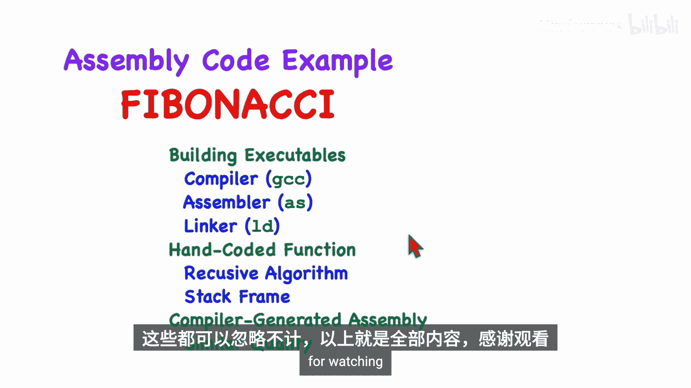

# RISC-V处理器架构，RV32指令集架构，汇编语言，Verilog-FPGA-p07-P07-RISC-V-Assembly-Code-#7---Example-Program--BV1aQ3nztE7J_p7-

Welcome to another video in a series on the Rik5 architecture and its assembly language。

In this video， I'll be working through a non trivialvi coding example。First。

 I'll talk about the steps involved in building an assembly language program。

 and then I'll code a small function in assembly code。Finally。

I'll take a look at the code generated by the compiler for the same function and compare the code I wrote with the compiler generated version and we can see some interesting differences。

In this video， we're going to use the Fibonacci series as our example。

 recall that with Fibonacci numbers， every Fibonacci number。

 such as 8 is computed by adding the previous two Fibonacci numbers。

We're going to write a function called Fib that's passed an argument N。

 and it returns the8th Fibonacci number。 So in past 8， it would return 21。

Here are a couple of equations that describe the Fibonacci series。

 and these will form the basis of our algorithm。 We're going to use these because they allow us to demonstrate recursion。

In other words， to compute Fibonacci of n， we're going to call this itself recursively two times passing smaller values of n。

This example will allow us to demonstrate a number of things like function， call and return。

 as well as recursion and stack frames and some other stuff。

We're also going to create a function calledMaine， which is a C program that we'll call our Fibonacci function。

 and this will allow us to demonstrate how C code is linked with assembly code and also just to test our function to make sure it works。

Before we start coding， we need to know exactly what we're doing。

 We need to know what our algorithm is， and we need to know how that algorithm is going to fit into some larger program。

Assembly programming as hard enough as it is。 So we need to have a very thorough understanding of our algorithm before we ever start coding。

 and we may need to test the algorithm， too， to make sure it works。So in order to do that。

 let's create this C code here。 and here I'm expressing our Fibonacci function in C， right。

 we see that we're passing an argument， returning result。

 we're testing to see whether we've got 0 or one and if so we're just returning0 or1。

 and then we're making our recursive call， using the argument that we're past。

 subtracting either one or two。And here we've got a main function that just has a little loop that calls this Fibonacci function and prints out a few results。

So in order to execute risksk 5 assembly code， you're going to need appropriate tools such as the compiler and so on and a way to execute risk 5 code。

I'm not going to tell you in this video how to set up your execution environment。 Instead。

 I'm just going to tell you that I'm running on a Mac O。

 and I've already downloaded the Rik 5 tool chain。 So I have things like the compiler。

 the asmbler and the linker available to me。I don't have a risk5 machine on the Mac obviously。

 so instead I'll be using Kiu。 Kiu is an emulator that means it is software that will execute riskk 5 machine code as exactly the way a riskk5 hardware core would execute it。

And I also have an experimental unx like operating system that runs under this emulator。

 I'm not going to talk about that at all， although I have a whole video playlist about the XV6 system elsewhere。

Now that we've got our execution environment set up， we can presumably compile and execute code。

So you're probably familiar with the GCC command， the dash O option allows you to rename the executable to something besides A dot out。

Well， if I type this on my Mac machine， I'm compiling a program to be run under the Mac operating system。

 which is a Uni sort Linux space system。Instead， to compileile risk programs。

 I've got to type all of this stuff here。 instead of using the regular compileilr。

 I'm using a special version of it for risk 5， and I've got a bunch of options that I have to list here。

To be quite honest with you， I just cut and pasted this from some place else。

 And I don't even know what all these options actually do。

 I suppose I could look em up if I had the time。I will mention a couple of options that are particularly useful that you should know about the W。

 all option will print all warning messages， and this is a good option to use whenever you compile things。

The dash W error option means if there are any warnings， then they should be treated as an error。

 and they would abort your compilation process。And dashash Big O stands for Opise。

 and we want the compiler to perform some optimizations。 There are some variations on that。

 I'll talk about the dash big S later。Okay， so obviously I don't want to type all of this stuff every time I want to compile the program。

 So I've created a make file to automate the assembly process。 Now。

 I don't know whether you know about the make command and make files。

 I'm not going to be talking about that in this video。 but it's something very useful。

 It allows me just to type the simple word make instead of having to type a bunch of different commands that look like this。

So what actually happens when you compile a program with a command like GCC？Well。

 you may not know it， but Gcc is actually a script or a wrappper program， if you will。

 that calls three other programs。It compiles the program， it assembles the program。

 and it links the program， and there are intermediate copies of your program along the way。

So the first step is to compile your C source code file into As code and assembly code programs or files usually end with an extension of dot S。

And the next step is that Gcc will call the asmbler or will invoke the asmbler program。

 and the asler program will convert your assembly code into what's called an object file。

 Object files traditionally end with dot O。And in the final step。

 GCC will invoke the Lier function or the Lier program。

 and the linker program will convert the object file into an executable。By default。

 executable files have the name a dot out， but we usually rename that to something more useful。Now。

 C source code files and assembly code files are human readable or at least programmer readable。😡。

But the object file and the executable are not human readable。 They contain bits， and in particular。

 they contain the machine code instructions that will be loaded into memory and executed。

The object file and the executable file are generally speaking in a format called Elf format that stands for executable and linkable format。

And so the object file and the executable file contain the bits， that is the machine code binary。

 bits that will be placed in memory and executed。The difference is that with the object file。

We don't know where those bits are going to be placed。

 so when the aser encounter something like a jump instruction for the target。

 it would just use zeros， it wouldn't actually know where in memory it's going to be jumping to。

What the linker does is it takes all the code from this object file and maybe some other object files and figures out where in memory to place all that code。

 And at that time， the linker will figure out what the actual addresses of everything are。

 and it will then go back to。Instructions like that jump instruction。

 and it will replace the zeros with actual bits for the appropriate address。

The Gccs script will do all these steps implicitly and automatically。

 But sometimes we want to stop the process prematurely and take a look at the intermediate files。

 And for that， we have some options。The dash C option will stop after the assembly process and produce an object file。

It will be given the obvious name with a dot O extension。

 but you can use the dash O option to rename it to something different if you wanted to。

And we can use the dash S that's a capital S to stop after the compilation process。

 and that will produce an assembly file which will be by default given the same name with a dot S extension。

 but of course you could rename that if you wanted to as well。

We can also perform the assembly and linking steps explicitly by invoking the Asmbler program or the linker tool directly。

 as I've shown here。The assembly program is usually called something like ASS。

 and you may have seen GAS。And the Lier program is called LD。So when you assemble a program。

 it will produce an object file and by default， it will give it the same name with a dot0 extension。

 but if you want to， you can name it something different。

 I really don't know why you'd ever want to do that the linker program will by default name the executable file  A do out。

 so with the linker you pretty much always use the dash O option to give it some more useful name。

Large programs are often broken up into a number of pieces。In this example。

 we've got a number of source code files that contain C code。

 and we've got a number of hand coated assembly files。

 And these pieces are all compiled and assembled independently。 So in order to build the executable。

 we've got to compile each of the C code files。 we've got to assemble all of the assembly code files。

 And then we run the linker once to combine all of the object files into an executable。

And this has a number of benefits。 Of course， the independent pieces could be maintained and modified independently。

 And if you've got some assembly code in your big project。

 probably you don't want to code the whole thing in assembly code。

 So you're only coding small pieces of critical code in assembly。 So in order to build an executable。

 we have to compile each of the code files， the C code files。

 And then we have to assemble each of the assembly code files。

 And when we modify only one of the files， for example， this file here。

 we need only recompile that file and assemble that piece。 And if we have no errors。

 then in order to produce an executable， we have to then link together all of the object files。

For the example in this video， we're going to create two files， main dot C and Fib dot S。

This is our build process， and I've created a make file that will do this for us。

We will compile the C code file， and then we will assemble it， And for the assembly code file。

 we will assemble it into an object file。 That should be a dot O。

 And then we'll link both of those object files together to produce our executable。

 I won't show the make file， but that's what it's doing for this project。Here's our main dot C file。

 We've got a main function with a small loop that calls our fib function， repeatedly。Now。

 C requires that you provide a what's called a function prototype before any use of a function。

And this allows the compiler to check to make sure that you are calling and using the function correctly。

When we go to link our program， the linker will look for a Fib function。

 And if it can't find one if if you fail to include the correct object file or you've misspelled something。

 then the linker is going to complain with an error message saying that the Fb symbol is unresolved or unknown。

 It can't find the symbol。 And so it cannot produce a correct object a correct executable file。

 And so you're going to have to go back and fix that error。

The first step is to make sure that our build process is working and that we can compile。

 assemble and link everything， as well as execute it。So for that。

 we're going to create this Demmy fib dot S file。 This little function simply takes an argument。

 which is passed in a0， adds 100 to it and returns that result。

 And pretty much nothing can go wrong with this。 And so with this。

 we can make the whole project and execute it。 And we can verify that the main dot C functions is working。

 Of course， the sequence that it prints out will be wrong， but at least we can compile everything。

And now we're ready to actually get going。Every function， in my opinion。

 should begin with a block comment that tells what that function does。

 So here I'm including a block comment。 and I'm saying that this is the algorithm that this function is going to compute would probably also be useful to include information about the registers。

 but I don't really have enough room on this slide for that。

 So we'll just leave it at this block comment and the next thing we're going to do is get rid of that ad instruction and make room for the code that we're just about to write。

So where shall we begin。We do call Fib recursively twice， so we can go ahead and write that down。

And we'll be passing an argument in a0 to the recursive call and getting result in a0。

 So let's put these two calls here。 And let's see what next。

 maybe we can think about how we are going to return a result。

 Certainly we're going to have to add the result that's return from our two recursive calls。

 So we'll have an add instruction。 and our result will be an a0。

 So we're going to return something in a0。 and we can add what comes back from the second call。

 That's in a0。 But as for the first call， well， it puts its result in a0。

 and that value is going to be clobbed or overwritten by this call right here。

 So what are we going to do about that。 or what are we going to add And the answer is we can use another register。

 and we'll use S1。 That's one of the save registers。 remember that when we call。

AF the saved registers will be saved by that function。

 All the S registers can be assumed to maintain their values across calls to other functions。

 So if we move a0 into S1 here， then we can be sure that at this point， it still has that value。

 And so that's what we use to add to a0 to get our result。Next。

 let's think about the first recursive call and the argument in -1。Our own argument N comes in in a0。

 So in order to compute the argument to send to this call， we simply need to subtract one from it。

 and we can do that with an add immediate instruction with an immediate value of -1。

 So that sets up the call。 Sorry， that sets up the argument to the first recursive invocation。

 And now we have the second recursive in。 That's got to be in-2。 So we've got to subtract2 from a0。

 But we can't do that here because a0 will have been clobbered by this stuff here。 So instead。

 what we'll do is we'll perform the subtraction first。 at this point。

 and then we'll put it into register S 2。 That is one of the save register。

 So we will preserve its value from here down to here。 And then at this point。

 we can move it into a 0 with a move instruction。 So it will be passed to the second recursive。

Of call。Well， that takes care of this line here。 and next let's turn our attention to the termination test。

So we need to compare our argument， which is an a0 with a value of one and return。

We'll need a branch and test instruction and we can compare a0 our argument to and this has to be a register and so we're going to use a register。

 I've chosen a1 here I suppose it could have been one of the temporary registers as well and loaded it with an immediate value of one and then I'm testing and jumping around a return statement。

 so we want to return if it's less than or equal and we don't want to return if it's the opposite which is greater than so I'm jumping and I'm creating a label called else here to jump around。

The returned statement。Well， that pretty much does all the computation we need。

 but we still need to talk about these save registers。

Remember that the programming conventions are that whenever a function uses one of the save registers。

The S registers， that function is required to save the previous value somewhere and then restore that value before returning。

 And so we are using registers S1 and S2 here。 so we need to save them up here and then restore them after we're done using them。

And we're also modifying the return address register。Remember that when we call something。

 we save our return address， which would be the move instruction here or the add instruction here in the R A register。

 And then that is used by the function when it wants to return。 Well。

 we've got a value in R A upon entry to this function here and we need to use it when we return。

 So we're going to need to save S 1， S 2 and R A。So assuming we're running on a 64 B machine。

 These registers are 8 Bs each。 So we're going to need 24 Bs。 And where are we going to save that。

 Well， somewhere in memory。And so here's memory。 I'm showing lower addresses toward the top of the page。

 And somewhere in memory， there's a stack。 okay， and with riskk 5 and many computers。

 the stack is said to grow downward， which means that when you push something onto the stack。

It will go into a memory address with a lower address。 So if we push something on the stack。

 it would go into this location here and then here and then here。And we have our S P register。

 which points to the item at the top of the stack。And by the way， for convenience。

 I am drawing not individual bys， but entire double words。

 So you can see my addresses are increasing by 8 in hex each time。

And so what we're going to need is 24 bytes or three double words。

 And so we're going to push those words， those double words onto the stack。And in order to do that。

 we're going to。Derement our stack pointer by 24。 Okay， because the number of bys we need is 24。

 So that's happening here。 We're adding to the S register， or-24。

And this is allocating a so called stack frame。So this function is going to have a frame on the stack where it saves its data and where it can keep its local variables and so on。

And then later， before we return， we're going to pop that stack frame and I guess go back to that。

 okay。So to pop it， we just add to the S P register。

Stack frames are used in programming languages like C all the time， whether you realize it or not。

 and it would be where you keep your local variables for a function， and in our case。

 we need to use it to save the S。1 and S 2 registers as well as R A。

 So we're going to put these things into our stack frame at these particular offsets，0，8 and 16。

 and then you know， 24 is the thing just beyond our stack frame。

 So here are some store double word instructions。 and some low double word instructions。

 And so we're going to save S1 S2 and RA in locations 0，8 and 16， as I've shown right here。

 And so then after we use them here。We can then restore their previous values by using low double words。

 And so again， using the same offsets， we grab them from the frame and move the values。

 the previous values back into S1， S2 and R A。Okay， so that concludes the Fib S file。

 I've typed this in and executed it and it works perfectly。

 I'm not going to show you the output because I'm going to hope that you can imagine what it might look like。

But instead， I want to take this opportunity to state my opinion about commenting as code files。

 This is the style that Ive found that really works best。 I mean。

 if you end up writing much as simply code， you'll realize very quickly that it is highly prone to errors。

 You forget instructions or you do things in the wrong way。 You clobber registers。

 you forget which registers are used for what。And so on and having comments like this next to the code makes it much easier to understand what some code is doing and when there's a problem to sort of locate the area where the problem might be and fix it。

So instead of showing you the output， what I'm going to do is I'm going to turn to the compiler and I'm going to ask。

 what assembly code does the compiler produce？I've actually renamed or created another file called Fb1 to distinguish it。

 and I'm going to compile it with the dash capital S option to produce an assembly code file and look at that file and compare it to the code that I wrote。

Here's the assembly code produced by the C compiler for a little C function named Fib1。

And my earlier quip about assembly code being sort of human readable can make sense when you look at something like this。

 I mean， this is pretty nasty and the fib function is really small and trivial。

 and you can imagine with a larger function that the assembly code is going to be really hard to get through。

 and it also backs up my comments about the importance of having good comments in your assembly code。

 But don't worry， we're going to look at this code and make sense of it。

The first thing about this code that just jumps right out at us is the large number of assembler directives。

 You can tell asler directives because they start with a period。Now。

 in an earlier video I described what dot Global is all about but we see things like CFI and location。

 CFfiI stands for call frame information and location is giving information about the following assembly code。

 for example， this assembly line right here， corresponds to file number one line number 26。

 character position number one， so that gives a correspondence between this assembly code and the original C code。

Now all of this information is used for the debugger。

 so this information would go into the object file and then it would also be put into the executable file and then if you go to debug your program with something like GDPB。

 it will find that information and it will help it to present an interface to the user that allows the assembly code to be interpreted in terms of the original source code。

We also see something here dot type where we're saying that fib1 happens to name a function。

 and down here we're seeing dot size， and we're saying that the name of the that the fib1 function has a particular size in this context。

 a period means the current address。 So we're computing the size of this function by subtracting the current address minus the address of the first instruction。

Okay， so we can just get rid of all this stuff because we don't care about that。

The next thing we notice is that there are an awful lot of compiler generated labels。

You can tell a compiler generated label because it begins with a period。

 and that period is actually part of the spelling。The period helps differentiate between compiler generated labels and human generated labels。

 like Fb 1。And you could also notice that there's some patterns like the LCFI， we have four or five。

And6 and 7 and so on。 none of these labels are referred to except for L6。

 L6 is used in this branch of less than or equal instruction。So we can just get rid of these。

 we don't care about them， and now we've got a bunch of code and I want to compress this code。

 so I'm going to reformat it， I'm not changing the instructions。

 I'm just packing them together so we can see them in a format that's a little bit easier to read。

In order to understand and decipher the compiler generated code。

 I am going to put up the code that I wrote next to it。 And so we can kind of use that as a guide。

 and we'll talk about how they differ。 And you can see that these two bodies of code or about the same size。

 The compiler generated a couple of extra instructions。

And so we can begin by seeing the overall structure， which is essentially the same。

 starts with the label for the beginning of the function。

 And we have two calls to fib somewhere in there。 And the next thing we notice is that the return instructions are a little bit different。

I coded return， and the compiler used a jump on register。

 so this basically jumps to the address in this register。

 These both compile or assem to the same exact machine instruction。

 so it's really no difference there。The next thing to notice is the code that allocates the stack frame and saves and restores the registers before returning。

 So I do the termination test up here。 And only if we don't return。

 do I bother with the stack frame and the saving， whereas the compiler generated code。

 always allocates the stack frame and does the saving and restoring of the registers。

So as far as the termination test， basically it's the same。 we load a register， I use A1。

 the compiler used a5， and then I jumped around a return statement。

 so I use branch of greater than whereas the compiler jumps to this code down here that performs the return。

 so it does a branch of less than or equal， so that's essentially pretty much the same。

The difference， really， is that， if we have。A call where the value is 0 or1。 The termination test。

 in my case， will execute three instructions whereas the compiler's code will execute a bunch of instructions。

And you might ask yourself， well， does this really make any difference。

 it's only the termination task。But if you think about this algorithm， it's a recursive algorithm。

 Every time we call the fib function， it calls itself twice。 So this thing blows up exponentially。

 and the number of leaf functions is actually huge。 So in fact。

 these instructions are going to be executed a whole bunch。

 And I think that my code is definitely going to perform better。 I of course。

 haven't bothered to do any performance analysis on it。 but I feel pretty certain about that。U。

I should also comment that computing Fibonacci numbers with a algorithm that does two recursive calls is pretty much the stupidest way to do it。

 I wanted to do that so I could demonstrate recursive calls。

 but the best way to compute Fibonacci numbers is with a simple loop。

the algorithm that we're using is essentially exponential。

 whereas a simple loop would be order in a linear function， much better。 But anyway。

 given that we're using a bad algorithm， my code works better in that respect。Now。

 let's take a look at the two recursive calls and the instructions to compute the result and move it into a0。

So the compiler generates essentially the same code。 here the two calls， and in my case。

 I move the result from the first call into S1。 the compiler uses S2。

 and I add them in this order and the compiler adds them in the other order。

 but essentially the code is the same。There is one， however， one difference that I found interesting。

 and that's that I used a double word ad here。 I'm assuming that we're running on a 64 B machine and we must be because I am doing store and low double words and the compiler is translating exactly the code that I wrote。

 and the C code that I wrote from which this code was generated。

 actually used ins and not long integers， So this is a 32 bit edition。

 So technically I suppose I didn't really quite correctly implement the algorithm that I specified in C。

 but I thought that was interesting。Next， let's take a look at how the argument is prepared for the first recursive call。

 and the code is exactly the same。 The only difference is that the compiler uses 32 B arithmetic to subtract one from N。

 whereas I use double word arithmetic。And now for the preparing the argument for the second call。

 what I do is do the subtraction first and then save it。

 whereas the compiler saves it first and then does the subtraction。I use S2， it uses S1。

 that's a minor difference， and also the compiler does 32 bit arithmetic。

 whereas I'm doing 64 bit arithmetic。In the compiler generated code。

 there's also one instruction that's present， but it's not in my code at all。

 And in order to understand what's going on here， I want to talk about the stack and how that operates。

So。Previously， we've said that arguments to functions are passed in the registers A0001 and so on。

But if there are more than 8 registers or they are larger than the register size。

 then they should be passed on the stack。 I said that earlier， but I didn't say much about that。

 well。Imagine that the collarer to this function has already placed a stack frame on the stack。

 And so when the function is called， S P points to the top of the stack before we actually allocate our frame here and。

In the collars frame， right at this end， the bottom end of it， I guess we will have the arguments。

 the additional arguments。 they would be located right here。 So then when we come into this function。

 what we're going to do is we're going to create a new stack frame。 Okay， so we create that frame。

 In the case of this code， it's 32 bys。 whereas I use 24 bys。

 But we create a stack frame that has four double words in it like this。 and。Right here。

 what we're doing is we're setting register。S0 to point to the old or previous top of the stack。

 Okay， And so that would allow us or the compiler's code。

 to access the arguments quite easily by using an offset from register S 0。

 So I think what the compiler's doing is setting up register S 0 so that it can be used if it needs to。

 although if you look at this code， S 0 is never referred to。

 So this instruction is essentially dead or unneeded code。

 It's not really dead code technically speaking， it's just its code that's useless。

 And so we could eliminate it safely。 and this thing would work just fine。

But the compiler code is needing to save registers RA S 01 and 2。

 so it's got to save this extra register as well， so that's why it needs 32 bytes instead of 24 bytes and later down here before we return the code will restore S2 as well as S0 and S1。

There's also another thing I wanted to mention。 and that it is that the。

Standard calling convention for risk 5 requires that the stack pointer， the top of the stack。

 the S P register shall always be quad word aligned。 In other words。

 the value in the S P register should always be something that's divisible by 16。

 So it's more than double word aligned。 And you might ask， what's going on with that。

 Why would we want that。 And I think the answer is because there's talk of an RV 128。

 and presumably there will be quadword loads in stores and things have to be properly aligned on 16 B boundaries。

 So in order to support future code they've made the calling conventions required that the stack pointer always be。

On an address that's quadword aligned or evenly divisible by 16。Now， my code。Just added 24 to it。

 so I would violate that alignment requirement。However。

 my code doesn't call any other code besides itself recursively。

 So it's not going to cause any problems。 but I did want to mention that you really should make sure that your stack frames are an even multiple of 16。

 And in this case，32 is， of course，2 quad words。 So that explains。

 I think what's going on with this code。Okay， that concludes my discussion of the compiler generated code。

 as well as my version of the function that I wrote myself。

 And I hope you found this to be interesting。Okay， that wraps up this video In this video。

 I gave an example of how to program in assembly language using the Fibonacci number series as an example。

I began by describing the compiler and the asmbler and the linker and talking about how these can be used independently to combine pieces of a large program and build a single executable file。

And then I got into the coding and produced a hand coated version of a Fibonacci computing function。

 I used a recursive algorithm which allowed me to demonstrate how stack frames are used。

And after that， I looked at the assembly code generated by the compiler and compared it to the code that I wrote myself。

 and I think we can conclude that the quality was similar。

 although the compiler failed to include any comments and included a bunch of stuff that we could easily ignore。

Well， that wraps everything up and I'll end by saying thanks for watching。

 and I'll see you in the next video。

