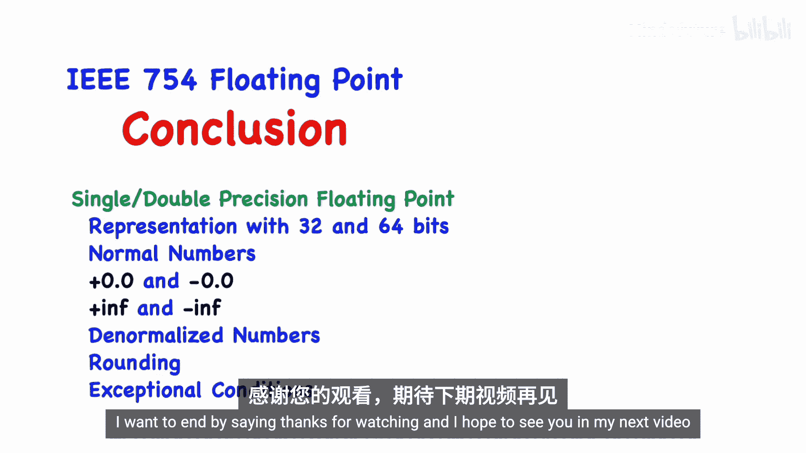

# RISC-V处理器架构，RV32指令集架构，汇编语言，Verilog-FPGA-p08-P08-RISC-V-Assembly-Code-#8---Floating-Point-IEEE-754--BV1aQ3nztE7J_p8-

Welcome to a video in which I introduce and describe floating point numbers。

This video is part of a playlist on the risksk5 architecture and assembly language。

 but this video is completely independent riskk 5。What I say here applies equally to risk 5 arm。

 intel processors and others as well。If you are familiar with floatinglo Point and the IE 754 specification。

 you can skip this video altogether and go straight on to the next video。

 which covers the specific risk 5 floating point architecture。But if you are new to a floating point。

 then this video contains important material， regardless of whether you're interested in risk 5 or not。

In this video， I'll be describing how single and double precision numbers work。In risk five terms。

 you'll need to know this information in order to understand the optional F and D extensions。

 which cover single and double precision respectively。

I'll be describing how floating point numbers are represented in binary。

 and I'll cover special cases like infinity， not a number， dennormalized numbers。

 and other things like rounding and error conditions。As I said， this video covers the IE 7。

54 standard。 The standard is adhered to throughout the industry， including by arm and intel。

The two most important parts of the standard cover single precision and double precision numbers。

There are other sizes as well， but those are less commonly implemented。

A single precision number is stored in 32 B or a word。

 While a double precision value is stored using 64 B， also known as a double word。

When you use the C programming language and you create a float variable。

 that would be single precision， and a double variable would be a double precision floating point number。

And for risk5， the floating point instructions all begin with an F， and for single precision。

 they end with a dot S suffix， and for double precision they end with a dot D suffix。In risk 5。

 if you have the double precision， then it is required that you also implement the single precision extension。

 so D implies F。Let's begin with a review of scientific notation using this example。

 which is in decimal。We've got a sign， and then we've got the value， which is called the mantisa。

 And that is multiplied by 10， raised to some power。With binary， we've got the same idea。

 We've got a sign， and then we've got the value， which is made of zeros and ones。

 and that is multiplied by two raised to some power。 So with decimal numbers。

 our exponent applies to a base of 10， whereas with binary floating point numbers。

 our exponent will be applied to a base of 2。With scientific notation。

 our habit is to put the decimal point just after the first digit， as shown here。

 And with binary numbers， we'll put our， well， we don't call it a decimal point。

 We call it a binary point or a raix point。 just after the first one bet。

This slide shows how we represent a normal single precision floating point value， using 32 Bs。

We've got 1 B reserved for the s bit， and then we've got 23 Bs to the right of the binary point here。

 So this green field is 23 B in size， And then we reserve 8 B to store the exponent。

 So that field is here。The initial bedt is always a one。

 So that's implicit and not actually represented。The representation of double precision floating point numbers is the same idea。

 Only the fields are bigger with double precision。 we've got a 52 B field for the Mantisa。

 and we now have 11 Bs for the exponent。 So that gives us both a greater precision and a larger range for double precision floating point numbers。

The term precision has different meanings， depending on whether we're talking about scientific notation or floating point values。

 We might say that precision is imprecise。With scientific notation。

 the number of digits tells you about the accuracy of the measurement。

 So the number of digits itself conveys information and tells you how close this value is to some ideal or correct number。

With floating point values， the mantia always has a fixed size。

 and so these additional zeroes give you absolutely no information。

Floating point numbers are just that they are numbers with no additional information about how close or accurate they are。

Every floating point value represents some particular， rational number。But obviously。

 with a fixed number of bits， we can only represent a few rational numbers。

 So there are gaps between the values that we can actually represent。

In order to give you a feel for this， I wanted to work through a couple of examples。

 and I'm going to start with this number， which is a very large number。

 and we have our 23 bits of precision for a single precision floating point number。

And so what value is this number？Well， if we move our point， our binary point over 35 places。

 we get this integer here。 and as you know， every bit corresponds to some power of 2， So we have1，2。

4，8 and so on all the way up to these bits up here。

 And if we look at those in particular we see that the number that we're represented。

 is actually a bit over 79 billion， which is a larger number that can be represented with an unsigned 32 B number or assigned 32 B number。

 So we have a greater range right off the get go。And now let's ask ourselves。

 what's the gap between numbers in this range？ So if we look at the next representable value that is we take this bit and we increment it to a1。

 then we get this value here。 And if we multiply it out。

 we see that this bit is in the bit position that corresponds to 2 to the 12 or 4K。

 and it represents this value here。 So we see there's quite a gap between these two values。

 The gap is exactly 4096 or 4K。But we see that these two values have the same first seven digits when represented in decimal。

 So it's often said that with single precision floating point numbers。

 we have about seven decimal places of precision， So that's a useful thing to keep in mind。

 about seven decimal places of precision with single precision floating point numbers。

We see that for very large numbers， the gap between successive values is very large。

 and with very small numbers， the gap between successive values is very small。

 So now let's take a look at a very small floating point number。 again， its single precision。

 and we have a negative exponent。 and if we shift our binary point to the left，16 places。

 we have this value right here。So as you know， with binary numbers， the place values are 1，2，4，8。

 and so on。And that same pattern holds to the right of the binary point。

 So the place values are 2 to the -1，2 to the -2， and so on。

 Or if we want to express that as fractions，1， half，1 quarter，1，8， and so on。

And so if we look at the value that we have here， as in our example。

 these particular bits are in the places that have these particular values。

 so if we multiply that out， we get this particular representation in decimal。Now。

 as an interesting bit of trivia， notice that the binary representation has the same number of bits as the decimal representation has digits。

 That's always true。 That's a bit of useless trivia。Okay。

 so now let's consider the gap between the values with these small numbers。

 So let's take this bit and let let's go to the next number or the next value by changing it to01。

 And so here's the number that we're representing and this one is way out in a position that has a very small multiplier2 to the minus- 39 and if we multiply it out。

 you would actually get this value here。 So here's one value and here's the very next value that we can represent。

 And if you compare these values， you could see that the gap between them is you know2 to the -39th。

 which is this value here。And also， notice that the first seven digits in the decimal representation is the same。

 So， again， we say that with floating point numbers， we have about 7。

Deimal places of precision and with double precision floating point numbers。

 we have about 16 decimal places of precision， so 16 decimal digits of precision with double point。

 double precision floating point and seven places of precision with single precision floating point。

With the floating points standard， there are actually several different kinds of things that we can represent。

So far， we've just seen the representation of normal numbers。But we can also represent 0 infinity。

 not a number and subnormal numbers。 And these are distinguished by special values in the exponent field。

With 0， the standard gives us both a positive 0 and a negative 0。

 And we also have positive and negative infinity。 and we have something called not a number。

 And we have subnormal numbers or also denormalized numbers。 And these are numbers that are very。

 very close to 0。 They have a reduced precision。 and the positive and negative zeros are actually special cases of deormalized numbers。

😊，Now， let me talk about exponents with a single precision floating point number。

 The exponent field is an 8 B field。 And with this 8 Bs， we can represent any exponent between  -1。

26 and plus 1，27。Actually， the encoding of these values is not the standard binary encoding。

 but you can ignore that trivia。 And just remember that the exponent ranges between -1，26 and 127。

If the field is 80 bits， then that's used for these deormalized numbers， including our zeros。

 and a field with all ones is used to encode infinities and the not a number of values。

With double precision， it's the same kind of thing， except our exponent field is 11 B。

 and we have a much larger range for our exponents。 But other than that， it's the same idea。

Here is how the infinities are represented with single precision floating point。

If the exponent is all ones and the mansa is all zeroes， then it is interpreted as infinity。

 and we have a signed bit so we can have positive infinity or negative infinity。

 And here are the representations in hex。 And for double precision， it's the same idea。Now。

 I want to describe subnormal numbers。 Subnormal numbers are also called deormalized numbers。

 and they're used to represent values that are very close to 0。So here is the smallest normal number。

 We've got our implicit one， but the ema is all zeros， and we've got the smallest possible exponent。

-126。With a subnormal number， that implicit leading one is no longer there。 and implicitly。

 we have a0 instead。And subnormal numbers are represented with an exponent field。 that's all zeros。

 And when our exponent field is all zeros， it's interpreted as the very same exponent， namely，-1，26。

 So we can say the exponent is sticky， and it sticks at the smallest possible value。

And with this particular subnormal number， we've got a manissa of all ones。

 So you can see it's just slightly smaller than the smallest normal number。

And if we keep going down closer to0， we have a mantisa of all zeros。

 except for a one in the least significant bit position。

 and that number corresponds to about 10 to the minus 45。

And if we change that bit to a 0 and our mensa is all zeroes， then we have a0 value。

With the floating point standard， we also have the ability to represent something that is not a number。

This would be， for example， our result， if we tried to add positive and negative infinity。

 there's no particular value that would be appropriate。

 So we have the not a number value as our result。Actually。

 there are very many different bit patterns that correspond or are interpreted as the not a number value。

 All we require is that the exponent be all ones and the mantisa。Have at least a single 1 B in it。

 It can't all be zeroes， or otherwise it would be interpreted as infinity。

 So we have many values that correspond to not a numbers。And we ignore the sign debt。

This particular value of all 1 B is the canonical representation of not a number for single precision numbers。

 And if we happen to interpret this bit pattern as a signed integer， it would be interpreted as -1。

With double precision floating points， we have the same basic idea。

A not a number value is anything where the exponent is all ones， and the mentea is not all zeros。

 And here's an example of 64 Bs representing not a number。 But in this particular example。

 I'm not specifying what the lower order 32 B actually contain。 And with the risk 5 processor。

 In fact， we're going to use those low order 32 B。 And what we're going to do is we're going to hide a single precision floating point value inside。

 that's called a payload。 and we'll have a single precision floating point value there。

 So we can interpret this 64 Bs as a double precision， not a number value。

 or we can look only at the lower third low order 32 B。

 and we can interpret it as a single precision floating point number。

I want to take this opportunity to make a slight diggression。 And for the sake of completeness。

 I want to mention something about not a number of values that you might encounter。

Sometimes you might see a distinction being made between quiet naans and signaling naans。

Quiet Nands are sometimes called Q Nans， and signaling Nns are sometimes called S Nans。

If signaling nans are implemented， then the most significant bit of the mantisa is used to distinguish between quiet and signaling。

 If it's a one， the nan is quiet and if it is 0， that would be a signaling nan。And with risk 5。

 all Nands are quiet by default。 Singing nas are not normally used。

 and it's probably better to ignore this distinction rather than get overwhelmed with the details。

The main thing to remember is that if something goes wrong in a floating point instruction。

 such as trying to divide 0 by 0 or taking the square root of -1。

 it's considered to be an invalid operation。O， there is no appropriate result。

At least one that can be represented in floating point。

The invalid operation bit in the floating point control and status register would be set to one。

 and the result would be a， not a number value。Lands are propagated。

 This means that if any operaran to an instruction is a nan， then the result will be a nan。

 Once you have a nan， it will be sticky， if you will。

A subsequent operation that depends on a previous operation that was invalid will itself produce a nan。

The propagation of Nans is useful when you have a lengthy series of operations。

 Your code only needs to check for a naan at the end。

Let me note that the wordex can be a bit confusing。For risk 5， an exception is a sort of trap。

 and it causes a break in the flow of execution。 A trap handler would be evoked。

 invoked and executed。For the IE floating point speck。

 an exception such as an invalid operation or an exact or overflow is more like an error condition。

The corresponding bit in the floating point status word would be set to one。

And so to avoid confusion， I prefer to call a floating point exception an error condition。

The floating point spec does not require that a trap occur when such a floating point error occurs。

 but according to the spec， a trap when an error occurs is allowable。However。

 I think that most processors don't implement this， and this goes for the risk5 as well。

 errorsors like overflow and invalid operation simply set a bit in the status word。

 and they keep going， returninging a not a number in the case of invalid operation。

So here's the difference between quiet and signaling mans as I understand it。

When an operation is attempted in which one operaand is a nan， the type of the Nan matters。

 If the operaand is a quiet nan， then it's propagated。

 but the operation is not considered to be an invalid operation。

If the opera brand is a signaling naan。It is propagated similarly， but in addition。

 an invalid operation error will occur。In all cases， whenever the operation is invalid。

 like 0 divided by 0 or the square root of -1， an invalid error occurs。

 and the result will be a quiet nan。In all cases， whenever one operaran， one operaran is a nan。

 the result will be a quiet naan。The difference is that whenever one opera brand is a signaling naan。

 an invalid operation error will also occur。But when the operaand is just a quiet nan。

 it's not considered to be an invalid operation。This might be useful in a situation where your algorithm is processing a large set of data points where each one is expressed as a floating point value。

If any of those data points is say missing， you could store a signaling naan in that particular slot。

Then after your algorithm completes execution， if such a missing data point was ever encountered。

 then the invalid bit would have been set。The risk 5 spec does not say very much about signaling Ns。

 but and I believe that they are not generally implemented。 In other words。

 whenever one of the operas of a floating point instruction is a nan。

 the invalid operation bit is not set。These bits are sticky， so presumably。

 it was set in an earlier instruction when the nan was first produced。So， listen。

 I don't pretend to be an expert on floating point。

 I hope that my explanation of signaling and quiet Nands is both clear and correct。 If not， I would。

 of course， appreciate being corrected。Given that with floating point numbers。

 we can only represent a finite subset of the infinite set of rational numbers。

 it's going to be the case that sometimes our operation will re a result that is not exactly representable with a floating point value。

 So we're going going to have to perform some sort of rounding operation。

The IreE standard describes several rounding operations。

 We can round a result down or we can round it up， or we can round it towards 0。

 That is we round positive numbers down and negative norm numbers up。

But perhaps the most useful is to round the result to the nearest number that is representable as a floating point value。

So we can always have a tie that is the exact result。

 might be half way between two values that are representable。

 So the spec requires us to round it to the nearest value that ends with a 0 bit。 Okay。

 so that sort of prevents any kind of bias by sometimes rounding up and sometimes rounding down。

So which rounding mode will be used？ Well， that would be determined by the current rounding mode。

 and that would be set by some field in some sort of a control and status register。And with risk 5。

 we have a control and status register that contains the current rounding mode to be used。

Another thing to ask is what exactly can go wrong。 What are our error conditions。

And the speck describes these particular exceptional conditions that might arise after any particular floating point instruction。

 We've already talked about the result being inexact。

 So some operations will yield the exactly correct answer。

 whereas others will yield a result that was rounded。We can also have overflow。

 in which case the result would be either a positive or negative infinity。

 We can also have underflow where the result is a sub normalormal value， or possibly0 itself。

We can also have invalid operations。 for example， if we try to divide 0 by 0 or add plus or minus infinity。

 And finally， we have the well known divide by 0 problem。

It turns out that this is not necessarily invalid。 For example。

 one divided by positive0 yields positive infinity。

 while one divided by negative 0 yields negative infinity。

The speck describes that all of these exceptional conditions shall correspond to bits in some kind of a control and status register。

 So when the exception or error condition arises， the corresponding bit would be set。

 and those bits would be sticky。 That is， they would stay set until they were explicitly cleared。

 So after a series of floating point operations， we could check the bits to see whether anything went wrong during the computation。

At this point， I want to make a few general comments and warn you about using floating point numbers。

So be careful。Floating point numbers as represented in computers are similar to。

 but are definitely not the same as numbers as mathematical numbers。 Of course。

 there is an uncountably infinite number of real numbers and rational numbers are also infinite。

 and what we represent is just a small， finite subset of all the rational numbers。

 So one thing that's sort of unusual， is that we have two representations of 0。

 So you might think of these two representations of 0 as being infinitessimally close to 0。

 either on the positive side or the negative side。But just be aware that we have two representations of zero。

 So what does it mean for equality。Most importantly， the results may not be exactly representable。

 So the result of a particular operation is not mathematically correct， if you will。

 close but not exact。Another thing that is really confusing is that the associivity that you're so used to with math doesn't always hold。

 so with floating point numbers， this computation here is not always correct。

The other thing is that we have overflow and underflow leading to both infinity and zero。

But I do want to point out that one thing that's true is that every 32 B integer。

 whether signed or unsigned， can be represented exactly with a 64 B double precision floating point number。

 So there's a bit of light for you。So to conclude this video。

 I gave an introduction and overview of the IE 754 floating point standard。In particular。

 I talked about single and double precision floating point values。

And I showed how they were represented with bits， either using 32 Bs for single precision or 64 Bs for double precision values。

I talked about how normal values were represented。And I also talked about the special representations for positive and negative zero。

 as well as for positive and negative infinity。I describe deormalized or sub normalmal numbers。

 which are very close to 0。 And I also described various rounding techniques and talked about some exceptional conditions that can arise during computations。

So that concludes this video， I want to end by saying thanks for watching and I hope to see you in my next video。

