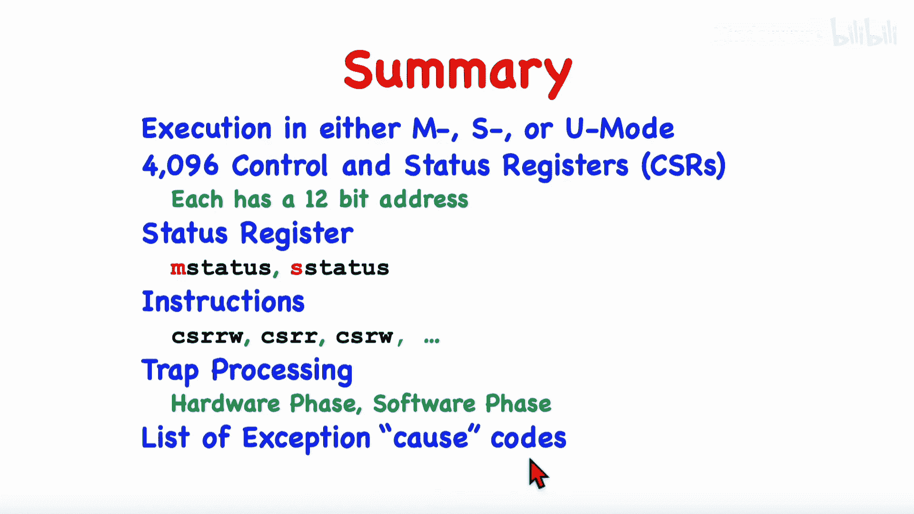

# RISC-V处理器架构，RV32指令集架构，汇编语言，Verilog-FPGA-p11-P11-RISC-V-Privilege-#11---Intro-to-Trap-Processing-and-Exceptions--BV1aQ3nztE7J_p11-

Welcome to another video in a series on the Risk 5 processor architecture。In this video。

 we'll start in on the privilege system and the security mechanisms。

 beginning with an introduction to machine mode， supervisorvis mode， and user mode。

I'll talk about the control and status registers and describe the instructions that access them directly。

These instructions are， of course， privileged instructions。I'll focus on the status register。

 although I'll also mention a few others， and finally。

 I'll describe what happens when a trap occurs and what steps the hardware will take on its way to invoking the trap handler code。

Let me begin by stating that with Ri 5， there are three execution modes。At any instant in time。

 the coreps is executing in exactly one of these three modes。

The execution mode is also called the privilege level。Machine mode has the greatest privileges。

 and essentially there is no security checking。A user mode is operating at the lowest privilege level。

 and there are many operations that cannot be done in user mode。And supervisor mode is intermediate。

There aren't any bits in any control and status register to indicate the current mode。

The current privilege level is implicit， so there's no clear way for a programme to determine the current mode。

But that's really not a problem。 since software is designed to be executed at a particular privilege level。

 with the current mode being implicit。In machine mode， which is the most privileged level。

 all operations and instructions are allowed。 There is no security checking。

Machine mode is entered on power up。 And when the reset line is pulsed。

 and for cores that only implement machine mode， of course。

 we would remain in machine mode throughout execution。

But for more complex core where we have supervisor and user mode implemented as well。

 I think the best way to think about it is that code running in machine mode handles traps and is responsible for start up initialization。

And by traps， I mean， interrupts and exceptions。So the code at startup runs in machine mode and performs initialization。

 sets up the interrupt system， and does secure booting if that's implemented。

And then the code would then transfer to code that runs in supervisor mode and would typically not be used after start。

Supervisor mode adds the ability to implement virtual memory using page tables and any risk5 core that's capable of virtual memory will have supervisor mode implemented。

So the idea is that an operating system colonel would be running in supervisor mode。

So the start code would run in machine mode， and then it would jump to the kernel and at the same time。

 switch into supervisor mode。And the colonel would then initialize things， including the page tables。

 and it would run user code in user mode。And then when traps occurred in user mode， for example。

 a timer interrupt， it would be handled by a trap handler running in the kernel in supervisor mode。

But actually， the machine mode code is responsible for regulating the traps。

 and it may in fact mask some of those traps， and if so， whenever one of those traps occurs。

 that would be handled by machine mode code and it would be invisible to the operating system kernel in supervisorvisor mode。

Finally， we have the lowest privilege level， which is user mode。For systems with an operating system。

 all application and user level code would run in user mode。When running in user mode。

 certain operations are not allowed。Any attempt to execute a privileged instruction would cause an illegal instruction。

 exception。When running in user mode， a trap can occur。

 This could be a device that's causing an interrupt。

 or it could be an exception for some particular instruction。

 or the code might be trying to do a system call。In any case。

 the code would be interrupted and a trap handler would run and typically would run in supervisor mode。

 but in systems without supervisor mode， it would be in machine mode。

So the trap handler would run and deal with the trap， do whatever is necessary。

 and then when it gets ready to return， it would return to the application code and at the same time go back to user mode。

A particular risk 5 core may or may not implement all three protection levels。

Here are the allowable combinations。Machine mode is always required。

The simplest risk 5 cores would implement only machine mode。

 and these would have no security or protection at all。 since all code is running at the highest。

 most privileged level。A more complex system like I discussed before that is capable of implementing an operating system would have machine。

 supervisor and user modes。Intermediate we have one without the supervisor mode。

 and this would be appropriate for a system with some level of security。

 since some code runs in machine mode with privileges， but other code runs at a lower level。However。

 such a system would not be able to implement a virtual memory system。

 since virtual memory is done at the supervisor mode level。

To manage the execution modes and the privilege mechanism。

 Rik 5 has a number of so called control and status registers， or CSsRrs。Every CSR has a unique name。

 for example， one is named M statusus。 Now this happens to be the status register associated with machine mode。

And we've got instructions to both read and to update the control and status registers。

These registers are protected and access is controlled。

 so these instructions to update them and to read them are privileged。

Each control and status register has a special usage。These are not general purpose registers。

For example， one CSR counts the number of clock cycles since the last reset。

 and we've got others to control trap processing and to manage the page table mechanism。

R 5 can accommodate up to 4096 different CSRs， so we use a 12 bit integer to number and to identify which register we are talking about。

For example， the instructions to read and to update the CSRs each contain a 12 bit immediate field。

 and that field would identify and contain the number of the register that we want to operate on。

So how is access to the control and status registers regulated？

There are actually three different categories or classes of registers。

 and every register belongs to one of these three classes。So for some registers。

 they can only be read or modified by code running in machine mode。

 and if code running in supervisor or user mode tries to access one of these registers。

 an illegal instruction exception would occur。And for other registers。

 they can be accessed either in supervisor or machine mode。

 otherwise code running in user mode would cause an illegal instruction exception。And finally。

 for some registers， they can be accessed regardless of the mode， so there's no restriction at all。

Here I have some examples of some commonly used registers。

 and for the registers that can only be accessed in machine mode。

 their names typically start with an M。And here， I'm showing both the name and the 12 B integer that identifies the register。

 This would be the value that's placed in an instruction that either reads or modifies the register。

And for registers that can be accessed either in supervisor or M mode。

 they typically have an S as the first letter of their names。And finally。

 four registers that have no restrictions， they typically don't have a U。

The next question to ask is exactly how big are the control and status registers。

 and the answer is that for 32 bit cores， they are 32 bits and for 64 bit cores，64 bits。

Now for some functions， 32 bits is not big enough， for example。

 there's a CSR to count the number of cycles since the last reset。

 and this is going to overflow 32 bits pretty quickly， we need a full 64 bits。

So if we're running on a 32 bit core for situations like this， we use two registers。

 so there's a second register that come in pairs like this and the other register has an H appended to the end of the name。

So cycle contains the lower 32 Bs of a 64 B value， and cycle H contains the upper half of the value。

If we're running on a 64 bit machine， then we've got 64 bit register。

 so we don't have the second H register。This technique is used not only for cycle。

 but for some other CSsRrs as well。Next， I want to describe the instructions to read and to modify the control and status registers。

 and we'll start with this CSR Readwrite instruction。It takes three operas。

 The CSR is specified symbolically with a name， and the asmbler would then substitute into the machine code。

 the actual 12 B integer for that CSR。This thing does both a read and an update。

 so the old value of the CSR is copied into a destination register。

 and the CSR is then updated using the value contained in a source register。

This instruction does both the read and the write simultaneously and atomically。

 so if the destination and the source registers are the same， it actually performs a swap。

And this ability to perform a swap will come in handy later， so keep that in mind。Next。

 let's look at the CSR read and set。Instruction and the CSR read and clear instructions。

These things both copy the old value of the CSR into a destination register。

The Reg Rs1 will contain a mask and for the read and set instruction。

 wherever the mask contains a one bit， the corresponding bit in the CSR will be set to one。

And for the read and clear instruction， wherever the mass contains a one。

 the corresponding bit in the CSR will be cleared。We've also got variations on these three instructions。

 they have the same names， except we have an eye appended for immediate。

 and instead of using a source register， the value comes from an immediate field in the instruction this is limited to a five bit field。

 and they make it particularly handy for accessing the low order of5 bits of the control and status register。

And by the way， this immediate is 0 extended to give a 32 B or 64 B value as appropriate。

So those are the machine instructions that are actually implemented on the core。In addition。

 we've got several pseudo instructions， which will make life a little easier。 For example。

 we've got the CSR read instruction to copy a value of a CSR into a destination register。

And the asmbler will translate that into the CSR read and set instruction。

 and it will provide the0 register as the last opera brand。

 That's the bit mass that tells which bits in the CSR to set to one。 And so we don't modify the CSR。

There are three important CSRs that are accessible in all three modes， cycle。

 instructions retired and the current time， and we have special instructions to access those registers and copy them into a destination register。

 and they're translated as shown here。Now on a 64 bit machine。

 these registers are 64 bits and that's all we have， but on a 32 bit machine。

 these only hold the low order 32 bits， and so we have three additional instructions to get the upper 32 bits from the corresponding high registers。

Here are some other pseudo instructions that you might encounter or need to use yourself。

 and these are for reading and setting that is getting the value and modifying the value Read set of the floating point CSR。

 the floating point Roing mode register， and the floating point flags register。

We saw how instructions to read the value of a CSR are translated by the asmbler for instructions like this one which modify the value of a CSR。

 those are translated into the CSR ReadW instruction。

Recall that that takes the old value of the CSR and moves it into a destination。

 and it then simultaneously takes the value in the source opera brand and moves it into the CSR。

 and the asmbler will just supply the zero register， so we discard the old value。

Now what do the floating point CSR Routing mode and flags registers do。

 those are discussed elsewhere in another video， so I won't talk about them at this point。Now。

 we're ready to talk about the most important control and status register， which is named M status。

 It's a complex register with many fields。But we can basically say that it supports trap handling and configuration at startup time。

As far as trap handling goes， we need to know at any point in time whether interrupts are allowed or whether they have to remain pending。

 and that's controlled by a bit in the status register。In addition to the current status。

 we've also got the previous status that is the status that was saved at the time of a trap。

 and this will be needed when we return from a trap handler to the interrupted code。

As far as configuration goes， we need to know what state needs to be saved when a trap occurs。

The Rik5 core is pretty configurable and there are a lot of options。

 so some cores may support the ability to run in both big and little Indian mode。

 and they may support the possibility of having registers with different sizes。

 so bits within the status register control， whether running a big or little Indian mode and the size of the registers。

We may also support virtualization， and so if so， the status Register has some bits that are concerned with the ability to run a hypervisor code where we have multiple guest operating systems running underneath the hypervisor。

Here is the layout of the status register。 Now， look at all these acronyms。

 You might be easy to get overwhelmed and intimidated by all this stuff。 but， you know， just relax。

 What I'm going to do is go through each one of these fields one by one and explain what it does。

 and why it has this funny acronym for a name。 And it'll all make sense when we go through it bit by bit。

 so to speak。Now I'm showing in this status register here in its 64 bit version。

 and if we're running on a 64 bit machine， this is what we'd have。If we're running on a 32 B machine。

 the 64 bit status register is broken into two 32 B pieces， the lower half and the upper half。

 so there are two register names and one inch with an H for hive half。

And the fields are essentially the same。 All right。

 the SD field is moved into this bit position and a couple of these fields are not needed for the 32 B version。

 but otherwise it's the same。 so we can ignore the 32 B version。

And now the name of this register is Ms status and it's accessible only when we're running in machine mode。

 And so when we're running in supervisor mode， we can access some of these fields， but not others。

 And so the way this works is there's another register with another name。 It's called S status。 Okay。

 the M status register is not accessible when we're running in supervisor mode。

 but the S status register is accessible。And the S status register is the same register， if you will。

 but some of the fields are masked。 okay， some of the fields are invisible。

 We can't read or update them。 So these are the fields that can be accessed when we're running in supervisor mode。

I'm showing it here for the 64 bit version， but if we're running on an RV 32 machine。

 we only have a 32 B version。 the SD field again is moved over here。

 and this field is not applicable at all for 32 B machines。

 so we don't even have an upper half register for RV 32 machines。

What I'm going to do next is look at trap handling。 And for that。

 we'll be focusing on only three of these bits。 Okay。

 we'll be focusing on the interrupts enabled bit。The previous value of the interrupts enabled bit and the previous privileged level bit。

Before going any further， I want to discuss terminology。When a program is executing。

 we might have an exception or an interrupt。Exceptions and interrupts are both kinds of traps。

 So a trap is either an exception or an interrupt。So imagine that a program is executing and either an exception or an interrupt occurs。

 That program will be momentarily suspended， and a so called trap handler will be invoked to deal with it。

The trap handler is essentially a subbertine within the operating system colonel。

 and it will deal with the issue。 And then in most cases。

 it will just return to executing the program that was suspended earlier。

So the difference between an exception and an interrupt is that exceptions are tied to a particular instruction。

 and generally， the instruction has caused a problem。

 If we try to execute something that's not an instruction。

 we would have an illegal instruction exception， or we could also have address violations or alignment problems。

If virtual memory is in effect， we might have a page fault。

And it also might be that the program is doing a system call and executes the E call instruction that would invoke a trap handler in the colonel to deal with the system call and then return。

On the other hand， if the program is interrupt from a device， for example。

 we would again invoke a trap handler。Interrupts come from these sources okay in risk five。

 there are four kinds of interrupts。One is called external interrupt。

 and that would be used for hardware that is requesting attention。We also have a timer interrupt。

 and we have something called a software interrupt and in certain cases， when counters overflow。

 we have something called a counter overflow interrupt。

I wanted to discuss the illegal instruction exception in one particular case。

 and that's when we're accessing the status register illegally。

 and that would cause an illegal instruction exception。

Remember that every control and status register has a 12 bit integer that sits effectively its address。

And we have the M status register， and we have the S status register。

 These both are referring to status bits in the core and effectively are one in the same register。

 just access two different ways。Well， if we're running in。

 let's say supervisor mode and we try to access the status sps using the M status address。

 that is we try to access the M status register， it would cause an illegal instruction exception。

If we try to access the status bits using the S status register and its corresponding 12 bit address。

 that's okay and no exception would occur。In machine mode。

 we can access the status bits using either address。

 that is we can access both the S status and the M status register。

While if we're running in the user mode， of course。

 any attempt to access either S status or M status。

 that is to access the status bits using either the S status address or the M status address。

 either one of those would cause an illegal instruction exception。

In order to describe trap processing， I want to look at a particular example。

So let's assume that we've got some code executing in user mode and it wants to do a system call。

 so it will execute an E instruction。We'll assume the trap handler runs in supervisor mode and willll ignore machine mode altogether。

This is the sort of setup that I described earlier。 Machine mode is only used during initialization。

 and we've got an operating system kernel running in supervisor mode。

Here are the control and status registers that are involved。

We're running in S mode in the trap handler， so we have S mode registers and they all start with the letter S。

 as you can see。We already talked about the status register。 The next one is ST Vec。

 the so called trap vector。 presumably， this has been initialized earlier to contain the address of the trap handler code。

 This would be the address of the first instruction of the code that will be executed when the trap occurs。

S A is the previous programme counter， and this would be set by the hardware when the trap occurs to the address of the offending instruction。

 In this case， the address of the E instruction itself。Also。

 the hardware hardware will set the S Ca register to a small integer to indicate exactly which exception has occurred。

 Every exception has a code， and E call happens to be number 8。

The ST Val instruction is used for some exceptions， but for the E call， it's not really used。

For example， if it was a page fault exception， then it would be set to the address causing the page fault。

And we've also got a scratch register that can be used by the trap handler， as needed。So here again。

 is the layout of the status register。In our example。

 we're assuming that we have an E call exception while running a user mode and the kernel is going to handle this trap in supervisor mode。

 so we're showing the version of the status register with the bits that are viewable and modifiable when running in supervisor mode。

Now， we can have asynchronous interrupts at any time。

 a device or the timer could at any time request an interrupt。

 and we could have a trap handler run for that pretty much at any time。

 So when we are handling this particular trap， we need to momentarily mask out and not have those interrupts。

So for that， we've got the interrupts enabled bit。This bit controls whether asynchronous interrupts will be processed or will be delayed。

So if it is one， then we would take the trap and process the asynchronous interrupt。

 but if it's zero， the interrupting device would have to wait。

 the interrupt would become pin and delayed and at some future time when this bid is set back to one。

 it would then be handled。So when we handle the E exception。

 the hardware will set this bit to zero to prevent interrupts from happening and confusing the software。

It will also save the previous value of this bit in the SIe or the previous interrupts enabled bit so that when we're done handling the E call trap。

 we can restore this bit to whatever it was。 and if we were running a user mode。

 it would almost certainly be one。Interrupts can happen and traps in general can happen when we're running in any mode。

 user， supervisor， or machine mode。If the code is running in machine mode。

 then it would be a machine mode trap handler， and so things would be different。

 But we're assuming this happens in user mode。 So we have to remember whether we were running in user mode or supervisor mode when this trap occurred。

 So that's the purpose of the previous priority bit here。 And upon return。

 we will return to whatever mode was saved here。 And in our example。

 we would be returning to user mode。Whenever a trap occurs。

 we have a hardware phase followed by a software phase。

So the code that was executing will be momentarily suspended。

 and the hardware will do a number of things and ultimately resume executing instructions with the first instruction of the trap handler。

The trap handleddler will run and ultimately return to executing instructions in the program that was suspended。

In our example， the hardware will first encounter the E instruction and will begin by disabling interrupts。

 so it'll set the S P I。e bit to 0。It will also save the previous value of this bit。

 along with the mode that we were executing in。 That was user mode in the other two bits in the status register。

The hardware will also set the cause register to a code number to indicate exactly what happened。

 In our case， it would be 8 to indicate that the E call happened while executing in user mode。

Risk 5 also accommodates the possibility that an e call could be executed when running in supervisor mode。

Now， you know， it's kind of complicated to think about what happens when the kernel itself makes a system call to itself。

 and that's beyond the topic discussed in this video series。

The hardware will also set the EP register to the address of the E call instruction。

 so it's effectively saving the previous value of the program counter。

 and then it sets the program counter to whatevers in the STVk。 presumablyably。

 the STVc register was initialized by the kernelel earlier to contain the address of the trap handle routine。

And so then it begins executing code at the trap handler's first instruction。

The trap handler can't really do anything without using the general purpose register。

 so the first thing it will do is to save the registers and to help out with this task。

 the S Sctch register is available for use。The system call， in our case， it's a system call。

 whatever is that involved with the trap would be dealt with。

 so the trap handler would begin by looking at the cause code to figure out exactly what caused the trap。

 and then it would deal with it。And then when it's ready to return to the code that was suspended。

 it will increment the the SPC register by four， right remember it was set to the address of the E call。

 so we want to resume with the instruction after that。

And it will also restore the general purpose registers。 And finally。

 the trap handler will end with the execution of the Sret instruction。

 which will restore the previous value of the interrupts enabled bit and the previous mode。So。

 as I mentioned。During the hardware phase of trap processing。

 the hardware will store a code number in the Ca code register to indicate what sort of trap has just occurred。

So we might have an exception or we might have an interrupt。

 and I'm listing the exception codes here， and I'm not going to talk about the interrupt codes today。

There is an S cause register that would be used by handlers that are running in supervisor mode。

 and theres also an M cause register， which would be used by handlers that are running in M mode。

 and the same code numbers are used for both。I just want to walk through and list all these exceptions that can happen to see and show you what sorts of exceptions can happen with riskk 5。

Instructions have to be properly aligned。 And so there's an exception for instruction address。

 misaligned。We could also have some sort of a problem when we try to access the memory。

 so we have instruction access fault。And finally， if we're running in virtual mode。

 we might have a page fault when we try to fetch the instruction。

 So there's an exception code for that as well。And these same three fault types can happen for loads and stores as well。

 So for loads， it might be misaligned， or we might have a problem with the memory。

 or in virtual mode， we might have a load page fault。And for stores， again。

 we have the same three for a store instruction or an atomic memory operation。It could be misaligned。

 or there could be a memory problem， Or we could have a page fault for store and atomic memory operations。

If the hardware encounters a breakpoint instruction， it would cause a breakpoint exception。

And if it encounters an E call instruction， it can cause any one of these three exceptions。

 depending on what mode we're executing in。Now， if we're looking at the S causeS register。

 we would only see supervisor mode related exceptions。

 so the E call from M mode would go to a machine mode trap handler and we would only be using the ICS register。

 and so this code number would only occur for the ICuse， but I listed it here to be complete。

And finally， we could have a problem with the hardware， so if the internal checks of the core fail。

 we might get a software check or a hardware error code。Okay， to wrap up in this video。

 we saw that at any one time the core is executing in either machine mode， supervisor mode。

 or user mode。😡，And upon reset， the Corps begins executing in machine mode。

 The operating system is typically running in supervisor mode。

We saw that there are a bunch of control and status registers。Each has a 12 bit address。

 and some special functionality。Some CSRs are accessible in any mode。

 while others can only be seen in supervisor and machine mode。

 and some registers are only accessible in machine mode。We talked about the status register。

 which can be accessed in machine mode using the nameI status。

Some of its bits are also visible to the kernel， which is presumably running in supervisor mode by being mirrored as the S status register。

And we saw a number of instructions to read and to update the control and status registers。

 including the swap instruction， CSR ReadWrite， and the CSR Read instruction。

 and there's also a CSRW instruction that I forgot to mention。

Any attempt to read or modify a register that violates the privileged level will result in an illegal instruction。

 exception。Then we looked at trap processing， showing what the core does during the hardware phase as it prepares to execute the trap handler code。

And I ended by listing all the various risk5 exception cause codes。Okay。

 that wraps it up for this video。 I look forward to seeing you in the next video。

 Thanks for watching。😊。

