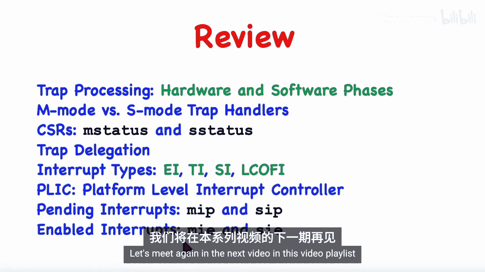

# RISC-V处理器架构，RV32指令集架构，汇编语言，Verilog-FPGA-p12-P12-RISC-V-Privilege-#12---Exceptions,-Interrupts,-and-the-PLIC--BV1aQ3nztE7J_p12-

Welcome to another video in a series on the Rik5 architecture。In the last video。

 we introduced the various privilege levels and talked about how traps are processed。In this video。

 we'll go into trap processing in more depth and we'll talk about the distinction between machine mode and supervisor mode trap handling。

Previously， we focused on exceptions， but in this video， we'll talk more about interrupts。

We'll also give an overview of the platform level interrupt controller。

And talk about how interrupts and exceptions can be delegated from machine mode to supervisor mode。

We'll also describe how interrupts can be enabled or disabled， either globally or individually。

Let's begin with a review of how trap processing works。When a trap occurs。

 the executing code is suspended and a trap handler is invoked。

Every trap handler will run in either supervisor mode or machine mode。In the previous video。

 I walked through an example in which the trap handler ran in supervisor mode。

A code that's running in supervisor mode can access That is read and update the supervisor mode。

 control and status registers， but it cannot access the machine mode， CSRs。

These are effectively invisible。Trap handlers that are running in supervisor mode can only serve as interrupts and exceptions that occur。

While running in user mode or supervisor mode。At the moment the trap occurs。

 the hardware will take several actions。First， the hardware will save the previous processor state。

 including the program counter， the Pri mode， and the interrupts enabled bit。

The mode will then be changed to supervisor mode。 that is， if the trap occurred in user mode。

 otherwise it's already in supervisor mode。And finally。

 a jump will be made to the beginning of the trap handler software routine。

The trap handler will end by executing the S RET instruction。

This is a privileged instruction that restores the previous privilege level and returns to the suspended code。

In this video， I'll be talking about both machine mode and supervisor mode。Previously。

 I talked about supervisor mode traps， but some traps will be serviced by a trap handler that runs in machine mode。

Everything works basically the same way for machine mode traps as for supervisor mode traps。

So you can ask what determines whether a particular interrupt or exception is a supervisor mode or a machine mode trap。

 That is whether it will be serviced by a handler running in supervisor mode or machine mode。Well。

 I'll discuss that later in this video， but one thing we can say at this point is that traps that occur while running in machine mode are always serviced only by a machine mode trap handler。

The actual trap handling is pretty much identical。Just as before， when the trap occurs。

 the hardware will begin by saving the processor state。

Then it will switch into machine mode from whatever it was and jump to the machine mode trap handler。

Within the trap handler， the code can access both the machine mode and the supervisorvis mode control and status registers。

And the handler will then finish up by executing an Mret instruction。

 which is quite similar to the Sret instruction。Risk 5 can support up to 4096 control and status registers。

 So a 12 B address is used to address the individual CSRrs。Some registers are read only。

 while others can also be updated。The mode of the register is also important。For example。

 user CSRs can be accessed regardless of the current privilege level。

 while supervisor CSRs can only be accessed in supervisor or machine mode。And finally， machine mode。

 CSsRrs can only be accessed by code that is running in machine mode。In case you're interested。

 several of these 12 bits are dedicated to determining what is allowed for the register。

Risk5 also has several instructions to access the control and status registers。For example。

 we have a CSR read and a CSR write instruction to read and to modify a CSR respectively。

The current mode， that is the current privilege level。

 determines whether a given operation is permitted or not。In machine mode。

 we have the greatest privilege so we can access any type of register， while in user mode。

 only user mode CSRs can be accessed。For example， when running in supervisor mode。

 if the code attempts to read a machine mode， control and status register。

 or attempts to update a read only register， an illegal instruction exception would be triggered。Now。

 of course， well mannered programmers wouldn't normally try to violate the security system by performing such an illegal operation。

Here's the M status register， and as you see it contains a number of bit fields。

This register and its fields are accessible only when running in machine mode。However。

 some of these fields， not all of them， but some of them also need to be accessible when running in supervisor mode。

To accommodate this， there's a separate register called S statusus。

So some of the bits are shared and they exist in both registers。

We can say that these bits are mirrored。 there's only one underlying copy。

The field can be read or modified either by accessing it through the M status register or the S status register。

Here are the bits that are mirrored and accessible in supervisor mode。

The other bits are invisible when reading S status， they would appear as zeros。

 and any attempt to modify them would be ignored by the hardware。Previously。

 when we described how traps are handled in supervisor mode， we looked at these three bits。

We have the interrupts enabled bit， the previous interrupts enabled bit。

 and the previous privileged mode。These bits are used whenever a trap occurs that is to be handled in supervisor mode。

But when the trap is to be serviced in machine mode by a trap handleler running in machine mode。

 then we have three different but similar fields， namely the interrupts enabled bit。

 the previous interrupts enabled bit and the previous privilege mode。

 But these are all for machine mode。And note that the previous privilege field is now two bits instead of one。

 since when we're handling a trap with a machine mode trap handler。

 the previous privilege level could have been either user， supervisor or machine mode。

Trap processing has a hardware phase， followed by a software phase。

Here I'm showing what happens when we have a supervisor level trap and the trap handle runs in supervisor mode。

On the next slide， I'll show what happens when we have a machine level trap and the handler runs in machine modeat。

 It's really quite similar， as you'll see。So when an exception or interrupt occurs。

 the hardware will first save the current status。In particular。

 it saves the previous value of the privileged level and the previous value of the interrupts enabled bit。

 And then it disables interrupts by changing the interrupts enabled bit to 0。 Now。

 these are all at the supervisor level。It also sets the cause register to a code number to indicate what sort or what kind of trap occurred。

And it saves a program counter in SEPC。And finally。

 it sets the program counter to whatever was previously stored in the S T Vc。

Control and status register。 And presumably， that's the address of the first instruction of the supervisor level trap handler。

And so the supervisor level trap handler will run， it will begin by saving registers。

 presumably using the S Sc register， and then it will process the trap。

 looking at the cause code register to determine what kind of trap it is and what needs to be done。

And then when it's done processing the trap， it will return first by restoring the registers and finally。

 by executing the Sret instruction。The SRD instruction will restore the interrupts enabled bit to whatever was saved。

 it will restore the operating mode to whatever the previous privilege level was。

 and it will set the program counter to whatever was saved in the SEPC register。

Now when we look at what happens in machine mode， we see that it's really quite similar。

 so you can see that the only differences are in which bits and which registers are used。

So when a trap occurs， that is a machine level trap。

 that is it to be processed by a trap handleler running in machine mode。

 the same exact things happen。 The only difference is that the M status register is used。

 and we have an M cause register and an M EPC register and an M Vc register。

As well as an M Scch register， so again we save the status。

 but this time we're saving the status in the M status register and we're changing the interrupts enabled bit at machine mode to zero。

And we set the cause register， the EPC register， and then we jump to the machine mode trap handler。

 so we have two。Trap Factor registersV，Vc and MTVc。

 so MTVc will point to the trap handler for machine mode traps。And again， it saves the registers。

 processes the trap based on the current value of the cause code register。

 restores a register and finally executes the Mret instruction。 And again。

 you can see this is almost identical to the S Re instruction。

Except that it uses the values in the M status register and it restores the PC to what was saved in the M EPC register。

The next question to ask is what exactly determines whether a trap is handled in supervisor mode or machine mode。

Well， if the court doesn't even implement supervisor mode。

 then all traps will obviously be handled at the machine mode， privilege level。But otherwise。

 the decision is up to machine mode code。We say that machine mode can delegate or offload some or all traps to supervisor mode。

And next， we'll be discussing how this delegation works。at first， as we've seen。

 both supervisor mode and machine mode have their own private sets of registers to be used during trap processing。

Supvisor mode traps will use the registers in the first line here。

 and Ma mode traps will use the registers whose names begin with M。In addition。

 there are a couple of machine mode， control and status registers。

 one for exception delegation and one for interrupt delegation。These are machine mode。

 control and status registers called M E Deig and M I Deleg。Normally。

 they would be initialized by machine code running running at start。

 and typically they would never be changed after initialization。

These delegation registers will be consulted by the hardware when a trap occurs to determine whether that trap should invoke a supervisor mode or a machine mode trap handler。

To summarize， if a trap occurs while the coreps is executing in supervisor mode or user mode。

 then by default， it would be handled by a trap handler that runs in machine mode。However。

 traps can be optionally delegated， and if so， this trap would be handled by a trap handler running at supervisor mode level。

On the other hand， all traps that occur while we are running in machine mode will be handled by trap handlers at the machine mode level。

So here is the layout of the exception delegation register， M E Deleg。

We have a number of different kinds of exceptions。 For example。

 we might have an illegal instruction exception or a load page fault exception and so on。

And for each different exception type， there's a corresponding bit in this register。

So as I said before， if the exception occurs while we're executing in machine mode。

 then it would always be handled by a trap handler running in machine mode。

But if the exception occurs when we're executing in user or supervisor mode。

 then the hardware will consult this register and we'll look at the bit corresponding to the exception that has actually occurred。

If that bit is0， then the hardware would invoke a trap handler running in machine mode。

 but if it's a one， the exception would be delegated and the hardware would invoke a trap handler running in supervisor mode。

Now these bit positions correspond exactly to the exception code numbers。

 and here I've listed out all the exceptions with the corresponding code number。

 this is the code that would be stored in the cause register when the exception occurs。

When an E instruction is executed， it can cause any one of these three exceptions。

If it's executed in user mode， it causes this exception in supervisor mode， this one。

 and if it's executed in machine mode， it's Ca code 11。However。

 if an E call is executed in machine mode， then the trap handler would be executed in machine modeat。

 It can never be delegated。 So in my previous diagram， that's why this bit is green。

 This bit is not used in the M E Deig register。Here's my best guess as to how the exception delegation mechanism would be used for a risk 5 system running an operating system such as Linux。

The Linux kernel would be run in supervisor mode， and machine mode would only be used for initialization and maybe secure booting。

All the kinds of exceptions that can occur in user mode need to be delegated to supervisorvis mode so the operating system kernel could deal with them。

And that would include problems with loads， stores and instruction fetching。

A system call from userland needs to invoke a kernel routine。

 So an E call encountered in user mode would be delegated to supervisor mode。

To support the debugging of user programs with the breakpoint instruction。

 that exception would also be delegated。As we said， an E call from machine mode cannot be delegated。

 And my guess is that code running in machine mode would never even need to execute an E call instruction in the first place。

As for hardware errors， I think it would be reasonable to invoke machine mode code， which might。

 for example， simply reboot the operating system。And an e call from supervisor mode would probably not be delegated。

This would allow the kernelel， which is running at supervisor level to make requests to the machine mode code。

For example， the kernelel might request a reboot by the machine mode code by executing and E instruction。

Interrupts can also be delegated in a way， similar to exceptions。Here's M I Deleg。

 the interrupt delegation register。There are several sources of interrupts， for example。

 a device can signal something called an external interrupt。And for each gene source。

 there is a corresponding bit that tells whether or not it's to be delegated。

If the interrupt occurs in machine mode， of course。

 it can't be delegated and will always invoke machine mode trap handling。Otherwise。

 when the interrupt occurs， the hardware will check this register to determine whether to invoke a supervisor mode or a machine mode trap handler。

If the bid is one， the interrupt is delegated to code that will run in supervisor mode。

There are basically four types of interrupt。Whenever an IO device needs attention， it causes。

 or we can say signals or raises an external interrupt。A timer interrupts are more internal to a cor。

A timer interrupts are used by the operating System kernel to implement time slicing。

We also have something called a software interrupt。A software interrupt。

 It can be raised directly by code and not by an I O device。

 and it might be used by a core to wake up another core or to signal that core when it needs to get its attention。

And finally， the coreps may implement a number of hardware performance monitoring counters。

 If one of these should overflow， then a local counter overflow interrupt would occur。Now。

 let me explain some acronyms and introduce the numbering system for interrupts。

Here we have our four potential interrupt sources， Soware interrupts， timer interrupts。

 external interrupts and local counter overflow interrupts。

Each of these three types of interrupts actually comes in two flavors。

 and these are called supervisorvis mode and machine mode。And as I understand things。

 this supervisor mode， machine mode distinction has little to do with the privilege level at the time of the interrupt or the mode at which the interrupt handler will be executed。

Each one can be either handled in machine mode or delegated to supervisor mode， as you wish。

Supervisor mode software interrupts can be caused by code running either in supervisor mode or machine mode。

 while machine mode software interrupts can only be caused by code running in machine mode。

We have two different timers。 One will cause supervisor mode， timer interrupts。

 and the other will cause machine mode timer interrupts。

The machine mode timer is invisible and can't be seen by code running at the supervisor level。

As for which type of external interrupt is caused by a device， Well。

 this depends on how things are wired up， and I'll be discussing that in a moment。

Now let's take a look at the acronyms and the corresponding code numbers。

These are exactly the bit numbers that are in the MI Delic register that I showed earlier。

And actually， it's more like this。 I'm guessing that in a typical risk5 system。

 all the supervisor mode interrupts will be delegated。

 and none of the machine mode interrupts would be delegated。Next。

 I want to introduce and briefly describe the platform level interrupt controller or the click。

 as we call it。So let's assume we've got many cores and many I devices。

The p is itself also a hardware device， and its purpose is to moderate the interrupts。

 So it will be the thing that actually raises the external interrupts at the individual cores。Now。

 the p is a device， and like every device， it's memory mapped。

 That means that a core can update and talk to the device by using memory addresses。 And。

 for example， the p must be initialized at start so that it knows how to deal with the various interrupts。

So when a device wants to interrupt， it doesn't interrupt a core directly。 Instead。

 it talks to the p， and the p will then decide which core or cores need to be notified。

 and it will notify those cores by raising an external interrupt in those cores。

And those cores will run interrupt handlers。 And the first thing the interrupt handler does is talk to the pque to claim the interrupt。

 It basically is saying to the pque。 I'm going to deal with this interrupt。

Other chos may try to claim the interrupt at the same time， but only one will succeed。

 and the other chorus will then give up and go back to doing whatever they were doing。

And so the corps that claimed the interrupt will run the interrupt handler to completion。

 talking to the I O device directly through memory mapped addresses。 And when it's done。

 it will notify the pque that that interrupt is complete。 and we say that that interrupt is retired。

 so the interrupt handler will end by notifying the p。 that the interrupt is now retired。

 And at that point， a new interrupt coming from that same device can be reprocessed and the cycle can start again。

What happens when the platform level interrupt controller raises an external interrupt at some core。

This is controlled by a couple of control and status registers。For each interrupt type。

And this would include， for example， external interrupts。 There are two bits， One is the pending bit。

 and one is the enabled bit。To signal and interrupt， the hardware forces the pending be to one。

But the trap handler may not be invoked immediately。Instead， interrupts can be masked。

 In other words， interrupts are either enabled or disabled。If they are enabled。

 the trapanttler is invoked immediately and if they are disabled， the interrupt becomes pending。

 causing the trapanttler to be delayed until later。

Whether an interrupt is processed or becomes pending is controlled by both a global interrupt。

 enabled bit。That's just the interrupts enabled bit in the status register。And an interrupt specific。

 enabled bit。And each interrupt type has its own enabled bit。When a trap is signaled。

 either the pending bit is cleared and trap processing occurs。

 or if either of these bits is disabled， then the trap remains pending。

The interrupt will remain pending until either a handler is invoked or the pending bed is lowered externally。

 For example， by the p itself， when some other corps has claimed an interrupt and the need to invoke the trap handler on this corps no longer exists。

Let me describe the operation of the platform level interrupt controller using this diagram。

We've got several cores， we've got main memory， we've got several devices， including the p itself。

And we're assuming that the cores communicate with the devices and with the p using memory mapped I O。

 So here's some kind of a shared bus， and the cores can communicate with the devices in the p by reading and modifying registers。

 using memory addresses directly。These dash lines here represent interrupt request lines going from the devices to the pleque。

 So when a device wants attention， it raises this line。

And these lines over here represent the ability of the p to make the external interrupts pending in the various cores。

 that is to raise the external interrupt and make it become pending。

So the first thing that needs to happen during initialization is the p needs to be initialized。

The p will contain some configuration registers and so on。

 It will tell which devices should interrupt， which cores and priority levels and so on。

So after some core initializes the p using memory mapped IO， we began executing。

And let's say at some point in time， some device needs attention。

 so it raises its interrupt request line and notifies the p。

And the p will consult its configuration registers and so on and figure out which cores need to be interrupted。

 and some cores may be capable of dealing with this device， and so they need to be interrupted。

 while other cores may not be able to deal with this device or for some other reason。

 the p may be configured so that those cores should not be notified when this device requested interrupt。

So the p will signal external interrupts to some of the cores as shown here。Now。

 actually I've just showed one line， but the p may signal a supervisor level。

 external interrupt or a machine level， external interrupt。

 and which it signals is probably determined by the configuration parameters that were initialized within the p at startup。

But in any case， one of these cores will be interrupted。

 and so let's assume this core here is the first to run its trap handler。

 and so it will contact the p using memorympped IO to say that it is claiming this interrupt。

And the p will then most likely lower the external interrupt line to the other cores。

 that is while it had initially made an external interrupt pending at this core。

 it would lower that pending line and make the pending bit zero。

 and that means that the core which hadn't yet had a chance to service the interrupt。

 won't be interrupted after all， and it can not be interrupted and it can continue doing whatever else it's doing。

Okay， this core has now claimed the interrupt， so now it needs to deal with the device and it will do that using memory Ma IIO so it will read and modify the registers in the IO device and do whatever is necessary。

And let's say that while all this is happening， other devices also are requesting interrupts。Well。

 the p is a multitasking kind of hardware， so it can deal with these and it may notify other cores simultaneously。

And so those can be claimed independently， perhaps it might notify this core that these other two devices are requesting。

Attention。But in any case， that proceeds more or less concurrently and simultaneously to the device and the interrupt that we're interested in。

So at some future time， this core will fully handle the interrupt and it will then stop communicating with the device。

 and it will also notify the p via memory mappedIO that this interrupter has now been retired。

 and so we go back to the starting situation。Finally。

 we can show the pending bits and the enabled bits。

The bits to indicate whether or not an interrupt is pending are located in a machine mode control and status register called MIP。

 the interrupts pending register。And the bits to indicate whether or not an interrupt is enabled are in a register called MIe。

 the interrupts enabled register。As you can see， the bid positions are laid out exactly the same way as for the interruptt delegation register。

 which was named MI Deleg。There's a bit for each interrupt type， so we have software interrupts。

 we have timer interrupts and external interrupts。And we have both a bit for machine mode interrupts and a bit for supervisor mode interrupts。

 and there's also a bit for the local counter overflow interrupt。

The field names for the pending bits all in in P for pending and the field names for the enabled bits all in in E。

These two registers are accessible only by code running in machine mode。

An interrupt can be signaled by setting one of the pending bits to one。

This can be done directly by software， or it might be done by hardware。For example。

 the platform level interrupt controller can set the pending bits for the external interrupts。

 and the timer would set the timer interrupt bits。Some of the bits in these registers can also be read and updated by code running in supervisor mode。

M I P and M Ie are machine mode registers。 So in order to facilitate this。

 there are two additional control and status registers that are accessible in supervisor mode。

These registers are named SIP and SIE， the Supervisor mode interrupts pending Reg and the Supervisor mode interrupts enabled register。

The bits that can be read or written in supervisor mode are the supervisor mode interrupts。

 as shown here， as well as the local counter overflow interrupt。Now these bits are mirrored。

 in other words， there's only a single bit for the fields that appear in both registers and this bit can be accessed either way。

Now my assumption is that typically a risk five system would on startup。

 delegate all the supervisor mode interrupts to be handled in supervisor mode。

Machine mode interrupts would typically not be delegated and would always be handled by trap handlers running in machine mode。

However， the presence of bits that allow for the delegating of machine mode interrupts in the delegation registerister suggests that the General Rik 5 design is somewhat flexible and can be used in ways we might not anticipate。

I would to said a little bit more about interrupt masking。

We've got bits in the MIIE and SIE registers that Ive just described to selectively enable and disable individual types of interrupts。

 but now I want to focus on the global interrupt enabled bits。

 and here I'm talking about the MIIE bit within the M statusus registerister and the SIE bit within the S status register。

😡，And by the way， the names of these bits are capitalized here， but the registers with similar names。

 MIe and SIe are written with lowercase names。So when the core is executing in user mode。

 these global bits are ignored。Interrupts can't be disabled， and trap processing will always happen。

The trap handler will run in either supervisor mode or machine mode。

 depending on whether it was delegated or not。When the core is executing in supervisor mode。

 it depends on whether the trap occurs in supervisor mode or machine mode。

 that is whether the trap handler will be running in supervisor or machine mode。

Machine mode traps are never masked， and these traps will always be processed。

The supervisor mode code will be suspended， and a trap handler will be run in machine mode。However。

 supervisor mode traps can be disabled， so the S I。

e bit controls whether the supervisor mode code can or cannot be interrupted by a trap handler that would also be running in supervisor mode。

Finally， when the coreps is executing in machine mode， all supervisor mode traps are disabled。

The machine mode code will not be interrupted to run supervisor mode code。However。

 machine mode traps may or may not be accepted， and this is determined by the MIE bit in the M status register。

Okay， let's wrap this lecture up。 We've covered a lot of rather complex material in this video。First。

 we went over the hardware and software phases of what happens when an interrupt or exception occurs。

We saw that a trap can either be processed with a machine mode trap handler or a supervisor mode trap handler。

The mechanism is very similar， just using a different set of registers。

We looked at the M status register and saw that some of the fields are also accessible in supervisorvis mode。

 and this is achieved by mirroring these bits in the S status register。

Then we saw how exceptions and interrupts can be delegated from machine mode to be handled by a trap handler running in supervisor mode。

And we talked about the four different types of interrupt。The external interrupts， timer interrupts。

 software interrupts， and local counter overflow interrupts。

We also introduce the platform level interrupt controller。

 which is a device outside the core that takes interrupts from various I devices and channels and directs them to specific cores where they cause external interrupts to become pending。

Then we wrapped up with a discussion of the registers used to indicate which interrupts are pending and which interrupts are enabled。

Okay， if you followed me up to here， well， thanks very much for watching。

 Let's meet again in the next video in this video playlist。

