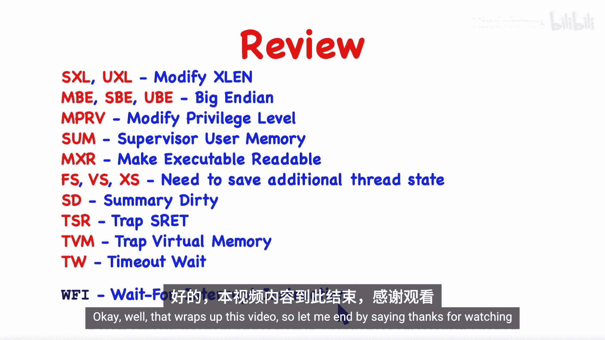

# RISC-V处理器架构，RV32指令集架构，汇编语言，Verilog-FPGA-p13-P13-RISC-V-Privilege-#13---mstatus,-sstatus---details--BV1aQ3nztE7J_p13-

Welcome to another video in a series on the Rik5 architecture。In previous videos。

 I discussed exceptions and interrupts in both machine and supervisor mode。

We saw how various bits in the status words support trap processing。

But there are a number of additional bits in the status words， and these are the topic of this video。

I'll be describing and discussing all the remaining bits in M status and S status。

This includes bits for altering the size of the registers。

 for determining whether loads and stores use big or little Indian order for supporting accessing virtual address spaces and some techniques to reduce the time required for context switches。

 as well as some bits that support hypervisor software。

I'll also cover the weight for interrupt instruction。

 which could be used to save battery life by reducing power consumption。

Let's begin with a review of the status register。There are two versions of this register with some bits accessible via either register。

S status contains the fields that are needed by supervisor mode code and is accessible when running in supervisor mode。

 which is typically used for the operating system kernel。

IM status contains all those fields and a few more。

Im status is only accessible when the core is executing in machine mode。In this video。

 I'll be focusing on the 64 bit versions of registers， but keep in mind that for 32 bit cores。

 many of the registers are split into two 32 bit pieces。For example。

 M status has split into 232 control and status registers。

The register with the lower 32 B is just called M status。

 While the upper 32 B are in a register with the same name。

 but with an H standing4 high half appended to the name。In the previous video。

 I talked about trap handling， and I discussed the fields shown here in red。

When the trap is a supervisor mode trap， that is when the trap handler will run in supervisor mode。

 the S I。e bit。 That's the interrupts enabled bit is changed to 0 to dis interrupts。

At the time of the trap， the hardware will save the previous value of S I。e in the S I。

e previous interrupts enabled field， and it sets the SPP field to the previous privilege level。

When the trap is handled in machine mode， the MIe， MP Ie and the MPP fields， which work the same way。

Are used instead。Okay， now let's discuss the SXL and UXL fields。Both fields are in M status。

 but SXL can't be modified by supervisoror mode code， so it's not in S status。😡。

The risk5 spec is quite general， and it describes 32 bit cores， 64 bit cores， and even 128 bit cores。

As we've stated with an RV 32 core， all the registers。

 both general purpose and the control and status registers are 32 Bs in size。

 While for an RV 64 core， they are 624 bit in size， and there's also an RV 128。

 but I'm not sure how likely you are to encounter one of those big boys。

So it turns out that we can actually reduce the number of bits in the registers for code that's running in either supervisor or user mode。

This allows software that was written for， say， a 32 bit machine to run correctly with no changes on a 64 bit machine。

The spec is written in a very general and abstract way， and then use notation like this like X L。

 or I guess we can say， X length， to specify the number of bits in the registers。

So X length is either 3264 or maybe 128 for RV 32， RV64， and RV 128 cores respectively。

They also use this symbol。M mode X length to describe the size of registers when running in machine mode。

 And this is how big the registers actually are and would be how big machine mode code sees them to be。

For example， MX length would be 64 for an RV64 core。The spec uses Sx length。

To denote the size of the registers when executing in supervisor mode and it uses UX length to denote the size of registers in user mode。

So by setting the SXL field in the status word。The machine mode code can reduce the register size。

 as seen by code that's running in supervisor mode。So for example。

 an RV64 machine might set the SXL field to 32 so that it can run a operating system kernel that's meant to be run on an RV32 core。

The kernelel， which is running in supervisor mode， will see all the registers as being 32 B in size。

 and it would work exactly the same way as if we were actually running on an RV 32 machine。

But maybe your colonel is the full 64 Bs running with 64 bit registers。

 but now suppose the colonel wants to run an application that's intended to be run on a 32 B core。

For this， the kernel can set the UXL field to reduce the register size for code that's running in user mode。

So register sizes can only be reduced and never enlarged。

An RV 32 Corps just doesn't have 64 B registers。 So we have this requirement that has to always be respected。

M x length must be greater than or equal to S x length。

 which must be greater than or equal to U x length。

The S X L field and the U XL field are both2 bits in size。

 and they use the encodings that are shown here。The SXL field can only be changed by code running in machine mode。

 whereas the UXL field can also be changed by code that's running in supervisor mode。And also。

 by the way， the core may or may not even implement this ability to change the register sizes。Next。

 let's consider big Indian and little Indian。For this， the status register has these fields。

Machine mode， big Indian， Super mode， big Indian and user Mo， Big Indian。

For Indianists recall that when a core loads or stores a multibte integer into memory。

 there's a question of which order the bites are to be placed into memory。With little Indian。

The least significant bite is stored in the by with the smallest address。

 and the more significant bys are placed after it in locations with successively greater addresses。

The Ri 5 corere is by default， a little Indian machine。

Instruction fetches always use little Indian order， and that can't be altered。

And that's because the bits to indicate the size of the instruction。

 that is whether it's a four byte full size instruction or2 byte compressed instruction occur in the least significant bits。

 So the core has to read the least significant by first so it can know how long the instruction is。

But when it comes to loads and stores， the Corps may offer options。

The status register has three bits that control the behavior of load and store instructions。

M B E controls the behavior of loads and stores that are executed in machine mode。 And if it's one。

 those would be performed using big Indian order。SBE controls the behavior of loads and stores that are executed in supervisorvisor mode。

 and UBE controls the behavior of loads and stores in user mode code。

MB E and S B E only occur in the M status register， not in S status。

 So the behavior for both machine mode code and supervisor mode code can only be altered by machine mode code。

This means that the kernelel， which runs in supervisor mode。

 gets whatever Indianness the machine mode code gave it。 It can't change itself。However。

 the colonel can run application processes in big Indian mode if it needs to。

Like changing the register size， this flexible Indianness functionality may or may not be implemented on your core。

 and it's possible that these bits are all hard wirered to 0。

 and the core is always fully little Indian。Next， let's take a look at these fields。

 M X R stands for Make Executable， readable。SUM stands for Supervisor Use Memory。

And MP RV is for modifying the privilege level。Let's start with the modify privilege level bit， MP。

 RV。Which only applies to code running in machine mode。

 so it's only present in the M status register。To explain what it does。

 let's take a look at the problem it solves。So imagine you've got some code executing and an unimplemented instruction is encountered。

For example， imagine that a load instruction is executed in some application code。

 perhaps running in user mode with an address that is not properly aligned。

So the idea is that an exception will occur and a trap handler running in machine mode will emulate this instruction。

Rather than abort the program， the machine mode trap handler will be invoked。

 and it will do whatever it takes to perform the load。

The handler would end by returning to the interrupted code， which will continue on its merry way。

 thinking the unaligned load instruction worked just fine。You know。

 any loads the handler routine actually does to get the job done would of course。

 have to be properly aligned。Consider， for example。

 trying to load a double word from an improperly aligned address。

 The trap handler would have to issue an aligned load to get the first part of the double word and then a second aligned load to get the remaining bits。

 And then it would squish the two pieces together and place the full 8 by double word result into the destination register。

But here's the thing。 The code attempting the Anaalign load might have been executing in user mode。

Most likely， paging would have been turned on， and the unaligned address was actually a virtual address。

 which would normally be translated by the hardware into a physical address using the page tables。

But the handler is running in machine mode， and paging is not done in machine mode。

And this is where this bit comes into play。By first setting it to one。

 any future loads or stores will be executed in user mode。😡。

So the trap handler can simply retrieve or store in the case of stores， bys using virtual addresses。

Actually， whenever the MP RV bid is set， subsequent loads and stores will be executed using whatever privileged level was in effect at the time the trap occurred。

 So the hardware actually looks at MPP， the previous privilege level。

Which was saved at the time the trap occurred。 The loader store is then executed as if the actual mode is whatever MP P indicates。

Also， upon returning from the trap handler， this bit is automatically cleared。Next。

 let's imagine that user code will be executed in user mode with paging turned on。

As we'll see in other videos， each page of the virtual address space is marked to be either a user page or a supervisor page。

User pages are marked U， and they may only be read or modified by code that's running in user mode。

P that are not marked U are only readable and modifiable by code that's running in supervisor mode。

A user code can't access supervisor pages and supervisor code cannot access user pages。

These restrictions can make the system more robust and secure against malware by keeping user execution within pages that are marked U and keeping code executed at the supervisor level out of pages that contain user data。

But there are times when the colonel needs to read or write to the user's virtual address space。

 consider， for example， a system call。Sometimes arguments are passed to the kernel in memory。

 and sometimes the results are returned to the user code in memory。

This is always the user's virtual address space。😡，By default。

 whenever the colonel reads or modifies pages that are marked you， an exception will occur。

But by setting the SUM supervisor user memory bit to one temporarily， the kernel。

 which is running in supervisor mode， is allowed to read and to modify pages that are marked as user pages。

When the kernelel is executing， paging is either turned on or it's not。 If paging is turned on。

 then all loads， stores and instruction fetches will be mapped via the page tables。

This seems to require whatever address mapping is used by the kernel at the moment it retrieves system call arguments。

 must map both the kernel code and the user code's data area。😡。

But what if the kernel code happens to be located at addresses that coincidentally overlap with the addresses used by the user's code for its arguments。

In order to be able to use the functionality provided by the S U M bit。

 it would seem to require that some pages in every user address space must be set aside to hold the kernel itself。

These pages would be marked as supervisor pages in order to keep the user code out of them。Okay。

 but with 32bit cores where the virtual address space is limited to4 gigabytes。

This could take a really big bite out of the usable virtual address spaces。

Another approach to attrieving this system call arguments would be to avoid the S M mechanism altogether。

 Instead， the colonel would consult the page tables and manually rem the virtual addresses to physical addresses and then access the data that way。

I can also think of another hack to deal with this， but it's really too gruesome to even describe。

 Anyway， I question whether this S U M bit is actually used in practice。

let me remark that in some of my other research， I explore a completely different architectural approach to this issue。

 but that's getting way off topic for this video。Each page of the user's virtual address space will be marked。

 readable， writeriable and or executable。So imagine that some instruction executing in user code needs to be emulated。

So it will be emulated by code that's running in supervisor mode。

The illegal instruction exception occurs， and the first thing the trap handler needs to do is to retrieve the instruction itself to see exactly what instruction it was that caused the trap。

The problem is that the page that contains the instruction might not be marked as readable。

So simply executing a load instruction to fetch the problem instruction might itself cause another exception。

Well， of course， I suppose the trap handler could alter the page tables to make the page readable。

 It would then need to flush all the relevant TLB registers， perform the load。

 then restore the page tables to what they were before and so on and so forth。

 But that's going to add a huge overhead。Instead， the kernelel could just set the M X R bit。

 That's the make executable， readable bit。Or more likely。

 the colonel will probably just leave the bit set to one for all time。Okay， so when this bit is0。

 any attempt， even by the kernel to load from a page that is not marked readable would cause a page fault exception。

 but by setting this bit to one， the kernel can load from a page that is only marked executable。

With no problem。Next， let's focus on the bits named S D， X，S， F，S， and VS。

These have to do with making context， switching faster。These bits can all be used by the colonel。

 running in supervisor mode。Let's review what a context switch is。

So imagine we've got a multitasking kernel that implements time slicing。

 So whenever a timer interrupt occurs， the time slice of some user process will be ending and the kernel will need to switch over to executing a time slice for some mother process。

The colonel will first save all of the state of the previous process。

 and then it will load all of the state of the next process before giving it control。

And this changeover from executing one process to another is what we mean by a contact switch。

And so what makes up the state of a process？ Well， the state of a process includes all the general purpose registers and the program counter。

 And clearly， these must be saved and restored upon every context switch。

But what if the core also implements floating point registers and these are being used by the process？

These would also be part of the process's state。I haven't yet described the vector registers in these videos。

 but it's the same sort of thing。A cor may or may not implement the vector registers， but if it does。

 and if these are in use by the process at the time in the context switch。

 then they would also be part of the process' state。And also。

 there could be some other stuff that's not covered by the risk5 standard。

 And perhaps there some other non standard registers that would also need to be saved and restored upon contact switches。

So knowing what needs to be saved and what needs to be restored at context switches is the role of the FS and the VS and the XS bits。

The goal here is to make context switching faster by only saving the state that's actually in use when a time slice ends and only loading the save state that's needed whenever a time slice is about to begin。

Let's take a look at how these bits are used by focusing just on the FS bits and the floating point registers。

So if the floating point registers are not used， we don't want the colonel to waste any time saving their values at the end of a time slice。

 and we don't want to waste any time at the start of the next time slice， loading the registers。

So we're going to assume that if a user process is going to be using the floating point registers。

 it will first notify the kernel and perhaps it would use a system call to say something like，"Hey。

 kernelel， I plan on using the floating point registers。

The colonel always needs to initialize the registers， both the floating point registers。

 as well as the general purpose registers before they are ever used by any user process in order to prevent data from one process becoming visible to another unrelated process。

That would be a form of data leak， and the kernelel must prevent all data leaks。

There are four possible situations。In order to capture these possibilities。

 the F S field is a tubebit field with the encoding shown here。

The first possibility or situation is that the floating point registers are simply not in use。

The second is that the process has told the colonel that they will be used。

 but it hasn't happened yet， so the register still contain their initial values。

The third is that the process has modified the registers。

And the final one is that the process has modified the registers during a previous time slice。

 but it hasn't yet modified them during the current time slice。In the first case。

 the floating point registers are simply not in use。Now。

 perhaps the user code will at some point in the future。

 tell the kernel that it will be using the registers。

 but until that time the kernel doesn't need to waste time saving or restoring them on each time slice。

In the second case， the registers will be used， but they haven't yet been used。

 so the kernelel needs to initialize them to their zero values。

 and it needs to do this at the start of every time slice because they might be accessed。

But until they're actually modified， the kernelel doesn't need to save the values of the registers at the end of the time slice。

In the third situation， the process has now modified the registers。

 We say that the registers are dirty， meaning that they've been modified and their values are no longer zeros。

Dirty registers must be loaded at the beginning of the time slice， and furthermore。

 if the user code modifies the registers during the time slice。

 then they'll need to be saved at the end of the time slice。呃。

But maybe the registers have been modified previously。

 but they were never touched during this time slice。 And this is the purpose of the fourth state。

Previously modified， but not this time slice。At the end of the time slicee。

 the colonel doesn't need to save them again。 The values that were previously saved haven't changed。

 These old values will suffice。Okay， so what happens during a time slice？Well。

 the hardware will watch for any changes to a floating point register。

 and if any instruction is executed that might possibly modify a floating point register。

 the Corps will take these actions。In the first state。

 the process hasn't yet asked for permission to use the floating point registers。

 So if the process tries to read or modify any floating point register。

 the hardware would cause an exception。In the second state。

 any change or modification to the register would cause the core to modify the state to dirty。

 which is code 11。And that would cause the colonel to save the state of the registers at the end of the time slice。

Now， if the registers have already been updated in the current time slice。

 then they're already dirty， so they would just remain in the dirty state。And finally。

 if the registers were modified in the previous time slice， they contain non zero values。

 but until they get modified again， there is no need to continually save them on every context switch。

But if there is a right to one of the floating point registers during the current time slice。

 the Corps would change the state to dirty， which will cause the updated state to be saved at the end of the time slice。

In summary。The F。 S field allows the colonel to avoid saving and restoring a bunch of floating point registers。

 which could be quite time consuming at every time slice。

Many programs will never use the floating point hardware。

 and only a tiny fraction of time slices will actually access the floating point registers。

 So the savings made possible by these bits is huge。As for the other fields。

 they all work the same way as the F。 S field。The V S field is used to indicate whether the vector registers are unused or dirty or whatever。

And if there's some other implementation dependent state that's not part of the risk5 spec。

 the X S field is used for it。It indicates whether anything else will need to be saved or restored。

And finally， we have the S D field， which is only a single bet。It's defined。

 as shown by this equation。Basically， if any of the state is dirty， then this bit will be set to one。

The S bit is in the most significant bit， the sign bit。 so it can be checked very easily。

So at the end of a time slice， in the typical case， when no state got modified。

 a quick check of the SD bit can determine that the colonel doesn't need to do anything more。

In the more rare case， when some of this special state actually got modified。

 the colonel can then look more closely at the F S， the S and X S fields and take appropriate action。

Next， let's take a look at the TSR， the TW， and the TVVM fields in the status word。

 which are only accessible by machine mode code。These concern hypervisor support。Now。

 it's not my intention to spend much time talking about hypervisors in this video。

The support for hypervisors in the risk 5 spec is way too complex for this video。

 but I want to go over some of the basics in order to describe these three bits。

A hypervisor is a sort of super operating system or a super supervisor where the application programs are themselves each entire operating systems。

So let's imagine that we've got two operating systems。

 let's say one is a Linux kernel and the other is a window system。

These are called the guest operating systems。We could have more。

 maybe three or four guest operating systems， but I think two is enough to give you the idea。

The guest operating systems run in supervisor mode and the hypervisor runs in machine mode。

Some people say that the hypervisor is running below the guest operating system and other people say that the hypervisor is running above the guest operating system。

 but it's just a matter of terminology， it means the same thing。

 and the idea is that the hypervisor is running closer to the hardware in machine modeat。

And by the way， I'm describing a so called type1 hypervisor here。

The hypervisor would be using time slicing to switch back and forth between the guest operating systems。

Of course， the guest operating systems are constructed to run on bare hardware。

 and they would have no knowledge or even any way to know that they're running as applications of some godlike hypervisor software。

In fact， each guest operating system would be performing time slicing itself in order to run multiple user level applications。

The hypervisor is， in some sense， faking things。 It's doing whatever is necessary to create the illusion for each guest operating system that the guest is running on bare metal。

For example， a guest operating system will perceive timer interrupts to happen from time to time。

 but in reality， it may not be seeing all the timer interrupts。

The hypervisor will be controlling things。 And so the guest operating systems will only perceive the timer interrupts that the hypervisor wants it to perceive。

Also。Each guest operating system will have a view of memory。

 and it will be using page tables to implement virtual memory。

But the Linux guest operating system will use memory and page tables in a completely different way than the Windows operating system。

 and each will think that it has exclusive access to the entire main memory。Yet， in reality。

 the hypervisor will allocate memory in such a way that a guest can share main memory without ever being aware that other guests even exist。

Each guest operating system will run in supervisor mode and will think it has complete control over all the supervisor mode。

 control and status registers。These would include the control and status registers that are used to implement trap processing and the SATP register。

 which is the Control and Sta register that control the page tables。

So in order to support these illusions， the hypervisor will have to watch for and control how the guest uses the control and status registers。

We might say loosely that the hypervisor is multiplexing a single set of supervisor mode control and status registers between multiple guest operating systems。

Recalls that the Sret instruction is used by a kernelel running in supervisor mode to switch into user mode。

This happens when the kernel is ready to give a user mode application a time slice。

But at this moment in time， the hypervisor may need to get control。

So if the TSR or trap Sret bit is set， the Sret instruction will cause a machine mode trap。

 allowing the hypervisor software to get control。😡。

Now let's talk about the TVM or Tra virtual memory be。😡。

Each guest operating system will have its own page table in effect at any moment in time。

Recall that a page table maps the virtual addresses used by code into physical memory addresses。Now。

 the hypervisor can't allow just any physical address to be used since the other guest operating systems are also using physical memory。

 and the guest operating systems need to be kept isolated from each other。

The SATP register points to the root of the page table。Whenever it's updated。

 the hypervisor probably needs to get involved and check to make sure that it's not trying to access physical memory that it shouldn't be accessing。

So if the TVM bit is set to one。Any attempt to load SATP will cause a trap。

I don't want to get into talking about the T LB registers here。

 but let me just say that the T LB registers are a sort of cache of page table entries and are needed to make virtual memory efficient。

The SF virtual memory address and the S invalidate virtualr memory address instructions are used to synchronize the TLB registers。

Whenever the guest operating system executes one of these instructions。

 the hypervisor also needs to get control。In order to explain the third bit， the TW bit。

 I need to first introduce the WFI or wait for interrupt instruction。This instruction has no operas。

So forget hypervisors for a moment and imagine that some normal OS kernel like Linux。

 is running a bunch of user level processes， but that all of them are currently blocked or waiting。

In other words， nothing is happening。 There's no code that needs to be executed。

This may happen more than you realize。Unless your laptop has been hijacked by hackers and the secretly spamming targets using some background process。

It's likely that when you're not typing or moving the mouse and the screen is not changing。

 nothing much is happening most of the time your computer is probably just waiting for some event。

Maybe the scheduler will execute a so called busy or idle loop。But more likely。

 it's going to go into a low power sleep state waiting for the next interrupt。To support this。

 Ri 5 has the wait for interrupt instruction。When this instruction is executed。

 it will suspend instruction execution and go into a low power mode to save the battery。

When some interrupt finally happens， maybe you press a key or a timer interrupt occurs or something comes in over the internet。

 The corps will wake up and run the trap handler。In multi corere systems。

 there are multiple hardware threads， at least one heart per core。Maybe some of them are busy。

 but most likely， several of the corpss will have nothing to do and will be suspended。

 waiting for an interrupt。The wait for interrupt instruction will suspend only the current hardware threat。

Now the instruction might work， as I've described， or it might be implemented as a no opP。😡。

In any case， normal instruction execution will eventually resume after the wait for interrupt instruction。

Either the trap handler will run， and then execution will continue normally。

 or perhaps it was implemented as a no up， and execution would never really stop。

 It would just resume immediately after the instruction with no waiting at all。

For the purposes of a hypervisor， whenever a guest operating system executes the wait for interrupt instruction。

 the hypervisor needs to get control。Now， maybe some guest operating system doesn't have anything to do。

 but the other guest operating systems may have plenty to do。

 and we really want to avoid wasting execution cycles。

So if the TW bit is set to one and some heart executes a wait for interrupt instruction。

A trap will occur， and the hypervisor， which is running in machine mode， will get control。Now。

 riskk 5 has a whole bunch of other stuff for hypervisor support。

 which I am not going to discuss at this time， but I just wanted to mention these bits to complete my description of the status word。

O， that completes my coverage of the status registers， both M status and S status。In this video。

 I describe the bitfield that are listed here。We saw how we could change the size of registers in supervisor or user mode with the SXL and UXL fields。

We saw how the MBE， SBE and UBE bits could be set if we want the load and store instructions to operate using big Indian order。

Of course， instruction fetching always happens using little Indian order。

We saw how the modified privilege level bit that's MPRV can be set to allow machine mode code to access memory as if it is running in supervisor mode using virtual addressing and paging。

We saw the SUM bit， supervisorvisor user memory bit， which allows the kernel。

 which is running in supervisorvis mode to access pages that are marked as user pages。

We saw the M XR， that's the make executable readable bit。

 which would be used by code emulating an instruction to read the instruction from a page that is not otherwise readable。

I described the F， S， V， S and X， S bits that would be used to avoid saving unneeded state in order to make context switching faster。

 and also the S D or summary dirty bit。That allows a quick check for the common case。

 when there is no additional state that needs to be attended to。

I gave a brief description of T 1 hypervisors in order to describe the TSR， TVM， and TW bits。

The TSR bit or trap Sret bit。Causes the Ssra instruction to cause a machine mode trap。

The TVM bit or trap virtual memory bit。Causes traps when the page tables are accessed or modified。

And the T W or time out wait bit costs a trap when the wait for interrupt instruction is executed。

I also introduced and described the wait for interrupt or W。 F I instruction。

 which puts the coreps into a low power， quiescent state until the next interrupt wakes it up。Okay。

 well， that wraps up this video， so let me end by saying thanks for watching。

 and I hope to see you in the next video。

