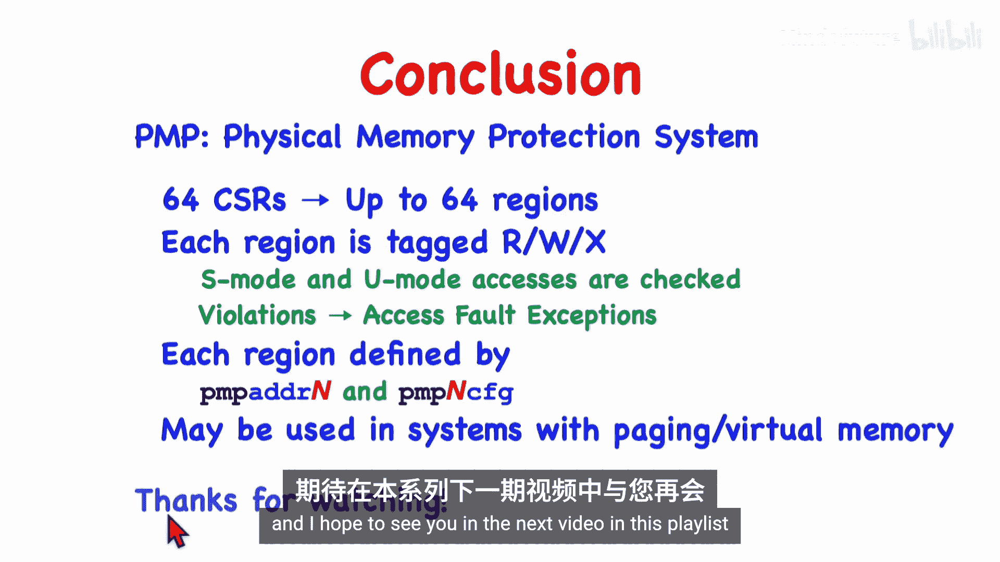

# RISC-V处理器架构，RV32指令集架构，汇编语言，Verilog-FPGA-p15-P15-RISC-V-Privilege-#15---PMP-The-Physical-Memory-Protection-System--BV1aQ3nztE7J_p15-

Welcome to another video in a series on the Risk5 architecture。In this video。

 I'll introduce and describe the physical memory protection system。In summary。

 this system allows code running in machine mode to impose access privileges and constraints on regions of the address space。

And this is the physical address space， so it can be used to protect main memory。

 as well as read only memory and I devices， which are memory mapped into the address space。

The physical memory protection system works by dividing the addresser space into a number of regions and imposing。

 read， write， and or execute permissions on each region。

The kernelel and any other code running at the supervisor or user mode privilege level is checked。

 and any violations will cause access fault exceptions。

The system might be used by a hyper running in machine mode to host a multiple guest operating systems simultaneously。

 each running in supervisor mode。It could restrict each operating system to certain areas to make sure they don't interact with each other。

The physical memory system might also be used to implement secure booting。

 real time operating systems， and other security infrastructure。Okay， with that introduction。

 let's get going。To motivate Rik5's physical memory protection mechanism。

 imagine that we've got a system running an operating system like Linux。

The kernel is running in supervisor mode and the user processes are running in user mode。Now。

 of course， the kernel will use the paging mechanisms to implement virtual memory。

The paging mechanism and the physical memory protection mechanism are two very different things。

A particular risk five system may have both paging and the physical memory protection mechanism implemented。

 or it may have one but not the other implemented。And some simple systems may provide neither paging nor physical memory protection。

Machine mode code will be used for booting and startup and to configure and set up the hardware。

In order to make the kernel portable， we need to hide as many of the hardware specifics from the kernel as we possibly can。

We want to force the kernel to use a standard interface to machine mode code so that the same kernel code can be run without any changes on different hardware platforms。

All hardware specific details should be handled only by machine mode code and should be hidden from the kernel software。

Also， to enforce security， we may want to protect certain memory regions and some I O devices from arbitrary access by the kernelel。

The hardware platform will have some physical address layout， as shown in this example here。

Some addresses will correspond and map to main memory。

And it's likely that there's also a region of read only memory。

 which would be used for booting that's mapped into some other location in the physical address space。

 and willll have several I devices。In risk 5， all devices are memory map。

 so each device is accessed by reading and writing to specific locations in the physical address space。

 using the load and store instructions。For the purposes of physical memory protection。

 the physical address space would be broken into a number of regions。

 and each region would be tagged as either readable， ridriable or executable。

 or maybe none of the above and not accessible at all。For example。

 the machine mode code might mark itself， which is located here。

 and the read only memory and maybe some devices as simply not accessible by the kernel。

Any attempt by the kernelel or user code to access these regions would be disallowed and would cause an exception。

The machine mode code might also mark some devices as readrite， but not executable。And other devices。

 perhaps like a real time clock or some configuration parameters， as read only。

After the machine mode code has loaded the kernel into memory。

 it could mark the kernel's code as execute only and mark the kernelel's data area as read Wr。

It might do this as a security measure to make sure malware doesn't alter the colonel code or try to execute something that's not legitimate Colel code。

The remainder of the memory where the colonel will be placing the user processes would be marked with no restrictions。

Now let's focus on a single region。For each region， we need two pieces of information。

We need to know where the region is located， and we need to know what protections the region is to have。

Let's discuss another scenario in which the physical memory protection system might be useful。

Imagine a real time system such as a computer controlling an airplane or a spacecraft。

In order to meet the timing requirements， the system will need to avoid using virtual memory。

Accessing page tables introduces too much uncertainty causing unpredictable delays。

 so maybe the core would not even implement supervisor mode。Instead。

 the kernel will run in machine mode and the application processes would run in user mode。

Each application process would be placed in its own fixed region of memory。

The key requirement is that processes must be isolated and any failure or malware in one process must not corrupt the other parts of the system。

The approach would be to put the kernel and each of the application processes into its own individual region。

Before running any one process， that is before giving a time slice to any application thread。

 the colonel would set the physical memory protection system up in order to allow only access to the region associated with that process。

 thereby protecting all the other regions of the address space。

Let's go back to the map of the address space and let's focus on one particular region。As I said。

 we need to know where that region begins and ends and what sorts of operations are allowed in it。

To implement this， the physical memory protection scheme provides a bunch of control and status registers。

 as shown here。Each region will be handled with one physical memorym Protection address registerister and one physical Mem Protection configurationration register。

The configuration register is only eight bits， and it has bits for read， write， and execute。

There is also a locked bit and an address matching field， but let's ignore those until later。

There are 64 of these registers， and so a risk5 system can accommodate up to 64 different regions。

Also， note the names of these registers。 The address registers are numbered。

 and the name ends with the number。While the configuration registers are also numbered。

 but the numbering is like this with the number in the middle。This confused me at first。

 and you'll see what I mean later。 And for now， just keep that in mind。

The system is kind of complicated， but let's begin simple like this。

The boundaries between the regions are specified by whatever is in the address registers。

Each region begins at the end of the previous region and extends to whatever its address register contains。

Adds register N points to the end of region N， and more precisely。

 it contains the address of the first word just beyond the region。The first region。

 begins at address 0 and extends to whatever the PMmpP address0 register contains。For 32 B risk Co。

 the PMP address registers are 32 Bs in size。But with paging。

 physical addresses can be up to 34 Bs in size， which means a 32 B core can access up to 16 gigab of physical memory。

The PM&P regions must always be at least， word aligned。

And since the boundaries must be evenly divisible by 4。

 the last two bits of any address must always end with 20 Bs。

So the P&P address registers contain 32 bits with an additional two bits of zeros being implicit。

 and this is how the physical memory protection mechanism accommodates 34 bits with a 32 B address register。

For 64 B core， physical addresses are now 56 Bs in size。

Since all regions must be at least word aligned， the final two bits of PM&P addresses are still implicit。

So the address registers， which are now 64 bits in size， contain the remaining 54 bits。

Any upper bits that exceed this or that exceed the actual address range implemented on the system are simply ignored。

Now， let's take a look at the8 bit configuration registers。On a 32 B risk core。

 all control and status registers are 32 Bs in size。For the physicalical memory protectionte scheme。

 four configuration bytes are packed into each control and status register。

In order to accommodate 64 regions， we need 16 control and status registers。

 and the configuration bys are packed into each register， as we're showing here。

Each configuration register contains four configuration bytes。

 and now let's look at the names of these registers。

You can see that the actual registers have names that end in a number， PM&P config。

 and then the number。While the configuration bytes have similar names。

 except for the number is in the middle。And see how the8 B bytes are packed into the4 Bte registers。

 notice， for example， PM P1 config is not in the register with the name P& P config 1。

 and this confused me initially。It's very similar for 64 bit core in which the control and status registers are 64 bits in size。

For these systems， we can now pack eight configuration bytes into each register。And for 64 regions。

 we now need only eight registers。These are the registers that are used to hold the configuration bys and notice that we are only using even numbered names。

The other half of the registers。Those with odd numberumbed names are not used and don't even exist。

How many physical memory protection registers must be implemented？In other words。

 how many regions can be accommodated？Well， the risk5 spec gives only three options，64，16 or none。

If the Corps can accommodate 64 regions， then it will have 64 address registers with these names。

And it will have 64 configuration bytes with these names packed into registers with these names here。

For systems that implement only 16 regions， well have 16 address registers and these 16 configuration bytes。

And for systems that don't implement the physical memory protection system at all。

 none of these registers would even exist。Now let's take a look at the so called address matching field。

This is a twobit field， with these possible values。So far， we've been assuming that it contains 0，1。

 which is the code for top of region。For now， we'll ignore the locked be。

If the configuration by does， in fact contain the top of region code， then the address registers。

 which are used to delineate and define the regions。

 are interpreted exactly as we described previously。In other words。

 Regent N will extend from the address in register PMP address n minus1 to the address in PP address N。

With the first region starting at address 0。With any attempt to access memory or to access a memory map device。

 either with a load， to store or an instruction fetch， the read。

 write and execute protection bits would be checked。If the corresponding bit is0。

 then the operation will not occur and an access fault will occur instead。For example。

 an attempt to load from a region not marked readable will cause a load access fault。And similarly。

 for store instructions to regions that are not ridriable or attempts to execute code in a region that is not marked executable。

 we would get an access fault。Now， in previous videos。

 I was a little vague about access fault exceptions。 And now。

 you know what can cause such an exception。These protection bits are only checked when executing in supervisor mode or in user mode。

Machine mode code has full privileges， and no checking is done。Now。

 let's look at some of the other codes for the address matching field。First。

 we could use the code for off if we just wanted to use the corresponding address register to specify the starting address of some region where the following register would contain the top of region address。

Now， you might think you could just specify a region with no privileges to achieve the same effect。

 but there are some subtleties。And by the way， this whole video should probably be viewed as an overview and an introduction to this subject。

Anyone actually coding this stuff should probably force themselves to pllow through the risk5 specification。

Another code 10 is called in a4 naturally aligned4bte field。

If the configuration byte contains this code， then the region will only be4 bytes in size。

This might be useful for protecting an individual I O device register whose size is a single word。

The address register would contain the address of the word to be protected。

And recall that the final two Bs are implicitly zeros。

 forcing the address to be a word aligned address。This last code， bits 1。

1 for naturally aligned power of two regions is used to specify regions whose size is。 Well。

 you guess it a power of 2 And starting with 8。 So the region size is either 8 or 16 or 32 and so on。

Regions of size 4 were handled with the N a 4 code。Okay。

 so if the configuration byte contains this code， then the hardware will look at the value that's stored in the corresponding address register to determine just how many bytes are to be in the region。

The address register contains an encoding of both the starting address as well as the regions size。

 basically the position of the rightmost zero in the register tells just how big the region is to be。

And so here are some examples to illustrate how this idea works。If， for example。

 the first zero is here。The physical memory protection hardware will understand that the region is to be 8 by in size。

And with the implicit two zeros right here and this0， the remaining bits give an address。

 which is evenly divisible by 8。 So it's an eight byte aligned address。

If you store a value that looks like this， for example， into the corresponding address register。

The hardware will see that the first0 bit is here and deduce that the region is to be 32 B in size。

And the hardware will then replace all these five Bs with zeros to give an address that is 32 B aligned。

 So that's pretty cool。As previously mentioned， the hardware will check the physical memory protection registers on every load store and instruction fetch when executing in supervisor or user mode。

And if there is a privilege violation， an access fault exception will occur。Of course。

 the registers could have been loaded with conflicting information and overlapping regions。However。

 the hardware will always check the registers in order。

 and the first one that matches the given address will be used。

If the address is not within any region， the access is considered to be in violation。

The physical memory protection registeristers are all machine mode registeristers。

 even though their names don't begin with an M。 So they can only be read or modified by code running in machine mode。

So far， we've ignored the locked bit and assumed it was 0。

 That is that the registers were not locked。When the region is unlocked。

 then accesses in supervisor mode and user mode are always checked。

 but accesses in machine mode are not checked and are always allowed。When a region is unlocked。

 the corresponding address， register and configuration by can be changed by any code running in machine modeat。

 But once the lock bit is set， things are very different。First， the address。

 register and configuration by become fixed and can't be changed even by code running in machine mode。

Upon system reset， all the registers start in the unlocked mode， but once locked。

 they can never be altered。 So the region cannot be unlocked。

 and it'll stay locked until the next reset。Furthermore， once a region has been locked。

 any and all accesses in machine mode to bytes within that region will be checked just as they are for supervisor and user mode accesses。

So how could this functionality be used Well， maybe the system needs to allow some untrusted code to run in machine mode。

The trusted code might be able to use locking to enforce some degree of security against both buggy code and malware。

So this mechanism might be used to try to protect critical code from being corrupted。

It might also be used to protect software that is considered to be intellectual property and make it tougher for people to read or modify。

So let me mention one other small detail。You know， locking some particular configuration by prevents changes to that configuration by as well as to the associated address register。

But if one configuration register specifies a region using the top of region code。

Then the previous address register， which contains the starting address of that region。

 also becomes critical。 So in this situation， locking such a configuration bite has the side effect of also locking the previous configuration by。

Now， we're going to get into even more detail and describe grain size。Up to this point。

 we've assumed that we can lock individual words， but nothing smaller。In other words。

 we can't lock individual bites within a word。 All the bites in the word must share the same privileges。

And further， all addresses must be word aligned， and the size of each region must be a number of words。

 that is。 It must be an even multiple of four bytes。And we call this the grain size。 So far。

 we've assumed a grain size of four Bs。But some systems might not support such a fine grain control over the PM&P privileged system。

As an example。We can imagine a system that can support physical memory protection。

 but only on chunks or blocks of size 256 bys。Each address must be properly aligned on a 256 byte boundary。

 and the size of every region must be a multiple of 256 bys。First of all。

 when the grain size is greater than4， the address matching code for naturally aligned4bte regions is simply not allowed because the system can't support regions that are that small。

Now， let's consider our example where the grain size is 256。

All properly aligned addresses will therefore end with 80 Bs， as shown here。

To determine the grain size of the system in case it can't be determined some other way。

 you could write some code。So the idea is to set one of the corresponding PMmpP configuration bytes to use the top of region code。

Then you'll write a value of all1 B into the corresponding PimpP address register。

And then read it back and see what you get。The hardware will zero out the lower order bits to force it to become a properly aligned address。

In this case， we read back a value in which the lower 8 bits are zeros。

 and we can conclude that the grain size is 256。Actually。

 you'd need to take into account the two implicit bits， but you get the idea。And finally。

 don't forget to properly initialize that region to something else。

 or at least turn it off so it doesn't cause problems later。Okay。

 that wraps up my overview of Risk Five's physical memory protection system。In this video。

 we saw that the system is implemented with a collection of machine mode。

 control and status registers that divide the physical address space into a number of regions。

Each region can be tagged as readable， ridriable and or executable。

When supervisor or user mode code attempts to use a memory address for which permissions are not granted。

 then an access fault exception will be signaled。A corps may implement up to 64 such regions。

 or maybe it doesn't even implement the P&P system at all。😡，But if memory protection is implemented。

We saw that each region has both an address register and a configuration by。

 These describe the address regions。The physical memory protection system can be used in conjunction with the virtual memory paging system。

Basically， an operating system running in supervisor mode will be constrained as to what areas of the physical address space it has access to。

So I covered a lot of details， but if you made it up to this point。

 you now have a pretty good idea of what the physical memory protection system is all about。

 So let me end by saying， thanks for watching。 And I hope to see you in the next video in this playlist。

