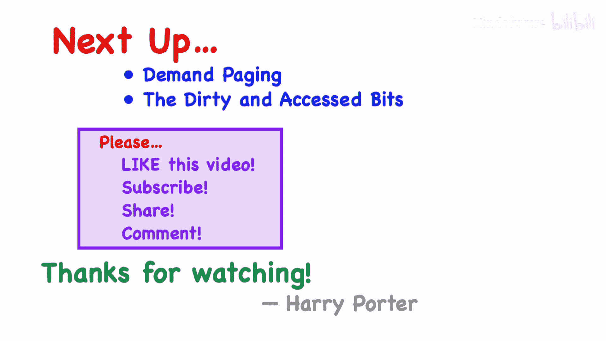

# RISC-V处理器架构，RV32指令集架构，汇编语言，Verilog-FPGA-p17-P17-RISC-V-17-Virtual-Memory-#2---MMU,-Tree-Walks,-Page-Faults,-Megapages--BV1aQ3nztE7J_p17-

Welcome to a video lecture series on virtual memory and paging。There are six videos in this series。

 and this video is part two of the series。These videos are part of a larger series on the Risk5 architecture。

The previous video gave an introduction to the main concepts。 In this video。

 these concepts will be illustrated with a specific example。 the S V 32 scheme used in Rik 5。

We'll see how virtual addresses can be viewed as a number of index fields followed by a page offset。

I'll describe how a walk of the page table tree works first。

 with an animation to give you the general idea。 and then with a more precise algorithmic definition。

You'll see how the memory management unit transforms a virtual address into a physical address。

We'll describe page faults， which can be caused when the user code tries to access an invalid page or tries to access a virtual page in violation of the privileged flags that are associated with that page。

And finally， I'll introduce and discuss mega pages。In this video。

 we will be focusing on the SV32 paging scheme in which the page table trees have two levels。

Now let's look at virtual addresses。 These are 32 bits in size。

 at least for the SV32 scheme we're describing now。

These are sometimes called program generated addresses。

 because these are the addresses that the program actually sees and uses， for example。

 in load and store instructions。As mentioned earlier， the virtual address is broken into two parts。

 a virtual page number and an offset， which is 12 bits。

Here the page number is a virtual page number and it's 20 bits， unlike the physical page number。

 which was 22 bits。So with 20 bits， we get 1 million virtual pages since two to the 20th is about 1 million。

Each page contains 4，000 bytes， so the virtual address space is4 gigabytes in size。

Now let's look at this 20 bit virtual page number and break it into two pieces， each of 10 bits each。

And we can call these VPN1 and VPN0。And recall that2 to the  tenth0th is 1024。So the first field。

 virtual page number part1， will be used as an index into the root node of the page table tree。

And the second field， VPN 0， or virtual page number part 0 will be used as an index into the second level node in the tree。

Next I want to work through an animation showing how the hardware will take a virtual address and transform it into a physical address。

So here's our page table tree and we have the root node and we have a bunch of nodes at the second level。

 and then down here we have the data pages。Each node of the tree is an array of 1024 page table entries。

And those page table entries contain pointers to the next level。Right。

 each page table entry contains a 22 B physical page number。

 which is effectively the address of a page in physical memory。

And let's assume for now that all the entries in this tree are valid。

 that is the V bit is set to one， and we won't run into any unmpped regions of the virtual outer space that would cause a page fault。

So step1 is for the hardware to go to the SATP register and get the address of the root node。😡，Next。

 the hardware will look at VPN1， the first1bit field in the virtual address。

 and treat it as an index into the root node。It will add that index to the pointer。

 and then it will fetch the page table entry from that particular slot in the node。

That will give it a new physical page number， and that's the address of the next node in the tree。

Then the hardware will look at VPN0。 that's the second tibitid field in the virtual address。

 and it will treat it as an index into the second level node。

It will use that to obtain the address of the next page table entry and will fetch a page table entry from the second level node。

This will give it the physical address of the data page。

 so I will also give it the protection bits for this data page so it can check those to make sure everything's legal and cause a page fault if necessary。

So next it builts the physical address and so it will get the physical page number from the page table entry and it will use that。

Then it gets the offset from the virtual address and uses that for the physical address。And finally。

 we've got everything， we've got the physical address。

 and it can use that to make the access either to read from or to store into memory。Now。

 I want to go through this procedure again。 this time， looking at it algorithmically， like code。

While I've expressed it here as a sort of program code。

 these actions would actually be performed by the hardware。It's not really a program。

 but looking at it this way is a little more precise than my animation。

This algorithm takes a virtual address and computes a physical address。It uses two variables。

 A and PTE。A is an address pointer containing a physical address。

 and we begin by initializing it to point to the root of the page table tree。In the second step。

 we look at the virtual address and we extract the first 10 bit index， which we called VPN1。

The page table entries are4 bytes in size， so we multiply it by4。

 and then we add it to the starting address of the root node。

 and that gives us the address of the page table entry we want。

 so we go to memory and retrieve that page table entry and store it in PTE。

Then we check its valid bet。If this is 0， then we stop right here and we cause a page fault exception。

 That means this whole branch of the tree is completely unallocated and invalid。

But assuming it's okay， we then extract the physical page number， the PPN from the page table entry。

That's the upper 22 Bs of a physical page address。 So we fill in the lower 12 bits with zeros to give an actual physical address for the page。

We can either shift it left by 12 bits or multiply it by 4096， those both do the same thing。

So now we've got a new address， and so we set A to point to the next node in the tree。

Then just as before， we extract the second10bit index VPN0 from the virtual address。

 we multiply it by 4 and add it to A and use that as an address and we go to memory and fetch the next page table entry and store it in PTE。

And again， if this page table entry is not valid， it means the virtual page is not allocated。

 So we stop immediately and we cause a page fault exception。But otherwise。

 we're ready to build the physical address。The hardware will do this by extracting the physical page number from this new page table entry and concatenating it with the 12 bit offset that comes from the original virtual address。

That gives the physical address to be used to access physical memory。

The hardware will also need to look at the accessed and the dirty bits， the A and D bits。

 And this can be done more or less in parallel to building the physical address。

We're about to access a data page， so if the access bit is0， then it must be changed to one。And also。

 if we're about to write into the data page and the dirty bit is0， it also has to be changed to one。

So if there is a change to either bit， then the hardware will update the page table entry。

 So it writes the updated version back to where it got it from。Actually。

 the Rik5 spec says that this must be done in such a way as to make sure that the page table entry we're updating hasn't coincidentally been simultaneously modified by some other core。

 So this update must be performed as an atomic memory operation。Now let's add in some detail。First。

 every time we go to memory to read a page table entry， it's possible that the memory read fails。

 or there's some violation of some sort。In any case， if there are any problems。

 we abort immediately with an access exception。That check happens both times we read memory。Also。

 there are some bit combinations that are illegal and reserved for future use by the spec。

 and if we happen to encounter an illegal bit pattern in one of the page table entries。

 we immediately abort with a page fault。And that check for illegal bit patterns also happens here。

 as well。So far， we've been talking about the SV32 scheme， which uses a two level page table。😡。

But what about 3 or 4 or five level page tables， as we'll encounter with the other S V schemes。Well。

 if we have several levels， this algorithm can just use a loop where each iteration goes down one more level。

So if you have more than two levels， you just keep going around this loop。

 doing the same thing as I' have shown here。Actually。

 the algorithm for two levels could also have been written as a loop that iterates only two times。

To make things clearer， I just repeated the code that's shown here in gray。

This is called loop unrolling。 Instead of showing an algorithm with a loop for S V 32。

 I think it was clearer to just unroll this loop and get rid of it altogether。

 even if it means that few of the lines are repeated。

There's also the question of what happens if we hit a leaf page table entry before we get to the bottom level。

😡，So look at this code here in block。It's possible that we encounter a page table entry where the readable or the executable bit is set to one before we get to the bottom leaf level。

That would indicate that we have what we call a mega page。Actually。

 the risk five spec requires that if theriable bit is set， then the readable bit must also be set。

So to determine if this is a leaf Page table entry。

 it's sufficient to check only the readable and executable bits。If the writeriable bit alone is set。

 then that would have been handled in this previous check for reserved encodings。

So if the hardware hits such a page table entry during the page table walk from the root to the bottom level。

 then it indicates that the page table entry points to a mega page and we would immediately exit the loop and finish up down here。

😡，I'll describe mega pages in a moment， but first， I want to go back to the access exceptions and the page fault exceptions that might arise whenever the hardware does a page table walk。

Here are all the exception codes used in risk 5。These are the exceptions。

 along with the corresponding code numbers that would get stored into the cause register。

Now with riskk 5， there are actually three kinds of access faults。 we have a load。

 a store and instruction fetch， and likewise there are three kinds of page fault exceptions， load。

 store and instruction fetch。Access faults are caused by problems accessing physical memory。

This could come from the PMP system。 that's the physical memory protection scheme。

 if that's implemented。I described the physical memory protection system in another video。

 It has nothing to do with virtual memory， but it can cause access faults if physical memory is accessed incorrectly。

A page faults are caused by something being wrong with the page table。

 which would make it impossible for the program to access virtual memory and complete the operation。

With virtual memory and page tables， whenever there is an access fault or a page fault。

 the exact type of the exception depends on the operation the hardware was ultimately trying to do。

In other words， what operation， a load， a store or an instruction fetch needed to have a virtual address translated into a physical address？

That would determine what kind of exception would happen if there's a problem translating the virtual address into a physical address。

Now let's take a look at the valid bit， which is in every page table entry。If the valid bit is0。

 it means that the page is invalid。In other words， that virtual page is not mapped into anything。

 There simply is no physical memory corresponding to those 4086 bytes of the virtual address space。

If an invalid page table entry is encountered at any point in a walk of the page table tree。

 then the rest of the page table entry is completely ignored。

 and the hardware will cause an immediate page fault。Next， let's take a look at the readable。

 ridriable， and executable bits。If they are all0， then this is an an node。

 The hardware needs to keep going down one more level in the page table tree。

But otherwise it's at a leaf， and that means the physical page number points to a data page。

 and then the readable， writeable and executable bits give the permission that would be needed to access that data page。

As I mentioned， with risk 5， we have the requirement that if a page is writeriable。

 then it must also be readable， so if the W bit is set， then the R bit must also be set。😡。

The other bit combinations are considered to be undefined or reserved and would cause a page fault exception if they were encountered。

Then the hardware will look at whether the operation was a load， a store or an instruction fetch。

If it's a load， but the page is not marked readable， it would cause a load page fault exception。

If it's a store， but the page is not markedriable， then it will cause a store AMO page fault exception。

The atomic memory operations do both a read and a write。Only the ridriable bit needs to be tested。

 There's no need to test the readable bit if the ridable bit was set。And finally。

 if it is an instruction fetch， but the page is not marked executable。

 then it will cause an instruction page fault exception。

There are a couple of other cases that we need to consider。We said that for interior nodes。

 the readable， writeriable and executable bits would all be0。

 while for leaf page table entries that point to data pages， they would not all be zero。

But what happens if that's not the case？Well， if the readable。

 writeriable and executable bits are all zero in a page table entry at the bottom of the tree。

 then something is very wrong。Now， we're assuming that we've already checked to make sure that the page table entry is valid。

 but if it's valid， but it's neither readable， writeriable nor executable。

 then this would cause a page fault。The interesting case happens when an interior page table entry contains a non zero value。

If the hardware encounters a page table entry before reaching the bottom of the tree。

 where either the readable， ratriable or executable bits are set。

 then we've encountered what we call a mega page。Let's go back to our picture of a two level page table tree。

Here we've got the root node and here we've got the pages at the second level of the tree where all the page table entries are leaf page table entries。

But now， let's imagine that we encounter one of these leaf page table entries in the root node like this。

 So one of the page table entries in the root node is also a leaf page table entry。In other words。

 it's marked readable， writeriable or executable， and that means it points to a data page。

 and more precisely it points to a mega page。Normally a node at this level of the tree would point to 1024 data pages。

 and that represents a huge chunk of the virtual address space。In particular。

 1024 data pages at 4 kilobytes per page means the virtual address space chunk that's represented here is4 megabytes in size。

Well， that's exactly how big the meggaage is for megabytes。

So the page table entry in the root node points to a huge data page。

 and the size of that data page is4 megabytes。This is called a mega page。

But I suppose the meaning of the prefix mega here is more like 4 million， rather than 1 million。

Let's take a look at the page table entries again and focus on the readable， writeriable。

 and executable bits。If they are all zeroes， it means this is not a leaf。

 The page table entry points to the next node in the page table tree。But if any bit is set。

 then the page table entry points to a data page。If such a page sample entry occurs in the root node。

 then it points to a mega page。 But， of course， if it occurs at the bottom of the tree。

 then it points to a normal 4 kB page。Now let's take a look at the physical page number。

And this is a 22 bit field， and if we look at it in more detail。

 we can break it into two parts called the physical page number part1 and physical page number part0。

If we have a page table entry that points to a mega page， then part0 must be all zeros， if it's not。

 then it's an error and a page fault would be generated。Meeggaages must be properly aligned。

Megaage is4 megabytes， which means that the lower 22 bits must be zero。For normal4 kilobyte pages。

 the byte offset into the page was 12 bits， but with a 4 megabyte mega page。

 this is extended to 22 Bs since 2 to the 22 power is 4， or really 4194304 to be exact。

With a 34 B address， this sleeves 12 bits in the upper portion of the address。

 and notice that physical page number part 1 is also 12 bits。So to form the physical address。

 the entire physical page number can be copied into the upper bits just as before。

The difference here is that part 0 is all zeroes， forcing the address to be properly aligned on a 4 MBby boundary。

So here's how the physical address is built。 First we extract the address of the mega page from the page table entry as shown here。

And then we look at the virtual address。Previously。

 we just grabbed the lower 12 bits to get the offset into a normal 4 kilobyte data page。

 but with a mega page， we grab the lower 22 bits， which is the offset into the 4 megabyte mega page。

Then the memory management hardware puts these two pieces together as we show here。

To give the final physical address to be used。Meegapages are  four megabytes in size。Later。

 when we talk about 64 B machines and page tables that have more levels。

 we'll see things called giga pages and eventerra pages。 But let's not get into those at this time。

One thing we can say is that if more megaage are used。

 we avoid having to allocate nodes at the bottom level of the page tree。For each mega page。

 we avoid allocating the interior node at the lowest level of the page table tree。

 which saves a little memory space。While this is good。

 there's another more important reason that makes megaages especially useful。I haven't yet described。

Translation， liaide， buffers。But suffice it to say that the TLB is effectively a cache of the most frequently used page table entries。

The TLB is of course different from the data and instruction caches which are known as L1， L2 and L3。

 those are completely different。By caching parts of the page table tree。

The hardware avoids having to read from memory every time the coreps needs to translate a virtual address into a physical address。

 which is a huge savings。But like with any cash， the entries in the Tl B are very expensive and in short supply。

Cashs are constructed out of what is called content addressable memory。

 which is especially expensive。 So the tea beside sizes is a big issue。And with mega pages。

A single pay table entry now covers 4 MBgaby instead of 4 kilo。

 So a single entry in the cache now covers a thousand times as much memory。

 so megaages can dramatically reduce the pressure on the TL B cache。

There's another benefit of mega pages。With risk5。The kernel of a Uniix like operating system will be mapped into all virtual addressro spaces。

That is each virtual address space will contain a bunch of user pages。

For the user level process and a bunch of supervisor pages。

 which will contain the kernel's code and data。Well， the kernelel's not small。

 So think of all the page table entries associated with mapping the colonel's memory。

It would occupy a lot of 4 kilobyte pages， but if we use mega pages instead。

 then the kernel might fit into a very small number of mega pages。

And since this is happening for every address space。

 the use of megaage is going to save a lot of entries in the TLB。Okay。

 I think that's enough for this video。In the next video。

 I'll introduce and describe demand paging in which some pages are not residentant in main memory。

We'll see that the invalid bit can be used to get the kernelel involved to read in pages from secondary storage when the user process tries to use them。

I'll also describe the dirty and accessed bits which come in handy when the colonel is doing demand paging。

But before I end， let me encourage you to like， subscribe。

 share and comment if you'd like to show your approval for this sort of content。 But in any case。

 thanks for watching。 And I'll see you in the next video。😊。

