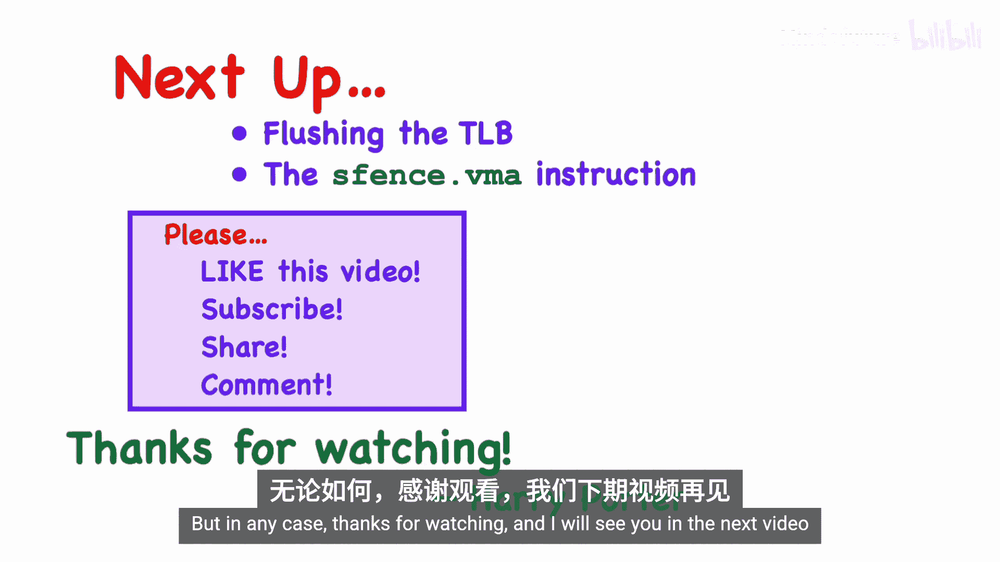

# RISC-V处理器架构，RV32指令集架构，汇编语言，Verilog-FPGA-p20-P20-RISC-V-20-Virtual-Memory-#5---Sv39,-Sv48,-Sv57--BV1aQ3nztE7J_p20-

Yeah。

Welcome to another video in a series on virtual memory and pageon。😊。

There are six videos in this series， and this is video number5。

These six videos are part of a larger series on the Rik5 architecture。In this video。

 I'll be describing and comparing the SV32， SV39， SV48， and SV57 paging schemes that are used in Ri5。

The formats for the virtual addresses， the physical addresses， the page table entries。

 and the page tree nodes for 64 bit machines are very similar to the 32 bit machines。

 but the details are slightly different。We saw how megaage were used in the two level SV32 scheme。

 and in this video we'll see how the extension to 3。

4 and5 level page table trees leads very naturally to giga pages，terra pages， and petta pages。So far。

 we've focused on 32 B machines and the SV32 paging scheme。Now， let's talk about 64 B machines。

A 64 B machine may implement any or all of these other paging schemes。With S V 32。

 the page tables had two levels， as we described。With SV39， the page tables have with SV48。

 they have four levels and with SV575 levels。All risk 5 machines use a 4 kilobyte page size。

This is one of the few risk 5 parameters that is simply not adjustable。With 32 B machines。

 the size of the page table entries is 32 B or 4 Bs。With 64 B machines。

 the page table entries are naturally enlarged to 64 Bs or 8 bys in size。

Each node in the page table tree is a page in size and is an array of page table entries。

This means that for 64 B machines， a node can now hold only 512 page table entries instead of 1024。

So we're going from a Radix 1024 tree where each node has 1024 children， to radix 512 trees。

And that means the size of the index into the page table nodes goes from 10 bits to 9 bits。

For a 32 bit machine， the virtual page number was broken into two parts of 10 bits each。

10 bits was just the right amount to index into an array of 1024 pageable entries。

But with 64 bit machines， we'll now use 9 bits to index into those arrays。

The size of the virtual address for 32 B machines was 32 bits。With 64 bit machines。

 the size of the virtual address is either 39， 48 or 57， depending on which paging scheme is used。

Since pages are still 4 kiloby in size， the page offset is the same， namely12 B。

What changes is the size of the virtual page number。With 32 B machines。

 the virtual page number was 20 B， broken into two index parts of 10 B each。With 64 bit machines。

 the indexes are 9 bits。So for example， with SV39。With three level trees。

 we need three indexes of nine bits each， so 9 plus 9 plus 9 is 27。

 which means the virtual page number is 27 bits。Then adding the 12 bit offset that gives us a 39 bit size for the virtual address。

With SV48， we now need four indexes。9 plus 9 plus 9 plus 9 gives a 36 B virtual page number。

 and then adding in 12 B for the offset。Gives us the 48 B virtual address。Finally， with SV 57。

 we have five indexes， so 5 times 9 is 45 plus 12 Bs for the offset gives the 57 bit virtual address。

With all these nines， you can now see why risk 5 uses those somewhat unusual numbers，39，48 and 57。

The SV32 scheme uses a physical address of 34 bits。Subtracting the 12 bits for the offset。

 we saw that the physical page numbers were 22 Bs。Well， with 64 bit machines。

 the physical addresses are all 56 bits regardless of which paging scheme is used。

Since the offset is still 12 bits， that implies that the physical page numbers are now 44 bits in size。

Next， let's take a look at the page table entries and see how they differ between 32 bit machines and 64 bit machines。

Here's the layout for 32 bit machines。With a 22 bit physical page number and various privilege bits。

And here's the layout for 64 B machines。All three paging schemes， SV 39， SV 48 and SV 57。

 use the same layout for page table entries。The page table is now 64 bits in size。

The physical page number has grown from 22 B to 44 Bs。The privilege bits are exactly the same。

Up at the top， we now have 10 bits that are new。7even bits are reserved for future risk5 enhancements。

 and three bits are used for an extension called SVPBMT that stands for page based memory types。

I'm not going to describe this extension at this time。

 but it has to do with caching and constraints on the ordering of memory operations。

This stuff is becoming more important for multico machines as time goes on with all kinds of caching and the associated issues with the ordering of operations。

Here's a 32 bit virtual address for the SV32 scheme， which we've seen before。

And notice that the virtual page number is broken into a number of parts。

Each part is 10 bits and is used as an index into one of the nodes of the page table tree。

The first part， VPN Part 1， is used as an index into the root node。

The virtual page number is broken into two parts because with SV32。

 the page table trees have two levels。As we'll see next。

 there's a different layout for each of the other page table schemes。Let's start with S V 39。

We see that the virtual address is 39 B in size， and the virtual page number is now broken into three index parts。

 VPN part 2， VPN part 1 and VPN part 0 plus the 12 B offset。

The upper 25 bits of any program generated address are ignored by the hardware。

The paint table trees for SV39 are three levels， so now we need three indexes。

Since the nodes of the tree are now array with only 512 entries。

 we now need indexes of nine bits2 to the  ninth is 512。So we see three indexes of9 bits each。

 and the first one is the index into the root node。You can probably see where this is going。

 so here are the virtual addresses for the SV48 scheme。

 and here are virtual addresses in the SV57 scheme。Let me show that again。SV 39。SV48。And S V 57。

With SV57， we have a five level Pages table tree。So we have five indexes of nine bits each。

 plus the 12 bit offset into the page， giving a 57 bit virtual address。

Each part of the address is used as an index into a node。

The indexes are used as we walk down the tree from the root toward the leaf。

 starting with virtual page number part 4 for the root node and so on until we get to the last level of the tree where we use VPN part 0 to index into the leaf node to get to the pageable entry that describes a 4 kilobyte data page。

Now， let's look at a representation of the page table tree。We'll start with that two level tree。

 which would be used in the S V 32 scheme on a 32 B machine。

We see the root node and we see the nodes at the second level， and down here we see the data pages。

Since the page table entries are four bytes in this game， the nodes each contain 1024 entries。

 In other words， there are 1024 page table entries for each node in the tree。And now。

 let's move on to the S V 39 scheme。 As you can see， there are now three levels in the tree。Also。

 since this would be for a 64 B machine， the size of the page table entries is now 8 by。

 which means that each node can contain only 512 entries。

I'm not going to show four level trees or five level trees since I'm sure you get the idea those diagrams would just get even bigger。

Obviously， these schemes accommodate a huge number of pages。

 showing every single node in a fully populated tree would， of course， be impossible。Instead。

Let's go back to the S V32 scheme with two level trees and show the tree in a slightly different format。

Here's the root node， and here are the nodes at the second level。

 and here are the4 kilobyte data pages at the bottom。

The virtual address can be broken into three parts， Vir page number part 1， Vit page number part 0。

 and the offset。Part1 is used to index into the root node to get a pointer to the next level。

And then part 0 is used to index into the node at the second level to get the leaf page table entry。

And the offset is used to index into the data page itself to get the byte address we're interested in accessing。

Okay， now let's move on to the SV39 scheme。You can see that there is now an additional level to the tree。

And you can see that the nodes now contain 512 entries， not 1024。

Here's a virtual address which is 39 bits in size with this scheme。

 and it's broken into parts first we have virtual page number part 2。

 then virtual page number part 1， virtual page number part 0。

 and finally the 12 bit offset into the data page。The memory management unit will use virtual page number part 2 as an index into the root node to get the page table entry that points to the next level。

Then it will use virtual page number part1 as an index into the node at the middle level of the tree。

And then it will use virtual page number part0 as an index into the node at the bottom level of the tree。

And finally， it'll get a leaf page table entry which contains the address of the data page。

 and it will use the offset to index into the data page itself in order to access the data。Now。

 I'm not going to show the SV 48 or SV57 schemes， but they follow the same general pattern。

The virtual page number is broken into a number of 9 bit fields。

 and these are used by the memory management unit as it performs a walk of the page tree。

Remember the algorithm that I sketched out earlier， the one with a loop。Well。

 this is the loop working right here。Each part of the virtual address is used in turn to index into successive arrays as the algorithm walks the tree。

 moving down toward the data page itself。Of course。

 the Page table walk could encounter an invalid page at any step in this process。

 in which case it would just stop and throw a page fault exception。

And it might also encounter a megaage or even a giga page。

And that is going to be our next topic of discussion。

Let's go back to the SV32 scheme and review mega pagess。Recall that a normal data page is 4 kiloB。

 and we use a 12 B offset to address any by in it since 2 to the 12 is 4096。

Normal pages are pointed to by page table entries at the bottom level of the page table tree。

But if we encounter a leaf Peable entry before we get to the bottom level。

 which would have to be at the root since there are only two levels with S V 32。

Then we have a mega page。Any page table entry with the readable。

 writeriable or executable bit set would be a leaf page table entry。With SV32。

 meapages are 4 megabytes in size， since2 to the 22nd is 4 million。

 a 22 B offset is used to index into a megaage。Here's a diagram showing what happens with normal pages in the SV32 scheme。

Both page table entries and virtual addresses are 32 bits in size and let's assume that the memory management unit walks the tree down to the bottom level of the page table tree before it finds a leaf page table entry。

At this level， the page sample entries point down to normal 4 kilobyte data pages。

The page table entry consists of a 22 bit physical page number， as well as the privilege bits。

The virtual address consists of two 10 bit index fields。

 which are used to perform the page table walk to locate the leaf page table entry。

And it contains the 12 bit offset into the data page。

So the memory management unit will take the 22 bits physical page number from the page table entry and the 12 bit offset from the original virtual address。

 and it will combine them to form the 34 bit physical address as shown like this。Now。

 let's suppose instead that we encounter a mega page。

So the memory management unit will use virtual page number part1 to index into the root node。

 but when it fetches the page table entry from this node， it will see that the readable。

 writeriable and executable bits are not all zero， and that means this is a leaf page table entry。

But since it's occurring at this level and not the bottom level， it means that we've got a mega page。

First， the memory management unit will check the page table entry。

 These 10 bits here had better be zeros， and they'll just be ignored。

Then to construct the physical address， the memory management unit will take the upper 12 bits from the page sample entry and copy them into the upper 12 bits of the physical address it's building。

This would give an address that will necessarily be aligned to a four megabyte boundary。

Then it takes not just 12， but the lower 22 B from the virtual address as the offset into the4 megaby megaage。

 and it glues them together to produce the final 34 B physical address。

Now let's move on to the SV39 scheme。With that， P table entries are now 64 bits in size。

 and the virtual address is， of course， 39 bits。Now maybe the program is providing a full 64 bit address。

 but the upper bits would be ignored and only the lower 39 bits would be used。

The virtual address now has three index parts of nine bits each。

 and these are used to index into the pages as we walk down to the leaf page s entrytry。

So let's describe what happens with normal pages。 So we'll assume the MM MU。

 that is the memory management unit， gets all the way to the bottom level here before it hits a leaf page table entry。

A page table entry at the bottom level will effectively contain the address of a normal 4 kilobyte data page。

With SV39， the physical page numbers are now 44 bits in size。So to construct the physical address。

 which is now going to be 56 B in size。The MMU will use all 44 bits as the upper portion of the address。

And it'll grab the 12 bit offset from the virtual address and glue it together to construct the complete physical address。

Now let's assume the MMU encounters a leaf paceable entry here on its walk from the root before it gets to the bottom level of the paceable tree。

We assume that it used the first two index fields to walk down to this point。

Then it retrieves a pageableable entry from this note here， and when it looks at it。

 it sees that the readable， ridriable and executable bits are not all zero。

 meaning that this is a leaf page ableable entry。And since it was found here at the second to the bottom level。

It means that we've got a mega page。The page table entry had better contain 90 bits in the lower portion of the physical page number。

Subtracting 9 from 44 gives 35 bits remaining， and these 35 bits will be used to form the upper part of the physical address。

The M Mu then goes to the virtual address to get the offset into the megaage。

 and it copies it into the lower portion of the physical address。With this paging scheme。

 the offset into the mega page is now 21 bits， right，9 plus 12 is 21。Previously， megaage with SV32。

Had offsets of 22 bits， but now it's 21 bits。With 64 bit machines。

 meapages are now two megabytes in size， not the four megabytes that we saw with SV32。

So here we have our 21 bit offset and then adding that to the 35 bits from the page table entry。

 which is effectively the aligned address of a two megabyte megaage。

 we now have the final 56 bit physical address。But now let's imagine what happens if the MMU hits a leaf page table entry in the root node here。

Now we have a so calledGab page。So the MMU has only consumed one of the nine bit index fields。

 virtual page number part2， which was used to index into the root node。

And that leaves 9 plus 9 plus 12， which is 30 bits for the offset。

The pigsable entry that was retrieved from the route has at least one of the Reed。

 W execute bits set to one。 So that's how the Imeu knew that it was a leaf pigsable entry。

And since this occurred in the root node or more precisely two levels up from the bottom level。

 it means that this pay table entry is pointing to a giga page。

The page table entry had better have these 18 bits set to 0。

These bits are effectively forcing the physical address contained in the page table entry to be properly aligned to the size of a gigab page。

44 18 is 26， so with these 18 bits set to0， that leaves 26 bits here。

 and those 26 bits would be used as the upper bits when the physical address is formed。

The lower bits， the offset into the Gia page， will come from the virtual address。And this offset。

 as I said， is now 30 bits。2 to the 30th power is 1 giga or about 1 billion。

 So the size of a gigab page is 1 gigab。Let's summarize。With S V 32， we had only mega pages。

 Their size was 4 megaby， which means that the offset into these megga pages was 22 B。With SVE 39。

 we have both megaages and gigabage。A meggaage is now 2 megaby in size。

 So we use a 21 B offset since 2 to the 21st power is 2 million。And by the way。

 I realize that I am saying million， which is of course， only an approximation to the exact value。

2 to the 20th power is actually 148576， but it's easier to just estimate 1 mega as 1 million。

 And I tend to do the same with giga and billion。A gigabage is 1 gigaby in size。

 So that's nice that the name exactly matches the size。All sets are now 30 bits with gigabage。

Because2 to the 30th power is 1 billion， or at least about 1 billion。 So now let's go to SV48。

 where we have exactly the same thing going on。If we had a leaf pastable entry。

 all the way at the bottom of the tree， now， our trees are four levels deep。

 so this would be the fourth level。Then it would point to a normal 4 kilobyte data page。

If we hit a leaf at the third level of the tree， then we've got a mega page。

 If we hit a leaf at the second level of the tree， then we've got a giga page。

 and if we hit a leaf at the very top of the tree， that would be in the root node。

 then we've got something that we call aterra page。So a  terrorage has an even larger offset。Again。

 we add another 9 bits，9 plus 9 plus 9 plus 12 is 39。 So our offsets are now 39 Bs。

And2 to the 39th power is 512 gig。 Thus， the size of aterrapage is only 512 gig。

And this is actually just half a terabyte。 But we're still calling these things terra pages。

 nonetheless。So now let's go to SV57。Here we have something called。 You guessed it。 a petta page。

A pet ofage is 256 TB in size。That's actually a quarter of a petabyte。 But what are you going to do。

The offsets have now grown by another 9 bits to 48 Bs。9 plus 9 plus 9 plus 9 plus 12 is 48。

And 2 to the 48th power is about 256 trillion。 So a petapage is a quarter of a petabyte or 256  TBs in size。

This is a good place to stop。 In this video， we described how paging is implemented on 64 B risk five systems。

We saw that it was almost identical to the SV32 scheme。

 but the details of how many bits are used for the various fields differed to accommodate larger virtual ladder spaces and more physical memory。

In the next video， we'll talk about flushing the translation lecoide buffer。

 and I'll describe the S fenceence。 VMA instruction， which is used to flush the tail B。

But before I end， if you'd like to show your approval for this sort of YouTube content。

 can I encourage you to like and to subscribe and to share this video， And also to comment。

 I really enjoyed reading the comments。 But in any case， thanks for watching。

 and I will see you in the next video。😊。

