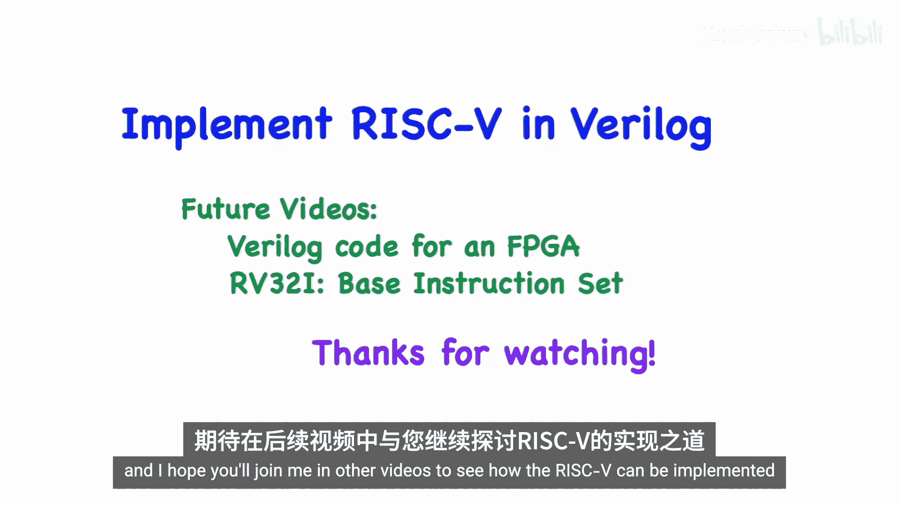

# RISC-V处理器架构，RV32指令集架构，汇编语言，Verilog-FPGA-p22-P22-RISC-V-Architecture-Instruction-Encoding--BV1aQ3nztE7J_p22-

In this video， I'll explain the riskk 5 instruction set architecture。

If you want to build a risk5 core in Verlog， or if you just want a thorough introduction to riskk 5。

 this is the video you should watch。I'll describe the registers。

 and I'll go over the basic instructions that any risk 5 must implement。 In particular。

 I'll be describing the RV 32 I specification。This video focuses on instruction encoding。

 That is how the various machine instructions are encoded into bits。

We won't go into assembly language or talk about programming techniques。Nevertheless。

 this material forms the necessary foundation and would be needed by anyone interested in assembly language programming。

This video is in support of other videos in which I describe how to implement a risk5 processor core in Vlog。

You'll need to know what the instructions are and how they are encoded in order to build hardware to execute those instructions。

So let's begin with the registers。 There are 32 general purpose registers。

Each register is 32 Bs in size。In this video， I'm covering the RV 32 specification in which the registers are 32 Bs。

 Ri5 also has an RV 64 variation in which the registers are 64 Bs。

 but we won't be discussing the 64 B stuff any further。Each register has a name。

 and those names are x 0， x1， and so on up to x 31。

There are also alternate names for the registers shown here。

 which the assembly language programmer can use， if desired to make programs more readable。

These names reflect the way the programmer uses the registers。In particular。

 I want to mention that X1， also called R A， is usually used to store the return address whenever a function call is made。

The registers all work in the same way。 That is， they are general purpose。

 so we can ignore these special names。There is， however， one exception。

 and that exception is register x 0， the so called0 register。Its value is fixed at 0。

 and is unchangeable。Register X 0 can be used as a source for the value 0。

 as well as a destination when the result of an operation is not wanted。

There is also a program counter。 These registers are the ones that are visible to the programmer。

 Of course， in our very log implementation， we'll have a few additional registers。

Here is how the instructions are encoded。 There are basically four approaches or formats for instruction encoding。

There are actually two instruction sets。First， there's the full size or normal instruction set。

 which is always present。 And then we have a compressed instruction set， which is optional。

Full sized instructions are required， and many implementations have only the full sized set。

We'll be discussing only the full size set in this video。

The full size instructions are all the same length and are 32 Bs in size。And that is。

 regardless of whether we're looking at the RV 32 standard or at 64 B versions of the risk 5。

 therere always 32 Bs in size。Compressed instructions are optional， and if present。

 each compressed instruction is 16 bits in size。Compressed instructions are simply abbreviations for some of the common。

 full sized instructions。The purpose of compressing instructions is to reduce the code size。

The compressed instructions are optional， and we won't be discussing them any further。

Here we're showing the full sized instruction types。

Notice that the least significant two bits are always11。

The other bit combinations are reserved for identifying compressed instructions。

Notice that the destination register， R D and the source registers。

 RS1 and RS2 are always located in the same bit positions in the instructions。

Since there are 32 registers， we need a5 bit field to encode the number of the registers。 since。

 of course，2 to the fifth power is 32。Some instructions contain immediate data。

 and the fields where the immediate value is placed are shown in blue。

The op code fields are shown in this diagram， in red。The bit positions。

 the bits in these positions are used to identify which instruction we're dealing with。Now。

 let's look at the different types of instructions。

 We have R type instructions for register to register operations。

We have I type for instructions that take an immediate value， which is encoded into the instruction。

We have S type for the store instructions and B type for the branch instructions。

The difference between S type and B type is in exactly how the immediate value is extracted from the instruction bits。

Then we have U type instructions， of which there are only two。

The load upper immediate instruction and the add upper immediate to the PC instruction。

And we have the J type instructions， or perhaps I should say instruction。

 since there's only one of them。 and that is the jump and link instruction。Next。

 let's take a look at each of these encodings in greater detail。

These instructions take two source registers and place a result in the destination register。

An example would be the addd instruction， which adds the contents of two registers and moves the result into the register indicated by the R D field。

Second， we have the eye type instructions。 an example of that would be the add immediate instruction。

 which adds an immediate value to a source register。The immediate field is 12 B。

 which is sign extended to 32 B， as shown here。This gives a limited range for the value that can be used in an eye type instruction。

And that range is plus or -2 k， since2 to the 12 power is 4096。Next， we have the S type format。

 which is used for store instructions。As you can see， there are two source registers。

 but no destination register。Like the I type format， the immediate value is also 12 B。

 but in this case， it's split between a 7 B field here and a 5 B field here。Again。

 the 12 B field is sine extended， as shown to give a value in the range of plus or -2 k。

The branch instructions， which compare two registers and optionally jump。

 use the same basic encoding。The difference with the eye type is in how the immediate value is constructed。

Risk 5 requires2 by alignment for all instructions。This works， since all instructions。

 whether compressed or not， are multiples of two bys in size。Therefore。

 the target address to jump to must always be even。

The way the immediate value is constructed is a little funky。 Basically， we insert a 0 here。

 which makes the result always even。Then we can use that extra bit， which is shown in purple。

 to give us a slightly larger range。Thus， the 12 bits of immediate data yield a value between plus or minus 4 k with a value that's always even。

And that range covers most cases， but if the programmer wants more。

 they'll need to use additional instructions。You type instructions are used to load a destination register with an immediate value。

There are no source registers involved， allowing the instruction to contain a 20 B immediate field。

These 20 bits are loaded into the upper 20 bits of the destination register。

 so the immediate value is used like this。Notice that 20 bits plus 12 Bs from another instruction allow us to load all 32 Bs of a register or to jump to any location in the address space。

 which in risk 5 is a 32 B address space。The J type format， which also has a 20 B immediate field。

 is used to construct a 32 B target address。The bits in the immediate field are moved in a rather convoluted way。

 as you can see here。This results in an even number in the range of about plus or-1 million。

 which is sufficient for almost every jump。Now let's introduce and talk about all the instructions。

 starting with the register to register instructions。These are ALU instructions。

Here I'm showing the Opcode bits， which select， which instruction it is。For example。

 we can add or subtract to registers， moving the result into the destinationation register RD。

In the case of subtract， we are computing RS1 minus RS2。

We also see bitwise logical operations and or an exclusive or。We also have shift instructions。

 shift left logical， shift right logical， and shift right arithmetic， and for the shift instructions。

 Rs2 will contain this shift amount。Here we've got SLT or set if less than。

This will compare the registers and move either a0 or a1 into register RD。If R S 1 is less than Rs2。

 it moves a1 into the destination register， and otherwise， it moves in a 0。This instruction， set。

 if less than unsigned， does the same thing only treating the values as unsigned numbers。

This 7 B field here is the primary op code。 It's present in all instruction encodings。

This field here， called function 3， is used in the R type instructions to select which ALU operation to perform。

And finally， this field is called function 7。Some of the bits in this field here are used to distinguish various cases。

Next， let's take a look at the eye type instructions。These fall into three categories。

 which are distinguished by the primary op code bits。First， we have the ALU instructions。

 and second we have the load instructions， and third we have the jump and link register instruction。

As a reminder， Ive shown up here how the 12 B immediate field is sine extended into a 32 B value。

Here we have pretty much the same A L U operations as in the register to register instructions shown on the previous slide。

 And it turns out that they use exactly the same values for the function 3 opcode bits。

I' have shown them in a slightly different order， but trust me。

 the function 3 field can be used the same for both R type and I type instructions。

Notice that there's no subtract immediate instruction here。

 because instead of subtracting an immediate， you could always just add the negative of that value。

Also， with the shift instructions， these five bits here are used to encode the shift amount。

With the remaining 7 Bs， as shown。This bit here differentiates between logical and arithmetic shifting。

A lo instruction fetch his data from memory and moves it into register R D。

The memory address is formed by adding R S1 to the immediate field。Of course。

 Rs1 can be the0 register x0 if we want to use the immediate values alone。

Or it could be a register whose upper 20 bits have been previously loaded by some other instruction。

So we can fetch either a bite， a half word or a word that is either one，2 or4 bytes。Normally。

 the value would be sign extended to 32 Bs， but we also have options to treat a by or half word as unsigned。

 That is， we would0 fill the upper bits。Finally， we have the jump and link register instruction。

This computes the target address in the same way and will jump to that address。

It also saves the address of the next instruction in the destination register。

For simple go to behavior， you just use x0 for the destination register。

But to implement a function call operation， the destination register would be the R。

 the return address register。With risk 5， return addresses are stored in a register and not pushed on the stack。

If a function will call sub functions， then the programmer is going to need to insert additional load and store instructions to save and restore register R。

Now， let's look at these store instructions。 Since no register gets updated， there's no R D field。

 Instead， we have a second source， the Rs 2 register。

This splits apart the bits for the immediate value。

 And I've shown here a reminder of how the bits are combined and sign extended to give a 32 B value。

The address to be stored into is computed the same way as it was for the load instructions。 Naly。

 the R S1 register is added to the immediate value， and either a byte。

 a half word or a word but is either 1，2 or 4 bytes from R S 2 are copied into memory。You might ask。

 does risk 5 require proper alignment？That is， do the load and store instructions require half word operations to have addresses evenly divisible by two and word operations to have addresses that align perfectly on4 byte word boundaries。

Well， the answer is that the spec leaves this issue optional and implementation dependent。

Maybe your processor will perform an unaligned operation correctly。

 or maybe it will cause some sort of trap or exception handling behavior。Next。

 let's take a look at the branch instructions。 These are conditional branches。

They compare the values in registers R S 1 and R S 2 and transfer control。

 That is they take the jump if the condition holds。The target address is a PC relative address。

PC relative means that the address is computed by adding the immediate value to the program counter to give the target of the jump。

And by the way， the value of the PC to be used is the address of the branch instruction itself。

Since all instructions must be aligned on even addresses。

 the least significant bit of any branch must always be a0。

Recall that to give a slightly larger range for the immediate values。

 The immediate fields are shifted around， as shown here。With 12 bits plus the extra 0 bit。

 we have the range shown here， which is going to suffice for the vast majority of uses。

We have instructions to test for equal and for not equal。

 And here we have an instruction to test for the less than condition。As you can see。

 theres no instruction for greater than， but you can achieve the same effect by simply swapping the registers and using the less than test。

So here's an instruction to test for the greater than or equal condition。

If you want to test4 less than or equal， well， just reverse the registers and use the greater than or equal test。

By the way， the asmbler can accept missing instructions like this。

 like greater than and less than or equal and perform these translations automatically。

 giving the programmer the illusion that these instructions actually exist。

 It's sort of the best of both worlds。 The programmer gets to use the instructions。

 but the hardware doesn't have to implement them。So these tests here use s comparison。

There are also variations that perform the comparison， treating the numbers as unsigned values。

Now let's talk about the JAL or jump and link instruction。Here's how it's encoded。

 And here I show how the 20 B immediate field is shifted around to build a 32 B number。

The resulting immediate value will be an even number with the rain shown here。

The jump and link instruction does two things。 First。

 the address of the instruction following the J A L is saved in the destination register。Second。

 a jump is taken。The target address is PC relative。

 That is the target is computed by adding the immediate value to the address of the J A L instruction itself。

Now， this instruction could be used in a couple of ways。First。

 it can be used to implement a call operation。In that case。

 the instruction after the JAL is the return address that is the place to return to after the function。

 so for a destination register in the JAL instruction。

 we specify the R A that is the return address register。Second。

 the J A L can be used as a straight jump instruction。

 in which case we don't need the return address。 So we just specify x 0。

 That's the0 register as our destination register。By the way。

 we can return from the function using a JALR instruction。

 the jump and link register instruction that we discussed earlier。For the target in that instruction。

 we would use an immediate value of 0。 And for the register， we would use the R A register。

 which is exactly where the call operation saved the return address。

Here are the two U type instructions。 L。 U I is load， upper immediate。

A UI PC is add upper immediate to the PC。Both these have a destination register at a 20 B immediate value。

The value is used as the upper 20 bits with the lower 12 bits filled with zeros， as I've shown here。

The load upper immediate simply moved this value into the destination register。

The add upper immediate PC instruction first adds in the program counter and then moves the sum into the destination register。

Next， let's see how the load upper immediate instruction can be used with the JALR instruction。First。

 recall that the jump and link register instruction saves the address of the instruction immediately following it and then jumps to a target address that is computed as the sum of register R S1 and the immediate value。

This instruction can be used in the following ways。First。

 we can use it as a straight jump where the target address is in a register that's shown here using some register such as X 5。

Second， we can use it as an indirect call where the address of the function is first somehow computed and placed in a register。

Here's an example of that。Third， we can use the jump and link register。

As a return instruction here we see the return address coming from R A， the return address register。

And finally， we see an object oriented programming example where the instruction is used to perform a dynamic dispatch。

Imagine that we have the address of a jump table in some register， such as X5。

This would probably be a pointer to the dispatch table for a class of objects。

The entries in the table would be jump instructions to the various method functions。

The desired method to invoke is they identified using an offset into this table。

Such offsets would be assigned by the compiler。The jump and link register instruction can be used to call。

 or we say invoke a method whose identity is determined dynamically based on the objects class。 Okay。

 so don't worry if you didn't follow that method dispatching stuff。

 The main takeaway is that this is a very useful instruction。Now。

 let's show some ways that the jump and link register instruction can be combined with the load up or immediate instruction。

 which can set the upper 20 bits of a register to any value。Let's say that we need to do a long jump。

 That is， we want to jump to a target that's too far away for a simple PCy relative address。

The first instruction here sets the upper 20 Bs of a register。T 0 is one of the temporary registers。

 which we can use for this example。Then the jump and link register instruction adds in the lower 12 Bs and performs the jump。

 Together， these two instructions allow us to branch to any 32 B address。

We can all also do something similar to make a long call。

 The only difference is that we are also updating the R A register to save the return address。

We could also use the add upper immediate to PC instruction instead of the load upper immediate instruction to make such long jumps and long hauls。

In that case， the address computations would be PC relative。

 which means that the resulting code would be relocatable and could be placed anywhere in memory。

This next group of instructions is called the system instructions。

Notice that they all have the same primary op code。

 They're differentiated mainly by the function 3 Opcode field。

The E call and E break instructions don't involve any registers and their complete encodings are shown here。

E call is the system call instruction。It would be used by a user level program to invoke a kernel function。

To get from user mode into supervisor or kernel mode， if you will， some sort of a trap must occur。

A number to indicate the desired system call， as well as any arguments would actually be passed in the registers。

The exact details of the calling conventions， such as which registers are used for what don't affect the hardware in any way。

The functionality of the E brake instruction is implementation dependent。

 It would typically be used to invoke some sort of a debugger。Next， we get to the CSR instructions。😡。

These instructions are not part of the RV 32 I base instruction set。 Instead。

 they're considered an optional extension， but I'm including them here because they'd be needed in almost any conceivable risk 5 implementation。

Each of these instructions operates on a control and status register。

 which would be identified by this 12 bit field。They also take a source value。

 and they update a destination register denoted by R D here。The source value comes from a register。

 RS1 in the first three instructions。The second three instructions perform exactly the same functions as the first three instructions。

 You can see that the instruction names are identical， except for the I。

 which indicates that the source value comes from an immediate field， which is in the instruction。

The immediate value is encoded in these five bits， as shown here。

This5 B value is then 0 extended to 32 B。So next let's talk about what these CSR instructions actually do。

In addition to the general purposese registers and the program counter。

 a Rik 5 core will also have a number of so called control and status registers or CSRs。

We identify general purpose registers with a5 bit field。

 and we identify the control and status registers with a 12 bit field。With 12 beds。

 there can be up to 4096 registers， since two to the 12 power is 4096。

Exactly how many of these control and status registers are actually implemented and the functionality of each one is implementation dependent。

There's a lot of variability between different implementations。

 Simple implementations might have only a couple of CSRrs。

 while more complex implementations would have a bunch of them。

The risk5 standard specifies the names and the numbers of the control and status registers。

Here are some common CSsRs that would occur in most implementations。

I'm showing both the register name and the 12 bit address in Hex。

Cycle counts the number of clock cycles since the last reset。Time gives the current clock time。

And this one is instructions retired， which is the number of instructions executed since reset。

M status is a status register involved in trap handling。

Let me just mention that the RV 32 I based specification does not include any information about how traps are handled。

 and by trap， I mean， both exceptions and interrupts。

So this includes what actually happens when an E call or ebra instruction is executed。

The risk 5 specification describes trap handling， along with the privilege mechanisms。

 but these are considered to be an optional extensions to the RV32 I base instruction set。

 which I'm describing in this video。There's a separate spec covering the privileged operations。

 trap handling， and the various processor modes， but I'm not covering any of that in this video。

Instead， let's describe what these six CSR instructions do。R W stands for Read， W， and CS SR Read。

 W is the first one。What it does is it both copies the old value of the indicated control and status register into the destination register R D。

 and it copies the value of the source register into the CSR。

 So it does both a read and a write to a control and status register。

 and it does those things atomically and simultaneously， if you will。This next one， CSR。

 read and set bits， is an instruction which can be used to set individual selected bits。

And the third one， CSR， read and clear bits can be used to clear selected bits。For both of these。

 the value in Reg RS1 is a so called bit mask。For the CSR read and set instruction。

 wherever that 32 B mask contains a one bit。 The corresponding bit in the CSR will be set to one。

The other bits would be unchanged。It also reads the CSR and storess the old value into the destination register。

This last one， CSR， read and clear is similar。 The R S1 register contains a bit mask。

 and wherever there is a one in the mask， the corresponding bit in the control and status register would be cleared to 0。

And these final three instructions do exactly the same thing。

 except that instead of the source value coming from a register。

 it comes from a5 bit immediate value， which is encoded in the instruction itself。

 and that5 bit immediate value gets 0 extended to 32 Bs。

This happens to make the low order of 5 Bs in any CSR， particularly easy to set or clear。Now。

 there is one more point to make about the CSR read and set and the CSR read and clear instructions where the source value comes from a register。

If that register happens to be x0， the0 register， then none of the bits of the CSR would be modified。

 so these instructions can be used to simply read a CSR。Now， if you're like me。

 you'll probably want to implement the instruction set we just covered in hardware。😡。

In other videos in this series， I describe exactly that， how to implement a riskk5 processor。

In particular， I go over some very cool V code that implements the entire RV32I instruction set。

As you'll see， that code is amazingly short and sweet。

 It's easy to understand and very well worth studying closely。

 But that's another video This video is done。 So let me end by saying， thanks for watching。

 And I hope you'll join me in other videos to see how the risk 5 can be implemented。😊。

